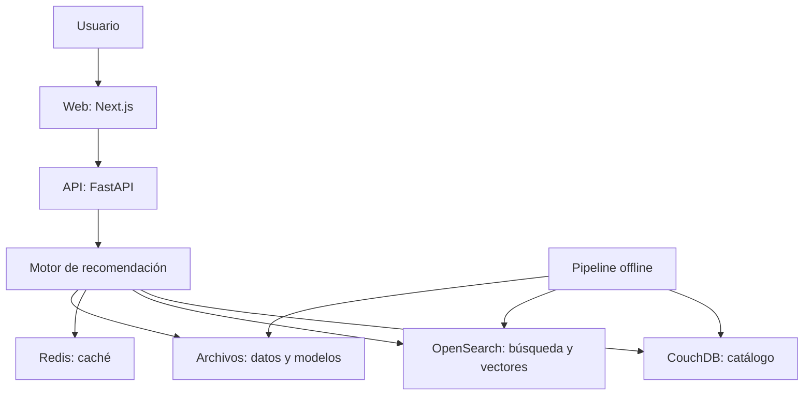

# SONORA: arquitectura de referencia

> **Nota (2026-11-12):** versión 0.1 anterior a la especificación v1.2. Donde la contradiga
> prevalecen [`REQUIREMENTS.md`](REQUIREMENTS.md) y
> `docs/handoff/SONORA_Contexto_Claude/ARQUITECTURA_ACTUAL.md` (web HTML/CSS/JS existente sin
> migración obligatoria a Next.js; MusicBrainz opcional; AcousticBrainz no es dependencia;
> FMA Medium con extracción acústica propia).

Versión 0.1. Decisiones de diseño propuestas para el prototipo; no implican que sus componentes estén implementados.
Directorio principal: `B:\University\2027-1\SONORA`.
Repositorio: https://github.com/BrunoRuizJuar/Sonora.git

## 1. Alcance

Aplicación web para buscar una canción por título y artista y encontrar otras relacionadas.
El primer prototipo trabaja con letras en inglés y ofrece tres modos: Letras, Música y Mixto.
La interfaz permanece en español. El modelo de letras en español se incorpora después, como
modelo separado. La similitud entre idiomas requerirá un diseño de alineación específico.

Controles del usuario: peso de letras frente a sonido, exploración, límite de recomendaciones
por artista y exclusión de covers identificados. El prototipo se evalúa con 5–10 personas.
El alcance inicial no necesita cuentas, historial de escucha ni un modelo colaborativo.

## 2. Organización del sistema

Monorepositorio con backend modular, frontend independiente y procesos offline.
La lógica de recomendación vive en un paquete Python compartido por la API y los procesos
de datos. La API recibe consultas y usa artefactos ya calculados. Entrenamiento, matching,
descargas y extracción acústica se ejecutan fuera del ciclo de una petición web.

## 3. Stack y responsabilidades

| Componente | Elección | Responsabilidad |
|---|---|---|
| Frontend | Next.js, React y TypeScript | Búsqueda, ajustes, resultados, estados y diseño adaptable |
| API | FastAPI y Pydantic | Contratos, validación, consultas y coordinación de servicios |
| Dominio | Paquete Python `sonora` | Recuperación, similitudes, combinación y diversidad |
| Procesamiento | Python, NumPy, pandas/Polars y Parquet | Ingesta, limpieza y tablas reproducibles |
| PLN | scikit-learn y Gensim | TF-IDF, LDA y embeddings propios |
| Audio | Características de AcousticBrainz; librosa cuando exista audio | Vectores acústicos y extracción propia |
| Datos operativos | CouchDB | Catálogo publicado, vínculos aceptados, evaluaciones y estado de trabajos |
| Recuperación | OpenSearch | Título/artista, filtros e índices vectoriales separados |
| Caché y cola | Redis; RQ para trabajos | Resultados temporales y tareas de larga duración |
| Artefactos | Archivos locales mediante una interfaz de almacenamiento | Parquet, matrices, modelos, manifiestos y audio disponible |
| Infraestructura local | Docker Compose | CouchDB, OpenSearch y Redis opcional |

Redis y el worker se incorporan al integrar trabajos en segundo plano. El primer experimento
puede ejecutarse mediante CLI. Las versiones exactas se fijan en los lockfiles durante la
instalación y se registran en cada experimento. Los rangos de `pyproject.toml` son una base,
no un entorno experimental bloqueado.

El stack previo contemplaba MinIO. Su repositorio comunitario está archivado y su distribución
cambió. Se elige almacenamiento local para esta versión y se reserva un adaptador compatible
con S3. El proveedor de almacenamiento futuro no debe cambiar el motor de recomendación.

## 4. Fuentes y catálogos

1. **Genius Lyrics:** corpus textual principal en inglés.
2. **MusicBrainz:** identidad musical, metadatos y MBID de grabación.
3. **AcousticBrainz:** candidato para descriptores acústicos precomputados; incorporación
   condicionada a la prueba de cobertura y calidad.
4. **FMA:** fuente candidata de audio para extracción propia. Sus coincidencias con las letras
   siguen pendientes; no se presenta como catálogo multimodal resuelto.

Se mantienen dos escalas: corpus de investigación amplio y catálogo publicado para la app.
El resumen del proyecto reporta alrededor de 1.56 millones de documentos procesados; esta
entrega no incluye ni verifica esos archivos. El catálogo de la web se seleccionará después
de auditar datos y cobertura, sin asumir que todos los registros tienen audio o MBID.

Capacidades por canción: `has_lyrics`, `has_text_vector`, `has_audio_features`, `has_audio_file`,
`playback_allowed` y `has_cover_art`. Tener descriptores acústicos no implica disponer de un
archivo reproducible. Cada modo se habilita según las capacidades reales.

## 5. Identidad, versiones y contratos de datos

`track_id` es un identificador interno estable, conservado en un registro de correspondencias.
Los identificadores de cada fuente se mantienen por separado. Si la fuente original no
incluye un ID, se conserva revisión, posición original y checksum para reproducir la ingesta.
Un MBID de grabación es un vínculo externo opcional, no se inventa cuando falta.

La asociación letra–grabación puede ser ambigua: una misma letra puede pertenecer a versiones
de estudio, conciertos o covers con audio distinto. Se registran candidatos, método, confianza,
estado de revisión y versión de la decisión. Un score alto no sustituye la auditoría.

Cada catálogo publicado lleva `catalog_version`; cada representación lleva `model_version`
y `feature_schema_version`. El manifiesto de publicación relaciona tablas, índices, matrices
y modelos compatibles. Nunca se compara una consulta con vectores de otro espacio o dimensión.

CouchDB mantiene documentos operativos de `tracks`, `source_links`, `evaluations`, `jobs` y
`catalog_releases`. El corpus completo y las matrices grandes permanecen en Parquet/NPY,
fuera de la base documental. Los índices de OpenSearch se regeneran desde los datos canónicos.

## 6. Pipeline offline

| Etapa | Trabajo | Salida |
|---|---|---|
| Ingesta | Descargar o importar fuentes y registrar revisión/checksum | `data/raw/` y manifiesto |
| Preparación | Normalizar texto, idioma, campos y duplicados | `data/interim/` |
| Matching | Resolver Genius con grabaciones y revisar ambigüedades | Tabla de vínculos |
| Cobertura | Probar disponibilidad de AcousticBrainz sobre unos 500 casos | Informe de cobertura/calidad |
| Curación | Seleccionar canciones válidas y separar grupos de evaluación | `data/processed/` |
| Modelos | Ajustar TF-IDF, LDA y embeddings de letras propios | `artifacts/models/` |
| Representación | Generar vectores textuales y acústicos compatibles | `artifacts/vectors/` |
| Publicación | Cargar catálogo e índices y validar consistencia | Release inmutable y manifiesto |
| Evaluación | Comparar rankings y recoger juicios humanos | `reports/` y `data/evaluation/` |

Todos los pasos deben poder reanudarse y registrar conteos de entrada, salida y rechazo.
Se escriben resultados temporales y se publican sólo al terminar la validación. Las consultas
externas respetan los límites de cada proveedor y usan caché; la web consulta copias locales.

## 7. Modelos de letras

- **TF-IDF:** baseline léxico verificable.
- **Word2Vec entrenado desde cero:** primera opción de embeddings propios. Para representar
  canciones se evalúa un promedio de palabras ponderado por TF-IDF y normalizado.
- **LDA:** distribuciones de temas que complementan la representación semántica.
- **MiniLM ya experimentado:** baseline externo para comparación; se identifica como preentrenado.
- **Emociones/tono:** componente posterior. Debemos definir etiquetas, datos y evaluación antes
  de presentarlo como modelo entrenado o como explicación confiable.

Los 256 componentes de Word2Vec y sus parámetros iniciales son hipótesis de trabajo.
Se ajustan con validación y presupuesto de cómputo. Se define qué hacer con letras vacías,
palabras fuera del vocabulario y vectores de norma cero. Un vector no válido no se indexa.

LDA y los embeddings aprenden representaciones distintas. Las etiquetas de temas se revisan
manualmente; los números de tópicos no se convierten automáticamente en nombres de emociones.

## 8. Representación acústica

La primera prueba usa un esquema común de descriptores de AcousticBrainz. Se registran el
orden, las unidades, el tipo y el tratamiento de valores faltantes de cada característica.
El escalador se ajusta con la partición de entrenamiento y se guarda junto al modelo.
Se rechazan esquemas incompatibles; no se rellenan características desconocidas con ceros
sin una política de imputación evaluada.

Si se obtiene audio, el pipeline propio podrá calcular MFCC, centroide y ancho espectral,
roll-off, sonoridad, onsets, BPM y chroma. Los parámetros de muestreo y agregación forman
parte de la versión del esquema. Los cambios temporales o deltas se investigan cuando existan
series de características; los descriptores agregados no reconstruyen la señal original.

AcousticBrainz dejó de recopilar datos en 2022 y sus autores señalaron limitaciones de calidad
y de recomendación. Sus valores son estimaciones, no etiquetas verificadas. La extracción propia
y los datos precomputados se evalúan por separado antes de mezclarlos.

## 9. Motor de recomendación

Entrada: canción, modo, peso de letras, exploración, Top-K y filtros. Flujo:

1. Validar la consulta, su versión y sus capacidades.
2. Recuperar candidatos desde el índice textual y/o acústico y unir sus IDs.
3. Aplicar elegibilidad, exclusión de la misma grabación y políticas de artista/covers.
4. Recalcular similitudes sobre las representaciones originales de los candidatos.
5. Combinar señales y ordenar.
6. Aplicar diversidad y producir razones sustentadas por las señales utilizadas.

Para una señal semántica basada en coseno, una transformación inicial es `s=(cos+1)/2`.
La señal de tópicos puede evaluarse con `1-sqrt(JS_base2(p,q))`. La mezcla textual puede
combinar embeddings y tópicos; sus coeficientes se eligen con validación. Estas transformaciones
comparten un intervalo, pero no garantizan calibración equivalente: se deben comparar
distribuciones y rankings sobre validación.

En modo Mixto:

`score = lyrics_weight * text_similarity + (1 - lyrics_weight) * audio_similarity`

Ambas señales deben existir para la consulta y el candidato. No se cambia de modo ni se
renormalizan pesos silenciosamente ante datos faltantes. Letras y Música son modos con una
sola señal. Los scores del buscador no se mezclan directamente: pueden tener transformaciones
dependientes del motor de OpenSearch.

La recuperación inicial puede pedir 500 candidatos por señal y ampliar la búsqueda con
un presupuesto acotado si los filtros reducen demasiado los resultados. Estos tamaños son
parámetros iniciales. La unión aproximada no garantiza el Top-K híbrido global; se compara
con una búsqueda exacta en una muestra para medir esa pérdida.

La exploración controla diversidad mediante un reranking tipo MMR sobre candidatos relevantes:
mayor exploración aumenta la penalización por redundancia. Se fijan empates/semillas para
reproducir evaluaciones. No equivale al peso de audio/letras ni requiere inventar un historial
de preferencias personales.

La exclusión de covers usa relaciones de composición/obra y evidencia verificada cuando existe.
La interfaz dice «Excluir covers identificados»; los casos desconocidos conservan su estado.
Las razones pueden señalar temas compartidos, cercanía semántica o rasgos acústicos medidos.
Una similitud coseno no se muestra como probabilidad ni porcentaje de satisfacción.

## 10. API y frontend

Contrato bajo `/api/v1`. Endpoints previstos: buscar canciones, consultar canción, recomendar,
consultar cobertura del catálogo y registrar evaluación anónima. Sólo las rutas de salud se
incluyen implementadas en el scaffold. Ver `CONTRATO_API.md`.

Next.js utiliza App Router y separa rutas, componentes, funcionalidades y cliente de API.
Pantallas previstas: descubrimiento, búsqueda, canción/recomendaciones y evaluación.
Los controles reflejan capacidades reales; el reproductor aparece cuando hay audio disponible
y autorizado para ese uso. La ausencia de reproducción no impide recuperar por descriptores.

La identidad visual usa sepia oscuro, crema, naranja quemado y terracota, con referencias
sutiles al viejo oeste. `design/` conserva originales; `apps/web/public/assets/` recibe sólo
exports optimizados. Los colores de `design/tokens/colors.json` son propuestas iniciales,
no sustituyen el diseño y los logos que se están iterando en el otro chat.

## 11. Almacenamiento y límites entre servicios

| Ubicación | Contenido | Regla |
|---|---|---|
| `data/raw/` | Copia de fuentes | Inmutable por revisión |
| `data/interim/` | Resultados parciales y matching | Reproducible |
| `data/processed/` | Tablas canónicas | Versionada por manifiestos |
| `artifacts/models/` | Modelos y escaladores | Inmutables por versión |
| `artifacts/vectors/` | Matrices e IDs alineados | Dimensión y checksum obligatorios |
| CouchDB | Catálogo y operación | Fuente operativa publicada |
| OpenSearch | Búsqueda e índices derivados | Reconstruible |
| Redis | Caché y cola | No es la única copia del resultado de un trabajo |

El contrato `ArtifactStore` expone lectura, escritura y existencia por clave relativa.
La implementación local valida que las claves permanezcan dentro de la raíz. Las rutas de
Windows pertenecen a configuración y no a los módulos del modelo. En contenedores el mismo
contenido se montará bajo `/workspace`; no se incrusta `B:` en el código del dominio.

Una clave de caché incluye versión del catálogo/modelos, canción, modo, peso, exploración,
filtros, K y semilla. Una nueva publicación invalida resultados por versión.

## 12. Desarrollo y despliegue

En Windows: Python 3.11 para la API y el pipeline; Node.js LTS compatible con Next.js para
el frontend; Docker Desktop/WSL2 para servicios. Los workers RQ se ejecutarán preferentemente
en Linux/WSL2 o contenedores; la CLI de procesamiento puede usarse directamente en Windows.

`compose.yaml` sólo arranca infraestructura de desarrollo. Usa volúmenes nombrados para los
datos de CouchDB/OpenSearch y puertos enlazados a localhost. API/web se desarrollan en el host.
El perfil `jobs` agrega Redis. No contiene una aplicación web desplegada ni modelos precargados.

Las imágenes por familia mayor son un punto de arranque; antes del primer experimento se
registran versiones/digests. `.env.example` no contiene una contraseña utilizable: se configura
localmente. OpenSearch requiere recursos y ajustes de WSL indicados en `WINDOWS.md`.

Para acceso por enlace, se publica una instancia en un servidor: proxy HTTPS delante de la
web/API y servicios de datos en red privada. La configuración local de OpenSearch tiene la
seguridad desactivada y no se reutiliza como despliegue público. Los procesos pesados se
programan por CLI/cola interna; no se ofrece administración anónima desde la página.

## 13. Evaluación y operación

Comparar TF-IDF, embeddings propios, baseline preentrenado, audio y Mixto sobre candidatos
comparables. Agrupar versiones, letras duplicadas y obras conocidas al separar entrenamiento,
validación y prueba; comprobar fugas antes de entrenar representaciones o ajustar escaladores.

Evaluación humana: consultas prefijadas, resultados mezclados y etiquetas de relevancia 0–3.
Reportar nDCG@10 y Precision@10 con umbral explícito. Recall@K sólo cuando exista un conjunto
de relevantes definido; los juicios sobre un pool incompleto no dan recall de todo el catálogo.
Los 5–10 evaluadores aportan evidencia exploratoria, no una afirmación general de superioridad.

Medir además cobertura por modo, diversidad de artistas, repeticiones, latencia p50/p95,
errores y recuperación ANN frente a una referencia exacta. Registrar configuración, semilla,
versiones y checksum en cada experimento. Las metas de latencia y tamaño se fijan después
de medir la máquina de desarrollo y la primera muestra publicada.

Las comprobaciones de implementación incluirán: pesos/capacidades, filtros de artistas y
covers, consistencia ID–vector, publicación de releases, fallos de dependencia y contrato API.
La salud del proceso no sustituye la preparación del catálogo.

## 14. Orden de construcción

M0 estructura y Git; M1 infraestructura; M2 auditoría de fuentes y matching; M3 recomendador
de letras; M4 prueba acústica e integración condicionada a resultados; M5 Mixto y diversidad;
M6 frontend con el diseño aprobado; M7 evaluación y publicación del prototipo.
Cada fase tiene criterios de salida en `PLAN_IMPLEMENTACION.md`.

## 15. Referencias primarias consultadas

Las decisiones de organización y alcance de este documento son propuestas para SONORA.
Las fuentes documentan capacidades y limitaciones de los componentes:

- [Genius Lyrics: ficha del dataset](https://huggingface.co/datasets/theelderemo/genius-lyrics-cleaned).
- [MusicBrainz: descripción](https://musicbrainz.org/doc/About).
- [AcousticBrainz](https://acousticbrainz.org/) y [datos descargables](https://acousticbrainz.org/download).
- [Limitaciones y finalización de AcousticBrainz](https://musicbrainz.wordpress.com/2022/02/16/acousticbrainz-making-a-hard-decision-to-end-the-project/).
- [FMA: repositorio de sus autores](https://github.com/mdeff/fma).
- [FastAPI: módulos y routers](https://fastapi.tiangolo.com/tutorial/bigger-applications/).
- [Next.js: estructura](https://nextjs.org/docs/app/getting-started/project-structure).
- [OpenSearch: espacios vectoriales](https://docs.opensearch.org/latest/mappings/supported-field-types/knn-spaces/).
- [OpenSearch: Docker y Windows](https://docs.opensearch.org/latest/install-and-configure/install-opensearch/docker/).
- [CouchDB: Docker](https://docs.couchdb.org/en/stable/install/docker.html).
- [RQ: workers](https://python-rq.org/docs/workers/).
- [MinIO: estado del repositorio](https://github.com/minio/minio).
