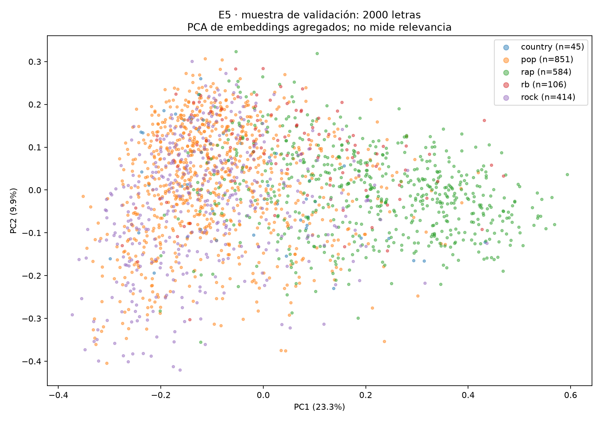

# E5 — semántica: resultados y revisión técnica

2026-11-16. **Cierre técnico/documental completado; revisión asistida realizada;
revisión personal del autor pendiente (H12).** Protocolo: [E5_METODO.md](E5_METODO.md).
Evidencia: [notebook ejecutado](../notebooks/evidencias/E5_semantica.ipynb).
Los juicios asistidos no son gold ni una medición de accuracy.

## Universo, cobertura y procedencia

La corrida `e5-surface-v2` terminó a las **20:07:02 America/Mexico_City**. Se
reutilizó el corpus completo de diez shards, sin repetir ingesta, idioma o spaCy.
La auditoría `scripts/verify_e5_results.py` verificó hashes de las representaciones
y todos los checkpoints publicados; su salida real es
`reports/nlp/lyrics_full_v1/e5_verification.json`.

| Split | Letras transformadas | Tokens superficiales |
|---|---:|---:|
| train | 2 208 832 | 631 669 490 |
| validation | 315 289 | 90 048 892 |
| test | 631 651 | 180 657 971 |
| Total | 3 155 772 | 902 376 353 |

Se verificaron **3 155 772 IDs únicos**, todos con embedding y tópicos disponibles.
Disponibilidad por letra no equivale a cobertura léxica total: el vocabulario de
100 000 términos cubre **738 990 323 tokens**, 81,901 % de train, 81,875 % de
validation y 81,878 % de test. OOV se omite. Son tokens regex, distintos de spaCy.

Vectores: 128 dimensiones, finitos, error máximo de norma L2 **1,79×10⁻⁷**.
Tópicos: 20 componentes finitas, no negativas, error máximo de suma a uno
**1,02×10⁻⁶**. Inspeccionar test aquí comprueba integridad de transformación,
sin juicios de relevancia, ajuste ni selección. Se conserva `lyrics_id`; el enlace
a grabaciones/track_id pertenece al catálogo verificado, todavía pendiente de audio.

Espacio común: `ec76a8c38600ad837729631f95a54d58ac2c983ae46c7259aded6897235d9479`.
Su firma identifica modelos, vocabulario y política de exportación.

## Embeddings propios y selección

Se entrenaron dos **Word2Vec/SGNS propios**, ventanas máximas 5 y 10, 128
dimensiones, cinco negativos, semilla 42 y tres épocas de todo train. Cada época
recorre 631 669 490 palabras brutas. Se verificaron los checkpoints 0–3 de ambos
modelos. Cuatro workers aceleran la ejecución, sin reproducibilidad bit a bit.

| Ventana | Objetivo SGNS medio en validation | Pares positivos |
|---|---:|---:|
| **5, seleccionada** | **−2,392892** | 100 000 |
| 10 | −2,401978 | 100 000 |

Fuente: `artifacts/models/lyrics_full_v1/e5-surface-v2/sgns_selection.json`.
Gana el mayor objetivo con los mismos pares/negativos. El tope de pares limita
el diagnóstico; no mide calidad de recomendación. El pooling suma palabras
distintas con TF-IDF sublineal y normaliza L2, sin duplicar el efecto de frecuencia.
No se filtra por POS ni se depende de lemas dudosos.

## Recuperación y casos de acierto parcial/fallo

TF-IDF y SGNS recuperaron diez vecinos para las mismas cinco consultas de
validation contra **2 208 832 candidatos de train**, sin construir N×N.
Fuentes: `reports/nlp/lyrics_full_v1/e5_{tfidf,embedding}_retrieval.json`.
La auditoría guarda extractos de hasta 180 palabras de consultas y dos primeros
vecinos SGNS. Las lecturas siguientes se basan en esos extractos y son asistidas,
no juicios gold. No se evalúa test.

| Consulta (validation) | Primer vecino SGNS (train) / coseno | Lectura contextual asistida | Vecinos comunes top-10 TF-IDF/SGNS |
|---|---|---|---:|
| Evil dudes demo · `lyr_edc300ca1b86e86572b2` | Jealous Girl, Tages · `lyr_4b5afd0dbcaad55c3787` / 0,941382 | Tristeza, llanto y sonrisa mediante apelación a otra persona: acierto parcial de relación afectiva. Celos/amor del vecino no quedan establecidos en la consulta. | 1 |
| Eat For Two MTV Unplugged · `lyr_15c965067a70c0fe209c` | Wandering Daughter, Kimya Dawson · `lyr_7633385cdeca9f3aa0c8` / 0,962936 | Embarazo y vivir por dos en la consulta; identidad filial, dolor e imágenes de cuento en el vecino. Registro metafórico compartido, pero fallo si se busca el tema específico del embarazo. Go Long, segundo vecino, tampoco lo confirma en su extracto. | 0 |
| Plug Music · `lyr_6eb1350e292960e4d3fb` | Hibachi, Smoke DZA · `lyr_e301e5c9d0097727221a` / 0,983038 | Dinero, pares y supervivencia/calle sostienen relación parcial. La promesa de cuidado del inicio de la consulta no queda igualmente reflejada; la media pierde estructura y voces. | 0 |
| The Way You Were · `lyr_c7ae2a9804278ee4fca3` | Walk Away, Peltsman · `lyr_f373b1191ddc8a004546` / 0,968649 | Discusión, distancia y separación ofrecen afinidad temática aunque cambia rb→rap; no prueba semejanza sonora. | 0 |
| Ive Gotten Used To The Cryin · `lyr_99e2f1f42b99ea8a6117` | I’ve Cried Before, Dion and The Belmonts · `lyr_58ea5de130130868e4c4` / 0,947726 | Llanto, dolor amoroso y ruptura ofrecen relación plausible. Mississippi Delta City Blues, segundo vecino, también trata ocultación del dolor. No se verifican covers. | 0 |

Los rankings son diferentes; el solapamiento no decide cuál es mejor. Cosenos
SGNS altos no son probabilidades ni se comparan directamente con TF-IDF.
La media pierde orden, negación y composición. Las palabras funcionales pueden
estrechar ángulos, pero aquí no se demuestra la causa de los scores elevados.
Faltan juicios independientes para medir calidad del recomendador.

La interfaz `pipelines/nlp/recommend_e5.py` completó una consulta real de cinco
vecinos contra todo train. [Uso y límites](E5_RECOMMENDATIONS.md). No incorpora
audio, filtros por artista/covers ni UI interactiva.

## PCA: parámetros y revisión visual

Dos componentes, `svd_solver=full`, `random_state=42`; ajuste sólo a las **2 000
letras de validation con menores SHA-256 de lyrics_id**. Todas se proyectaron.
IDs, coordenadas, media/componentes: `e5_analysis.json`. PC1 explica **23,323 %**
y PC2 **9,852 %**, total **33,176 %**. El resto de variación no se representa.
Muestra: country 45, pop 851, rap 584, rb 106, rock 414.

Figura inspeccionada visualmente: título, porcentajes y leyenda legibles, sin
recortes. Rap se concentra más hacia PC1 positivo, con considerable solapamiento;
pop/rock se extienden hacia negativo y se mezclan ampliamente. Esto describe
esta muestra/proyección, sin demostrar separación de géneros, significancia,
clusters musicales o calidad de recomendación.

## Conceptos y variación de contextos

Los cinco conceptos usan **el mismo SGNS estático**, contextos ±5 palabras y
promedios con igual peso por letra. Las ocurrencias conservan repeticiones.
Umbral descriptivo: ≥10 letras y ≥20 ocurrencias. Un vecino puede ser colocación,
oposición o relación temática, no necesariamente sinónimo.

| Concepto | Relación observada | Soporte y variación |
|---|---|---|
| love | `unconditionally` 0,696 y `unconditional` 0,662 asocian modo de amar. `lovе` 0,941 es variante gráfica, no descubrimiento conceptual. | Todos los tags con soporte: pop 290 letras/1 173 ocurrencias; rap 200/533; rock 91/327; rb 57/309; country 20/86. Décadas desde 1970 comparables; 1940/1950/1960 insuficientes. Coseno 1970–1980: 0,963, sin prueba de cambio. |
| home | `homesick` 0,625, `back` 0,590 y `homeplace` 0,630 relacionan añoranza, retorno y lugar. Los nombres propios entre vecinos no son sinónimos. | Pop 98/209, rock 41/86 y rap 69/117 con soporte; country 10/16 y rb 9/11 no. `lyr_668235a57971fbdccdd6`, posición 18, combina vivienda y soledad. Coseno 1990–2000: 0,953. |
| money | `cash` 0,789, `guap` 0,721 y `dough` 0,707 relacionan dinero; polisemia requiere contexto. `monеy` 0,906 es variante gráfica. | Rap 155/501, pop 28/79, rock 17/26; rb 6/8 y country 1/1 insuficientes. Búsqueda de dinero en `lyr_e9b51d5a7255fd900a8a`, posición 68; estatus familiar en `lyr_fc94c9c5d4855c7ff8cf`, posición 5. Coseno 2010–2020: 0,992, contraste casi nulo en este espacio. |
| war | `battle` 0,741, `warfare` 0,680 y `bloodshed` 0,676 relacionan conflicto; `waging` 0,772 es colocación. | Rap 25/68, pop 16/20 y rock 13/20 admiten contraste por tag (0,910–0,943). Sólo 2010 supera umbral temporal: no hay contraste entre décadas. Contexto de tácticas/matar: `lyr_2007784ddfd8a9422a73`, posición 19. |
| freedom | `liberty` 0,782 y `liberation` 0,744 próximos; `oppression` 0,650 es oposición/tema, no sinónimo. | Ningún tag supera umbral; rock 7/24 sigue insuficiente. Sólo 2010 tiene soporte (11/31): **no hay contrastes**. Se conservan ejemplos de salvación y libertad de elección. |

Fuente completa, incluidos grupos insuficientes y ejemplos con ID/posición:
`e5_analysis.json`. Años/tags son metadatos de fuente, no fechas de composición
o géneros validados. Mezcla de artistas, longitud, repetición y escasez histórica
limitan comparaciones. El vector de cada palabra no cambia; cambian sus contextos
promediados. No se comparan modelos temporales independientes ni se afirma
evolución causal del significado.

## Tópicos: resultado negativo que se conserva

LDA online: conteos de train, mismo vocabulario, priors simétricos, 30 iteraciones,
una pasada, conservando stopwords. Selección entre seed42 por mayor cota variacional
por palabra en la misma muestra de validación.

| K / semilla | Cota por palabra | UMass | Diversidad top-10 |
|---|---:|---:|---:|
| **20 / 42, seleccionado** | **−9,310046** | −7,550188 | 0,7750 |
| 40 / 42 | −10,691584 | −6,541798 | 0,4775 |
| 20 / 43, estabilidad | −9,257948 | −7,350777 | 0,6450 |

K=40 tiene UMass menos negativo, pero pierde el criterio predefinido. Seed43
diagnostica estabilidad y no sustituye retrospectivamente al modelo elegido.
La cota no es perplexity normalizada ni se compara con KenLM de E2.
Se verificaron los diez checkpoints de cada una de las tres corridas.

Emparejamiento húngaro top-10 seed42/43: Jaccard medio **0,364228**, mínimo **0**;
seis de veinte emparejamientos son cero. Varios 1,0 corresponden a listas
tipográficas repetidas: no prueban estabilidad temática. En seed42 los tópicos
5, 10, 15 y 16 comparten la misma lista estilizada: redundancia/degeneración.

Tópicos 0/4/14 dominados por funcionales/pronombres concentran **94,925 %** de la
masa temática media por letra en train (45,418 %, 25,548 %, 23,958 %).
El 17 agrupa vocalizaciones; el 11 incluye pronombres femeninos/vocabulario afectivo;
el 18 mezcla conflicto y autoridad sin etiqueta única defendible. No se asignan
emociones. Aparecen formas dialectales, multilingües y Unicode; no se excluyen
letras ni se infiere idioma por esos términos aislados.

La pasada única no demuestra convergencia; Gensim lo advirtió. Las distribuciones
son numéricamente válidas y temáticamente limitadas. **No se incorporan al ranking**:
falta ablación con juicios de validación. Una variante de stopwords/Unicode tendría
versión propia; no se reescribe esta corrida ni se modifica E3 silenciosamente.

## Matriz de cierre

| Requisito | Evidencia ejecutada | Estado técnico |
|---|---|---|
| E5-01 | SGNS propio completo, selección, pooling/normalización; dos rankings y revisión contextual de aciertos parciales/fallos | Completado; sin evaluación de relevancia |
| E5-02 | PCA real, muestra/IDs, parámetros/varianza y figura revisada visualmente | Completado |
| E5-03 | Cinco conceptos, vecinos y relaciones con ocurrencias verificables | Completado |
| E5-04 | Contextos por tag/década, soportes, sesgos y contrastes nulos/insuficientes conservados | Completado como descripción |
| E5-05 | Un espacio común, versión exportada y distinción vector estático/contexto | Completado |

Suite vigente: **48 passed** con fixtures sintéticos; no son métricas del corpus.
La auditoría real se registra por separado. La interrupción se reanudó desde
checkpoints sin cambiar código/configuración; consultar marcadores finales,
no los porcentajes históricos del handoff.

Pendiente personal: [TODO-human.md](../TODO-human.md), **H12**, confirmar/corregir
interpretaciones y figura. E3/E4 mantienen sus pendientes. Cierre técnico no
significa aprobación del autor, evaluación del recomendador ni integración de audio.
