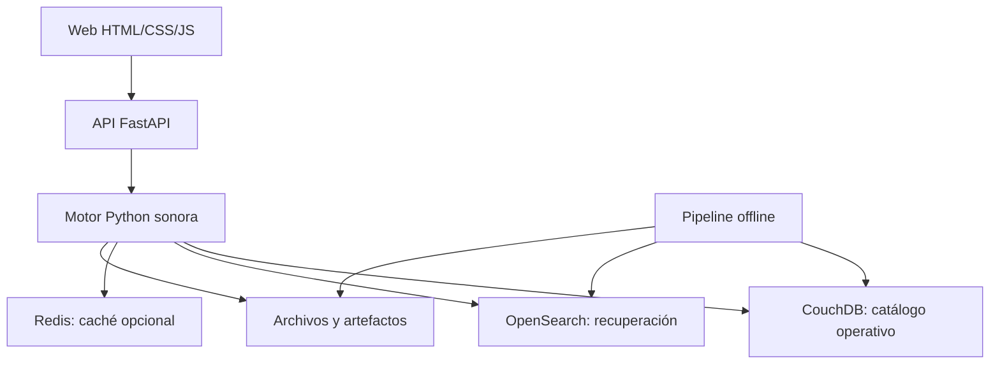

# SONORA — Requirements Document

**Especificación de requisitos académicos, funcionales y técnicos · Versión 1.2**

| Campo | Valor |
|---|---|
| Fecha | 12 de noviembre de 2026 |
| Proyecto | SONORA: descubrimiento musical mediante letras y características acústicas |
| Materias | Procesamiento de Lenguaje Natural y Datos Masivos |
| Directorio de trabajo | `B:\University\2027-1\SONORA` |
| Repositorio | <https://github.com/BrunoRuizJuar/Sonora.git> |
| Ubicación prevista de este documento | `docs/REQUIREMENTS.md` |
| Estado | FMA Medium elegido; 886 pistas con coincidencia exacta conservadas para experimentar; corpus completo de letras en inglés para PLN; validación de contenido, modelos y tamaño final pendientes |
| Idioma del corpus inicial | Inglés; interfaz en español |
| Particiones acordadas | Entrenamiento 70 %, prueba 20 %, validación 10 % |

## 1. Propósito y autoridad del documento

Este documento rige el desarrollo, la evaluación y la entrega de SONORA. Integra la consigna
de PLN proporcionada por el usuario, sus decisiones de producto y los fundamentos de la base
de conocimientos. Define qué debe existir, cómo verificarlo y qué continúa pendiente.
No certifica que los modelos, las fuentes o los resultados aquí especificados ya existan.

Los requisitos se expresan con **debe**. Una propuesta técnica adoptada en esta versión se
distingue de una exigencia del profesor mediante su origen. Los valores iniciales de ingeniería
pueden modificarse con justificación y registro; las exigencias académicas no se declaran
satisfechas mediante un cambio de redacción.

Orden para resolver contradicciones: instrucciones explícitas vigentes del usuario y consigna
académica registrada; requisitos de esta versión; contratos técnicos derivados; propuestas
anteriores y base de conocimientos. Si una decisión del usuario cambia el alcance de una
exigencia académica, se registra la discrepancia y su resolución pendiente. No se inventa
una autorización del profesor.

La base de conocimientos contiene conceptos y propuestas; su presencia no obliga a implementar
todos los algoritmos del curso. Este documento selecciona un método principal y exige justificar
las alternativas descartadas o aplazadas.

### 1.1 Orígenes de los requisitos

| Código | Origen y alcance |
|---|---|
| AS-OBJ | Consigna del usuario: pregunta o problema de PLN, resultado tangible y desarrollo incremental. |
| AS-COR | Consigna: fuente propia o pública citada, extensión aproximada de 150–300 páginas, mismo idioma predominante y estructura comparable. |
| AS-E1 | Construcción y exploración del corpus; mínimos transcritos en la matriz de §15. |
| AS-E2 | Modelos estadísticos del lenguaje y sus mínimos. |
| AS-E3 | Análisis morfosintáctico y sus mínimos. |
| AS-E4 | Análisis sintáctico y sus mínimos. |
| AS-E5 | Representación semántica y sus mínimos. |
| USR-PROD | Decisiones de SONORA: canción semilla; Letras/Música/Mixto; ponderaciones, exploración, variedad y covers. |
| USR-DAT | Decisión actual: FMA para audio y metadatos; Genius para letras correctamente vinculadas. MusicBrainz queda como enriquecimiento opcional. |
| USR-FMA | Actualización del usuario: matching por título + artista, extracción acústica propia, catálogo combinado verificado y dashboard comparativo. Piloto de 200 y catálogo de 500–1 000 son propuestas sin aprobar. |
| USR-SPLIT | Última decisión explícita: 70 % entrenamiento, 20 % prueba y 10 % validación. |
| USR-WEB | Diseño aprobado e iteraciones de la web en el chat de diseño; HTML/CSS/JS incorporable en `apps/web/`. |
| USR-ENV | Ruta de Windows y repositorio indicados por el usuario. |
| KB | `knowledge(1).md`, versión interna 0.2; §§4–14 y 17–18. |
| ENG | Decisión de ingeniería de esta línea base, no requisito atribuido al profesor. |

### 1.2 Prioridades y cierre

Todos los requisitos de las tablas de §§4–13 son obligatorios para cerrar el alcance que
describen. Los marcados como **condicionales** se activan cuando se adopta la técnica o fuente
indicada; no autorizan a presentar resultados inexistentes. Las extensiones de §14 quedan fuera
de los criterios de cierre de la primera versión.

Se distinguen dos verificaciones: **cierre académico de PLN** y **cierre funcional de SONORA**.
El primero requiere las cinco evidencias, investigación y análisis; el segundo agrega los modos
musical y mixto con datos reales. Si sólo funciona Letras, debe informarse ese alcance y los
otros modos permanecen pendientes. Aprobar una fase no significa completar todo el proyecto.

## 2. Problema, preguntas y objetivos

Las búsquedas por artista, título o coincidencias de palabras no describen por sí solas qué
hace que dos canciones estén relacionadas. SONORA permitirá explorar esa relación a partir
del contenido de sus letras y, cuando existan datos compatibles, de sus características acústicas.

**Pregunta principal de PLN:** ¿qué diferencias aparecen en la recuperación de canciones
relevantes al representar letras en inglés con TF-IDF, embeddings propios y distribuciones
temáticas, y cómo se relacionan esas diferencias con la estructura lingüística del corpus?

**Pregunta de producto y Datos Masivos:** ¿cómo construir y evaluar un recomendador basado
en contenido que combine similitud de letras y sonido, permita controlar diversidad y opere
con un catálogo cuyo tamaño y cobertura estén documentados?

**Hipótesis contrastables, no conclusiones anticipadas:**

- H1: los embeddings propios pueden recuperar relaciones relevantes con menor coincidencia
  léxica que TF-IDF; la evaluación debe determinar si ocurre y en qué casos.
- H2: los tópicos pueden aportar información interpretable adicional; una ablación debe medir
  si aportan valor al ranking o principalmente al análisis.
- H3: cambiar el peso de letras/sonido modifica la ordenación según las señales disponibles;
  eso no garantiza una mejora para todos los usuarios o canciones.
- H4: un reranking de diversidad puede reducir redundancia a cambio de relevancia inmediata;
  ambos efectos deben medirse.

| ID | Requisito | Criterio de aceptación | Origen |
|---|---|---|---|
| OBJ-01 | El proyecto debe resolver una pregunta de PLN mediante un corpus seleccionado y un resultado tangible. | El reporte vincula pregunta, datos, método, experimentos, resultados y limitaciones; la app permite consultar recomendaciones reales. | AS-OBJ |
| OBJ-02 | Debe reutilizar e integrar las cinco prácticas de manera incremental. | Cada evidencia tiene notebook o pipeline ejecutado, resultados y referencia desde el reporte; se identifican cambios respecto de prácticas anteriores. | AS-OBJ; AS-E1–E5 |
| OBJ-03 | Debe separar hipótesis, decisiones, implementaciones y resultados medidos. | Ninguna tabla de resultados usa valores de ejemplo o de las diapositivas como mediciones de SONORA; cada resultado tiene un experimento identificable. | KB §§1,14,19 |

## 3. Alcance y estado de las decisiones

**Primera versión:** corpus de letras en inglés; análisis lingüístico completo; recomendación
por canción semilla; modos Letras, Música y Mixto; interfaz web con el diseño trabajado;
dashboard pequeño para comparar dos canciones; evaluación empírica y reporte reproducible.
El catálogo combinado se construye desde FMA y las letras de Genius con vínculos verificados.
No se exige entrenar un transformer desde cero.

| Decisión | Estado vigente | Consecuencia |
|---|---|---|
| Corpus inicial en inglés | Adoptada | Un pipeline y un modelo de letras iniciales; español queda como ampliación. |
| Split 70/20/10 | Adoptada | 70 % train, 20 % test, 10 % validation; la implementación debe conservar esos nombres. |
| Genius como fuente textual | Diez Parquet locales; 3 179 588 registros leídos por el matching | Inspeccionar esquema de letras, idioma, procedencia y hashes; determinar tamaño limpio real. |
| FMA como fuente de audio y metadatos | Medium adoptado: 25 000 clips de 30 segundos | Comprobar presencia/decodificación de audio y extraer características; no dar por procesados los archivos. |
| Matching FMA → Genius por título + artista | Ejecutado sobre metadatos; exactos conservados | Medium aporta 886 pistas exactas y 850 localizadores Genius; conservar grabaciones repetidas, inspeccionar contenido y mantener fuzzy separado. |
| MusicBrainz | Enriquecimiento opcional | Puede ayudar a resolver identidades; no bloquea el pipeline obligatorio FMA + Genius. |
| AcousticBrainz | Fuera de las dependencias del núcleo | La demo extraerá características desde el audio de FMA. No se requiere esta fuente. |
| Cantidad final de canciones | Abierta | Depende de cobertura y calidad; 200 para piloto y 500–1 000 finales son propuestas sin aprobar. |
| Modelo concreto de embeddings | Abierto | Se conserva la dirección de aprender representaciones propias; Word2Vec/SGNS es una opción inicial, no la familia definitivamente elegida. |
| Dashboard de dos canciones | Adoptado | Audio, letras, similitudes separadas y mezcla, tópicos y descriptores interpretables. |
| Recomendador basado en contenido | Método principal adoptado | No requiere inventar una matriz de preferencias de usuarios. |
| Interfaz HTML/CSS/JS existente | Base de frontend | Se preserva el diseño y se conecta a FastAPI; Next.js es una migración opcional. |
| 150–300 páginas de la consigna | Pendiente de comprobar o aclarar | No determina el split ni recorta automáticamente el dataset. |

Las dos fuentes principales son **FMA y Genius** y la variante adoptada es **FMA Medium**.
El matching de metadatos ya se ejecutó; sus cifras se registran en §4.4. La disponibilidad y
decodificación del audio y el contenido de las letras deben comprobarse localmente.

**El análisis de PLN se ejecutará sobre todo el corpus de letras válidas en inglés obtenido
de los diez Parquet, tras la limpieza y deduplicación documentadas.** No se restringirá al
subconjunto con audio. El catálogo de la demo es un subconjunto vinculado a ese corpus.
Las exclusiones por idioma/calidad se contabilizan; no se equiparan los registros de origen
con letras limpias ni se reemplaza el corpus por una muestra sin autorización del usuario.

## 4. Fuentes, corpus y particiones

### 4.1 Qué significa el tamaño del corpus

La unidad documental de SONORA es una **letra de canción**, vinculada a una o varias
grabaciones cuando esa relación se puede verificar. El tamaño se reportará en documentos,
palabras/tokens, vocabulario y bytes, con versión del procesamiento.

La referencia a páginas procede de la consigna académica. No es una unidad de entrenamiento
ni de evaluación y no cambia el reparto 70/20/10. No se crea un segundo corpus obligatorio
por páginas ni se establece una conversión arbitraria de palabras a páginas. Se conservará
el requisito académico como condición pendiente: comprobarlo con un criterio de presentación
explícito si se solicita, o registrar la aclaración del profesor para un dataset digital de letras.
Hasta entonces no se declarará verificado ese punto de la consigna.

Se podrán usar muestras identificadas para pruebas de desarrollo, inspección manual y figuras
legibles. Las métricas agregadas de E1–E5 deben cubrir el corpus limpio completo pertinente,
incluidos POS, lemas y dependencias; ejemplos de árboles y proyecciones podrán usar selecciones
documentadas. El procesamiento costoso se implementa por lotes, con caché y reanudación.
Una muestra no sustituye el análisis completo ni se presenta como ejecución sobre todo el corpus.
Si el hardware impide completarlo, se informa la limitación y se ajusta la ejecución sin declarar
completada esa evidencia ni reducir su universo silenciosamente.

### 4.2 Contrato de datos

| ID | Requisito | Criterio de aceptación | Origen |
|---|---|---|---|
| DAT-01 | Debe registrarse la procedencia de cada fuente y snapshot: referencia, revisión/fecha, campos y checksum cuando corresponda. | Un manifiesto permite identificar la entrada exacta y su cita; se distinguen permisos/condiciones declaradas de letras, audio, metadatos y assets. | AS-COR; KB §13 |
| DAT-02 | El corpus inicial debe estar predominantemente en inglés. | Se documentan identificación de idioma, ambiguos y exclusiones; se auditan casos dudosos y una muestra de los aceptados. | AS-COR; USR-DAT |
| DAT-03 | Debe conservarse una estructura que permita comparar secciones. | Cada letra conserva sus límites y metadatos; se definen al menos dos grupos comparables por época, género, artista u otro criterio disponible, con sus tamaños. | AS-COR |
| DAT-04 | Debe preservarse el texto original y generarse vistas derivadas por tarea. | Existen texto original, vista estructural y vista de análisis; se registran normalización, contracciones, negación, puntuación y política de estribillos. | AS-E1; KB §17.2 |
| DAT-05 | Cada entidad debe tener un ID interno estable y vínculos externos separados. | Las uniones usan IDs; los MBID ausentes permanecen ausentes; los candidatos de matching tienen método, score, estado y revisión. | KB §§13,18 |
| DAT-06 | Deben distinguirse letra, grabación, lanzamiento y composición cuando haya evidencia. | Se detectan letras duplicadas y versiones; la misma letra no obliga a considerar idénticos dos audios; el estado desconocido se conserva. | USR-PROD; KB §13 |
| DAT-07 | Deben registrarse capacidades por canción. | Figuran `has_lyrics`, `has_text_vector`, `has_audio_features`, `has_audio_file` y `playback_allowed`; ninguna se infiere automáticamente de otra. | USR-PROD; ENG |
| DAT-08 | Debe comprobarse la viabilidad del catálogo FMA + Genius antes de fijar su tamaño final. | Se conserva el cruce ya ejecutado y se informa el avance desde 886 coincidencias exactas Medium hasta contenido usable: letras, idioma, audio, exclusiones y recursos; no se exige repetir un piloto artificial de 200. | USR-DAT; USR-FMA |
| DAT-09 | Toda muestra y conteo debe identificar su universo y procesamiento. | Se distinguen registros de origen, corpus limpio completo de PLN, particiones, ejemplos visuales y catálogo de demo; se informan pérdidas por etapa. El corpus no se filtra por tener audio. | KB §§13–14; decisión actual del usuario |
| DAT-10 | La condición de extensión de la consigna debe mantenerse visible hasta resolverse. | El registro contiene el criterio de comprobación o la aclaración recibida; no usa el split como sustituto ni afirma cumplimiento sin evidencia. | AS-COR; aclaración actual del usuario |
| DAT-11 | El matching debe usar título y artista normalizados y conservar la evidencia original. | La tabla registra IDs FMA/Genius, ambos nombres originales/normalizados, método, score, estado y revisión; se prueba que un título igual con artista distinto no se acepta automáticamente. | USR-FMA |
| DAT-12 | El catálogo combinado debe incluir únicamente vínculos aceptados y capacidades válidas. | Consulta y candidato tienen archivo de audio válido, letra vinculada y representaciones compatibles; los casos ambiguos no entran como confirmados. | USR-FMA |
| DAT-13 | La versión de FMA y la duración efectivamente analizada deben ser reproducibles. | Se conserva variante, archivo/revisión, checksum, fma_track_id, duración, segmento y política de selección; se distingue clip de canción completa. | USR-FMA; ENG |

### 4.4 Cantidad y elección de FMA

**FMA Medium está elegido. El tamaño final usable permanece pendiente de comprobar contenido.**

| Elemento | Estado |
|---|---|
| FMA examinado en el cruce | 106 574 filas de metadatos; no equivale a audios descargados. |
| Genius examinado en el cruce | 3 179 588 registros de diez Parquet; no equivale a letras limpias. |
| Variante para la demo | Medium: 25 000 pistas con clips de 30 segundos. |
| Candidatas Medium, incluyendo fuzzy | 987 pistas; fuzzy queda separado y pendiente de revisión. |
| Selección exacta Medium | 886 pistas: 787 exactas únicas y 99 marcadas por clave repetida en FMA. |
| Filas Genius de esa selección | 850 localizadores distintos; no se eliminan grabaciones sólo por compartir letra. |
| Total exact_unique_candidate del catálogo FMA examinado | 2 098; es un conteo del catálogo amplio, no de Medium. |
| Catálogo final usable | Sin tamaño fijado; no se convierte la propuesta histórica de 500–1 000 en requisito. |
| Corpus de PLN | Todas las letras válidas en inglés de los diez Parquet, con deduplicación documentada. |

Los conteos proceden del ZIP aportado por el usuario, ejecución `run_20261113T021601Z_160845`,
y de su auditoría de metadatos. La fecha de ejecución se conserva en UTC como procedencia,
aunque las decisiones del documento se fechan según la hora local del usuario.
Conservar coincidencias exactas para experimentar no certifica contenido leído ni audio escuchado.

FMA publica variantes con clips de 30 segundos y una variante con grabaciones sin recortar,
según la documentación de sus autores. La selección debe registrar qué audio se analiza y qué
reproduce la interfaz. Si se trabaja con clips, la similitud acústica describe ese segmento;
no se atribuye automáticamente a toda la canción. No se construirá un catálogo diferente
para alcanzar artificialmente el tamaño propuesto ni se afirmará que todas las pistas tienen letra.

El volumen descargado, el número de candidatos examinados, el número de matches aceptados,
el catálogo publicable y los elementos por partición son conteos distintos y deben informarse
por separado. El reparto 70/20/10 se conserva después de establecer identidades y grupos
relacionados. Que FMA incluya un split propio no sustituye automáticamente el split de SONORA.

### 4.5 Política de emparejamiento

El recorrido parte de **FMA → búsqueda de letra en Genius**. La normalización incluye una
política documentada de mayúsculas, Unicode, espacios y puntuación. Colaboraciones, versiones
en vivo, remixes y otros indicadores no se eliminan indiscriminadamente: pueden distinguir
grabaciones diferentes. El fuzzy matching propone candidatos y no prueba por sí solo identidad.

Estados mínimos: `accepted`, `ambiguous`, `rejected` y `not_found`, con motivo y procedencia.
Todas las coincidencias exactas de título y artista normalizados se conservan para experimentar,
incluidas varias grabaciones FMA para una misma clave. La repetición por sí sola no es motivo
de exclusión. Se separa `retained_for_experiment` de `lyrics_validated` y `audio_validated`;
no se describe un candidato retenido como contenido validado. Los candidatos fuzzy no se
aceptan automáticamente. Los enlaces usados en la demo deben tener capacidades comprobadas.
También se audita una muestra de aceptados para estimar errores. Una letra no encontrada no prueba
que la pista sea instrumental ni que no exista letra. Las pistas sin letra quedan fuera del
catálogo combinado y pueden conservarse para análisis de audio identificados como tales.

MusicBrainz puede añadirse para enriquecimiento o desambiguación. Los IDs de FMA y Genius
y el identificador interno permiten construir el catálogo aunque no haya MBID.

### 4.3 Distribución y control de fugas

| Partición | Porcentaje | Uso autorizado |
|---|---:|---|
| `train` | 70 % | Aprender vocabularios, IDF, tópicos, embeddings, escaladores y otros parámetros ajustables. |
| `test` | 20 % | Evaluación final con modelos y decisiones congelados. |
| `validation` | 10 % | Elegir hiperparámetros, pesos, umbrales y variantes antes de evaluar test. |

La asignación se hace **por grupos de documentos relacionados**, no por tokens ni por filas
aisladas. Se agrupan duplicados y, cuando se conocen, versiones de una misma obra. En la
selección Medium se utiliza inicialmente el localizador Genius como grupo provisional;
tras leer letras se fusionan también hashes de texto idéntico y relaciones conocidas.
El catálogo de audio hereda los grupos/particiones textuales, sin hacer un segundo sorteo
independiente que mezcle las mismas letras entre particiones. Como
los grupos pueden tener tamaños distintos, los porcentajes son objetivos aproximados y se
reporta el reparto real. La semilla inicial propuesta es 42; no tiene un significado estadístico especial.

Que el recomendador se evalúe empíricamente no elimina esta separación. Los usuarios aportan
juicios de relevancia; validación se usa para elegir el sistema y prueba para describir su
comportamiento final. No se elige la mejor configuración mirando los juicios de prueba.

| ID | Requisito | Criterio de aceptación | Origen |
|---|---|---|---|
| SPL-01 | Debe usarse el objetivo 70 % train, 20 % test y 10 % validation. | El manifiesto incluye IDs, porcentajes reales, agrupación, semilla y motivos de cualquier desviación por grupos. | USR-SPLIT |
| SPL-02 | Duplicados y relaciones conocidas deben resolverse antes del reparto. | Ningún grupo registrado aparece en varias particiones; se informa la limitación de obras o versiones no identificadas. | KB §14.2 |
| SPL-03 | Los ajustes aprendidos deben usar train y la selección de variantes debe usar validation. | Se guardan corpus de ajuste, parámetros y transformaciones; test sólo recibe transformaciones ya ajustadas. | KB §§14,17 |
| SPL-04 | El protocolo de recomendación debe declarar qué canciones son consultas y cuáles son candidatas. | Cada comparación usa un snapshot y reglas de elegibilidad definidos; el contenido de candidatos de test puede transformarse sin usarlo para reajustar modelos. | KB §14.2; ENG |
| SPL-05 | Las estadísticas descriptivas pueden analizar todo el corpus, identificando ese alcance. | Se distinguen análisis descriptivos globales de estimaciones de rendimiento fuera de entrenamiento; las etiquetas de test no regresan al ajuste del experimento. | AS-E1–E5; KB §14 |

Si después se adopta un experimento transductivo con todo el catálogo para ajuste no supervisado,
debe declararse como protocolo diferente y no compararse como si fuera la misma prueba de
generalización a canciones no vistas. El protocolo inicial sigue el reparto acordado.

## 5. Evidencias obligatorias de PLN

Cada evidencia debe conservar código/notebook, configuración, entradas identificables,
salidas ejecutadas, visualizaciones y una interpretación. Se podrá reutilizar el trabajo previo,
pero debe reconciliarse con la versión canónica de datos. Un notebook sin ejecutar o con una
excepción sin resolver no acredita el resultado afectado.

### 5.1 Evidencia 1 — Construcción y exploración

| ID | Requisito | Criterio de aceptación | Origen |
|---|---|---|---|
| E1-01 | Debe documentarse la carga y limpieza del corpus. | Se muestran esquema, ejemplos antes/después, reglas y conteos de entrada, salida y rechazo. | AS-E1 |
| E1-02 | Deben ejecutarse tokenización y normalización con políticas explícitas. | Se identifica tokenizer, versión, idioma, tratamiento de contracciones, stopwords y repeticiones; se preserva el original. | AS-E1; NLP-03/04/05 vía KB |
| E1-03 | Debe realizarse segmentación en oraciones distinguiendo versos y estrofas. | Se auditan ejemplos; los saltos de línea no se presentan automáticamente como fronteras de oración y se informa la ambigüedad propia de letras. | AS-E1; ENG |
| E1-04 | Deben generarse estadísticas descriptivas iniciales. | Se reportan documentos, tokens, vocabulario, longitudes, faltantes, idiomas y duplicados con denominadores/versiones. | AS-E1 |
| E1-05 | Deben incluirse visualizaciones interpretadas. | Hay distribución de longitudes y al menos otra visualización pertinente; cada figura indica muestra, ejes, unidades y hallazgo. | AS-E1; ENG |

### 5.2 Evidencia 2 — Estadística y modelos del lenguaje

| ID | Requisito | Criterio de aceptación | Origen |
|---|---|---|---|
| E2-01 | Deben calcularse distribuciones y palabras más frecuentes. | Tablas de frecuencia absoluta y relativa y comparación justificada con/sin palabras funcionales; se declara el universo de tokens. | AS-E2 |
| E2-02 | Deben analizarse n-gramas. | Se reportan unigramas, bigramas y trigramas con reglas de frontera, filtros, conteos y ejemplos de patrones. | AS-E2; NLP-09 vía KB |
| E2-03 | Debe estudiarse Zipf o un análisis estadístico equivalente. | Una figura rango–frecuencia y su interpretación describen el ajuste y las desviaciones; no se presupone que toda distribución cumple una ley exacta. | AS-E2 |
| E2-04 | Debe identificarse e interpretarse al menos un patrón adicional del corpus. | Se examinan, por ejemplo, hapax, repetición de estribillos o variaciones entre grupos, con soporte cuantitativo. | AS-E2; ENG |
| E2-05 | Debe implementarse un baseline probabilístico de lenguaje como integración del curso. | Un modelo de n-gramas declara vocabulario, OOV, fronteras y suavizado, aprende en train y evalúa perplejidad compatible; no confunde ésta con calidad de recomendación. | ENG; KB §17.4 |

### 5.3 Evidencia 3 — Morfosintaxis

| ID | Requisito | Criterio de aceptación | Origen |
|---|---|---|---|
| E3-01 | Deben aplicarse POS tagging y lematización. | Se identifican herramienta/modelo/versiones; ejemplos mantienen token, POS, lema y referencia al texto. | AS-E3; NLP-12 vía KB |
| E3-02 | Debe analizarse la distribución gramatical. | Se reportan conteos y proporciones por categoría y tratamiento de puntuación; el denominador es explícito. | AS-E3 |
| E3-03 | Deben compararse al menos dos secciones del corpus. | Se usan grupos documentados en DAT-03 y medidas comparables por documento o token; se informan tamaños y desequilibrios. | AS-E3 |
| E3-04 | Debe interpretarse lingüísticamente el resultado y revisar errores de dominio. | Se inspeccionan ejemplos de contracciones, slang, fragmentos y nombres; la precisión de POS sólo se cuantifica si existe referencia humana definida. | AS-E3; KB §17.8 |

### 5.4 Evidencia 4 — Sintaxis

| ID | Requisito | Criterio de aceptación | Origen |
|---|---|---|---|
| E4-01 | Deben generarse árboles representativos y parsing por dependencias. | Se incluyen al menos tres ejemplos seleccionados con criterio explícito y procedencia; se identifica el parser y sus convenciones. | AS-E4; ENG |
| E4-02 | Deben analizarse relaciones entre palabras. | Se presentan relaciones cabeza–dependiente y sus etiquetas con ejemplos; se distingue función gramatical de papel semántico. | AS-E4; NLP-14 vía KB |
| E4-03 | Deben calcularse métricas básicas de complejidad sintáctica. | Se reportan longitud de oración, profundidad y distancia media de dependencia o equivalentes justificados, con fórmulas y exclusiones. | AS-E4; ENG |
| E4-04 | Deben compararse secciones y discutir limitaciones. | Se comparan grupos de DAT-03 y se revisan fragmentos o parses inválidos; un chunker se etiqueta como análisis parcial y no como parser completo de constituyentes. | AS-E4; KB §17.9 |

Convenciones iniciales: profundidad de la raíz igual a cero; distancia de dependencia como
media de `abs(posición_dependiente − posición_cabeza)` sobre arcos incluidos, excluyendo
la raíz. Puntuación, segmentos rechazados y longitudes se tratan de forma consistente. Estas
convenciones se registran y pueden refinarse antes del experimento.

### 5.5 Evidencia 5 — Semántica

| ID | Requisito | Criterio de aceptación | Origen |
|---|---|---|---|
| E5-01 | Deben construirse embeddings y calcularse similitudes semánticas. | Se documentan entrenamiento o procedencia, dimensión, pooling y normalización; se muestran vecinos y casos de acierto/fallo. | AS-E5; NLP-10/18 vía KB |
| E5-02 | Debe visualizarse el espacio vectorial. | PCA, UMAP u otra proyección documenta parámetros, muestra y semilla; la visualización no se usa como prueba suficiente de relevancia o separación. | AS-E5; KB §17.6 |
| E5-03 | Deben analizarse relaciones entre conceptos o entidades del corpus. | Se estudian conceptos con ocurrencias verificables, sus contextos y vecinos o red de relaciones; se diferencia similitud de mera relación temática. | AS-E5 |
| E5-04 | Debe discutirse la evolución o variación semántica dentro del corpus. | Se comparan contextos y usos entre periodos/secciones válidos; se informan soporte, sesgos y resultados nulos o insuficientes. | AS-E5 |
| E5-05 | La comparación semántica debe respetar la compatibilidad de espacios. | Se usa una representación común o una alineación documentada; no se comparan coordenadas de modelos independientes ni se atribuye contextualidad a Word2Vec estático. | KB §§17.6,17.11,18 |

Para E5-04 se propone comparar contextos, coocurrencias y representaciones de contexto en un
espacio común entre grupos temporales. Si los años son insuficientes, se registra esa limitación
y se analiza variación entre secciones disponibles. Un cambio de frecuencia temática no prueba
por sí solo un cambio de significado; no es obligatorio encontrar un cambio real para discutir
la evidencia. Una animación de puntos sin un protocolo comparable no satisface el análisis.

## 6. Representaciones y modelos

### 6.1 Modelos iniciales

| Modelo | Papel en la primera versión | Fundamento |
|---|---|---|
| TF-IDF + coseno | Baseline léxico obligatorio. | DM-S06 y KB §6; transparencia y bajo coste inicial. |
| Embeddings propios; familia por elegir | Representación semántica de letras. Word2Vec/SGNS es la primera opción propuesta. | NLP-10 y KB §17.6; intención previa de aprender representaciones propias, con elección concreta aún abierta. |
| LDA | Análisis de tópicos y experimento de señal temática. | NLP-11 y KB §17.5; las etiquetas interpretables requieren revisión. |
| Descriptores extraídos de FMA | Canal musical con ritmo, energía, timbre y armonía; selección exacta pendiente. | Decisión del usuario; extracción y validación documentadas sobre los archivos de audio. |
| Encoder preentrenado | Comparador opcional identificado como tal. | NLP-17/18; no reemplaza silenciosamente el experimento de embeddings propios. |

| ID | Requisito | Criterio de aceptación | Origen |
|---|---|---|---|
| MOD-01 | Debe existir un baseline TF-IDF reproducible. | Se conserva vocabulario, IDF, política de texto y resultados de recuperación; el ajuste respeta SPL-03. | ENG; KB §6 |
| MOD-02 | Debe elegirse y documentarse el modelo de embeddings, conservando la intención de aprender representaciones propias. | La decisión registra familia, régimen de aprendizaje, objetivo, corpus y parámetros; si se adopta SGNS, incluye matrices objetivo/contexto, negativos, ventana y vectores retenidos. Hay artefacto y log del modelo elegido. | USR-PROD; USR-FMA; KB §17.6 |
| MOD-03 | Debe definirse cómo representar una letra a partir de palabras. | El pooling, OOV y vectores cero tienen una política; cada vector tiene track_id y versión, y no mezcla modelos. | KB §§17.6,18 |
| MOD-04 | Debe entrenarse y analizarse LDA. | Se registran vocabulario de conteos, número de tópicos, priors, método de inferencia, semilla y documentos/términos representativos; una ablación decide su uso en ranking. | USR-PROD; KB §17.5 |
| MOD-05 | Debe versionarse el esquema acústico y su transformación. | Orden, unidades, agregación, faltantes, origen y escalador son comunes por release; la fuente y la calidad se verifican antes de indexar. | USR-PROD; KB §§6,13 |

Opción inicial de ingeniería, **todavía no elección definitiva de modelo**: Word2Vec con 256
dimensiones, skip-gram, ventana 5, `min_count=5` y semilla 42. La familia se elige considerando
volumen textual y evaluación; los demás parámetros se fijan antes de cada ejecución. Estos
valores no provienen de una exigencia docente ni constituyen resultados. Cualquier cambio
de la intención de entrenamiento propio a un modelo exclusivamente preentrenado se registra.

Pooling inicial por letra `d`, usando palabras distintas cubiertas por el modelo:

\[
v_d=\frac{\sum_{w\in V_d}x_{dw}u_w}{\sum_{w\in V_d}x_{dw}},
\qquad \widehat v_d=\frac{v_d}{\lVert v_d\rVert_2},
\]

donde `x_dw` es el peso TF-IDF y `u_w` el embedding retenido. Al sumar sobre palabras distintas,
la frecuencia ya incluida en TF-IDF no se vuelve a multiplicar por ocurrencias. Denominadores
nulos o norma cero producen una representación no disponible, no una similitud arbitraria.

Los tópicos se entrenan con conteos y una política textual documentada. La selección de tópicos
usa validación, estabilidad e interpretación; no se bautiza automáticamente un tópico como emoción.
Las emociones y el tono quedan como extensión con etiquetas o léxico definido, no como un
clasificador cuya precisión se presupone.

### 6.2 Extracción acústica propia

La demo calculará sus características desde los archivos de **FMA**. Las siguientes familias
están acordadas; los descriptores concretos, parámetros y métrica de similitud siguen pendientes:

| Familia | Opciones para evaluar, no selección final | Interpretación permitida |
|---|---|---|
| Ritmo | BPM estimado, tasa de onsets, resúmenes de patrones temporales. | Cercanía en el ritmo efectivamente medido. |
| Energía | RMS, dinámica y medidas de sonoridad con unidades explícitas. | Energía/sonoridad del segmento; no emoción de la letra. |
| Timbre | MFCC y estadísticas espectrales como centroide, ancho o roll-off. | Propiedades de textura/espectro de la señal. |
| Armonía | Chroma y resúmenes tonales validados. | Proximidad en los descriptores armónicos usados; no identidad de melodías. |

El pipeline registra decodificador, frecuencia de muestreo, canales, duración, ventanas/hop,
FFT/STFT, agregación temporal y tratamiento de archivos inválidos. El análisis de Fourier
debe incluir al menos espectro de magnitud y espectrograma STFT con ejes/unidades y ejemplos
interpretados; se justifica la ventana, resolución y hop. No se usa la semejanza de bins FFT
sin tratamiento de duración, dinámica y agregación como sustituto automático de similitud musical. El
vector y su orden de componentes se versionan. Escaladores u otras transformaciones se ajustan
en train y se aplican sin reajuste a validation/test.

| ID | Requisito | Criterio de aceptación | Origen |
|---|---|---|---|
| AUD-01 | Deben extraerse características propias de ritmo, energía, timbre y armonía desde FMA. | Cada familia tiene al menos un descriptor elegido y justificado, código ejecutado y procedencia del archivo; se documentan casos no fiables o no estimables. | USR-FMA |
| AUD-02 | La selección de segmentos y el preprocesamiento de audio deben ser explícitos. | Se registran duración/offset, muestreo, canales y parámetros; no se mezclan silenciosamente clips y canciones completas con significados distintos. | USR-FMA; ENG |
| AUD-03 | Deben construirse vectores acústicos comparables y una métrica documentada. | El esquema, escala, faltantes y distancia/similitud elegidos se validan; vectores inválidos no se indexan ni reciben una similitud artificial. | USR-FMA; MOD-05 |
| AUD-04 | El reproductor, los descriptores y la letra deben corresponder a la misma entidad vinculada. | Una prueba por IDs verifica que cambiar de pista actualiza archivo/segmento, metadatos, letra y características; su duración y disponibilidad se muestran. | USR-FMA |

## 7. Algoritmo de recomendación y justificación

### 7.1 Clasificación adoptada

SONORA implementará **recomendación basada en contenido, de ítem a ítem, iniciada por una
canción semilla**. La modalidad Mixto es una **fusión multimodal de contenido** por combinación
de scores de letras y sonido. No se describe como filtrado colaborativo ni como un híbrido
contenido–colaborativo mientras no utilice interacciones reales de ese tipo.

La preferencia inmediata se expresa mediante la canción elegida y los controles. La primera
versión no estima una preferencia personal persistente ni necesita una cuenta para recomendar.

| Familia del curso | Decisión | Justificación basada en los datos y el objetivo |
|---|---|---|
| Basada en contenido | Método principal. | Existen letras y se busca establecer descriptores acústicos; permite comparar canciones sin historial colectivo. |
| Vecindarios colaborativos | Aplazados. | No hay una matriz de interacciones con solapamiento suficiente establecido. Comparar letras de dos ítems no es CF. |
| Factores latentes de preferencias | Aplazados. | Requieren observaciones reales de preferencias y un objetivo de entrenamiento adecuado; no se rellenan ausencias con disgustos. |
| Apriori/reglas | Extensión futura. | Necesitan cestas/sesiones definidas y coocurrencias repetidas; no hay evidencia que las establezca todavía. |
| PageRank personalizado | Experimento opcional. | Puede recorrer un grafo de vecinos de contenido, pero añade construcción de grafo y no garantiza mejorar relevancia. |
| HITS | Fuera del núcleo. | Resulta justificable con relaciones de playlists/curadores y canciones; esas relaciones no están establecidas en el catálogo actual. |

Fundamento: KB §§4,6–12; fuentes DM-S06, DM-S07, DM-S09 y DM-S10 registradas en esa base.
Los cinco a diez evaluadores ayudan a evaluar contenido; su cantidad no demuestra que ya
existan datos suficientes para entrenar un sistema colaborativo.

### 7.2 Flujo obligatorio

1. Resolver título y artista a un `track_id` seleccionable.
2. Validar capacidades de la semilla, modo, parámetros y versión del catálogo.
3. Recuperar candidatos textuales y/o musicales con presupuesto acotado.
4. Unir IDs y comprobar elegibilidad; excluir la semilla y grabaciones duplicadas.
5. Recalcular scores de las señales disponibles en espacios compatibles.
6. Combinar las señales del modo solicitado.
7. Aplicar diversidad y restricciones duras; devolver hasta K resultados.
8. Producir explicaciones sustentadas y registrar la solicitud para evaluación/diagnóstico.

### 7.3 Scores, combinación y exploración

Para embeddings generales, el coseno puede ser negativo. Como punto inicial se usa
`c(s)=(s+1)/2`. Para TF-IDF no negativo puede conservarse su coseno en `[0,1]`. Compartir
intervalo no garantiza calibración equivalente; las distribuciones y los efectos de los pesos
deben analizarse en validación.

Una variante textual a comparar es:

\[
s_L(q,i)=\lambda_E c(\cos(\widehat v_q,\widehat v_i))
 +(1-\lambda_E)s_T(q,i),
\qquad 0\leq\lambda_E\leq1.
\]

`s_T` puede definirse como `1 − sqrt(JS_base2(θ_q,θ_i))`, con distribuciones temáticas válidas.
La variante sin tópicos (`lambda_E=1`) forma parte de la ablación. La configuración productiva
se selecciona en validación; no se obliga a conservar una señal que empeora el resultado.

Con un score acústico `s_A` transformado y documentado:

\[
s(q,i)=\alpha s_L(q,i)+(1-\alpha)s_A(q,i),\qquad \alpha\in[0,1].
\]

Letras usa sólo `s_L`; Música usa sólo `s_A`. En Mixto, consulta y candidato deben tener ambas
representaciones. La primera versión no renormaliza pesos silenciosamente ante una señal ausente.
Cuando la semilla no cumple, se explica qué modo está disponible y el usuario decide cambiarlo.

La exploración se implementará como diversidad entre candidatos relevantes, separada de `alpha`.
Una heurística inicial tipo MMR selecciona, dado lo ya elegido `S`:

\[
\eta s(q,i)-(1-\eta)\max_{j\in S}r(i,j),
\qquad \eta=1-\rho,
\]

donde `rho` es el control de exploración, el máximo vale cero si `S` está vacío y `r` es una
redundancia declarada y comparable con la relevancia. Se define un umbral de relevancia con
validación. Mayor diversidad no equivale automáticamente a novedad para el usuario, gusto o
sorpresa útil; esas dimensiones requieren juicios específicos.

| ID | Requisito | Criterio de aceptación | Origen |
|---|---|---|---|
| REC-01 | Debe implementarse el algoritmo, no sólo una interfaz con ejemplos. | Una consulta sobre el catálogo real produce scores y ranking trazables a modelos/representaciones existentes. | USR-PROD |
| REC-02 | Debe justificarse su clasificación y elección frente a alternativas del curso. | El reporte incluye la distinción contenido/CF, los datos necesarios por familia y el motivo de selección. | Solicitud actual; KB §§4–12 |
| REC-03 | Deben funcionar Letras, Música y Mixto cuando la semilla tenga las capacidades requeridas. | Cada modo utiliza sus señales declaradas y reporta cobertura y pesos efectivos. | USR-PROD |
| REC-04 | Debe comprobarse la elegibilidad de consulta y candidatos. | Un caso sin vector, audio o versión compatible no produce scores ficticios; Mixto exige ambas señales. | KB §§12–13; ENG |
| REC-05 | Los pesos deben ser válidos y afectar el cálculo real. | Valores fuera de rango se rechazan; extremos y un caso controlado de intercambio de scores producen el comportamiento esperado. | USR-PROD |
| REC-06 | Debe excluirse la semilla y sus duplicados de grabación conocidos. | Casos controlados no devuelven el mismo ítem bajo otro lanzamiento; la igualdad de título no se usa como única prueba. | USR-PROD; KB §13 |
| REC-07 | Debe respetarse el límite por artista canónico. | Se comprueban el límite, colaboraciones y artistas desconocidos; se informa si reduce el tamaño de la lista. | USR-PROD; ENG |
| REC-08 | Debe existir una política honesta de covers. | Se excluyen covers identificados según relaciones verificadas; los desconocidos no se presentan como originales comprobados. | USR-PROD; KB §12.4 |
| REC-09 | Debe existir exploración mediante una política explícita. | Se documenta relevancia/redundancia, semilla y restricciones; la evaluación compara diversidad y relevancia al variar el control. | USR-PROD; KB §12.4 |
| REC-10 | Debe devolverse una lista de hasta K y explicaciones sustentadas. | No se inventan resultados para completar K ni se relajan filtros sin aviso; las razones corresponden a señales calculadas. | KB §§12.4–12.5 |
| REC-11 | Deben conservarse versiones y procedencia de cada ranking. | La solicitud registra semilla, modo, pesos, filtros, candidatos, IDs finales, scores, configuración y tiempos. | KB §13 |

## 8. Datos Masivos y escalabilidad

La contribución de Datos Masivos se demostrará mediante el diseño y la evaluación del
recomendador, sus representaciones y sus costes. El nombre de la materia no obliga a usar
Spark ni una infraestructura distribuida sin evidencia de necesidad.

Una matriz densa de todas las similitudes requiere `O(N²)` almacenamiento y aproximadamente
`O(N²d)` trabajo para vectores densos. Como ejemplo teórico, no medición del catálogo actual,
100 000 canciones en float32 producirían unos 40 GB decimales sólo de scores. En cambio,
sus vectores de 256 componentes ocuparían unos 102,4 MB antes del índice y otros metadatos.
Una consulta exacta requiere `O(Nd)` trabajo; conservar K vecinos por canción requiere `O(NK)`
registros. Un índice aproximado añade una compensación entre recursos, latencia y recuperación.

| ID | Requisito | Criterio de aceptación | Origen |
|---|---|---|---|
| BD-01 | El sistema debe separar preparación offline de consulta online. | Limpieza, ajuste, extracción e indexación se ejecutan por lotes; una petición no vuelve a entrenar ni descarga el corpus. | KB §13.3; DM-S04 vía KB |
| BD-02 | Debe evitarse una matriz densa global de similitud como almacenamiento obligatorio. | Se usan representaciones dispersas/densas adecuadas, recuperación por consulta o vecinos acotados; se documenta su coste. | KB §13.4 |
| BD-03 | Deben medirse recursos en tamaños crecientes. | Se reportan N, d, tiempo, RAM/almacenamiento e indexación/consulta para al menos dos escalas viables en el hardware declarado. | ENG; KB §13.4 |
| BD-04 | La generación aproximada de candidatos debe tener una referencia exacta. | Si se usa ANN o unión acotada de canales, se mide recuperación frente al Top-K exacto sobre una muestra manejable. | KB §§12.3,13.4 |
| BD-05 | El procesamiento debe admitir lotes, reanudación y trazabilidad. | Se registran particiones/checkpoints, errores y conteos; una repetición controlada no duplica entidades o mezcla versiones. | ENG; KB §13 |
| BD-06 | Cachés e índices deben seguir las versiones de datos/modelos. | Se invalidan o reconstruyen al cambiar representaciones; añadir canciones no se considera resuelto calculando sólo sus propios vecinos. | KB §13.4 |

Presupuesto inicial para probar: 500 candidatos por señal, ampliación acotada hasta 5 000
candidatos si los filtros lo justifican y Top-K por defecto igual a 10. Son valores de ingeniería
ajustables con mediciones. La unión de los mejores candidatos por canal no garantiza contener
el mejor resultado de la mezcla global; BD-04 debe cuantificar esa aproximación.

La distribución de procesamiento se incorporará sólo si el coste medido excede la capacidad
de una máquina o la necesidad de operación lo justifica. No se presentará una ejecución local
como un sistema distribuido.

## 9. Experiencia web y diseño

La web existente en HTML/CSS/JS es la base de integración. Sus canciones y explicaciones de
muestra no son resultados del modelo. La arquitectura previa que proponía Next.js se considera
una alternativa de evolución, no una dependencia necesaria para conectar esta interfaz.

| ID | Requisito | Criterio de aceptación | Origen |
|---|---|---|---|
| WEB-01 | Debe poder buscarse por título y artista y elegirse una semilla inequívoca. | La interfaz muestra coincidencias, artistas y estados sin resultados; evita seleccionar automáticamente un homónimo ambiguo. | USR-PROD |
| WEB-02 | Los controles deben enviar su configuración real a la API. | Modo, peso, exploración, límite por artista y covers llegan con unidades y nombres del contrato; la respuesta refleja valores efectivos. | USR-PROD |
| WEB-03 | Debe haber estados de carga, error, vacío y modalidad no disponible. | Se prueban fallos de API y datos faltantes; una caída no sustituye silenciosamente el ranking por la muestra visual. | ENG |
| WEB-04 | Debe conservarse el diseño aprobado y su identidad. | Paleta sepia rojiza con naranja/terracota; Smokum en títulos, Rubik Distressed de uso mínimo y Ovo en el resto según la iteración vigente; originales y licencias se conservan. | USR-WEB |
| WEB-05 | Debe respetarse la regla de banners diurno/nocturno acordada. | Hora local del navegador: día desde 06:00 inclusive hasta 18:00 exclusiva; noche el resto; se verifica el cambio sin alterar la configuración del recomendador. | USR-WEB; ENG |
| WEB-06 | Debe poder utilizarse en escritorio y móvil con controles legibles. | Navegación por teclado, foco visible, etiquetas y ausencia de elementos decorativos que tapen información; se revisan al menos ambos tamaños. | USR-WEB; ENG |
| WEB-07 | El estado de demostración, audio y guardados debe ser explícito. | La muestra se identifica como demo, el catálogo real inicial es inglés, la reproducción depende de audio disponible y los guardados locales no se anuncian como cuentas sincronizadas. | USR-WEB; USR-DAT |
| WEB-08 | Debe poder abrirse una comparación entre la semilla y una canción recomendada o seleccionada. | La vista conserva los dos IDs, muestra las capacidades reales y permite volver a recomendaciones sin perder los controles elegidos. | USR-FMA |

Botas con espuelas, revólveres y otros detalles gráficos del diseño son ornamentales. Su
presencia y posición se trasladan desde los assets aprobados; este documento no certifica
que la versión más reciente del otro chat ya esté copiada al repositorio.

### 9.1 Dashboard pequeño de comparación

Se mostrarán dos canciones lado a lado, identificadas como A y B. La vista incluirá:

- Título y artista de cada pista, reproductores y letras correspondientes.
- Similitud por embeddings, similitud por distribuciones LDA y similitud acústica, separadas.
- Tópicos principales de ambas letras y los descriptores musicales que sustentan la comparación.
- Control **Letras ↔ Música**, pesos efectivos y puntuación combinada.
- Estado y versión de modelos, unidades/rangos, duración del audio analizado y datos no disponibles.

Debe permitir examinar casos de audio cercano con letras distintas y de letras cercanas con
sonidos diferentes. Son preguntas de exploración, no resultados que se garantizan por diseño.
La palabra «vibra» describe una percepción que se contrasta con usuarios; las medidas del
modelo no se anuncian como porcentajes de gusto, identidad semántica o experiencia humana.

| ID | Requisito | Criterio de aceptación | Origen |
|---|---|---|---|
| DASH-01 | Deben visualizarse dos canciones con sus audios y letras correctamente vinculados. | La vista identifica A/B, sus fuentes y segmentos; no muestra letras de otra grabación como si el matching estuviera confirmado. | USR-FMA |
| DASH-02 | Deben mostrarse scores de embeddings, LDA y audio por separado. | Cada score indica modelo/versión, medida y escala; LDA y embeddings no se colapsan en una sola cifra sin explicación. | USR-FMA |
| DASH-03 | La interpretación debe apoyarse en tópicos y características calculadas. | Se muestran tópicos y descriptores de ambas pistas con unidades o etiquetas revisadas; no se inventan estados emocionales. | USR-FMA |
| DASH-04 | El control de mezcla debe cambiar el score combinado conservando las medidas base del mismo par. | Al variar sólo alpha, los scores de embeddings/LDA/audio del par permanecen iguales y la mezcla sigue la fórmula; el ranking se recalcula cuando se solicita. | USR-FMA; REC-05 |

## 10. Arquitectura, API y organización

### 10.1 Arquitectura de referencia



La API y el pipeline comparten el paquete de dominio. El frontend no accede directamente a
las bases. La implementación puede comenzar con búsqueda exacta y ejecución por CLI para
validar resultados; OpenSearch y la caché se integran según las necesidades medidas y sus
adaptadores no deben cambiar el significado de los scores.

| ID | Requisito | Criterio de aceptación | Origen |
|---|---|---|---|
| TEC-01 | El código debe separar presentación, API, dominio y acceso a datos. | El motor puede ejecutarse fuera de la web y los adaptadores se prueban contra contratos explícitos. | ENG; arquitectura previa |
| TEC-02 | Debe existir un contrato de API único y versionado. | Rutas, unidades, validaciones, errores y capacidades están documentados; frontend/backend usan los mismos nombres o un adaptador probado. | ENG |
| TEC-03 | Deben publicarse releases compatibles de datos, modelos e índices. | Un manifiesto activo relaciona versiones, IDs de filas, dimensiones, normalización, rutas y checksums; un release incompleto no se marca listo. | KB §13 |
| TEC-04 | El proyecto debe organizarse bajo la ruta y el repositorio acordados. | Código y configuración son relativos a la raíz o a variables de entorno; no se incrusta `B:` en los algoritmos. | USR-ENV |
| TEC-05 | La salud del proceso debe distinguirse de la preparación funcional. | Liveness puede responder aunque falten datos; readiness informa indisponibilidad hasta que catálogo/modelos requeridos estén validados. | ENG |
| TEC-06 | Debe existir un contrato para comparar dos canciones reales del catálogo. | La API recibe dos track_id y configuración, devuelve scores desglosados y evidencia compatible, y valida la disponibilidad de ambos ítems. | USR-FMA |

### 10.2 Contrato inicial de integración

| Método y ruta | Función |
|---|---|
| `GET /api/v1/health/live` | Salud del proceso. |
| `GET /api/v1/health/ready` | Preparación de dependencias y release. |
| `GET /api/v1/tracks/search?q=...` | Resolver título/artista. |
| `GET /api/v1/tracks/{track_id}` | Metadatos y capacidades. |
| `GET /api/v1/catalog/stats` | Tamaño, versiones y cobertura por modo. |
| `POST /api/v1/recommendations` | Recuperar y ordenar recomendaciones. |
| `POST /api/v1/comparisons` | Comparar dos canciones y devolver evidencia textual/acústica para el dashboard. |
| `POST /api/v1/evaluations` | Guardar juicios del estudio. |

Solicitud propuesta para recomendación:

```json
{
  "track_id": "identificador-interno",
  "mode": "mixed",
  "lyrics_weight": 0.7,
  "exploration": 0.2,
  "top_k": 10,
  "max_per_artist": 1,
  "exclude_known_covers": true,
  "seed": 42
}
```

Se aceptan modos `lyrics`, `audio` y `mixed`; controles fraccionarios en `[0,1]`; `top_k`
entre 1 y 50. La respuesta incluye pesos efectivos, versión del catálogo/modelos, filtros,
IDs, scores por señal, razones, número real de resultados y avisos pertinentes. Los errores
previstos son 404 para semilla inexistente, 409 para modalidad incompatible, 422 para parámetros
inválidos y 503 para dependencias no preparadas.

La comparación recibe `track_a_id`, `track_b_id` y `lyrics_weight` y devuelve IDs y versión,
`embedding_similarity`, `topic_similarity`, `audio_similarity`, `lyrics_similarity` y
`combined_similarity`, junto a las medidas/transformaciones utilizadas, tópicos y descriptores.
Los valores no disponibles se devuelven como tales y no como cero. El cálculo comparte las
representaciones y versiones del motor de recomendación, evitando un dashboard con scores
de un modelo distinto del que ordena canciones.

El documento del ZIP de diseño propuso otros nombres. La integración debe resolver estas
diferencias sin mantener dos contratos contradictorios:

| Concepto del diseño | Contrato canónico |
|---|---|
| `song_id` | `track_id` |
| modo `music` | modo `audio` |
| Porcentaje de música `p` | `lyrics_weight = 1 - p/100` |
| `limit` | `top_k` |
| `exclude_covers` | `exclude_known_covers` |
| `/api/search` | `/api/v1/tracks/search` |
| `/api/recommend` | `/api/v1/recommendations` |

En desarrollo, web en puerto 8080 y API en 8000, con orígenes autorizados explícitos. En
publicación pueden compartir origen mediante un proxy. Un servidor estático no ejecuta por
sí mismo los modelos ni implementa los endpoints.

### 10.3 Estructura por responsabilidad

| Carpeta | Responsabilidad |
|---|---|
| `apps/web/` | Interfaz estática, servidor de desarrollo y assets optimizados. |
| `apps/api/` | FastAPI, contratos y coordinación. |
| `apps/worker/` | Trabajos en segundo plano si se integran. |
| `packages/sonora/` | Ingesta, matching, PLN, audio, ranking y evaluación reutilizables. |
| `pipelines/` | Ejecución de etapas offline. |
| `data/raw/` | Entradas originales por fuente/revisión. |
| `data/interim/` | Resultados de limpieza y reconciliación. |
| `data/processed/` | Corpus canónico, particiones y catálogo. |
| `artifacts/` | Modelos, escaladores, vectores e índices derivados. |
| `notebooks/` | Prácticas, exploración y experimentos ejecutados. |
| `config/` | Parámetros, fuentes y políticas de ranking. |
| `manifests/` | Snapshots, splits, experimentos y releases. |
| `design/` | Originales de marca, referencias y especificaciones. |
| `docs/` | Requisitos, arquitectura, contrato y decisiones. |
| `reports/` | Reporte final, figuras y resultados. |
| `tests/` | Comprobaciones de datos, modelos e integración. |
| `infra/` | Servicios y despliegue. |
| `runtime/` | Caché, temporales y logs locales. |

Las bases pueden usar volúmenes de Docker fuera de B:; su ubicación debe documentarse si
se utilizan. El requisito de directorio organiza el proyecto y no afirma dónde Docker guarda
físicamente cada volumen.

## 11. Evaluación empírica

### 11.1 Protocolo mínimo

La relevancia se obtiene de personas y se conserva separada de predicciones. Se plantea un
estudio exploratorio con 5–10 evaluadores. Como punto inicial de ingeniería se preparan al
menos diez semillas finales de prueba, separadas de las usadas para elegir parámetros.
El tamaño final y la carga por evaluador se fijan antes de recoger los juicios de prueba.

Se construye un pool deduplicado de candidatos de los métodos comparados, bajo el mismo
catálogo y restricciones. Las personas reciben las instrucciones del modo y califican con una
escala 0–3: no relacionado, relación débil, relacionado, muy relacionado. Para evaluar sonido
deben poder escuchar los mismos segmentos disponibles o declarar una familiaridad suficiente;
sin evidencia auditiva no se presenta ese juicio como evaluación del canal musical. Los casos
sin posibilidad de valoración se registran como no juzgados.

Los métodos se ocultan cuando sea posible y se alterna el orden. Una parte del pool recibe
doble anotación para describir desacuerdo. Los juicios no deben generarse con un modelo ni
derivarse de un like supuesto. El tamaño reducido permite aprender sobre el prototipo, no
afirmar eficacia en una población general.

| ID | Requisito | Criterio de aceptación | Origen |
|---|---|---|---|
| VAL-01 | Deben compararse métodos con una referencia simple. | Se comparan al menos TF-IDF, embeddings propios y su variante temática; Música/Mixto se comparan sobre un subconjunto elegible común y también reportan cobertura global. | KB §14.1; ENG |
| VAL-02 | Deben realizarse ablaciones de señales y diversidad. | Se comparan sin/con tópicos y sin/con reranking manteniendo condiciones; se describen ganancias, pérdidas y resultados nulos. | ENG; hipótesis H2/H4 |
| VAL-03 | Debe recogerse relevancia humana mediante un protocolo fijo. | Se conserva escala, instrucciones, semilla, candidato, modo, evaluador seudónimo, versión y estado no juzgado. | KB §14.4 |
| VAL-04 | Deben calcularse métricas de ranking interpretables. | Se reportan nDCG@10 y Precision@10 con denominadores/política de listas cortas; se definen casos sin relevantes y candidatos no juzgados. | KB §14.3 |
| VAL-05 | Deben medirse cobertura y diversidad además de relevancia. | Se reportan cobertura por modalidad, artistas únicos/repetidos, fill rate e intra-list diversity sobre un espacio declarado. | KB §14.3 |
| VAL-06 | Debe distinguirse evaluación de componentes de evaluación del recomendador. | Perplejidad, POS, parsing, proyecciones y clustering no se presentan como sustitutos de relevancia humana; precisión de anotadores automáticos exige gold. | KB §§14,17–18 |
| VAL-07 | Deben conservarse desacuerdos, fallos y límites del estudio. | El reporte incluye tamaño real, agregación por semilla/evaluador, ejemplos negativos y ausencia de garantías de generalización o superioridad. | KB §14.4 |
| VAL-08 | Debe contrastarse la relación entre similitud numérica y percepción de letras/sonido. | Los usuarios valoran ambas dimensiones por separado sobre pares con audio/letras disponibles; se reportan coincidencias, desacuerdos y límites del término «vibra». | USR-FMA |

### 11.2 Convenciones de métricas

- **Precision@10:** positivos con relevancia al menos 2 en las diez posiciones solicitadas,
  dividido por 10. Las posiciones no devueltas no suman positivos; se informa fill rate.
  También puede añadirse precisión sobre longitud real, etiquetada por separado.
- **nDCG@10:** ganancia `2^g-1` y descuento `log2(r+1)`. La lista ideal se define sobre el
  mismo pool juzgado. Cuando IDCG es cero se informa el caso como no definido y se declara
  cómo se excluye del promedio; se reporta cuántas semillas quedan evaluables.
- **No juzgados:** no se convierten automáticamente en irrelevantes. Las listas finales de
  prueba se incluyen en el pool a juzgar antes del cálculo principal, o se declara una métrica
  parcial y su cobertura. No se oculta que el pool es un universo limitado.
- **Recall@K de relevancia:** sólo se reporta si existe un conjunto relevante definido; con un
  pool parcial se denomina recall respecto del pool y no recall de todo el catálogo.
- **Recuperación de candidatos/ANN:** intersección con un Top-K exacto dividido por K,
  con representación, modo y universo de referencia declarados. No es recall de preferencias.
- **Novedad y sorpresa útil:** se consultan al evaluador. Una distancia alta o un artista
  distinto no demuestran desconocimiento ni satisfacción.

La aceptación académica exige ejecutar y analizar comparaciones; no obliga a obtener una
mejora positiva. Si el baseline gana, se informa y puede seleccionarse como configuración
operativa mientras se conserva el análisis del modelo propio.

## 12. Requisitos no funcionales y reproducibilidad

| ID | Requisito | Criterio de aceptación | Origen |
|---|---|---|---|
| NF-01 | Los experimentos deben poder reconstruirse. | Se guardan revisión de código, fuentes, splits, dependencias exactas, configuración, semillas y artefactos; el procedimiento se documenta desde una copia limpia del proyecto. | KB §§13–14 |
| NF-02 | Debe medirse el rendimiento en un entorno declarado. | Se informa hardware, N, dimensiones, candidatos, caché fría/caliente, carga y latencia p50/p95; el presupuesto se fija antes del ensayo y se registra si no se cumple. | ENG; KB §13.4 |
| NF-03 | Los fallos deben ser visibles y los resultados numéricamente válidos. | Se rechazan dimensiones incompatibles, NaN/inf y vectores cero; las indisponibilidades no producen rankings de ejemplo presentados como reales. | KB §13.2; ENG |
| NF-04 | Deben separarse secretos, datos grandes y evidencia publicable. | Git conserva código, configuración de ejemplo, documentos y manifiestos; credenciales, corpus/audio y modelos pesados quedan fuera salvo una muestra autorizada y explícita. | USR-ENV; ENG |
| NF-05 | El prototipo debe recolectar sólo la información necesaria para su evaluación y ofrecer acceso verificable. | Se usan sesiones seudónimas, se explica qué se registra y cómo se conserva; un evaluador puede abrir la app y completar el flujo en el entorno de demostración documentado. | USR-PROD; KB §§4,14 |

Propuesta inicial de rendimiento: buscar un p95 de recomendación de hasta 3 segundos sobre
un catálogo de desarrollo de hasta 10 000 canciones y una solicitud simultánea, con al menos
100 solicitudes de medición. Este objetivo no procede del profesor ni es una medición actual.
Debe confirmarse o ajustarse con hardware y catálogo declarados antes de evaluar la versión;
la medición de BD-03 sigue siendo obligatoria cualquiera que sea el presupuesto final.

## 13. Entregables y definición de terminado

| ID | Requisito | Criterio de aceptación | Origen |
|---|---|---|---|
| ENT-01 | Debe entregarse el corpus documentado o un procedimiento reproducible para obtenerlo. | Ficha de fuentes, esquema, conteos, versiones, limpieza, selección y splits; condiciones de distribución registradas. | AS-COR; AS-E1 |
| ENT-02 | Deben entregarse las cinco evidencias ejecutadas y sus resultados. | Índice navegable que enlaza código, figuras, tablas, entradas, versiones e interpretación de E1–E5. | AS-E1–E5 |
| ENT-03 | Debe entregarse un recomendador funcional con su evaluación. | Código del algoritmo, modelos, configuración activa, comparaciones y limitaciones; se identifican modos realmente disponibles. | USR-PROD; solicitud actual |
| ENT-04 | Deben entregarse interfaz y procedimiento de ejecución. | Instrucciones desde la raíz en Windows, variables de entorno y flujo de demostración; assets y contrato API integrados. | USR-WEB; USR-ENV |
| ENT-05 | Debe entregarse un reporte técnico final que responda la investigación. | Problema, corpus, metodología, cinco evidencias, justificación del recomendador, escalabilidad, evaluación, discusión, conclusiones, referencias y limitaciones. | AS-OBJ; solicitud actual |

### 13.1 Cierre académico de PLN

Se verifica que la investigación tiene respuesta basada en resultados; las cinco evidencias
cubren todos sus mínimos; el corpus es identificable, citado y predominantemente inglés;
existen comparaciones entre secciones e interpretación lingüística y semántica; se preserva
el split acordado; el requisito de extensión tiene comprobación o aclaración registrada.
Una condición pendiente debe identificarse y no se describe como cumplimiento total.

### 13.2 Cierre funcional de SONORA

Se verifica búsqueda real, selección de semilla, ranking trazable, modos Letras/Música/Mixto
con capacidades reales, filtros, exploración, dashboard comparativo de dos canciones,
integración web/API, evaluación humana y mediciones de recursos. Para Música/Mixto debe
existir un subconjunto FMA + Genius correctamente vinculado que permita ejecutar los casos
de prueba y medir cobertura; no basta con controles gráficos. No se fija 500–1 000 como
umbral de cierre mientras ese tamaño siga siendo una propuesta sin aprobar.

Un canal sin datos, una API ficticia o un gráfico de embeddings por sí solo no permiten
declarar terminado el producto completo. Una entrega parcial se documenta por su alcance real.

## 14. Extensiones fuera del núcleo obligatorio

Se podrán agregar español con su propio pipeline, alineación entre idiomas, análisis afectivo,
encoders contextualizados, recomendaciones por múltiples semillas, cuentas/sincronización,
filtrado colaborativo, reglas de asociación, factores de preferencias, PageRank personalizado,
HITS para colecciones o procesamiento distribuido. Cada extensión requiere datos, protocolo,
justificación y prueba de valor; no se añade a producción sólo por estar en la base de conocimientos.

El análisis afectivo debe definir si representa sentimiento expresado, emociones o dimensiones
como valencia/arousal. Las predicciones no son etiquetas humanas y la emoción del narrador
no se identifica con la del usuario ni con la energía acústica.

## 15. Matriz de trazabilidad de la consigna

| Exigencia suministrada | Requisitos que la cubren | Evidencia de verificación |
|---|---|---|
| Pregunta/problema de PLN | OBJ-01, OBJ-03; §2 | Reporte, preguntas, experimentos y conclusiones. |
| Resultado tangible | OBJ-01, REC-01, ENT-03–ENT-05 | App funcional y reporte. |
| Desarrollo incremental con prácticas | OBJ-02, ENT-02 | Índice E1–E5 y registro de evolución. |
| Fuente propia o pública correctamente citada | DAT-01, ENT-01 | Ficha y manifiesto de fuentes. |
| Extensión aproximada 150–300 páginas | DAT-10; §4.1 | Comprobación o aclaración pendiente; no sustituida por el split. |
| Texto continuo principalmente en un idioma | DAT-02, DAT-04, E1-03 | Letras completas en inglés y segmentación documentada. |
| Estructura para comparar secciones | DAT-03, E3-03, E4-04, E5-04 | Grupos, metadatos y análisis comparativo. |
| E1: carga | E1-01 | Lectura ejecutada, esquema y conteos. |
| E1: limpieza | E1-01, DAT-04 | Reglas y ejemplos antes/después. |
| E1: tokenización | E1-02 | Tokens y configuración. |
| E1: segmentación de oraciones | E1-03 | Segmentos auditados y política para versos. |
| E1: normalización | E1-02, DAT-04 | Vistas derivadas y trazabilidad. |
| E1: estadísticas iniciales | E1-04 | Tablas y denominadores. |
| E1: visualizaciones | E1-05 | Figuras interpretadas. |
| E2: distribución de frecuencias | E2-01 | Frecuencias absolutas y relativas. |
| E2: palabras frecuentes | E2-01 | Tablas y comparación de políticas. |
| E2: n-gramas | E2-02 | Unigramas, bigramas y trigramas. |
| E2: Zipf o equivalente | E2-03 | Figura y discusión. |
| E2: patrones e interpretación | E2-04, ENT-05 | Análisis estadístico argumentado. |
| E3: POS tagging | E3-01 | Anotaciones y modelo. |
| E3: lematización | E3-01 | Tokens y lemas. |
| E3: categorías gramaticales | E3-02 | Conteos y proporciones. |
| E3: comparación entre secciones | E3-03 | Grupos con tamaños y resultados. |
| E3: interpretación lingüística | E3-04 | Ejemplos y limitaciones. |
| E4: árboles representativos | E4-01 | Árboles con procedencia y criterio. |
| E4: parsing por dependencias | E4-01, E4-02 | Arcos y etiquetas. |
| E4: relaciones entre palabras | E4-02 | Ejemplos y análisis. |
| E4: complejidad sintáctica | E4-03 | Métricas y convenciones. |
| E4: comparación entre secciones | E4-04 | Tablas/figuras comparativas. |
| E5: embeddings | E5-01, MOD-02, MOD-03 | Modelos, vectores y metodología. |
| E5: similitud semántica | E5-01, E5-03 | Vecinos, relaciones y fallos. |
| E5: espacio vectorial | E5-02 | Proyección documentada. |
| E5: relaciones de conceptos/entidades | E5-03 | Contextos y relaciones verificables. |
| E5: evolución semántica | E5-04, E5-05 | Comparación válida y discusión, incluidos resultados insuficientes. |
| Algoritmo de recomendación y su tipo | REC-01, REC-02; §7 | Implementación y justificación frente a familias del curso. |
| Fundamentación en Datos Masivos | REC-02, BD-01–BD-06 | Referencias del curso, complejidad, almacenamiento y benchmark. |
| Fuentes FMA + Genius y matching por título/artista | DAT-08, DAT-11–DAT-13 | Informe del piloto, vínculos aceptados y manifiesto de versión. |
| Extracción propia de ritmo/energía/timbre/armonía | AUD-01–AUD-04, MOD-05 | Pipeline, archivos/segmentos y vectores acústicos. |
| Dashboard de dos canciones y similitudes separadas | WEB-08, DASH-01–DASH-04, TEC-06 | Comparación real, evidencia desglosada y control de mezcla. |
| Relación de medidas con la «vibra» percibida | VAL-08 | Juicios humanos por dimensión y discusión de desacuerdos. |

## 16. Casos de aceptación de integración

| Caso | Condición y acción | Resultado esperado | Requisitos principales |
|---|---|---|---|
| AC-01 | Reconstruir el split con los mismos datos y semilla. | Mismos grupos/IDs; reparto real reportado sin cruces de grupos. | SPL-01–SPL-03 |
| AC-02 | Procesar una letra con estribillos, contracciones y versos. | Se conserva el original y se generan vistas/segmentos auditables. | DAT-04, E1-02, E1-03 |
| AC-03 | Ejecutar E1–E5 sobre una versión identificada. | Resultados ejecutados e interpretación; cada mínimo aparece en el índice final. | OBJ-02, E1-01–E5-05 |
| AC-04 | Consultar una semilla con letra y descriptor válidos en los tres modos. | Se ejecuta el modo solicitado con señales y pesos correctos. | REC-01, REC-03, REC-05 |
| AC-05 | Pedir Mixto para una semilla sin descriptor acústico. | Se comunica indisponibilidad; no se inventa audio ni se cambia de modo silenciosamente. | DAT-07, REC-04, WEB-03 |
| AC-06 | Introducir peso fuera de rango o vector incompatible. | Error validado; no hay ranking numéricamente inválido. | REC-05, NF-03 |
| AC-07 | Usar candidatos con misma grabación, artistas repetidos y covers conocidos. | Se respetan exclusiones, límite y política de desconocidos. | REC-06–REC-08 |
| AC-08 | Pedir diez resultados cuando sólo seis cumplen filtros. | Se devuelven hasta seis y se informa el alcance; sin relleno ficticio. | REC-10 |
| AC-09 | Variar exploración en un caso con candidatos redundantes. | Cambia el reranking según la política, conservando restricciones y trazabilidad. | REC-09, VAL-02 |
| AC-10 | Comparar recuperación aproximada y exacta. | Se mide intersección, calidad y coste bajo condiciones declaradas. | BD-03, BD-04 |
| AC-11 | Cambiar el modelo o publicar un nuevo catálogo. | Se reconstruyen artefactos incompatibles y no se reutilizan scores de otra versión. | BD-06, TEC-03 |
| AC-12 | Interrumpir la API y volver a abrir la web. | Estado de error explícito; la demo no suplanta resultados reales. | WEB-03, NF-03 |
| AC-13 | Simular 05:59, 06:00, 17:59 y 18:00 locales. | Banner coherente con el intervalo acordado; sin alterar recomendaciones. | WEB-05 |
| AC-14 | Revisar el estudio con juicios incompletos o sin relevantes. | No juzgados y métricas no definidas se tratan conforme al protocolo y se reportan denominadores. | VAL-03, VAL-04 |
| AC-15 | Evaluar test tras congelar la configuración. | Se conservan resultados finales y no se reutilizan sus etiquetas para seleccionar esa versión. | SPL-03, VAL-07 |
| AC-16 | Abrir el repositorio desde una copia limpia. | Hay instrucciones, contratos y manifiestos; secretos y datos pesados no aparecen como dependencias implícitas. | NF-01, NF-04, ENT-04 |
| AC-17 | Buscar una letra para dos pistas con título igual y artistas distintos. | No se acepta el match usando sólo el título; la ambigüedad queda registrada. | DAT-11, DAT-12 |
| AC-18 | Comparar dos pistas vinculadas y mover sólo el peso Letras/Música. | Se conservan las medidas base y se actualiza la mezcla; IDs, audio y letras siguen correspondiendo. | DASH-01–DASH-04, AUD-04 |
| AC-19 | Analizar y reproducir un clip de 30 segundos. | La interfaz identifica el segmento y los resultados se atribuyen al audio analizado, no a una canción completa no procesada. | DAT-13, AUD-02 |
| AC-20 | Revisar resultados del piloto y tamaño del catálogo. | Se distinguen pistas examinadas y matches aceptados; las propuestas 200 y 500–1 000 no se presentan como cantidades aprobadas o conseguidas. | DAT-08, DAT-09; §4.4 |

Los casos son criterios de verificación, no resultados ya ejecutados. Las pruebas concretas
se escribirán al implementar comportamientos, evitando tests que sólo repitan el código.

## 17. Fases y dependencias

| Fase | Trabajo | Criterio de salida |
|---|---|---|
| M0 — Línea base | Requisitos, inventario de archivos y entorno. | Documento versionado, pendientes registrados, hardware y alcance declarados. |
| M1 — Corpus | Fuentes textuales, limpieza, estructura y split. | DAT/SPL verificados; E1 ejecutada; extensión académica aclarada o aún marcada pendiente. |
| M2 — Catálogo combinado | FMA Medium, reutilización de matching existente y prueba acústica. | Se comprueban las 886 candidatas exactas; cobertura y calidad medidas; catálogo usable y grupos/split materializados antes de entrenar. MusicBrainz es opcional. |
| M3 — Estadística y lingüística | E2, E3 y E4. | Resultados interpretados y comparaciones entre secciones; código reutilizable extraído cuando proceda. |
| M4 — Representaciones | TF-IDF, embeddings propios, LDA y E5. | Artefactos, análisis semántico y configuración elegida con validación. |
| M5 — Recomendador | Letras, Música, Mixto y diversidad. | AC-04–AC-11 verificables sobre datos reales; benchmark de recuperación. |
| M6 — Integración web | Conexión de diseño, API y dashboard de comparación. | Flujo completo, dos pistas con audio/letras, scores desglosados y controles; muestra visual separada de resultados reales. |
| M7 — Evaluación final | Congelar configuración, juicios test y métricas. | Resultados, desacuerdos, ablaciones y límites registrados. |
| M8 — Entrega | Reporte, evidencias y demostración. | Checklist académico y funcional con pendientes explícitos. |

Las fases de diseño y algunos análisis pueden avanzar en paralelo como trabajo del proyecto;
el documento no presupone un equipo adicional. No se fija una fecha de entrega que el usuario
no haya proporcionado. La duración previa de un mes y un desarrollador es una referencia de
planificación a revisar, no una fecha contractual.

## 18. Riesgos, pendientes y decisiones de cierre

| ID | Pendiente o riesgo | Acción exigida antes del cierre correspondiente |
|---|---|---|
| OPEN-01 | Snapshot real de Genius y corpus ya procesado. | Identificar archivos conservados, hashes y diferencias; reutilizar si son adecuados en lugar de asumir una nueva descarga. |
| OPEN-02 | Adquisición/estado local del audio y catálogo final. | Medium ya está elegido; inventariar clips existentes, verificar decodificación y tamaño usable sin asumir archivos presentes ni imponer 500–1 000. |
| OPEN-03 | Calidad de matches y escasa intersección entre fuentes. | Auditar positivos/negativos/ambiguos y reducir el catálogo con criterios declarados, no con ejemplos elegidos sólo por buen resultado. |
| OPEN-04 | Extensión académica en páginas para un dataset digital. | Registrar criterio de comprobación o aclaración del profesor; no equiparar el porcentaje de train/test con el volumen exigido. |
| OPEN-05 | Datos de año/género insuficientes para comparaciones. | Elegir agrupaciones con evidencia y describir sus límites; no fabricar metadatos ni conclusiones temporales. |
| OPEN-06 | Cantidad final y protocolo de evaluadores. | Fijar semillas, carga, pool, instrucciones y métricas antes de recoger test. |
| OPEN-07 | Capacidad de hardware y despliegue por enlace. | Medir y fijar presupuesto antes del benchmark; documentar diferencias entre demo local y publicación. |
| OPEN-08 | Diseño actualizado aún en otro chat. | Importar los archivos aprobados y revisar contrato, fuentes, assets y regla día/noche; no asumir que el ZIP previo contiene todas las iteraciones. |
| OPEN-09 | Modelo de embeddings y número de tópicos sin selección definitiva. | Elegir familia, corpus y parámetros en validación; registrar si se mantiene la propuesta SGNS u otra representación propia. |
| OPEN-10 | Descriptores acústicos y métrica pendientes. | Seleccionar el esquema de ritmo/energía/timbre/armonía y su transformación según calidad, segmentos y evaluación. |

FMA y Genius cierran las fuentes principales de contenido. Resolver los pendientes significa
concretar versiones, adquisición, matching, modelos, métricas y tamaño; no seleccionar de nuevo
el proveedor musical sin una razón registrada. El responsable operativo inicial es quien
desarrolla SONORA; no se atribuyen tareas a personas no confirmadas.

## 19. Control de cambios y mantenimiento

Una modificación de idioma, split, definición de ítem, fuente, modelo, score, política de faltantes
o protocolo de evaluación debe registrar: motivo, requisito afectado, versión, impacto sobre
datos/modelos/índices, pruebas a repetir y artefactos invalidados. Se actualizan arquitectura,
API y guía de ejecución para evitar contradicciones.

Cambios de parámetros elegidos con validación no autorizan a cambiar el test después de ver
su resultado. Un nuevo experimento puede usar otra configuración, pero debe conservar y
distinguir la evaluación anterior.

| Versión | Fecha | Cambio |
|---|---|---|
| 1.0 | 2026-11-11 | Primera línea base integrada de PLN, recomendación y Datos Masivos. Incorpora split 70/20/10 indicado por el usuario; fuentes acústicas abiertas; condición de páginas pendiente sin recorte del corpus; frontend estático existente. |
| 1.1 | 2026-11-11 | Incorpora la decisión FMA + Genius, matching por título/artista, extracción acústica propia y dashboard comparativo. MusicBrainz queda opcional y AcousticBrainz sale del núcleo. Tamaños 200 y 500–1 000, variante FMA, modelo concreto y métricas siguen pendientes. Conserva split 70/20/10 y evidencias académicas. |

| 1.2 | 2026-11-12 | Adopta FMA Medium y conserva 886 coincidencias exactas, incluidas 99 por clave FMA repetida, correspondientes a 850 filas Genius. Exige PLN sobre todo el corpus limpio en inglés, independiente del audio; documenta diez Parquet y 3 179 588 registros de origen, procesamiento por lotes, grupos comunes para splits y análisis de Fourier. No declara validados contenidos pendientes. |

## 20. Referencias y límites de las fuentes

1. **Consigna académica de PLN:** texto proporcionado por el usuario en esta conversación,
   con objetivo, corpus y cinco evidencias. No se recibió una rúbrica de ponderaciones ni una
   fecha de entrega; este documento no las inventa.
2. **Base de conocimientos:** [knowledge(1).md](https://chatgpt.com/library?file_id=libfile_9df3f775e428819193bd137401d34fdd&account_id=personal),
   versión interna 0.2, actualizada el 9 de noviembre de 2026. SHA-256 del archivo leído:
   `30e77d8d0e8d8a86fc96be04ed89bc512ee3af8a868eebd2b0f0bff661f4370c`.
3. **Datos Masivos, según el registro de esa base:** DM-S06, recomendación basada en
   contenido, pp. 2–10; DM-S07, sistemas de recomendación, pp. 3–24; DM-S09, filtrado
   colaborativo, pp. 3–14; DM-S10, descomposición de matrices, pp. 6–30; DM-S04, separación
   offline/consulta y PageRank sensible a tópicos, pp. 5–15. Apriori, PageRank y HITS se
   revisan como alternativas en KB §§5,9–11.
4. **PLN, según el mismo registro:** NLP-03/04/05, preparación y unidades textuales;
   NLP-09, modelos n-grama; NLP-10, embeddings; NLP-11, LDA; NLP-12, etiquetado;
   NLP-13/14, constituyentes y dependencias; NLP-17/18, transformers y BERT.
5. **Decisiones del usuario en esta conversación:** directorio/repositorio, modos de SONORA,
   inglés inicial, diseño existente, fuentes candidatas y split 70/20/10. Las especificaciones
   gráficas posteriores constan como decisiones del chat de diseño y deben comprobarse
   contra sus archivos finales al integrarlos.
6. **Actualizaciones explícitas de alcance del usuario:** FMA + Genius, demo con dos canciones,
   elección de Medium, conservación de exactos por título/artista incluso repetidos y PLN sobre
   todo el corpus limpio de letras. Los tamaños históricos 200 y 500–1 000 no son compromisos.
7. **FMA — documentación de los autores:** [mdeff/fma](https://github.com/mdeff/fma),
   sección Data; consultada para distinguir variantes de clips de 30 segundos y audio sin
   recortar. Las condiciones por pista y los archivos efectivamente adquiridos se registran
   durante la ingesta.

Las referencias a páginas de los materiales docentes proceden de la base de conocimientos;
la elaboración de este documento no constituye una segunda revisión independiente de todos
los PDFs originales. Los snapshots, accesos, campos y archivos de las fuentes elegidas deben
verificarse durante la adquisición; elegir FMA + Genius no garantiza cobertura total de letras.

### Glosario breve

- **Corpus:** colección textual seleccionada y documentada.
- **Partición:** conjunto asignado a train, validation o test; no indica longitud en páginas.
- **Ítem:** grabación identificada por `track_id`, con vínculos a letra y obra cuando se conocen.
- **Embedding propio:** representación aprendida por el proyecto a partir del corpus declarado.
- **Contenido:** características del ítem; no es una interacción de usuario.
- **Recomendador multimodal de contenido:** combina características de letras y sonido.
- **Filtrado colaborativo:** usa patrones de interacciones/preferencias observadas entre usuarios e ítems.
- **Relevancia:** juicio definido respecto de la semilla y el modo, distinto de similitud numérica.
- **Cobertura:** proporción de un universo declarado que dispone de datos o recibe recomendaciones.
- **Gold/juicio humano:** referencia anotada para evaluar; no una etiqueta automática asumida correcta.
- **Release:** conjunto compatible de catálogo, modelos, índices y configuración publicado como versión.
- **Pendiente:** decisión o evidencia aún no resuelta; no equivale a valor cero ni a requisito cumplido.
