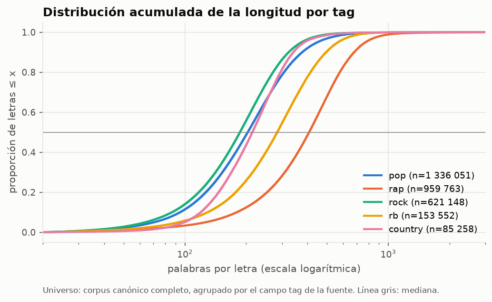

# 4. Corpus y preparación

## 4.1. Fuentes y unidades de análisis

El corpus textual procede de una copia local de `theelderemo/genius-lyrics-cleaned`, distribuido mediante Hugging Face [7]. La corrida `lyrics_full_v1` leyó diez archivos Parquet y **3 179 588 registros**. Sus campos son `title`, `artist`, `tag`, `year` y `lyrics`; no existe una columna de idioma ni un identificador único. Cada fila se localiza mediante el nombre del archivo y su posición global desde cero. Los nombres de archivo que empiezan por `train-` pertenecen a la distribución de origen y no identifican el conjunto de entrenamiento de SONORA [2, 4].

Una fila de origen, una letra y una grabación son unidades diferentes. Una letra canónica es un texto aceptado conservado una sola vez tras la deduplicación definida en §4.4. Puede corresponder a varias filas de origen y a varias grabaciones. La demo parte de FMA Medium, cuya documentación especifica 25 000 clips de 30 segundos [8]; esa fuente acústica no restringe la selección textual. La identidad de los Parquet locales queda registrada mediante hashes SHA-256, huellas del contenido de cada archivo. Sin embargo, no se registró la revisión remota de la descarga Genius: los hashes identifican el snapshot local y no resuelven esa omisión de procedencia [4, 9]. La tarjeta pública tampoco sustituye la revisión de condiciones aplicables a cada contenido.

## 4.2. Vistas textuales y limpieza

La preparación conserva tres vistas, versión `lyrics-views-v1` [2, 10]. La original retiene el texto leído. La estructural normaliza Unicode a NFC, homogeneiza saltos de línea, espacios y apóstrofos, y elimina artefactos de formato o extracción cuando coinciden con reglas explícitas, incluidos sufijos `Embed`, una línea de sugerencias y determinadas etiquetas HTML. NFC homogeneiza representaciones Unicode canónicamente equivalentes; no convierte automáticamente todas las grafías tipográficas o caracteres visualmente semejantes en una sola palabra.

La vista de análisis elimina anotaciones editoriales entre corchetes, como encabezados de sección, y utiliza los encabezados de línea como fronteras de estrofa. Conserva mayúsculas, puntuación, contracciones, negación y saltos de verso. No expande instrucciones como `[Chorus x2]` ni elimina los estribillos escritos varias veces. Esta decisión evita reconstruir contenido ausente, pero mantiene el peso de las repeticiones transcritas en las frecuencias posteriores. Por ello, frecuencia de uso y número de letras que contienen una palabra se distinguirán en el análisis estadístico.

Se excluyen textos vacíos, textos con menos de cinco palabras en la vista de análisis y ciertos marcadores de ausencia de letra de hasta treinta palabras. La longitud elevada y problemas como caracteres de reemplazo se registran como banderas, sin exclusión automática. Cada registro conserva estado y motivo; la eliminación del conjunto aceptado no equivale a borrar su trazabilidad [2, 4].

## 4.3. Identificación del idioma y resultados de selección

La identificación del idioma se aplica sobre extractos del inicio, centro y final de la vista de análisis, de hasta 800 caracteres por ventana. Así se reduce la dependencia de la introducción y de encabezados potencialmente ingleses. El detector primario es `lingua-language-detector` 2.2.0, en modo de alta precisión y con todos sus idiomas; `py3langid` 0.4.0 interviene cuando la decisión primaria no es concluyente [2, 10]. Son herramientas existentes, no modelos de idioma entrenados por SONORA.

La aceptación directa requiere inglés como primera opción, confianza de al menos 0,99 y veinte palabras o más. En los demás casos se requiere acuerdo de ambos detectores en inglés, con confianza secundaria de al menos 0,50. El acuerdo en otro idioma conduce a exclusión cuando el texto tiene al menos veinte palabras; los desacuerdos y otros casos no concluyentes quedan en revisión. Esas confianzas son puntajes de los detectores y no tasas de exactitud empíricas del corpus.

**Tabla 1. Flujo de selección de `lyrics_full_v1`. Las primeras cinco filas usan como universo los 3 179 588 registros de origen; la deduplicación opera sobre los 3 177 443 aceptados [4].**

| Etapa o motivo | Cantidad | Unidad |
|---|---:|---|
| Entrada leída | 3 179 588 | registros |
| Aceptados | 3 177 443 | registros |
| Idioma incierto, en revisión | 1 914 | registros |
| Excluidos por idioma no inglés | 155 | registros |
| Excluidos por marcador de ausencia / menos de cinco palabras | 75 / 1 | registros |
| Aceptados consolidados como duplicados exactos | 21 671 | registros |
| Corpus canónico resultante | 3 155 772 | letras |

Los estados aceptado, revisión y exclusión reconcilian la entrada. El conjunto canónico representa letras **aceptadas automáticamente como inglesas**, sin garantía de monolingüismo de cada pasaje. La anotación sintáctica posterior identificó un caso de idioma/contexto incierto dentro de una letra aceptada; no permite estimar su prevalencia [11]. La auditoría humana prevista contiene 200 aceptados, 200 inciertos y 100 no ingleses, con semilla 42, y permanece pendiente [4]. [PENDIENTE: revisar esa muestra y documentar errores del detector antes de informar una exactitud de idioma.]

## 4.4. Deduplicación, identidad y grupos relacionados

La clave de deduplicación se obtiene de la vista de análisis con `casefold` y espacios consecutivos colapsados; el hash SHA-256 de esa clave identifica el texto. `casefold` realiza una normalización de caja para comparar cadenas. El identificador `lyrics_id` conserva veinte dígitos hexadecimales del hash y el registro canónico es el primero en orden de archivo y fila. La correspondencia con todas las filas de origen se mantiene separada [2, 10]. Los **21 671 registros** consolidados no son necesariamente errores: el hash demuestra igualdad según la regla, pero no distingue por sí solo covers, reediciones y duplicación de extracción.

Antes de particionar se agrupan letras idénticas y letras con igual artista normalizado y título base, eliminando sufijos de versión documentados. Los componentes relacionados contienen **3 145 790 grupos**, con un máximo de **24 letras**. Agrupar antes del reparto reduce la presencia de versiones relacionadas en conjuntos distintos. La regla no detecta exhaustivamente casi duplicados ni covers con texto modificado y artista diferente, por lo que no demuestra ausencia total de contaminación entre particiones [5].

## 4.5. Particiones y separación entre descripción y ajuste

Se aplica SHA-256 a la cadena `42:<group_id>` y se transforma en un valor uniforme del intervalo [0,1). Los valores inferiores a 0,70 se asignan a entrenamiento; los comprendidos entre 0,70 y 0,90, a prueba; el resto, a validación. El grupo completo hereda una sola asignación. Como se distribuyen grupos de distinto tamaño, las fracciones documentales resultantes se aproximan al objetivo 70/20/10 [5].

**Tabla 2. Reparto producido por grupos. Porcentajes de letras calculados sobre 3 155 772 documentos, redondeados a dos decimales; grupos sobre 3 145 790 componentes [5].**

| Partición | Letras | % de letras | Grupos |
|---|---:|---:|---:|
| Entrenamiento (`train`) | 2 208 832 | 69,99 | 2 201 895 |
| Prueba (`test`) | 631 651 | 20,02 | 629 609 |
| Validación (`validation`) | 315 289 | 9,99 | 314 286 |

Los modelos aprenden vocabulario y parámetros con entrenamiento; validación selecciona configuraciones y prueba se reserva para evaluación final. En cambio, las distribuciones descriptivas del corpus pueden reunir las tres particiones, siempre que no se reutilicen para seleccionar modelos. E5 ya transformó todas las letras con un espacio fijado desde entrenamiento; disponer de vectores de prueba no significa haberlos utilizado para ajuste ni haber efectuado la evaluación final [3, 12]. El procedimiento de asignación mantiene los grupos juntos; [PENDIENTE: incorporar una comprobación independiente del no solapamiento desde el Parquet para la auditoría final del artículo.]

## 4.6. Tokenización, segmentación y primeras observaciones

Un token es una unidad obtenida por una regla de segmentación. Para estadística léxica, `regex-words-v1` aplica minúsculas y reconoce secuencias de letras Unicode con apóstrofos internos: `don't` constituye un token; dígitos y puntuación quedan fuera. Para categorías gramaticales, lemas y dependencias se utiliza spaCy 3.8.18 y el modelo preentrenado `en_core_web_sm` 3.8.0, que puede separar contracciones y contar puntuación. Sus totales responden a unidades diferentes y no se suman ni comparan como si fueran la misma medición [2, 13].

El léxico posterior registra **902 376 353 tokens y 1 277 145 tipos**, donde un tipo es una forma distinta. El reporte de preparación conserva **902 376 173 palabras** calculadas antes de la conversión a minúsculas. Ambos totales corresponden al mismo conjunto documental, pero sus procedimientos difieren. [PENDIENTE: reconciliar los 180 tokens de diferencia con casos identificados; no se presupone su causa.] En adelante, los análisis estadísticos que reutilicen el léxico deben indicar expresamente su total de 902 376 353 tokens [4, 13].

La segmentación sintáctica fuerza una frontera en cada salto de verso y permite divisiones adicionales del parser. Un parser predice relaciones gramaticales; una frontera forzada es una decisión de procesamiento, no una prueba de que el verso sea una oración completa. La comparación guardada en E1 utiliza una **muestra de las primeras 400 letras del shard 5**. Con segmentación predeterminada, 3 018 de 4 746 segmentos cruzaban al menos un salto; con fronteras forzadas se obtuvieron 16 955 segmentos y ninguno lo cruzaba. Esta comparación describe el efecto de la regla, sin medir exactitud sintáctica ni justificar que todo cruce sea erróneo. La regla puede fragmentar oraciones que continúan entre versos [13].

Para la morfosintaxis se aplica además una normalización de ciertas grafías con omisión de la `g` final, mediante un texto sombra que permite al modelo analizar una forma terminada en `-ing` y conserva la forma original. El criterio exige que la forma expandida aparezca al menos veinte veces en el léxico del corpus. Es un recurso descriptivo de anotación, no una mejora de precisión demostrada por una ablación. E5 utiliza formas superficiales y no depende de aceptar todos los lemas producidos por esa anotación [2, 3].

La mediana del corpus es **242 palabras, 37 versos y 6 estrofas por letra**, como medidas marginales. El campo `tag` contiene 1 336 051 letras `pop`, 959 763 `rap`, 621 148 `rock`, 153 552 `rb` y 85 258 `country`. Estas son etiquetas de fuente, no géneros musicalmente validados [4]. La figura 1 compara longitudes dentro de cada tag mediante una distribución acumulada: para cada longitud indica qué proporción de letras no la supera.

**Figura 1. Distribución acumulada de palabras por letra según el tag de origen, sobre las 3 155 772 letras canónicas de `lyrics_full_v1`.** Eje horizontal logarítmico: palabras por letra; eje vertical: proporción acumulada dentro de cada tag. La leyenda informa los tamaños y la línea horizontal marca 0,5. Fuente: E1, celda 28, figura guardada `reports/figures/E1/e1_longitud_por_tag.png`, copiada sin modificación. Las medianas tabuladas en E1, celda 25, son 204 (`pop`), 408 (`rap`), 187 (`rock`), 284 (`rb`) y 215 (`country`) palabras. La separación describe longitudes y no significancia estadística ni propiedades causales de los géneros [13].

La curva de `rap` se desplaza hacia longitudes mayores; su mediana duplica la de `pop` en las tablas guardadas. Esto implica que los conteos agregados de tokens ponderan de forma distinta a los grupos, incluso antes de analizar contenido. Por tanto, las secciones posteriores distinguirán porcentajes por token, tamaños documentales y comparaciones dentro de tag. El campo `year` presenta 1 673 valores anteriores a 1900 y 392 posteriores a 2022, que se señalan como dudosos; las comparaciones temporales delimitan el intervalo válido y no reconstruyen fechas desconocidas [13].

## 4.7. Vínculos de la demo y límites de preparación

El reporte confirma **886 grabaciones retenidas**, **850 localizadores Genius** y **849 letras canónicas**; dos filas Genius comparten un texto deduplicado. Se verificó igualdad de título y artista normalizados en los 886 localizadores y todos enlazan con letras aceptadas. Las grabaciones heredan la partición textual: 575 de entrenamiento, 210 de prueba y 101 de validación. Esos conteos se refieren a grabaciones, no al reparto global de letras [4].

En el mismo reporte, las 886 tienen archivo de audio local y ninguna es elegible aún para el catálogo combinado. Un archivo existente no acredita decodificación correcta, correspondencia auditiva, letra revisada o autorización de reproducción. Por eso estas coincidencias no se describen como 886 canciones multimodales validadas. La preparación del corpus textual sí está completa según sus reglas automáticas; la validación humana del idioma, el criterio docente de extensión de 150–300 páginas y la validación del catálogo musical permanecen pendientes [2, 4]. Estas limitaciones acompañan el análisis sin reducir su universo al subconjunto con audio.
