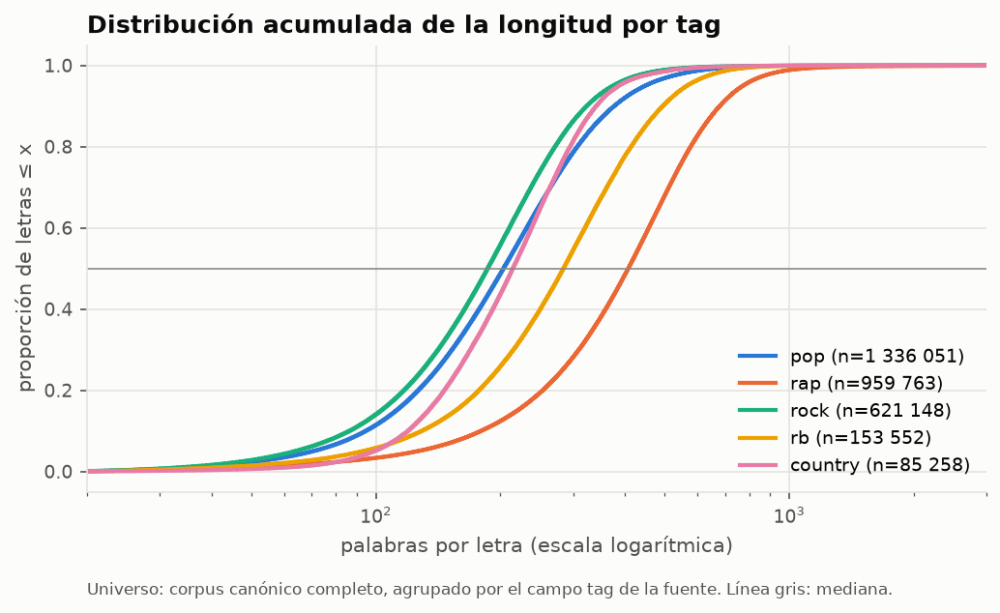

# Estructura lingüística y representaciones textuales para la recuperación de canciones en SONORA

**Título provisional. Borrador parcial — segunda entrega.** Introducción y Corpus revisados críticamente, con citas a notebooks y celdas. No acredita cierre de las cinco evidencias. Autoría y afiliación: [PENDIENTE: incorporar sólo datos confirmados]. [Índice](INDICE.md) · [Fact checks](00_FACT_CHECKS.md). Los índices de celda de las citas empiezan en cero; no son contadores de ejecución.

# 2. Introducción

Las letras de canciones ofrecen una vía para estudiar relaciones entre lenguaje y recuperación musical. Una búsqueda por título o artista localiza una entidad conocida, pero no describe las relaciones textuales que permiten explorar otras canciones. En SONORA, el problema de procesamiento de lenguaje natural (PLN), entendido como el análisis computacional del lenguaje, consiste en caracterizar un corpus de letras en inglés y examinar cómo distintas representaciones de ese contenido sustentan la recuperación de canciones. El resultado tangible previsto es un recomendador basado en contenido: una canción semilla se compara con otras mediante propiedades de sus letras y, en una etapa adicional, de su audio [1].

Este problema exige conectar la representación con las propiedades del material analizado. La frecuencia de una palabra depende tanto de su difusión entre canciones como de su repetición dentro de una letra. Los saltos de verso tampoco equivalen necesariamente a límites de oración. Asimismo, las contracciones y las grafías coloquiales afectan la tokenización, es decir, la división del texto en unidades analizables. El corpus y las anotaciones actuales permiten estudiar estos factores, aunque una anotación automática no constituye una interpretación lingüística validada. Por ello, la investigación integra construcción y exploración del corpus, estadística del lenguaje, análisis morfosintáctico, análisis sintáctico y representación semántica; cada nivel aporta información para interpretar los siguientes [1, 2]. La distinción entre difusión y repetición se examina en [14, E2, celdas 19, 20](../../notebooks/evidencias/E2_estadistica_modelos_lenguaje.ipynb); los errores ilustrativos de anotación y segmentación, en [15, E3, celda 9](../../notebooks/evidencias/E3_morfosintaxis.ipynb) y [16, E4, celda 7](../../notebooks/evidencias/E4_sintaxis_dependencias.ipynb).

Se conserva la pregunta principal ya adoptada por el proyecto: **¿qué diferencias aparecen en la recuperación de canciones relevantes al representar letras en inglés con TF-IDF, embeddings propios y distribuciones temáticas, y cómo se relacionan esas diferencias con la estructura lingüística del corpus?** [1]. TF-IDF pondera términos según su frecuencia en una letra y su presencia en los documentos de entrenamiento. Los embeddings son vectores aprendidos a partir de contextos de palabras; la implementación actual utiliza Word2Vec con muestreo negativo, SGNS. Las distribuciones temáticas se obtienen mediante LDA, un modelo probabilístico que representa cada documento como mezcla de tópicos y cada tópico como distribución de palabras. Estos métodos cumplen funciones distintas: compartir palabras, aproximar relaciones de contexto y describir temas no son operaciones equivalentes [3]. Su comparación debe distinguir cambios de vecinos recuperados de mejoras de relevancia juzgadas por personas.

El objetivo general es estudiar la relación entre estructura lingüística y recuperación basada en letras con evidencia reproducible. Para ello se documentan las decisiones de selección, limpieza y partición; se caracterizan vocabulario, frecuencias y secuencias de palabras; se examinan categorías gramaticales, lemas y dependencias; y se analizan las representaciones semánticas y sus resultados de recuperación. La evaluación integrada deberá contrastar los métodos con un protocolo de relevancia independiente de los puntajes internos. Las hipótesis de mayor recuperación semántica mediante embeddings o de valor adicional de los tópicos permanecen abiertas; una similitud alta no representa un porcentaje de gusto ni demuestra superioridad [1, 3].

El universo textual comprende **3 155 772 letras canónicas** aceptadas automáticamente como inglesas en la corrida `lyrics_full_v1`, obtenidas de diez Parquet de Genius; no se restringe a las canciones con audio [2, 4]; [13, E1, celdas 6, 14, 22](../../notebooks/evidencias/E1_construccion_exploracion.ipynb). Los análisis descriptivos pueden utilizar el corpus completo. El ajuste de vocabularios y modelos se separa de esa descripción: entrenamiento utiliza `train`, selección utiliza `validation` y la evaluación final se reserva para `test`. Una transformación de todas las particiones con parámetros ya fijados no equivale a ajustar con todas ellas [3, 5]; [17, E5, celdas 1, 3](../../notebooks/evidencias/E5_semantica.ipynb). Esta separación de ajuste se refiere a los modelos KenLM y E5; la anotación descriptiva con spaCy preentrenado utiliza un criterio de normalización gráfica derivado del léxico completo, como se precisa en §4.6.

Para la demo musical se adoptó FMA Medium. El reporte conservado de `lyrics_full_v1` registra **886 grabaciones** retenidas por coincidencia exacta de título y artista normalizados, vinculadas a **850 localizadores Genius** y **849 letras canónicas** [2, 4]. Son resultados de aquella ejecución: la auditoría actual no encontró la tabla `demo_links.parquet`, la selección original ni la carpeta de audio en las rutas documentadas de este equipo [18]. Esa correspondencia de metadatos no valida por sí sola el contenido de la letra ni la relación auditiva con cada grabación. El recuperador textual actual ordena vectores de letras por similitud coseno ([17, E5, celda 9](../../notebooks/evidencias/E5_semantica.ipynb)); la extracción acústica, la fusión de señales y la integración funcional deben documentarse según sus ejecuciones reales [6]. La combinación futura de letras y audio seguirá siendo recomendación basada en contenido mientras no utilice interacciones reales de usuarios. El objetivo central de este artículo es el estudio de PLN, con la recomendación como aplicación y la modalidad acústica como extensión condicionada a evidencia disponible.

Esta primera versión presenta la introducción y la preparación del corpus. [PENDIENTE: completar la comparación de relevancia entre representaciones y la evaluación final antes de responder definitivamente la pregunta de investigación.] Los resultados técnicos existentes permiten continuar la redacción de los análisis, pero no justifican anticipar una respuesta favorable a las hipótesis.

# 4. Corpus y preparación

## 4.1. Fuentes y unidades de análisis

El corpus textual procesado procede del snapshot de `theelderemo/genius-lyrics-cleaned`, distribuido mediante Hugging Face [7]. El manifiesto y las salidas guardadas documentan que la corrida `lyrics_full_v1` leyó diez archivos Parquet y **3 179 588 registros** ([13, E1, celdas 3, 6](../../notebooks/evidencias/E1_construccion_exploracion.ipynb)). En este equipo se conserva el corpus procesado; `data/raw/genius/` sólo contiene `.gitkeep`, por lo que no se revalidó la entrada original desde sus Parquet. La suma de registros aceptados representados en el corpus y filas de exclusión reproduce el total declarado [18]. El esquema de entrada documentado contiene `title`, `artist`, `tag`, `year` y `lyrics`; no existe una columna de idioma ni un identificador único, según el esquema de origen guardado en [13, E1, celdas 2, 3](../../notebooks/evidencias/E1_construccion_exploracion.ipynb). Cada fila se localiza mediante el nombre del archivo y su posición global desde cero. Los nombres de archivo que empiezan por `train-` pertenecen a la distribución de origen y no identifican el conjunto de entrenamiento de SONORA [2, 4].

Una fila de origen, una letra y una grabación son unidades diferentes. Una letra canónica es un texto aceptado conservado una sola vez tras la deduplicación definida en §4.4. Puede corresponder a varias filas de origen y a varias grabaciones. La demo parte de FMA Medium, cuya documentación especifica 25 000 clips de 30 segundos [8]; esa fuente acústica no restringe la selección textual. La identidad de los Parquet de aquella ejecución quedó registrada mediante hashes SHA-256, huellas del contenido de cada archivo. Sin embargo, no se registró la revisión remota de la descarga Genius: los hashes identifican el snapshot local y no resuelven esa omisión de procedencia [4, 9]. La tarjeta pública tampoco sustituye la revisión de condiciones aplicables a cada contenido.

## 4.2. Vistas textuales y limpieza

La preparación conserva tres vistas, versión `lyrics-views-v1` [2, 10]. La original retiene el texto leído. La estructural normaliza Unicode a NFC, homogeneiza saltos de línea, espacios y apóstrofos, y elimina artefactos de formato o extracción cuando coinciden con reglas explícitas, incluidos sufijos `Embed`, una línea de sugerencias y determinadas etiquetas HTML. NFC homogeneiza representaciones Unicode canónicamente equivalentes; no convierte automáticamente todas las grafías tipográficas o caracteres visualmente semejantes en una sola palabra.

La vista de análisis elimina anotaciones editoriales entre corchetes, como encabezados de sección, y utiliza los encabezados de línea como fronteras de estrofa. Conserva mayúsculas, puntuación, contracciones, negación y saltos de verso. No expande instrucciones como `[Chorus x2]` ni elimina los estribillos escritos varias veces. Esta decisión evita reconstruir contenido ausente, pero mantiene el peso de las repeticiones transcritas en las frecuencias posteriores ([13, E1, celda 9](../../notebooks/evidencias/E1_construccion_exploracion.ipynb); [14, E2, celda 19](../../notebooks/evidencias/E2_estadistica_modelos_lenguaje.ipynb)). Por ello, frecuencia de uso y número de letras que contienen una palabra se distinguirán en el análisis estadístico.

Se excluyen textos vacíos, textos con menos de cinco palabras en la vista de análisis y ciertos marcadores de ausencia de letra de hasta treinta palabras. La longitud elevada y problemas como caracteres de reemplazo se registran como banderas, sin exclusión automática ([13, E1, celdas 5, 6, 7, 8](../../notebooks/evidencias/E1_construccion_exploracion.ipynb)). Cada registro conserva estado y motivo; la eliminación del conjunto aceptado no equivale a borrar su trazabilidad [2, 4].

## 4.3. Identificación del idioma y resultados de selección

La identificación del idioma se aplica sobre extractos del inicio, centro y final de la vista de análisis, de hasta 800 caracteres por ventana. Así se reduce la dependencia de la introducción y de encabezados potencialmente ingleses. El detector primario es `lingua-language-detector` 2.2.0, en modo de alta precisión y con todos sus idiomas; `py3langid` 0.4.0 interviene cuando la decisión primaria no es concluyente [2, 10]. Son herramientas existentes, no modelos de idioma entrenados por SONORA ([13, E1, celdas 10, 11](../../notebooks/evidencias/E1_construccion_exploracion.ipynb)).

La aceptación directa requiere inglés como primera opción, confianza de al menos 0,99 y veinte palabras o más. En los demás casos se requiere acuerdo de ambos detectores en inglés, con confianza secundaria de al menos 0,50. El acuerdo en otro idioma conduce a exclusión cuando el texto tiene al menos veinte palabras; los desacuerdos y otros casos no concluyentes quedan en revisión. Esas confianzas son puntajes de los detectores y no tasas de exactitud empíricas del corpus.

**Tabla 1. Flujo de selección de `lyrics_full_v1`. Las primeras cinco filas usan como universo los 3 179 588 registros de origen; la deduplicación opera sobre los 3 177 443 aceptados [4].** Fuente: [13, E1, celdas 6, 14](../../notebooks/evidencias/E1_construccion_exploracion.ipynb); revalidación de metadatos procesados y exclusiones [18].

| Etapa o motivo | Cantidad | Unidad |
|---|---:|---|
| Entrada leída | 3 179 588 | registros |
| Aceptados | 3 177 443 | registros |
| Idioma incierto, en revisión | 1 914 | registros |
| Excluidos por idioma no inglés | 155 | registros |
| Excluidos por marcador de ausencia / menos de cinco palabras | 75 / 1 | registros |
| Aceptados consolidados como duplicados exactos | 21 671 | registros |
| Corpus canónico resultante | 3 155 772 | letras |

Los estados aceptado, revisión y exclusión reconcilian la entrada. El conjunto canónico representa letras **aceptadas automáticamente como inglesas**, sin garantía de monolingüismo de cada pasaje. La anotación sintáctica posterior identificó un caso de idioma/contexto incierto dentro de una letra aceptada; no permite estimar su prevalencia [11]; [16, E4, celdas 7, 10](../../notebooks/evidencias/E4_sintaxis_dependencias.ipynb). La auditoría humana prevista contiene 200 aceptados, 200 inciertos y 100 no ingleses, con semilla 42, y permanece pendiente [4]. [PENDIENTE: revisar esa muestra y documentar errores del detector antes de informar una exactitud de idioma.]

## 4.4. Deduplicación, identidad y grupos relacionados

La clave de deduplicación se obtiene de la vista de análisis con `casefold` y espacios consecutivos colapsados; el hash SHA-256 de esa clave identifica el texto. `casefold` realiza una normalización de caja para comparar cadenas. El identificador `lyrics_id` conserva veinte dígitos hexadecimales del hash y el registro canónico es el primero en orden de archivo y fila. La correspondencia con todas las filas de origen se mantiene separada [2, 10]; [13, E1, celdas 13, 14](../../notebooks/evidencias/E1_construccion_exploracion.ipynb). Los agregados por letra utilizan `tag`, `year`, título y artista del registro canónico seleccionado; conservar las correspondencias de origen no implica incorporar todas sus etiquetas en cada agregado. Los **21 671 registros** consolidados no son necesariamente errores: el hash demuestra igualdad según la regla, pero no distingue por sí solo covers, reediciones y duplicación de extracción.

Antes de particionar se agrupan letras idénticas y letras con igual artista normalizado y título base, eliminando sufijos de versión documentados. Los componentes relacionados contienen **3 145 790 grupos**, con un máximo de **24 letras**, revalidados desde las particiones [18]. La agrupación utiliza los metadatos de todas las filas aceptadas, no únicamente los del primer registro canónico. Las conexiones son transitivas: un componente no tiene necesariamente un único artista o título. Agrupar antes del reparto reduce la presencia de versiones relacionadas en conjuntos distintos [10, código `lyrics_corpus.py`, función `_group_roots`]. La regla no detecta exhaustivamente casi duplicados ni covers con texto modificado y artista diferente, por lo que no demuestra ausencia total de contaminación entre particiones [5].

## 4.5. Particiones y separación entre descripción y ajuste

Se aplica SHA-256 a la cadena `42:<group_id>` y se transforma en un valor normalizado del intervalo [0,1). Los valores inferiores a 0,70 se asignan a entrenamiento; los comprendidos entre 0,70 y 0,90, a prueba; el resto, a validación. El grupo completo hereda una sola asignación. Como se distribuyen grupos de distinto tamaño, las fracciones documentales resultantes se aproximan al objetivo 70/20/10 [5].

**Tabla 2. Reparto producido por grupos. Porcentajes de letras calculados sobre 3 155 772 documentos, redondeados a dos decimales; grupos sobre 3 145 790 componentes [5].** Revalidación directa de letras y grupos por partición [18]; [13, E1, celda 25](../../notebooks/evidencias/E1_construccion_exploracion.ipynb) presenta los conteos documentales por split.

| Partición | Letras | % de letras | Grupos |
|---|---:|---:|---:|
| Entrenamiento (`train`) | 2 208 832 | 69,99 | 2 201 895 |
| Prueba (`test`) | 631 651 | 20,02 | 629 609 |
| Validación (`validation`) | 315 289 | 9,99 | 314 286 |

Los modelos KenLM de E2 y TF-IDF, SGNS y LDA de E5 aprenden vocabularios o parámetros con entrenamiento; validación selecciona configuraciones y prueba se reserva para evaluación final ([14, E2, celdas 24, 25](../../notebooks/evidencias/E2_estadistica_modelos_lenguaje.ipynb); [17, E5, celdas 1, 3, 11](../../notebooks/evidencias/E5_semantica.ipynb)). Esta separación no implica que todo preprocesamiento se haya fijado exclusivamente en entrenamiento: spaCy es preentrenado y el criterio descriptivo de g-dropping consulta el léxico completo. En cambio, las distribuciones descriptivas del corpus pueden reunir las tres particiones, siempre que no se reutilicen para seleccionar modelos. E5 ya transformó todas las letras con un espacio fijado desde entrenamiento; disponer de vectores de prueba no significa haberlos utilizado para ajuste ni haber efectuado la evaluación final [3, 12]. El procedimiento de asignación mantiene los grupos juntos. La revalidación directa del Parquet encontró **3 155 772 `lyrics_id` únicos** y **cero grupos registrados presentes en más de una partición**; su SHA-256 coincide con el manifiesto. También se comprobó que cada ID del corpus aparece una vez en la tabla de particiones. Esto verifica la separación de los IDs y grupos registrados, sin demostrar ausencia de casi duplicados no detectados [18].

## 4.6. Tokenización, segmentación y primeras observaciones

Un token es una unidad obtenida por una regla de segmentación. Para estadística léxica, `regex-words-v1` aplica minúsculas y reconoce secuencias de letras Unicode con apóstrofos internos: `don't` constituye un token; dígitos y puntuación quedan fuera. Para categorías gramaticales, lemas y dependencias se utiliza spaCy 3.8.18 y el modelo preentrenado `en_core_web_sm` 3.8.0, que puede separar contracciones y contar puntuación. Sus totales responden a unidades diferentes y no se suman ni comparan como si fueran la misma medición [2, 13]; [13, E1, celdas 15, 16](../../notebooks/evidencias/E1_construccion_exploracion.ipynb) y [15, E3, celdas 1, 3](../../notebooks/evidencias/E3_morfosintaxis.ipynb).

El léxico posterior registra **902 376 353 tokens y 1 277 145 tipos**, donde un tipo es una forma distinta. El reporte de preparación conserva **902 376 173 palabras** calculadas antes de la conversión a minúsculas. La revalidación comparó por ID los conteos de los diez shards de metadatos: **56 letras** presentan diferencias, que suman exactamente **180 tokens**. Sólo se releyó el texto de esas letras. En ellas, convertir `İ` (U+0130) a minúsculas produce `i` seguida de la marca combinante U+0307; la expresión regular trata esa marca como separador y puede dividir una secuencia de letras. Ambos conteos guardados se reprodujeron exactamente. Como control, sustituir `İ` por `I` antes de convertir a minúsculas recuperó, en cada uno de los 56 casos, el conteo previo. Este control explica la diferencia de conteos en esta versión; no es una corrección aplicada al corpus, no demuestra igualdad de las secuencias de tokens ni determina el idioma de las letras [18]. En adelante, los análisis estadísticos que reutilicen el léxico deben indicar expresamente su total de 902 376 353 tokens [4, 13]; [13, E1, celda 22](../../notebooks/evidencias/E1_construccion_exploracion.ipynb) y [14, E2, celda 3](../../notebooks/evidencias/E2_estadistica_modelos_lenguaje.ipynb).

La segmentación sintáctica fuerza una frontera en cada salto de verso y permite divisiones adicionales del parser. Un parser predice relaciones gramaticales; una frontera forzada es una decisión de procesamiento, no una prueba de que el verso sea una oración completa. La comparación guardada en E1 utiliza una **muestra de las primeras 400 letras del shard 5**. Con segmentación predeterminada, 3 018 de 4 746 segmentos cruzaban al menos un salto; con fronteras forzadas se obtuvieron 16 955 segmentos y ninguno lo cruzaba. Esta comparación describe el efecto de la regla, sin medir exactitud sintáctica ni justificar que todo cruce sea erróneo ([13, E1, celda 19](../../notebooks/evidencias/E1_construccion_exploracion.ipynb), código y tabla guardada; no se repitió la anotación de esa muestra). La regla puede fragmentar oraciones que continúan entre versos [13].

Para la morfosintaxis se aplica además una normalización de ciertas grafías con omisión de la `g` final, mediante un texto sombra que permite al modelo analizar una forma terminada en `-ing` y conserva la forma original. El criterio exige que la forma expandida aparezca al menos veinte veces en el léxico del corpus. Es un recurso descriptivo de anotación, no una mejora de precisión demostrada por una ablación. El umbral de veinte apariciones se calcula en el léxico completo; por tanto, esta anotación descriptiva depende también de datos ajenos a `train`. E5 utiliza formas superficiales, conserva stopwords y negación, y no utiliza lemas, etiquetas POS ni la expansión inferida de g-dropping [2, 3; código `semantics.py`, función `words`]. Esto evita atribuir a E5 aquella dependencia de la anotación; tampoco demuestra una evaluación de relevancia ([13, E1, celdas 15, 17](../../notebooks/evidencias/E1_construccion_exploracion.ipynb); [15, E3, celda 9](../../notebooks/evidencias/E3_morfosintaxis.ipynb); [17, E5, celdas 3, 9](../../notebooks/evidencias/E5_semantica.ipynb)).

La mediana del corpus es **242 palabras, 37 versos y 6 estrofas por letra**, como medidas marginales ([13, E1, celdas 20, 23](../../notebooks/evidencias/E1_construccion_exploracion.ipynb)). El campo `tag` contiene 1 336 051 letras `pop`, 959 763 `rap`, 621 148 `rock`, 153 552 `rb` y 85 258 `country`. Estas son etiquetas de fuente, no géneros musicalmente validados [4]. La figura 1 compara longitudes dentro de cada tag mediante una distribución acumulada: para cada longitud indica qué proporción de letras no la supera.

**Figura 1. Distribución acumulada de palabras por letra según el tag de origen, sobre las 3 155 772 letras canónicas de `lyrics_full_v1`.** Eje horizontal logarítmico: palabras por letra; eje vertical: proporción acumulada dentro de cada tag. La leyenda informa los tamaños y la línea horizontal marca 0,5. Fuente: [13, E1, celda 28](../../notebooks/evidencias/E1_construccion_exploracion.ipynb) (celda 29 contando desde uno; ID `6e450d0a`; ejecución guardada `In[19]`). Se copió sin modificación el PNG externo `reports/figures/E1/e1_longitud_por_tag.png` generado por esa celda; no se extrajo ni regeneró una imagen del output. El hash de copia y original se conserva en el inventario y en la verificación de esta entrega. Las medianas tabuladas en [13, E1, celda 25](../../notebooks/evidencias/E1_construccion_exploracion.ipynb) y revalidadas desde `doc_stats` [18] son 204 (`pop`), 408 (`rap`), 187 (`rock`), 284 (`rb`) y 215 (`country`) palabras. La separación describe longitudes y no significancia estadística ni propiedades causales de los géneros [13].

La curva de `rap` se desplaza hacia longitudes mayores; su mediana duplica la de `pop` en las tablas guardadas. Esto implica que los conteos agregados de tokens ponderan de forma distinta a los grupos, incluso antes de analizar contenido. Por tanto, las secciones posteriores distinguirán porcentajes por token, tamaños documentales y comparaciones dentro de tag. El campo `year` presenta 1 673 valores anteriores a 1900 y 392 posteriores a 2022, que se señalan como dudosos; las comparaciones temporales delimitan el intervalo válido y no reconstruyen fechas desconocidas ([13, E1, celda 24](../../notebooks/evidencias/E1_construccion_exploracion.ipynb)). Los tamaños, las medianas y los conteos de años dudosos se revalidaron directamente desde las columnas procesadas [18].

## 4.7. Vínculos de la demo y límites de preparación

El reporte conservado registra **886 grabaciones retenidas**, **850 localizadores Genius distintos** y **849 letras canónicas**; documenta dos filas Genius con un texto deduplicado. Su campo `demo.locator_check.title_artist_normalized_equal` registra **886 comprobaciones de vínculos**, no 886 localizadores distintos; `demo.lyrics_status.accepted` registra 886 grabaciones enlazadas con letras aceptadas. La igualdad de metadatos y la aceptación lingüística son comprobaciones diferentes: la bandera `has_lyrics` por sí sola no demuestra ambas [4, 10]. Las grabaciones heredan la partición textual: 575 de entrenamiento, 210 de prueba y 101 de validación. Esos conteos se refieren a grabaciones, no al reparto global de letras [4].

El mismo reporte registra históricamente 886 archivos de audio presentes y cero grabaciones elegibles para el catálogo combinado. La auditoría de este equipo no encontró `data/processed/demo/lyrics_full_v1/demo_links.parquet`, `medium_prioritarios.json` ni `data/raw/fma/fma_medium/` en sus rutas documentadas. Por tanto, aquellos conteos no acreditan presencia actual de audio ni permiten rehacer aquí la comprobación de vínculos [18]. [PENDIENTE: localizar o restaurar la tabla de vínculos y el audio antes de verificar el catálogo actual; no se realizó esa restauración para redactar.] Un archivo existente no acredita decodificación correcta, correspondencia auditiva, letra revisada o autorización de reproducción. Por eso estas coincidencias no se describen como 886 canciones multimodales validadas. La preparación del corpus textual sí está completa según sus reglas automáticas; la validación humana del idioma, el criterio docente de extensión de 150–300 páginas y la validación del catálogo musical permanecen pendientes [2, 4]. Estas limitaciones acompañan el análisis sin reducir su universo al subconjunto con audio.

# 13. Referencias verificadas de esta entrega

Sistema único de citas numéricas [n], conservado en las secciones y en el integrado. Enlaces como [13, E1, celda 22] añaden evidencia y localizador al número bibliográfico. Toda celda se numera desde cero; el ordinal desde uno, ID y contador de ejecución se distinguen en el mapa de citas. Las entradas internas son evidencia de implementación, no publicaciones revisadas por pares. Fecha de consulta externa: 16 de noviembre de 2026, hora local. No se atribuye autoría institucional al artículo.

[1] SONORA. *Especificación de requisitos académicos, funcionales y técnicos*, v1.2, 12 de noviembre de 2026. Documento interno: [docs/REQUIREMENTS.md](../../docs/REQUIREMENTS.md), §§2–5, 13 y 15.

[2] SONORA. *Corpus completo de letras en inglés y vínculos de la demo*. Documento técnico interno: [docs/CORPUS_LETRAS.md](../../docs/CORPUS_LETRAS.md), §§1–7, 11–13.

[3] SONORA. *E5 — protocolo de representaciones semánticas*, 16 de noviembre de 2026. Protocolo interno: [docs/E5_METODO.md](../../docs/E5_METODO.md). Describe TF-IDF, SGNS y LDA de la implementación; las publicaciones metodológicas originales se incorporarán verificadas en la sección 03.

[4] SONORA. *Quality report: lyrics_full_v1*, generado el 14 de noviembre de 2026 UTC. Artefacto de resultados: [quality_report.json](../corpus/lyrics_full_v1/quality_report.json). Localizadores por clave en 00_REGISTRO_RESULTADOS.md.

[5] SONORA. *Manifiesto de particiones lyrics_full_v1*. Artefacto reproducible: [manifests/splits/lyrics_full_v1.json](../../manifests/splits/lyrics_full_v1.json), seed, group_rules, by_split y actual_fraction_lyrics.

[6] SONORA. *Recuperación textual ítem a ítem*. Código interno: [lyrics.py](../../packages/sonora/src/sonora/recommendation/lyrics.py), función recommend_lyrics; [main.py](../../apps/api/src/sonora_api/main.py), estado de API; [ranking.yaml](../../config/ranking.yaml), hipótesis de combinación. El código se cita como implementación, no como prueba empírica de calidad.

[7] theelderemo. *genius-lyrics-cleaned*. Dataset en Hugging Face, sin fecha de publicación comprobada. [Tarjeta oficial](https://huggingface.co/datasets/theelderemo/genius-lyrics-cleaned). Verificados identificador y esquema público. Revisión de la copia local no registrada. No se asume que una licencia declarada por el depositante resuelva derechos sobre cada letra. DOI visible en tarjeta no se incorpora como identificador verificado del snapshot local.

[8] Responsables del repositorio mdeff/fma. *FMA: A Dataset For Music Analysis*. [Repositorio oficial de datos y documentación](https://github.com/mdeff/fma). Documentación de variantes y clips; no se atribuye un año bibliográfico al repositorio consultado. La publicación metodológica FMA y sus autores se verificarán antes de añadirla a antecedentes.

[9] SONORA. *Manifiestos de la entrada Genius y de la corrida completa*. [genius_snapshot.json](../../manifests/sources/genius_snapshot.json) y [lyrics_full_v1.json](../../manifests/runs/lyrics_full_v1.json). Hashes y procedencia de la copia local.

[10] SONORA. *Configuración y preparación lingüística*. [lyrics_corpus.yaml](../../config/lyrics_corpus.yaml); [lyrics_text.py](../../packages/sonora/src/sonora/preprocessing/lyrics_text.py), build_views/dedup_key/language_excerpt; [lyrics_corpus.py](../../packages/sonora/src/sonora/ingestion/lyrics_corpus.py), _group_roots y consolidación; [language.py](../../packages/sonora/src/sonora/nlp/language.py), needs_secondary/decide. Fuentes de software local.

[11] SONORA. *Revisión lingüística y cierre de E4*, 16 de noviembre de 2026. [E4_REVISION.md](../../docs/E4_REVISION.md), ejemplo lyr_9b869033ae33f65fdae4, sent_i=56, line_i=61; revisión del autor pendiente.

[12] SONORA. *Exportación del espacio E5 e5-surface-v2*. [complete.json](../../data/processed/nlp/lyrics_full_v1/semantics/e5-surface-v2/representations/complete.json), counts y space_id; [trained.json](../../artifacts/models/lyrics_full_v1/e5-surface-v2/trained.json), modelos seleccionados y test_consumed. Artefactos locales, fuera de Git; disponibilidad no garantizada en otra copia.

[13] SONORA. *Evidencia 1 — Construcción y exploración del corpus de letras*. [Notebook ejecutado](../../notebooks/evidencias/E1_construccion_exploracion.ipynb), celdas base cero 15, 19–25 y 28. [Manifiesto NLP](../../manifests/nlp/lyrics_full_v1.json), lexicon y annotations; [lexicon.py](../../packages/sonora/src/sonora/nlp/lexicon.py), count_file. Las salidas son evidencia guardada con las reservas registradas en los controles.

Pendientes bibliográficos: publicaciones primarias de TF-IDF/recuperación, SGNS, LDA, spaCy, KenLM, Zipf y antecedentes específicos de recuperación musical. No se incluyen referencias no comprobadas ni citas secundarias como si se hubieran leído los originales.

[14] SONORA. *Evidencia 2 — Estadística del corpus y modelo de lenguaje de n-gramas*. [Notebook E2](../../notebooks/evidencias/E2_estadistica_modelos_lenguaje.ipynb). Celdas e IDs exactos de esta versión en [00_CITAS_NOTEBOOKS.md](00_CITAS_NOTEBOOKS.md); SHA-256 en revalidacion_independiente.json. Fuente de evidencia guardada, no publicación metodológica.

[15] SONORA. *Evidencia 3 — Morfosintaxis*. [Notebook E3](../../notebooks/evidencias/E3_morfosintaxis.ipynb). Celdas e IDs exactos de esta versión en [00_CITAS_NOTEBOOKS.md](00_CITAS_NOTEBOOKS.md); SHA-256 en revalidacion_independiente.json. Fuente de evidencia guardada, no publicación metodológica.

[16] SONORA. *Evidencia 4 — Sintaxis y dependencias*. [Notebook E4](../../notebooks/evidencias/E4_sintaxis_dependencias.ipynb). Celdas e IDs exactos de esta versión en [00_CITAS_NOTEBOOKS.md](00_CITAS_NOTEBOOKS.md); SHA-256 en revalidacion_independiente.json. Fuente de evidencia guardada, no publicación metodológica.

[17] SONORA. *Evidencia 5 — Semántica*. [Notebook E5](../../notebooks/evidencias/E5_semantica.ipynb). Celdas e IDs exactos de esta versión en [00_CITAS_NOTEBOOKS.md](00_CITAS_NOTEBOOKS.md); SHA-256 en revalidacion_independiente.json. Fuente de evidencia guardada, no publicación metodológica.

[18] SONORA, auditoría para el artículo. *Revalidación independiente de conteos, particiones y casos Unicode*, 16 de noviembre de 2026, hora local. [Procedimiento](revalidar_hallazgos.py) y [resultados](revalidacion_independiente.json). Lectura de metadatos de los diez shards; texto sólo en 56 letras discrepantes. Sin ejecución de pipelines ni cambios al corpus.
