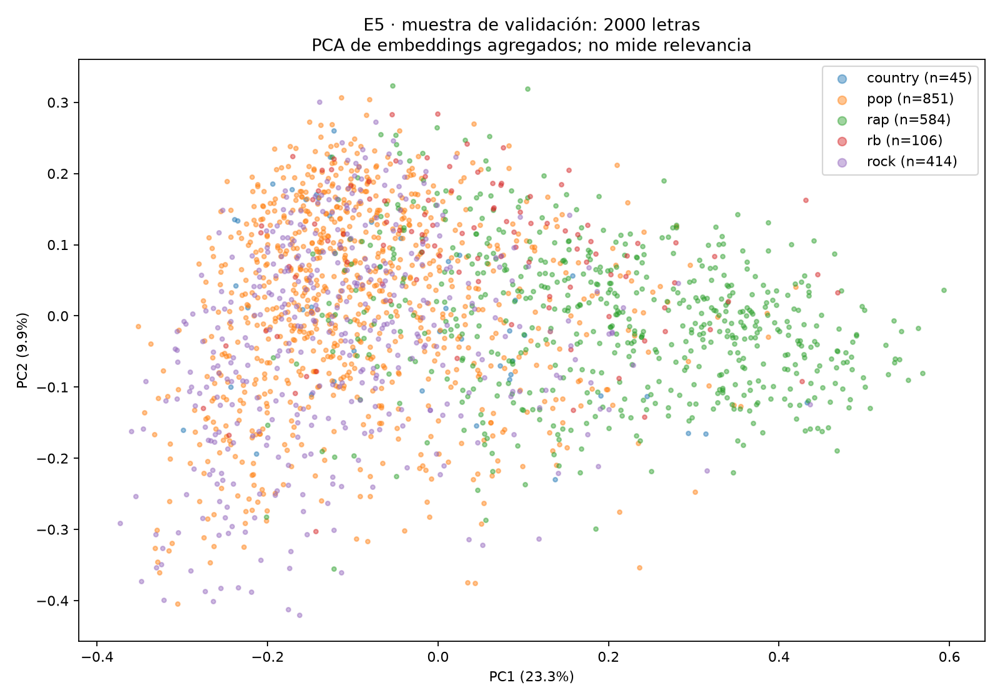

# Lectura documental de notebooks

Copia de consulta de Markdown, código y outputs textuales; índices base cero. Las imágenes permanecen en sus fuentes. No se ejecutó ninguna celda.

# notebooks/evidencias/E1_construccion_exploracion.ipynb

## Celda 0 (markdown; ejecución None)

# Evidencia 1 — Construcción y exploración del corpus de letras

**Proyecto:** SONORA · **Materia:** Procesamiento de Lenguaje Natural · **Requisitos:** E1-01 … E1-05 (`docs/REQUIREMENTS.md` v1.2)

**Universo de este notebook:** el corpus **completo** preparado en la ejecución `lyrics_full_v1`
(10 Parquet de Genius, 3 179 588 registros de origen → 3 155 772 letras canónicas en inglés).
Todas las tablas y figuras se calculan sobre ese universo salvo que una celda declare
explícitamente una **muestra** (sólo para ejemplos legibles o auditorías).

El procesamiento pesado no se repite aquí: se ejecutó con los pipelines versionados y este notebook
lee sus salidas.

| Etapa | Comando | Documentación |
|---|---|---|
| Ingesta, limpieza, idioma, duplicados, split | `pipelines/ingestion/prepare_lyrics_corpus.py all --run-id lyrics_full_v1` | `docs/CORPUS_LETRAS.md` |
| Léxico y anotación spaCy | `pipelines/nlp/annotate_corpus.py lexicon` / `annotate` | `config/nlp_annotation.yaml` |
| Estadísticas por letra | `pipelines/nlp/corpus_stats.py` | `packages/sonora/src/sonora/nlp/doc_stats.py` |

## Celda 1 (code; ejecución 1)

import json, sys, textwrap
from pathlib import Path
import numpy as np
import pyarrow as pa, pyarrow.compute as pc, pyarrow.dataset as ds, pyarrow.parquet as pq
import matplotlib.pyplot as plt

ROOT = Path.cwd()
sys.path.insert(0, str(ROOT / "packages" / "sonora" / "src"))
from sonora import viz
from sonora.preprocessing.lyrics_text import build_views
viz.apply_style()

RUN = "lyrics_full_v1"
P = {
    "manifest": ROOT / "manifests/runs" / f"{RUN}.json",
    "report": ROOT / "reports/corpus" / RUN / "quality_report.json",
    "sources": ROOT / "manifests/sources/genius_snapshot.json",
    "records": ROOT / "data/interim/lyrics" / RUN / "records",
    "corpus": ROOT / "data/processed/lyrics" / RUN / "corpus",
    "mapping": ROOT / "data/processed/lyrics" / RUN / "source_to_lyrics.parquet",
    "exclusions": ROOT / "data/processed/lyrics" / RUN / "exclusions.parquet",
    "splits": ROOT / "data/processed/splits" / RUN / "lyrics_splits.parquet",
    "lexicon": ROOT / "data/processed/nlp" / RUN / "lexicon/lexicon.parquet",
    "gdrop": ROOT / "data/processed/nlp" / RUN / "lexicon/gdrop_forms.parquet",
    "doc_stats": ROOT / "data/processed/nlp" / RUN / "doc_stats",
    "annotation": ROOT / "data/processed/nlp" / RUN / "spacy_sm_v1",
}
FIG = ROOT / "reports/figures/E1"
manifest = json.loads(P["manifest"].read_text(encoding="utf-8"))
report = json.loads(P["report"].read_text(encoding="utf-8"))
print("Ejecución:", manifest["run_id"], "| corpus completo:", manifest["complete_full_corpus_run"],
      "| reconciliado:", report["reconciled"])

def fmt(n):
    return f"{n:,}".replace(",", " ")

def show(rows, cols=None):
    from IPython.display import Markdown, display
    cols = cols or list(rows[0].keys())
    lines = ["| " + " | ".join(cols) + " |", "|" + "---|" * len(cols)]
    for r in rows:
        lines.append("| " + " | ".join(fmt(r[c]) if isinstance(r[c], (int, np.integer)) else str(r[c]) for c in cols) + " |")
    display(Markdown("\n".join(lines)))

Salida textual:
Ejecución: lyrics_full_v1 | corpus completo: True | reconciliado: True


## Celda 2 (markdown; ejecución None)

## 1. Fuente, procedencia y esquema (E1-01)

Fuente: dataset de Hugging Face `theelderemo/genius-lyrics-cleaned`, copia local de 10 Parquet.
La revisión del dataset no quedó registrada en la descarga; la identidad exacta de la entrada se
fija por **sha256** de cada archivo. No existe columna de idioma ni identificador único: cada
registro se identifica por `archivo#row=<fila global base 0>`.

## Celda 3 (code; ejecución 2)

snap = json.loads(P["sources"].read_text(encoding="utf-8"))
show([{"archivo": f["name"], "filas": f["num_rows"], "MB": round(f["bytes"] / 1e6, 1),
       "row groups": f["num_row_groups"], "sha256 (12)": f["sha256"][:12]} for f in snap["files"]])
print("Total de filas:", fmt(sum(f["num_rows"] for f in snap["files"])))
print("Esquema:", snap["files"][0]["columns"])

Salida textual:

| archivo | filas | MB | row groups | sha256 (12) |
|---|---|---|---|---|
| train-00000-of-00010.parquet | 317 959 | 326.1 | 318 | a6a573dc7640 |
| train-00001-of-00010.parquet | 317 959 | 279.1 | 318 | e46820fbae4b |
| train-00002-of-00010.parquet | 317 959 | 258.3 | 318 | 5027958c0374 |
| train-00003-of-00010.parquet | 317 959 | 244.9 | 318 | 2f13f71bcf21 |
| train-00004-of-00010.parquet | 317 959 | 241.2 | 318 | 6bb939305655 |
| train-00005-of-00010.parquet | 317 959 | 248.2 | 318 | d3eac2425448 |
| train-00006-of-00010.parquet | 317 959 | 251.5 | 318 | ce6cce8e23ae |
| train-00007-of-00010.parquet | 317 959 | 244.6 | 318 | b7b2fbe4d773 |
| train-00008-of-00010.parquet | 317 958 | 241.4 | 318 | 65956e943641 |
| train-00009-of-00010.parquet | 317 958 | 223.5 | 318 | b40a35806567 |
<IPython.core.display.Markdown object>

Salida textual:
Total de filas: 3 179 588
Esquema: {'title': 'string', 'artist': 'string', 'tag': 'string', 'year': 'int64', 'lyrics': 'string'}


## Celda 4 (code; ejecución 3)

# Tres registros de origen tal como están en el Parquet (texto truncado a 250 caracteres).
raw = pq.ParquetFile(ROOT / "data/raw/genius/train-00003-of-00010.parquet").read_row_group(57).slice(0, 3).to_pylist()
for r in raw:
    print(f"title={r['title']!r} | artist={r['artist']!r} | tag={r['tag']} | year={r['year']}")
    print(repr(r["lyrics"][:250]), "\n")

Salida textual:
title='Creep' | artist='Mimi and josefin' | tag=pop | year=2019
'(mimi)\nWhen you hear me before\nGot to look in the eyes\nYour just like an angel\nYour skin makes me cry\n(josefin)\nYou flow like a feather\nIn a beautiful world\nI wish I was special\nYou are so fucking special\n(both)\nBut I am a creep\nI am a weirdo,what th'

title='Samba Reggae' | artist='Jimmy Cliff' | tag=rap | year=1992
'Come on, make we rock, rock, rock, samba reggae\nCome on, make we jam, jam, jam, samba reggae\nCome on, make we rock, rock, rock, samba reggae\nCome on, make we jam, jam, jam, samba reggae\n\nCome on, make we jump, jump, jump, samba reggae\nCome on, make w'

title='It Ain’t Easy 2' | artist='Supermax' | tag=pop | year=2015
"I'm moving along on the wings of time\nTrying to find a progressive line\nIt Ain't Easy\nIt Ain't Easy\nTo find\n\nI'm moving along on the wings of time\nTrying to find a progressive line\nIt Ain't Easy\nIt Ain't Easy\nTo find\n\nIt Ain't Easy to find\nIt Ain't E"


## Celda 5 (markdown; ejecución None)

## 2. Limpieza: reglas, conteos y ejemplos antes/después (E1-01)

Cada registro recibe un estado (`accepted`, `excluded`, `review`) y, si no se acepta, una regla y
un motivo. Ninguna fila desaparece: `source_to_lyrics.parquet` conserva la correspondencia de los
3 179 588 registros y `exclusions.parquet` el motivo de cada uno no aceptado.

## Celda 6 (code; ejecución 4)

sc = report["status_counts"]; rules = report["exclusion_or_review_rule_counts"]
show([{"etapa": "Registros de origen leídos", "registros": report["source_records_read"]},
      {"etapa": "Aceptados (inglés, con letra)", "registros": sc["accepted"]},
      {"etapa": "En revisión: idioma incierto", "registros": sc.get("review", 0)},
      {"etapa": "Excluidos", "registros": sc.get("excluded", 0)},
      {"etapa": "Letras canónicas tras duplicados exactos", "registros": report["canonical_lyrics"]}])
show([{"regla": k, "registros": v} for k, v in rules.items()])
assert sum(sc.values()) == report["source_records_read"] == report["source_records_expected_in_scope"]

Salida textual:

| etapa | registros |
|---|---|
| Registros de origen leídos | 3 179 588 |
| Aceptados (inglés, con letra) | 3 177 443 |
| En revisión: idioma incierto | 1 914 |
| Excluidos | 231 |
| Letras canónicas tras duplicados exactos | 3 155 772 |
<IPython.core.display.Markdown object>

Salida textual:

| regla | registros |
|---|---|
| language_uncertain | 1 914 |
| non_english | 155 |
| placeholder_text | 75 |
| too_few_words | 1 |
<IPython.core.display.Markdown object>

## Celda 7 (code; ejecución 5)

# Qué normalizaciones se aplicaron realmente (corpus canónico completo).
dstats = ds.dataset(P["doc_stats"]).to_table()
N = dstats.num_rows
rows = []
for col, label in [("changed_any", "Vista estructural distinta del original"),
                   ("had_curly_quotes", "Comillas/apóstrofos tipográficos → ASCII"),
                   ("had_special_spaces", "Espacios Unicode (U+2005, U+00A0, tab…) → espacio"),
                   ("had_zero_width", "Caracteres de ancho cero eliminados"),
                   ("had_crlf", "Saltos \\r\\n → \\n"),
                   ("had_multi_blank_lines", "Varias líneas vacías → un salto de estrofa"),
                   ("had_trailing_spaces", "Espacios al final de línea")]:
    k = int(pc.sum(dstats[col]).as_py())
    rows.append({"normalización": label, "letras": k, "% de letras": f"{100 * k / N:.2f}"})
flags = report["quality_flag_counts"]
for f, label in [("escaped_quote_fixed", "Comillas escapadas \\' \\\" corregidas"),
                 ("html_entity_unescaped", "Entidades HTML decodificadas"),
                 ("embed_suffix_removed", "Sufijo «NNEmbed» de scraping eliminado"),
                 ("replacement_char", "Contiene U+FFFD (irrecuperable, sólo marcado)"),
                 ("contains_url", "Contiene URL (sólo marcado)"),
                 ("very_long", "≥ 20 000 caracteres (sólo marcado)")]:
    rows.append({"normalización": label + " ‡", "letras": flags.get(f, 0), "% de letras": "—"})
show(rows)
print("Universo:", fmt(N), "letras canónicas. ‡ = conteo sobre los 3 179 588 registros de origen.")

Salida textual:

| normalización | letras | % de letras |
|---|---|---|
| Vista estructural distinta del original | 1 069 650 | 33.90 |
| Comillas/apóstrofos tipográficos → ASCII | 733 086 | 23.23 |
| Espacios Unicode (U+2005, U+00A0, tab…) → espacio | 497 377 | 15.76 |
| Caracteres de ancho cero eliminados | 7 761 | 0.25 |
| Saltos \r\n → \n | 0 | 0.00 |
| Varias líneas vacías → un salto de estrofa | 0 | 0.00 |
| Espacios al final de línea | 23 168 | 0.73 |
| Comillas escapadas \' \" corregidas ‡ | 125 | — |
| Entidades HTML decodificadas ‡ | 31 | — |
| Sufijo «NNEmbed» de scraping eliminado ‡ | 2 | — |
| Contiene U+FFFD (irrecuperable, sólo marcado) ‡ | 128 | — |
| Contiene URL (sólo marcado) ‡ | 1 768 | — |
| ≥ 20 000 caracteres (sólo marcado) ‡ | 492 | — |
<IPython.core.display.Markdown object>

Salida textual:
Universo: 3 155 772 letras canónicas. ‡ = conteo sobre los 3 179 588 registros de origen.


## Celda 8 (code; ejecución 6)

# Ejemplos reales antes/después. Selección: primeras letras canónicas (orden de shard) que
# presentan cada fenómeno; se muestra sólo el fragmento afectado.
import re
def first_with(pattern, max_files=10):
    rx = re.compile(pattern)
    for f in sorted(P["corpus"].glob("*.parquet")):
        for b in pq.ParquetFile(f).iter_batches(batch_size=2000, columns=["lyrics_id", "lyrics_original"]):
            for lid, t in zip(*[c.to_pylist() for c in b.columns]):
                m = rx.search(t)
                if m:
                    return lid, t, m.start()
    return None

def lines_around(t, at, before=1, after=2):
    # Whole lines around the match, so the views below are applied to the same fragment.
    start = t.rfind("\n", 0, at)
    for _ in range(before):
        start = t.rfind("\n", 0, max(start, 0))
    end = at
    for _ in range(after + 1):
        nxt = t.find("\n", end + 1)
        end = len(t) if nxt < 0 else nxt
    return t[max(start, 0):end].strip("\n")

for label, pattern in [("apóstrofo tipográfico", "’"), ("espacio U+2005", " "),
                       ("comilla escapada", r"\\'"), ("marcador de sección", r"\n\[Chorus")]:
    lid, t, at = first_with(pattern)
    frag = lines_around(t, at + (1 if label == "marcador de sección" else 0))
    v = build_views(frag)  # las vistas son locales: aplicarlas al fragmento equivale a recortarlas
    print(f"── {label} ({lid})")
    print("  original   :", repr(frag))
    print("  estructural:", repr(v.structural))
    print("  análisis   :", repr(v.analysis), "\n")

Salida textual:
── apóstrofo tipográfico (lyr_6ba4cb2e8f1cad01bd82)
  original   : "Ayy, I remember syrup sandwiches and crime allowances\nFinesse a nigga with some counterfeits, but now I'm countin’ this\nParmesan where my accountant lives, in fact, I'm downin' this\nD’USSÉ with my boo bae, tastes like Kool-Aid for the analysts"
  estructural: "Ayy, I remember syrup sandwiches and crime allowances\nFinesse a nigga with some counterfeits, but now I'm countin' this\nParmesan where my accountant lives, in fact, I'm downin' this\nD'USSÉ with my boo bae, tastes like Kool-Aid for the analysts"
  análisis   : "Ayy, I remember syrup sandwiches and crime allowances\nFinesse a nigga with some counterfeits, but now I'm countin' this\nParmesan where my accountant lives, in fact, I'm downin' this\nD'USSÉ with my boo bae, tastes like Kool-Aid for the analysts"

── espacio U+2005 (lyr_0c2a202b3c00dfad766c)
  original   : "There's some whores in this house\nThere's some\u2005whores\u2005in this house\u2005(Hol' up)\nI said certified freak, seven\u2005days a week\nWet-ass pussy, make that pullout game weak, woo (Ah)"
  estructural: "There's some whores in this house\nThere's some whores in this house (Hol' up)\nI said certified freak, seven days a week\nWet-ass pussy, make that pullout game weak, woo (Ah)"
  análisis   : "There's some whores in this house\nThere's some whores in this house (Hol' up)\nI said certified freak, seven days a week\nWet-ass pussy, make that pullout game weak, woo (Ah)"


Salida textual:
── comilla escapada (lyr_80e40ad68c062f334e07)
  original   : "Keep your hand on the plow, hold on\nI know my robe\\'s gonna fit me well\nI tried it on at the gates of Hell\nKeep your hand on the plow, hold on"
  estructural: "Keep your hand on the plow, hold on\nI know my robe's gonna fit me well\nI tried it on at the gates of Hell\nKeep your hand on the plow, hold on"
  análisis   : "Keep your hand on the plow, hold on\nI know my robe's gonna fit me well\nI tried it on at the gates of Hell\nKeep your hand on the plow, hold on"

── marcador de sección (lyr_94b5237c6f7464b6c4b5)
  original   : "[Chorus]\nI'm beginnin' to feel like a Rap God, Rap God\nAll my people from the front to the back nod, back nod"
  estructural: "[Chorus]\nI'm beginnin' to feel like a Rap God, Rap God\nAll my people from the front to the back nod, back nod"
  análisis   : "I'm beginnin' to feel like a Rap God, Rap God\nAll my people from the front to the back nod, back nod"


## Celda 9 (markdown; ejecución None)

**Vistas (DAT-04).** La vista *estructural* conserva marcadores de sección, mayúsculas,
puntuación, contracciones, negaciones y la repetición escrita de estribillos; la vista de
*análisis* elimina sólo anotaciones editoriales entre corchetes (`[Chorus]`, `[?]`,
`[Produced by …]`) y convierte cada encabezado en frontera de estrofa. Ninguna vista expande
`[Chorus x2]`: el corpus contiene lo que el transcriptor escribió.

## Celda 10 (markdown; ejecución None)

## 3. Idioma (E1-04, DAT-02)

No hay columna de idioma. Se usan dos detectores identificados y versionados sobre un extracto
de la vista de análisis (inicio/medio/final, 3×800 caracteres, sin encabezados en inglés):
`lingua-language-detector` 2.2.0 (primario) y `py3langid` 0.4.0 (sólo si el primario no es concluyente).
Un texto se excluye por idioma **sólo si ambos coinciden**; el desacuerdo queda en revisión.

## Celda 11 (code; ejecución 7)

show([{"motivo": k, "registros": v} for k, v in report["language_reason_counts"].items() if k != "None"])
print("Detector secundario ejecutado en", fmt(report["secondary_detector_runs"]), "registros.")
excl = pq.read_table(P["exclusions"], columns=["source_key", "status", "exclusion_rule", "lang_top", "lang_secondary"])
ne = excl.filter(pc.equal(excl["exclusion_rule"], "non_english"))
show(sorted([{"idioma (ambos detectores)": r["values"], "registros": r["counts"]} for r in pc.value_counts(ne["lang_top"]).to_pylist()], key=lambda r: -r["registros"]))

Salida textual:

| motivo | registros |
|---|---|
| primary_en_high_conf | 3 158 471 |
| both_detectors_en | 18 972 |
| primary_not_en_secondary_en | 1 447 |
| primary_en_secondary_not_en | 289 |
| detectors_disagree_non_en | 178 |
| both_detectors_ja | 80 |
| both_detectors_zh | 56 |
| both_detectors_tl | 5 |
| both_detectors_xh | 4 |
| both_detectors_zu | 3 |
| both_detectors_sn | 3 |
| both_detectors_la | 2 |
| both_detectors_ga | 1 |
| both_detectors_sv | 1 |
<IPython.core.display.Markdown object>

Salida textual:
Detector secundario ejecutado en 21 041 registros.


Salida textual:

| idioma (ambos detectores) | registros |
|---|---|
| ja | 80 |
| zh | 56 |
| tl | 5 |
| xh | 4 |
| zu | 3 |
| sn | 3 |
| la | 2 |
| ga | 1 |
| sv | 1 |
<IPython.core.display.Markdown object>

## Celda 12 (code; ejecución 8)

# Muestra para inspección: 4 casos en revisión (desacuerdo) con extracto de 160 caracteres.
from sonora.ingestion.genius import read_rows_at
rv = excl.filter(pc.equal(excl["status"], "review")).slice(0, 4).to_pylist()
for r in rv:
    name, row = r["source_key"].split("#row=")
    t = read_rows_at(ROOT / "data/raw/genius" / name, [int(row)], ["lyrics"])[int(row)]["lyrics"]
    print(f"{r['source_key']}: lingua={r['lang_top']} py3langid={r['lang_secondary']}")
    print("   ", repr(build_views(t).analysis[:160]))

Salida textual:
train-00000-of-00010.parquet#row=8625: lingua=nb py3langid=en
    'Work it, make it\nDo it, makes us\nHarder, better\nFaster, stronger\nMore than, hour\nHour, never\nEver, after\nWork is, over\nWork it, make it\nDo it, makes us\nHarder, '
train-00000-of-00010.parquet#row=12109: lingua=zu py3langid=en
    "Vete al carajo y mámame la tota\nTwo wrongs don't make us right away\nTell me something's wrong\nParty all of our lives away\nTo take you on\n\nAw baby, I want you (y"
train-00000-of-00010.parquet#row=13984: lingua=yo py3langid=en
    "Our hero, our hero\nClaims a warrior's heart\nI tell you, I tell you\nThe Dragonborn comes\n\nWith a Voice wielding power\nOf the ancient Nord art\nBelieve, believe\nTh"
train-00000-of-00010.parquet#row=14122: lingua=tl py3langid=en
    "You knew you'd find me\nHmm, hmm\nYou knew just where to find me\nHmm, hmm\nJe t'aime beaucoup, tu es drôle, t'es à moi\nHmm, hmm\nNo longer you can deny me\nHmm, hmm\n"


## Celda 13 (markdown; ejecución None)

## 4. Duplicados (E1-04, DAT-06)

Duplicado exacto = misma vista de análisis tras *casefold* y colapso de espacios (sha256).
La letra canónica es el primer registro en orden (shard, fila); los demás quedan enlazados con
`consolidation_reason = identical_normalized_text_hash`. Distintas puntuaciones o versiones
no se fusionan sin evidencia.

## Celda 14 (code; ejecución 9)

corpus_meta = ds.dataset(P["corpus"]).to_table(columns=["lyrics_id", "title", "artist", "tag", "year",
    "n_source_records", "n_words", "n_chars_original", "n_lines", "n_stanzas", "n_section_markers"])
nsr = corpus_meta["n_source_records"].to_numpy()
show([{"registros de origen por letra": k, "letras": int((nsr == k).sum()) if k < 5 else int((nsr >= 5).sum())}
      for k in (1, 2, 3, 4, 5)])
print("Registros aceptados consolidados como duplicado:", fmt(report["accepted_duplicate_source_records"]))
# Ejemplo: la letra con más registros de origen, con sus títulos/artistas.
top = corpus_meta.sort_by([("n_source_records", "descending")]).slice(0, 1).to_pylist()[0]
m = pq.read_table(P["mapping"], columns=["lyrics_id", "title", "artist", "source_key"],
                  filters=[("lyrics_id", "=", top["lyrics_id"])]).to_pylist()
print(f"\n{top['lyrics_id']} aparece {top['n_source_records']} veces; primeros registros:")
for r in m[:6]:
    print("  ", r["source_key"], "|", r["artist"], "—", r["title"])

Salida textual:

| registros de origen por letra | letras |
|---|---|
| 1 | 3 136 069 |
| 2 | 18 185 |
| 3 | 1 228 |
| 4 | 196 |
| 5 | 94 |
<IPython.core.display.Markdown object>

Salida textual:
Registros aceptados consolidados como duplicado: 21 671


Salida textual:

lyr_be879a334e04a6f43267 aparece 18 veces; primeros registros:
   train-00000-of-00010.parquet#row=265391 | Kurt Nilsen — Have Yourself A Merry Little Christmas
   train-00004-of-00010.parquet#row=78699 | Katie Melua — Have Yourself a Merry Little Christmas
   train-00004-of-00010.parquet#row=215189 | Toby Keith — Have Yourself a Merry Little Christmas
   train-00004-of-00010.parquet#row=222856 | Sara Groves — Have Yourself a Merry Little Christmas
   train-00004-of-00010.parquet#row=236106 | Lionel Richie — Have Yourself a Merry Little Christmas
   train-00005-of-00010.parquet#row=50809 | BarlowGirl — Have Yourself A Merry Little Christmas


## Celda 15 (markdown; ejecución None)

## 5. Tokenización y normalización (E1-02)

Se usan **dos tokenizaciones con propósitos distintos**, ambas declaradas:

| Uso | Tokenizador | Política |
|---|---|---|
| Conteos de palabras, vocabulario, Zipf (E1/E2) | Regex `[^\W\d_]+(?:'[^\W\d_]+)*` (léxico `regex-words-v1`) | Minúsculas; una contracción es **un** token (`don't`); dígitos y puntuación no son palabras |
| POS, lemas, dependencias (E3/E4) | spaCy 3.8.18 `en_core_web_sm` 3.8.0 | Separa clíticos (`do` + `n't`, `gon` + `na`); `n't` → lema `not`; puntuación como token propio |

**Stopwords:** lista de spaCy 3.8 (326 palabras funcionales en inglés). **Vocablos/muletillas**
(`oh`, `yeah`, `na`, `la`) se tratan como capa separada en E2. **Repeticiones:** los estribillos
se conservan; su peso se mide (sección 7) en lugar de eliminarse. **g-dropping:** `runnin'` se
analiza con spaCy como `running` en un *texto sombra* de igual longitud, sólo si la forma `-ing` existe ≥ 20
veces en el corpus; el token conserva su forma original.

## Celda 16 (code; ejecución 10)

import spacy
from sonora.nlp.annotate import build_nlp, shadow_text
nlp = build_nlp("en_core_web_sm")
print("spaCy", spacy.__version__, "| modelo", f"{nlp.meta['lang']}_{nlp.meta['name']}", nlp.meta["version"], "| componentes:", nlp.pipe_names)
print("Stopwords spaCy:", len(nlp.Defaults.stop_words))
from sonora.nlp.lexicon import WORD
g = pq.read_table(P["gdrop"])
forms = frozenset(g.filter(pc.greater_equal(g["ing_form_count"], 20))["ing_form"].to_pylist())
examples = ["I don't wanna go, I ain't gonna stop", "Y'all can't tell me nothin'",
            "She's runnin' 'cause we're livin' fast", "Ooh yeah, na-na-na, baby"]
for s in examples:
    sh, _ = shadow_text(s, forms)
    d = nlp(sh)
    print("\nregex :", WORD.findall(s.lower()))
    print("spaCy :", " ".join(f"{s[t.idx:t.idx+len(t)]}/{t.lemma_}/{t.pos_}" for t in d))

Salida textual:
spaCy 3.8.18 | modelo en_core_web_sm 3.8.0 | componentes: ['tok2vec', 'tagger', 'line_sentences', 'parser', 'attribute_ruler', 'lemmatizer']
Stopwords spaCy: 326

regex : ['i', "don't", 'wanna', 'go', 'i', "ain't", 'gonna', 'stop']
spaCy : I/I/PRON do/do/AUX n't/not/PART wanna/wanna/VERB go/go/VERB ,/,/PUNCT I/I/PRON ai/be/AUX n't/not/PART gon/go/VERB na/to/PART stop/stop/VERB

regex : ["y'all", "can't", 'tell', 'me', 'nothin']
spaCy : Y'all/Y'all/PROPN ca/can/AUX n't/not/PART tell/tell/VERB me/I/PRON nothin'/nothing/PRON

regex : ["she's", 'runnin', 'cause', "we're", 'livin', 'fast']
spaCy : She/she/PRON 's/be/AUX runnin'/run/VERB 'cause/'cause/SCONJ we/we/PRON 're/be/AUX livin'/live/VERB fast/fast/ADV

regex : ['ooh', 'yeah', 'na', 'na', 'na', 'baby']
spaCy : Ooh/Ooh/PROPN yeah/yeah/INTJ ,/,/PUNCT na/na/NOUN -/-/PUNCT na/na/VERB -/-/PUNCT na/na/VERB ,/,/PUNCT baby/baby/NOUN


## Celda 17 (code; ejecución 11)

gsum = int(pc.sum(g["count"]).as_py()); gcov = g.filter(pc.greater_equal(g["ing_form_count"], 20))
print(f"Formas con g final omitida (X-in'): {fmt(g.num_rows)} raíces, {fmt(gsum)} apariciones; "
      f"normalizables con evidencia: {fmt(gcov.num_rows)} raíces ({100*int(pc.sum(gcov['count']).as_py())/gsum:.1f} % de apariciones)")
show([{k: r[k] for k in ("surface_stem", "count", "ing_form", "ing_form_count")} for r in g.slice(0, 8).to_pylist()])
print("Bloqueadas por falta de evidencia (ejemplos):",
      [(r["surface_stem"] + "'", r["ing_form_count"]) for r in g.filter(pc.less(g["ing_form_count"], 20)).slice(0, 8).to_pylist()])

Salida textual:
Formas con g final omitida (X-in'): 15 166 raíces, 5 272 148 apariciones; normalizables con evidencia: 5 431 raíces (99.5 % de apariciones)


Salida textual:

| surface_stem | count | ing_form | ing_form_count |
|---|---|---|---|
| fuckin | 208 121 | fucking | 587 301 |
| goin | 147 584 | going | 722 799 |
| gettin | 144 696 | getting | 532 337 |
| talkin | 122 989 | talking | 324 585 |
| nothin | 115 563 | nothing | 827 281 |
| feelin | 114 952 | feeling | 620 672 |
| lookin | 114 080 | looking | 460 242 |
| comin | 103 565 | coming | 466 068 |
<IPython.core.display.Markdown object>

Salida textual:
Bloqueadas por falta de evidencia (ejemplos): [("barefootin'", 6), ("hannenin'", 2), ("evahflowin'", 0), ("hannin'", 9), ("msayin'", 0), ("shortnin'", 0), ("coffin'", 18), ("hatnin'", 0)]


## Celda 18 (markdown; ejecución None)

## 6. Segmentación: versos, estrofas y oraciones (E1-03)

En letras, el salto de línea marca un **verso**, no necesariamente una oración, y la puntuación
suele faltar. La política adoptada para el análisis sintáctico es: **todo salto de línea es una
frontera de oración obligatoria**; el parser puede además dividir un verso con puntuación interna.
Antes de adoptarla se comparó con la segmentación por defecto de spaCy en una **muestra** declarada.

## Celda 19 (code; ejecución 12)

# Auditoría en MUESTRA: 400 letras canónicas (las primeras 400 del shard 5), ambas políticas.
sample = pq.ParquetFile(P["corpus"] / "train-00005-of-00010.parquet").read_row_group(0, columns=["lyrics_id", "lyrics_analysis"]).slice(0, 400)
texts = sample["lyrics_analysis"].to_pylist()
default = spacy.load("en_core_web_sm", exclude=["ner"])
stats = {"default": [0, 0, 0], "lines": [0, 0, 0]}  # oraciones, oraciones que cruzan versos, palabras
cross_example = None
for name, model in (("default", default), ("lines", nlp)):
    for t, d in zip(texts, model.pipe(texts, batch_size=16)):
        for s in d.sents:
            words = [x for x in s if not x.is_space and not x.is_punct]
            if not words:
                continue
            stats[name][0] += 1
            stats[name][2] += len(words)
            if "\n" in s.text.strip():
                stats[name][1] += 1
                if name == "default" and cross_example is None:
                    cross_example = s.text.strip()
show([{"política": n, "oraciones": v[0], "oraciones que cruzan un salto de verso": v[1],
       "palabras por oración": f"{v[2] / v[0]:.1f}"} for n, v in stats.items()])
print("Ejemplo de 'oración' por defecto que une versos:\n", textwrap.indent(cross_example[:300], "   "))

Salida textual:

| política | oraciones | oraciones que cruzan un salto de verso | palabras por oración |
|---|---|---|---|
| default | 4 746 | 3 018 | 23.1 |
| lines | 16 955 | 0 | 6.5 |
<IPython.core.display.Markdown object>

Salida textual:
Ejemplo de 'oración' por defecto que une versos:
    Mine, mine, mine, worker number one
   Dusty black eyes hard muscles line
   So piece by piece cut away the ground
   Earth is shaking under the jackhammer sound
   Nothing to feel, nothing to see
   Slave of the darkness he used to be
   Hammering coal and breathing gas


## Celda 20 (code; ejecución 13)

# Estadísticas de segmentación sobre la anotación spaCy del corpus completo (la celda verifica la cobertura).
adocs = ds.dataset(P["annotation"] / "docs")
annotated = adocs.count_rows()
cover = annotated / corpus_meta.num_rows
print(f"Letras anotadas: {fmt(annotated)} de {fmt(corpus_meta.num_rows)} ({100*cover:.1f} %)")
ad = adocs.to_table(columns=["n_sents", "n_lines", "n_stanzas", "mean_sent_words"])
for col in ("n_lines", "n_stanzas", "n_sents", "mean_sent_words"):
    v = ad[col].to_numpy(zero_copy_only=False).astype(float)
    v = v[~np.isnan(v)]
    print(f"{col:16s} mediana {np.median(v):6.1f} | p5 {np.percentile(v,5):6.1f} | p95 {np.percentile(v,95):6.1f}")

Salida textual:
Letras anotadas: 3 155 772 de 3 155 772 (100.0 %)


Salida textual:
n_lines          mediana   37.0 | p5   11.0 | p95   86.0


Salida textual:
n_stanzas        mediana    6.0 | p5    1.0 | p95   12.0


Salida textual:
n_sents          mediana   40.0 | p5   13.0 | p95   97.0


Salida textual:
mean_sent_words  mediana    6.5 | p5    4.1 | p95   10.1


## Celda 21 (markdown; ejecución None)

## 7. Estadísticas descriptivas del corpus completo (E1-04)

Denominadores explícitos: *letras* = 3 155 772 canónicas; *palabras* = tokens del léxico regex
sobre la vista de análisis (minúsculas, contracción = 1 token); *tipos* = palabras distintas.

## Celda 22 (code; ejecución 14)

lex = pq.read_table(P["lexicon"])
counts = lex["count"].to_numpy()
tokens = int(counts.sum()); types = len(counts); hapax = int((counts == 1).sum())
show([
    {"medida": "Letras canónicas", "valor": corpus_meta.num_rows},
    {"medida": "Palabras (tokens regex)", "valor": tokens},
    {"medida": "Vocabulario (tipos)", "valor": types},
    {"medida": "Hapax legomena (frecuencia 1)", "valor": hapax},
    {"medida": "Tipos con frecuencia ≥ 5", "valor": int((counts >= 5).sum())},
    {"medida": "Tipos con frecuencia ≥ 100", "valor": int((counts >= 100).sum())},
    {"medida": "Bytes del texto original (UTF-8, aprox.)", "valor": int(pc.sum(corpus_meta["n_chars_original"]).as_py())},
])
print(f"Hapax: {100*hapax/types:.1f} % de los tipos y {100*hapax/tokens:.3f} % de los tokens.")

Salida textual:

| medida | valor |
|---|---|
| Letras canónicas | 3 155 772 |
| Palabras (tokens regex) | 902 376 353 |
| Vocabulario (tipos) | 1 277 145 |
| Hapax legomena (frecuencia 1) | 659 589 |
| Tipos con frecuencia ≥ 5 | 308 070 |
| Tipos con frecuencia ≥ 100 | 57 027 |
| Bytes del texto original (UTF-8, aprox.) | 4 620 787 538 |
<IPython.core.display.Markdown object>

Salida textual:
Hapax: 51.6 % de los tipos y 0.073 % de los tokens.


## Celda 23 (code; ejecución 15)

nw = dstats["n_words"].to_numpy(); nt = dstats["n_types"].to_numpy()
ttr = nt / np.maximum(nw, 1)
def pct(v): return {f"p{q}": f"{np.percentile(v, q):.0f}" if v.max() > 2 else f"{np.percentile(v, q):.2f}" for q in (1, 5, 25, 50, 75, 95, 99)}
rows = []
for label, v in [("palabras por letra", nw), ("tipos por letra", nt), ("versos por letra", corpus_meta["n_lines"].to_numpy()),
                 ("estrofas por letra", corpus_meta["n_stanzas"].to_numpy()), ("TTR por letra", ttr),
                 ("proporción de versos repetidos", dstats["repeated_line_share"].to_numpy())]:
    rows.append({"medida": label, **pct(v), "media": f"{v.mean():.2f}"})
show(rows)

Salida textual:

| medida | p1 | p5 | p25 | p50 | p75 | p95 | p99 | media |
|---|---|---|---|---|---|---|---|---|
| palabras por letra | 38 | 77 | 159 | 242 | 368 | 629 | 850 | 285.94 |
| tipos por letra | 21 | 39 | 71 | 98 | 145 | 261 | 351 | 117.89 |
| versos por letra | 4 | 11 | 25 | 37 | 53 | 86 | 119 | 41.57 |
| estrofas por letra | 1 | 1 | 4 | 6 | 8 | 12 | 23 | 6.19 |
| TTR por letra | 0.17 | 0.24 | 0.35 | 0.43 | 0.54 | 0.70 | 0.83 | 0.45 |
| proporción de versos repetidos | 0.00 | 0.00 | 0.08 | 0.24 | 0.38 | 0.56 | 0.69 | 0.24 |
<IPython.core.display.Markdown object>

## Celda 24 (code; ejecución 16)

# Faltantes y valores dudosos de metadatos (letras canónicas).
year = corpus_meta["year"].to_numpy()
title_missing = int(pc.sum(pc.or_(pc.is_null(corpus_meta["title"]), pc.equal(pc.utf8_trim_whitespace(corpus_meta["title"]), ""))).as_py())
show([{"campo": "title nulo o vacío", "letras": title_missing},
      {"campo": "artist nulo", "letras": int(pc.sum(pc.is_null(corpus_meta["artist"])).as_py())},
      {"campo": "tag nulo", "letras": int(pc.sum(pc.is_null(corpus_meta["tag"])).as_py())},
      {"campo": "year < 1900 (dudoso)", "letras": int((year < 1900).sum())},
      {"campo": "year > 2022 (posterior a la fuente)", "letras": int((year > 2022).sum())}])

Salida textual:

| campo | letras |
|---|---|
| title nulo o vacío | 1 |
| artist nulo | 0 |
| tag nulo | 0 |
| year < 1900 (dudoso) | 1 673 |
| year > 2022 (posterior a la fuente) | 392 |
<IPython.core.display.Markdown object>

## Celda 25 (code; ejecución 17)

# Grupos comparables (DAT-03): tag y split.
sp = pq.read_table(P["splits"], columns=["lyrics_id", "split"])
meta = corpus_meta.select(["lyrics_id", "tag", "year"]).join(sp, "lyrics_id").join(
    dstats.select(["lyrics_id", "n_words", "n_types", "repeated_line_share"]), "lyrics_id")
rows = []
for tag in viz.TAG_ORDER:
    t = meta.filter(pc.equal(meta["tag"], tag))
    w = t["n_words"].to_numpy()
    rows.append({"tag": tag, "letras": t.num_rows, "% corpus": f"{100*t.num_rows/meta.num_rows:.1f}",
                 "palabras": int(w.sum()), "mediana palabras": int(np.median(w)),
                 "mediana versos repetidos": f"{np.median(t['repeated_line_share'].to_numpy()):.2f}"})
show(rows)
show([{"split": s, "letras": int(pc.sum(pc.equal(meta["split"], s)).as_py())} for s in viz.SPLIT_ORDER])

Salida textual:

| tag | letras | % corpus | palabras | mediana palabras | mediana versos repetidos |
|---|---|---|---|---|---|
| pop | 1 336 051 | 42.3 | 300 931 247 | 204 | 0.28 |
| rap | 959 763 | 30.4 | 411 417 047 | 408 | 0.16 |
| rock | 621 148 | 19.7 | 124 275 048 | 187 | 0.25 |
| rb | 153 552 | 4.9 | 46 414 365 | 284 | 0.29 |
| country | 85 258 | 2.7 | 19 338 646 | 215 | 0.27 |
<IPython.core.display.Markdown object>

Salida textual:

| split | letras |
|---|---|
| train | 2 208 832 |
| validation | 315 289 |
| test | 631 651 |
<IPython.core.display.Markdown object>

## Celda 26 (markdown; ejecución None)

## 8. Visualizaciones (E1-05)

## Celda 27 (code; ejecución 18)

fig, ax = plt.subplots(figsize=(8, 4))
bins = np.logspace(np.log10(max(nw.min(), 1)), np.log10(nw.max()), 70)
ax.hist(nw, bins=bins, color=viz.SEQUENTIAL, edgecolor=viz.SURFACE, linewidth=0.5)
ax.set_xscale("log")
med = np.median(nw)
ax.axvline(med, color=viz.TEXT, linewidth=1, linestyle="--")
ax.annotate(f"mediana {med:.0f} palabras", xy=(med, ax.get_ylim()[1] * 0.92), xytext=(6, 0),
            textcoords="offset points", fontsize=9, color=viz.TEXT)
ax.set_title("Longitud de las letras (palabras por letra)")
ax.set_xlabel("palabras por letra (escala logarítmica)"); ax.set_ylabel("letras")
ax.yaxis.set_major_formatter(viz.thousands())
viz.caption(ax, f"Universo: {fmt(len(nw))} letras canónicas (corpus completo). Palabras = tokens regex de la vista de análisis.")
viz.save(fig, FIG / "e1_longitud_letras.png"); plt.show()

Salida textual:

<Figure size 880x440 with 1 Axes>

## Celda 28 (code; ejecución 19)

fig, ax = plt.subplots(figsize=(8, 4))
for tag in viz.TAG_ORDER:
    w = np.sort(meta.filter(pc.equal(meta["tag"], tag))["n_words"].to_numpy())
    y = np.arange(1, len(w) + 1) / len(w)
    ax.plot(w, y, color=viz.TAG_COLORS[tag], linewidth=2, label=f"{tag} (n={fmt(len(w))})")
ax.set_xscale("log"); ax.set_xlim(20, 3000)
ax.axhline(0.5, color=viz.MUTED, linewidth=0.8)
ax.set_title("Distribución acumulada de la longitud por tag")
ax.set_xlabel("palabras por letra (escala logarítmica)"); ax.set_ylabel("proporción de letras ≤ x")
ax.legend(loc="lower right")
viz.caption(ax, "Universo: corpus canónico completo, agrupado por el campo tag de la fuente. Línea gris: mediana.")
viz.save(fig, FIG / "e1_longitud_por_tag.png"); plt.show()

Salida textual:

<Figure size 880x440 with 1 Axes>

## Celda 29 (code; ejecución 20)

fig, ax = plt.subplots(figsize=(8, 3.8))
dec = (year // 10) * 10
valid = (year >= 1900) & (year <= 2022)
decs, cnt = np.unique(dec[valid], return_counts=True)
ax.bar([str(d) for d in decs], cnt, color=viz.SEQUENTIAL, width=0.8)
for x, c in zip(range(len(decs)), cnt):
    if c > cnt.max() * 0.08:
        ax.annotate(fmt(int(c)), xy=(x, c), xytext=(0, 3), textcoords="offset points", ha="center", fontsize=8, color=viz.TEXT_SECONDARY)
ax.set_title("Letras por década (campo year de la fuente)")
ax.set_xlabel("década"); ax.set_ylabel("letras")
ax.yaxis.set_major_formatter(viz.thousands())
viz.caption(ax, f"Universo: {fmt(int(valid.sum()))} letras con 1900 ≤ year ≤ 2022; se omiten {fmt(int((~valid).sum()))} con año dudoso.")
viz.save(fig, FIG / "e1_letras_por_decada.png"); plt.show()
show([{"década": int(d), "letras": int(c)} for d, c in zip(decs, cnt)])

Salida textual:

<Figure size 880x418 with 1 Axes>

Salida textual:

| década | letras |
|---|---|
| 1 900 | 100 |
| 1 910 | 182 |
| 1 920 | 1 361 |
| 1 930 | 1 096 |
| 1 940 | 1 200 |
| 1 950 | 9 014 |
| 1 960 | 39 341 |
| 1 970 | 62 259 |
| 1 980 | 93 673 |
| 1 990 | 213 283 |
| 2 000 | 435 534 |
| 2 010 | 1 582 505 |
| 2 020 | 714 159 |
<IPython.core.display.Markdown object>

## Celda 30 (code; ejecución 21)

fig, ax = plt.subplots(figsize=(8, 4))
edges = np.linspace(0, 1, 21)
for tag in viz.TAG_ORDER:
    r = meta.filter(pc.equal(meta["tag"], tag))["repeated_line_share"].to_numpy()
    h, _ = np.histogram(r, bins=edges)
    ax.plot((edges[:-1] + edges[1:]) / 2, h / h.sum(), color=viz.TAG_COLORS[tag], marker="o", markersize=4,
            label=f"{tag} (mediana {np.median(r):.2f})")
ax.set_title("Repetición de versos dentro de cada letra (estribillos)")
ax.set_xlabel("proporción de versos que repiten otro verso de la misma letra"); ax.set_ylabel("proporción de letras")
ax.legend()
viz.caption(ax, "Universo: corpus canónico completo. Verso comparado tras minúsculas, espacios y puntuación de borde.")
viz.save(fig, FIG / "e1_repeticion_por_tag.png"); plt.show()

Salida textual:

<Figure size 880x440 with 1 Axes>

## Celda 31 (markdown; ejecución None)

## 9. Hallazgos e interpretación

1. **El corpus es grande y casi completamente inglés tras una limpieza conservadora.** De
   3 179 588 registros, 3 177 443 (99,93 %) se aceptan; sólo 231 se excluyen y 1 914 quedan en
   revisión por desacuerdo entre detectores. Los excluidos por idioma son mayoritariamente
   japonés y chino (80 y 56). El dataset de origen ya estaba prefiltrado (longitud mínima de
   101 caracteres, sin columna de idioma), así que la limpieza consistió sobre todo en
   **normalizar formato**: un tercio de las letras (33,9 %) cambió en la vista estructural, casi
   siempre por apóstrofos tipográficos (23,2 %) o espacios Unicode como U+2005 (15,8 %).
   Sin esa normalización, `don't` y `don’t` serían tipos distintos en todas las estadísticas.

2. **Los detectores de idioma no son intercambiables.** La regla de acuerdo evitó excluir
   1 447 letras en las que lingua proponía otro idioma y py3langid inglés; los ejemplos
   inspeccionados (Daft Punk «Harder, Better…», letras con un verso en español o francés)
   son inglés o mezcla, no letras extranjeras. Las letras con varios idiomas quedan, por diseño,
   en revisión y no se reportan como inglés.

3. **Duplicados: pocos y con significado.** 21 671 registros (0,7 %) repiten exactamente una
   letra aceptada; el caso extremo (18 registros) es «Have Yourself a Merry Little Christmas»
   interpretada por artistas distintos. Es decir, la duplicación textual refleja **covers**, no
   errores de scraping; por eso la letra canónica es única pero el grupo de split los mantiene
   juntos, evitando que la misma letra aparezca en train y test.

4. **Distribución léxica de cola larga.** 902 M palabras y 1,28 M tipos; el 51,6 % de los tipos
   son *hapax* pero suponen sólo el 0,073 % de los tokens, y únicamente 57 027 tipos aparecen
   ≥ 100 veces. Esto anticipa (E2) una distribución tipo Zipf y justifica umbrales de frecuencia
   mínima en los vocabularios de TF-IDF/Word2Vec.

5. **Las letras son textos cortos y muy repetitivos.** Mediana de 242 palabras, 37 versos y
   6 estrofas; una letra típica repite el 24 % de sus versos. La repetición depende del género:
   el rap es el doble de largo (mediana 408 palabras) y el menos repetitivo (mediana 0,16; el
   31 % de las letras de rap casi no repite versos), mientras pop, rb y country rondan 0,27–0,29.
   Esta diferencia (verso narrativo frente a estribillo) es una sección comparable para E2–E4
   y advierte que las frecuencias de las letras pop están infladas por la repetición.

6. **El salto de línea no es una oración, pero sí una frontera necesaria.** En la muestra
   auditada (400 letras), la segmentación por defecto de spaCy produjo «oraciones» de 23
   palabras y el 64 % cruzaba al menos un verso, uniendo versos independientes; forzar la
   frontera en cada verso da unidades de ~6,5 palabras sin cruces. Se adopta la política por
   verso para POS/dependencias, documentando que algunas oraciones gramaticales reales sí
   continúan en el verso siguiente (encabalgamiento) y quedarán partidas.

7. **Limitaciones registradas.** (a) Los marcadores de hablante entre paréntesis, como
   `(mimi)`, no se eliminan porque no son distinguibles con seguridad de letra cantada entre
   paréntesis; (b) el campo `tag` es la etiqueta de la fuente, no un género verificado, y el
   corpus está desbalanceado (pop 42 %, country 2,7 %); (c) `year` tiene 2 065 valores dudosos
   (< 1900 o > 2022) y el 72,8 % de las letras son de 2010–2022, lo que limita los análisis
   diacrónicos de E5; (d) las estadísticas de segmentación de la sección 6 se calculan sobre la anotación
   spaCy completa (3 155 772 de 3 155 772 letras; la celda verifica la cobertura): mediana de
   37 versos, 40 oraciones y 6,5 palabras por oración por letra; hay más oraciones que versos
   porque el parser aún divide algunos versos largos en varias oraciones.

# notebooks/evidencias/E2_estadistica_modelos_lenguaje.ipynb

## Celda 0 (markdown; ejecución None)

# Evidencia 2 — Estadística del corpus y modelo de lenguaje de n-gramas

**Proyecto:** SONORA · **Materia:** Procesamiento de Lenguaje Natural · **Requisitos:** E2-01 … E2-05 (`docs/REQUIREMENTS.md` v1.2)

**Universo:** el corpus **completo** `lyrics_full_v1` (3 155 772 letras canónicas en inglés).
Las métricas descriptivas (secciones 1–6) usan **todas** las letras; el modelo de lenguaje
(sección 7) **aprende sólo con `train`** y se evalúa en `validation`; `test` no se usa aquí
(queda reservado para la evaluación final). Cuando una celda muestra ejemplos de una muestra lo
declara.

**Unidad de conteo («token» en E2).** Palabra regex `regex-words-v1`: secuencias máximas de
letras Unicode con apóstrofos internos (`don't`, `y'all` = 1 token), en minúsculas, sobre la vista
de análisis (sin anotaciones editoriales entre corchetes). Números y puntuación no son palabras.
No es la tokenización de spaCy (que separa `do` + `n't`); spaCy se usa sólo para el POS que define
los vocablos (sección 3).

**Frontera de n-gramas:** el verso. Ningún bigrama/trigrama cruza un salto de línea; los
marcadores `<s>`/`</s>` existen sólo en los conteos de `train` para el modelo de lenguaje y se
excluyen de todas las tablas descriptivas.

| Etapa | Comando | Salida |
|---|---|---|
| Conteo de n-gramas 1–3 por split | `pipelines/nlp/count_ngrams.py` | `data/processed/nlp/lyrics_full_v1/ngrams/counts` |
| Léxico POS (spaCy) por split | `pipelines/nlp/e2_frequency.py pos-lexicon` | `frequency/word_pos.parquet`, `group_pos.parquet` |
| Candidatos a vocablo (sólo train) | `pipelines/nlp/e2_frequency.py vocable-candidates` | `frequency/vocable_candidates.json` → revisión → `config/vocables.yaml` |
| Unigramas por tag y década | `pipelines/nlp/e2_frequency.py group-unigrams` | `frequency/group_unigrams/group_unigrams.parquet` |
| Resumen de n-gramas (totales, espectro, top-K) | `pipelines/nlp/e2_frequency.py ngram-summary` | `frequency/ngram_summary.json` |
| Vocabulario y texto del modelo | `pipelines/nlp/e2_frequency.py lm-vocab` / `lm-export` | `lm/vocab_train_min2.txt`, `lm/text/shards/` |
| KenLM (WSL) | `scripts/kenlm/build_kenlm.sh`; `pipelines/nlp/ngram_lm.py train/eval` | `lm/results.json` |

## Celda 1 (code; ejecución 1)

import json, math, sys
from collections import Counter
from pathlib import Path
import numpy as np
import pyarrow as pa, pyarrow.compute as pc, pyarrow.dataset as ds, pyarrow.parquet as pq
import matplotlib.pyplot as plt
import yaml

ROOT = Path.cwd()
sys.path.insert(0, str(ROOT / "packages" / "sonora" / "src"))
from sonora import viz
viz.apply_style()

RUN = "lyrics_full_v1"
NLP = ROOT / "data/processed/nlp" / RUN
FIG = ROOT / "reports/figures/E2"
S = json.loads((NLP / "frequency/ngram_summary.json").read_text(encoding="utf-8"))
O = S["orders"]
manifest = json.loads((ROOT / "manifests/nlp" / f"{RUN}.json").read_text(encoding="utf-8"))
lex = pq.read_table(NLP / "lexicon/lexicon.parquet")
lex_count = dict(zip(lex["word"].to_pylist(), lex["count"].to_pylist()))
VOC = yaml.safe_load((ROOT / "config/vocables.yaml").read_text(encoding="utf-8"))
VOCABLES = set(VOC["vocables"])
from spacy.lang.en.stop_words import STOP_WORDS
from sonora.nlp.frequency import function_words
STOP_SPACY = {w.lower() for w in STOP_WORDS}
STOP = function_words(STOP_SPACY, lex["word"].to_pylist())  # + contracciones funcionales (i'm, don't)

def fmt(n): return f"{n:,}".replace(",", " ")
def show(rows, cols=None):
    from IPython.display import Markdown, display
    cols = cols or list(rows[0])
    def cell(v):
        if isinstance(v, float): return f"{v:,.3f}".replace(",", " ")
        if isinstance(v, (int, np.integer)): return fmt(int(v))
        return str(v)
    lines = ["| " + " | ".join(cols) + " |", "|" + "---|" * len(cols)]
    lines += ["| " + " | ".join(cell(r[c]) for c in cols) + " |" for r in rows]
    display(Markdown("\n".join(lines)))
print("Resumen de n-gramas:", S["version"], "|", S["partitions"], "particiones |", S["note"])
print("Stopwords spaCy:", len(STOP_SPACY), "| + contracciones funcionales del léxico:", len(STOP - STOP_SPACY),
      "| vocablos:", len(VOCABLES), f"({VOC['version']})")
print("Ejemplos de contracciones añadidas:", ", ".join(sorted(STOP - STOP_SPACY, key=lambda w: -int(lex_count.get(w, 0)))[:15]))

Salida textual:
Resumen de n-gramas: frequency-v1 | 256 particiones | descriptive: n-grams with <s>/</s> removed; within-verse n-grams only
Stopwords spaCy: 326 | + contracciones funcionales del léxico: 807 | vocablos: 424 (vocables-v1)
Ejemplos de contracciones añadidas: i'm, don't, it's, can't, ain't, you're, i'll, that's, i've, won't, there's, we're, you'll, what's, i'd


## Celda 2 (markdown; ejecución None)

## 1. Universo de tokens y reconciliación (E2-01)

Antes de interpretar, los totales del resumen de n-gramas deben coincidir con el léxico
construido de forma independiente (`annotate_corpus.py lexicon`) y con el manifiesto del conteo.

## Celda 3 (code; ejecución 2)

lex_tokens = int(pc.sum(lex["count"]).as_py())
ng_summary = json.loads((NLP / "ngrams/summary.json").read_text(encoding="utf-8"))
rows = []
for scope in ("all", "train", "validation", "test"):
    u = O["1"][scope]
    ref = lex_tokens if scope == "all" else ng_summary["totals_by_split"][scope]["tokens"]
    rows.append({"alcance": scope, "tokens (unigramas)": u["tokens"], "tipos": u["types"],
                 "referencia": ref, "coincide": "sí" if u["tokens"] == ref else "NO"})
show(rows)
assert all(r["coincide"] == "sí" for r in rows)
assert O["1"]["all"]["types"] == lex.num_rows
N = O["1"]["all"]["tokens"]
print(f"Universo: {fmt(N)} tokens, {fmt(O['1']['all']['types'])} tipos, {fmt(lex.num_rows)} filas del léxico.")

Salida textual:

| alcance | tokens (unigramas) | tipos | referencia | coincide |
|---|---|---|---|---|
| all | 902 376 353 | 1 277 145 | 902 376 353 | sí |
| train | 631 669 490 | 1 027 340 | 631 669 490 | sí |
| validation | 90 048 892 | 318 297 | 90 048 892 | sí |
| test | 180 657 971 | 482 111 | 180 657 971 | sí |
<IPython.core.display.Markdown object>

Salida textual:
Universo: 902 376 353 tokens, 1 277 145 tipos, 1 277 145 filas del léxico.


## Celda 4 (markdown; ejecución None)

## 2. Frecuencias absolutas y relativas con y sin palabras funcionales (E2-01)

Tres políticas sobre el **mismo** universo de tokens: (a) todas las palabras; (b) sin las 326
*stopwords* de spaCy 3.8 (palabras funcionales y algunos adverbios frecuentes) **más las
contracciones formadas sólo por ellas** (`i'm`, `don't`, `it's`: el tokenizador regex no las separa
y la lista de spaCy sólo contiene las piezas `'m`, `n't`); (c) sin
stopwords ni vocablos/muletillas (sección 3). La frecuencia relativa se expresa por millón de
tokens del universo completo, de modo que las tres columnas son comparables.

La comparación se justifica porque (a) mide la distribución real (base de Zipf y del modelo de
lenguaje), mientras (b) y (c) revelan el contenido temático que las palabras funcionales y los
vocablos ocultan en el top.

## Celda 5 (code; ejecución 3)

words = lex["word"].to_pylist(); counts = lex["count"].to_numpy(); dfreq = lex["doc_freq"].to_numpy()
is_stop = np.array([w in STOP for w in words]); is_voc = np.array([w in VOCABLES for w in words])
D = 3155772
def top(mask, k=25):
    idx = np.flatnonzero(mask)[:k]  # el léxico ya está ordenado por frecuencia descendente
    cum = 0; out = []
    for r, i in enumerate(idx, 1):
        cum += counts[i]
        out.append({"rango": r, "palabra": words[i], "frecuencia": int(counts[i]),
                    "por millón": 1e6 * counts[i] / N, "% acumulado": 100 * cum / N,
                    "% de letras": 100 * dfreq[i] / D})
    return out
pol = {"a) todas": np.ones(len(words), bool), "b) sin stopwords": ~is_stop, "c) sin stopwords ni vocablos": ~is_stop & ~is_voc}
for name, m in pol.items():
    print(name); show(top(m, 20))
show([{"política": n, "tokens que quedan": int(counts[m].sum()), "% del universo": 100 * counts[m].sum() / N,
       "tipos": int(m.sum())} for n, m in pol.items()])

Salida textual:
a) todas


Salida textual:

| rango | palabra | frecuencia | por millón | % acumulado | % de letras |
|---|---|---|---|---|---|
| 1 | the | 33 561 503 | 37 192.356 | 3.719 | 95.156 |
| 2 | i | 33 215 499 | 36 808.920 | 7.400 | 87.604 |
| 3 | you | 27 479 421 | 30 452.284 | 10.445 | 85.680 |
| 4 | to | 18 143 568 | 20 106.431 | 12.456 | 90.024 |
| 5 | a | 18 094 127 | 20 051.641 | 14.461 | 84.647 |
| 6 | and | 17 239 983 | 19 105.092 | 16.372 | 87.777 |
| 7 | my | 14 392 176 | 15 949.195 | 17.967 | 75.130 |
| 8 | me | 13 966 279 | 15 477.222 | 19.514 | 74.836 |
| 9 | in | 11 704 180 | 12 970.398 | 20.811 | 80.889 |
| 10 | it | 11 624 714 | 12 882.334 | 22.100 | 71.205 |
| 11 | i'm | 10 030 814 | 11 115.998 | 23.211 | 59.604 |
| 12 | that | 8 834 926 | 9 790.733 | 24.190 | 68.278 |
| 13 | on | 8 642 829 | 9 577.854 | 25.148 | 66.874 |
| 14 | of | 8 406 547 | 9 316.010 | 26.080 | 70.286 |
| 15 | your | 7 512 650 | 8 325.407 | 26.912 | 60.075 |
| 16 | like | 6 678 567 | 7 401.088 | 27.652 | 53.940 |
| 17 | all | 6 563 386 | 7 273.446 | 28.380 | 63.450 |
| 18 | we | 6 356 405 | 7 044.073 | 29.084 | 47.071 |
| 19 | is | 6 215 693 | 6 888.138 | 29.773 | 59.874 |
| 20 | for | 6 160 706 | 6 827.202 | 30.456 | 60.758 |
<IPython.core.display.Markdown object>

Salida textual:
b) sin stopwords


Salida textual:

| rango | palabra | frecuencia | por millón | % acumulado | % de letras |
|---|---|---|---|---|---|
| 1 | like | 6 678 567 | 7 401.088 | 0.740 | 53.940 |
| 2 | know | 5 383 100 | 5 965.471 | 1.337 | 51.807 |
| 3 | got | 4 363 197 | 4 835.230 | 1.820 | 40.749 |
| 4 | yeah | 3 977 078 | 4 407.338 | 2.261 | 26.845 |
| 5 | love | 3 828 765 | 4 242.980 | 2.685 | 33.787 |
| 6 | oh | 3 262 694 | 3 615.669 | 3.047 | 23.895 |
| 7 | time | 2 715 313 | 3 009.069 | 3.348 | 36.532 |
| 8 | want | 2 317 028 | 2 567.696 | 3.604 | 27.226 |
| 9 | cause | 2 183 344 | 2 419.549 | 3.846 | 28.602 |
| 10 | wanna | 2 049 306 | 2 271.010 | 4.074 | 21.674 |
| 11 | way | 1 960 003 | 2 172.046 | 4.291 | 28.039 |
| 12 | let | 1 937 179 | 2 146.753 | 4.505 | 24.741 |
| 13 | come | 1 896 337 | 2 101.492 | 4.716 | 25.853 |
| 14 | feel | 1 867 632 | 2 069.682 | 4.923 | 25.765 |
| 15 | need | 1 828 537 | 2 026.357 | 5.125 | 24.148 |
| 16 | baby | 1 816 980 | 2 013.550 | 5.326 | 16.597 |
| 17 | life | 1 757 459 | 1 947.590 | 5.521 | 25.548 |
| 18 | shit | 1 749 228 | 1 938.468 | 5.715 | 18.580 |
| 19 | fuck | 1 603 266 | 1 776.715 | 5.893 | 17.010 |
| 20 | right | 1 575 676 | 1 746.141 | 6.067 | 23.011 |
<IPython.core.display.Markdown object>

Salida textual:
c) sin stopwords ni vocablos


Salida textual:

| rango | palabra | frecuencia | por millón | % acumulado | % de letras |
|---|---|---|---|---|---|
| 1 | like | 6 678 567 | 7 401.088 | 0.740 | 53.940 |
| 2 | know | 5 383 100 | 5 965.471 | 1.337 | 51.807 |
| 3 | got | 4 363 197 | 4 835.230 | 1.820 | 40.749 |
| 4 | love | 3 828 765 | 4 242.980 | 2.244 | 33.787 |
| 5 | time | 2 715 313 | 3 009.069 | 2.545 | 36.532 |
| 6 | want | 2 317 028 | 2 567.696 | 2.802 | 27.226 |
| 7 | cause | 2 183 344 | 2 419.549 | 3.044 | 28.602 |
| 8 | wanna | 2 049 306 | 2 271.010 | 3.271 | 21.674 |
| 9 | way | 1 960 003 | 2 172.046 | 3.488 | 28.039 |
| 10 | let | 1 937 179 | 2 146.753 | 3.703 | 24.741 |
| 11 | come | 1 896 337 | 2 101.492 | 3.913 | 25.853 |
| 12 | feel | 1 867 632 | 2 069.682 | 4.120 | 25.765 |
| 13 | need | 1 828 537 | 2 026.357 | 4.323 | 24.148 |
| 14 | baby | 1 816 980 | 2 013.550 | 4.524 | 16.597 |
| 15 | life | 1 757 459 | 1 947.590 | 4.719 | 25.548 |
| 16 | shit | 1 749 228 | 1 938.468 | 4.913 | 18.580 |
| 17 | fuck | 1 603 266 | 1 776.715 | 5.090 | 17.010 |
| 18 | right | 1 575 676 | 1 746.141 | 5.265 | 23.011 |
| 19 | bitch | 1 536 446 | 1 702.667 | 5.435 | 12.975 |
| 20 | tell | 1 516 514 | 1 680.578 | 5.603 | 21.802 |
<IPython.core.display.Markdown object>

Salida textual:

| política | tokens que quedan | % del universo | tipos |
|---|---|---|---|
| a) todas | 902 376 353 | 100.000 | 1 277 145 |
| b) sin stopwords | 391 545 121 | 43.390 | 1 276 033 |
| c) sin stopwords ni vocablos | 376 102 627 | 41.679 | 1 275 609 |
<IPython.core.display.Markdown object>

## Celda 6 (code; ejecución 4)

fig, axes = plt.subplots(1, 3, figsize=(12, 5.2), sharex=False)
for ax, (name, m) in zip(axes, pol.items()):
    t = top(m, 15)[::-1]
    ax.barh([r["palabra"] for r in t], [r["por millón"] for r in t], color=viz.SEQUENTIAL, height=0.7)
    ax.set_title(name, fontsize=11); ax.set_xlabel("por millón de tokens")
    ax.grid(axis="y", visible=False)
fig.suptitle("Las 15 palabras más frecuentes según la política de filtrado", x=0.01, ha="left", fontweight="bold")
viz.caption(axes[0], f"Universo: {fmt(N)} tokens regex del corpus completo (3 155 772 letras). Mismo denominador en los tres paneles.")
fig.tight_layout(); viz.save(fig, FIG / "e2_top_palabras_politicas.png"); plt.show()

Salida textual:

<Figure size 1320x572 with 3 Axes>

## Celda 7 (markdown; ejecución None)

## 3. Vocablos y muletillas: lista derivada de los datos (E2-01)

Un *vocablo* es una palabra no léxica de relleno o expresión (`oh`, `yeah`, `na`, `ooh`). La
lista no se escribió a mano: se derivó **sólo de `train`** con dos criterios y luego se revisó.

1. **POS mayoritario `INTJ`** en la anotación spaCy de `train` (forma en minúsculas, ≥ 100
   apariciones);
2. **patrón de sílabas**: una sílaba corta repetida (`nana`, `lalala`) o una letra alargada
   tres o más veces (`ooooh`), con ≥ 100 apariciones.

La revisión excluye interjecciones con contenido léxico (saludos, cortesía, insultos, `yes`/`no`)
y registra cada exclusión con su motivo en `config/vocables.yaml`.

## Celda 8 (code; ejecución 5)

cand = json.loads((NLP / "frequency/vocable_candidates.json").read_text(encoding="utf-8"))
reasons = Counter(r for c in cand for r in c["reasons"])
print(f"Candidatos (train, ≥100): {len(cand)} | por criterio: {dict(reasons)}")
print(f"Lista final: {len(VOCABLES)} vocablos | excluidos en revisión: {len(VOC['excluded'])}")
show([{"forma": c["form"], "frecuencia train": c["count"], "POS mayoritario": c["majority_upos"],
       "% INTJ": 100 * c["intj_share"], "criterio": ", ".join(c["reasons"]),
       "decisión": "vocablo" if c["form"] in VOCABLES else ("excluido en revisión: " + VOC["excluded"][c["form"]]
                  if c["form"] in VOC["excluded"] else "no admitido: sólo patrón y su reducción no es vocablo")}
      for c in cand[:40]])
voc_tokens = int(counts[is_voc].sum())
print(f"Los vocablos suman {fmt(voc_tokens)} tokens ({100*voc_tokens/N:.2f} % del universo completo).")

Salida textual:
Candidatos (train, ≥100): 731 | por criterio: {'intj_majority': 42, 'self_repetition': 184, 'repeated_syllable': 167, 'elongated': 387}
Lista final: 424 vocablos | excluidos en revisión: 90


Salida textual:

| forma | frecuencia train | POS mayoritario | % INTJ | criterio | decisión |
|---|---|---|---|---|---|
| yeah | 2 784 994 | INTJ | 93.550 | intj_majority | vocablo |
| oh | 2 284 898 | INTJ | 96.320 | intj_majority, self_repetition | vocablo |
| ooh | 529 998 | PROPN | 34.750 | self_repetition | vocablo |
| well | 519 139 | INTJ | 66.720 | intj_majority | excluido en revisión: adverbio y marcador discursivo léxico (además es stopword) |
| hey | 452 490 | INTJ | 87.460 | intj_majority, self_repetition | vocablo |
| uh | 452 021 | INTJ | 99.810 | intj_majority | vocablo |
| la | 410 426 | PROPN | 14.430 | self_repetition | vocablo |
| please | 361 066 | INTJ | 91.840 | intj_majority | excluido en revisión: cortesía, contenido léxico |
| ah | 327 656 | INTJ | 96.330 | intj_majority, self_repetition | vocablo |
| na | 293 529 | PART | 1.150 | self_repetition | vocablo |
| damn | 271 815 | INTJ | 23.270 | intj_majority | excluido en revisión: expletivo con contenido léxico |
| da | 234 224 | PROPN | 1.040 | self_repetition | vocablo |
| yes | 230 747 | INTJ | 95.950 | intj_majority | excluido en revisión: afirmación léxica |
| woah | 177 105 | PROPN | 33.780 | self_repetition | vocablo |
| nah | 166 233 | PROPN | 34.260 | self_repetition | vocablo |
| ay | 139 253 | PROPN | 30.510 | self_repetition | vocablo |
| ha | 132 152 | INTJ | 87.580 | intj_majority, self_repetition | vocablo |
| mama | 130 468 | PROPN | 0.710 | repeated_syllable | no admitido: sólo patrón y su reducción no es vocablo |
| whoa | 126 374 | INTJ | 34.190 | intj_majority, self_repetition | vocablo |
| bang | 93 064 | PROPN | 0.000 | self_repetition | excluido en revisión: onomatopeya léxica (verbo/sustantivo) |
| boom | 72 222 | NOUN | 0.000 | self_repetition | excluido en revisión: onomatopeya léxica |
| doo | 67 840 | PROPN | 3.300 | self_repetition | vocablo |
| eh | 66 970 | INTJ | 87.180 | intj_majority, self_repetition | vocablo |
| yah | 66 731 | PROPN | 26.460 | self_repetition | vocablo |
| ba | 66 194 | PROPN | 0.150 | self_repetition | vocablo |
| hello | 62 348 | INTJ | 74.470 | intj_majority | excluido en revisión: saludo léxico |
| bye | 57 959 | INTJ | 46.720 | intj_majority, self_repetition | excluido en revisión: despedida léxica |
| mmm | 47 900 | PROPN | 1.860 | elongated, self_repetition | vocablo |
| oooh | 46 162 | PROPN | 0.170 | elongated | vocablo |
| ahh | 42 496 | PROPN | 0.000 | self_repetition | vocablo |
| oo | 41 929 | NOUN | 15.880 | repeated_syllable, self_repetition | vocablo |
| mm | 40 948 | PROPN | 9.920 | self_repetition | vocablo |
| wow | 36 909 | INTJ | 77.860 | intj_majority | vocablo |
| ooo | 36 776 | PROPN | 0.730 | repeated_syllable, elongated | vocablo |
| hmm | 31 917 | INTJ | 44.690 | intj_majority, self_repetition | vocablo |
| hi | 31 422 | INTJ | 53.410 | intj_majority | excluido en revisión: saludo léxico |
| hoo | 30 827 | PROPN | 0.120 | self_repetition | vocablo |
| haha | 27 501 | PROPN | 8.470 | repeated_syllable | vocablo |
| lo | 26 644 | PROPN | 0.730 | self_repetition | excluido en revisión: pronombre español / inglés arcaico (ambiguo) |
| ey | 26 556 | PROPN | 1.600 | self_repetition | vocablo |
<IPython.core.display.Markdown object>

Salida textual:
Los vocablos suman 15 442 494 tokens (1.71 % del universo completo).


## Celda 9 (code; ejecución 6)

# Peso de los vocablos por tag (corpus completo; tokens regex; denominador = tokens del tag).
gu = pq.read_table(NLP / "frequency/group_unigrams/group_unigrams.parquet")
tg = gu.filter(pc.equal(gu["kind"], "tag"))
by = {}
for g, w, c in zip(tg["group"].to_pylist(), tg["word"].to_pylist(), tg["count"].to_pylist()):
    b = by.setdefault(g, [0, 0, 0]); b[0] += c
    if w in VOCABLES: b[1] += c
    if w in STOP: b[2] += c
show([{"tag": t, "tokens": by[t][0], "vocablos por 1000": 1000 * by[t][1] / by[t][0],
       "stopwords %": 100 * by[t][2] / by[t][0]} for t in viz.TAG_ORDER])
assert sum(v[0] for v in by.values()) == N

Salida textual:

| tag | tokens | vocablos por 1000 | stopwords % |
|---|---|---|---|
| pop | 300 931 247 | 19.477 | 58.873 |
| rap | 411 417 047 | 15.586 | 53.960 |
| rock | 124 275 048 | 12.652 | 58.589 |
| rb | 46 414 365 | 29.193 | 59.193 |
| country | 19 338 646 | 12.499 | 58.849 |
<IPython.core.display.Markdown object>

## Celda 10 (markdown; ejecución None)

## 4. n-gramas (E2-02)

Reglas: tokens regex en minúsculas; bigramas y trigramas **dentro del verso**; sin marcadores;
conteos sobre el corpus completo (suma de los tres splits). El filtro «contenido» elimina todo
n-grama que contenga al menos una stopword o un vocablo.

## Celda 11 (code; ejecución 7)

rows = []
for o in ("1", "2", "3"):
    a = O[o]["all"]; sp = a["spectrum_le1000"]
    rows.append({"orden": int(o), "ocurrencias": a["tokens"], "tipos": a["types"],
                 "hapax (f=1)": sp.get("1", 0), "% tipos hapax": 100 * sp.get("1", 0) / a["types"],
                 "tipos/ocurrencias": a["types"] / a["tokens"]})
show(rows)
def ngram_table(order, key, k=20):
    t = O[order]["all"][key][:k]
    tot = O[order]["all"]["tokens"]
    return [{"rango": i, "n-grama": g, "frecuencia": c, "por millón": 1e6 * c / tot} for i, (g, c) in enumerate(t, 1)]
for o, name in (("2", "Bigramas"), ("3", "Trigramas")):
    print(name, "— todos"); show(ngram_table(o, "top"))
    print(name, "— contenido (sin stopwords ni vocablos)"); show(ngram_table(o, "top_content"))

Salida textual:

| orden | ocurrencias | tipos | hapax (f=1) | % tipos hapax | tipos/ocurrencias |
|---|---|---|---|---|---|
| 1 | 902 376 353 | 1 277 145 | 659 589 | 51.646 | 0.001 |
| 2 | 771 323 850 | 25 877 889 | 15 043 878 | 58.134 | 0.034 |
| 3 | 643 678 822 | 105 251 805 | 70 245 738 | 66.741 | 0.164 |
<IPython.core.display.Markdown object>

Salida textual:
Bigramas — todos


Salida textual:

| rango | n-grama | frecuencia | por millón |
|---|---|---|---|
| 1 | in the | 3 439 666 | 4 459.432 |
| 2 | i don't | 2 132 565 | 2 764.811 |
| 3 | on the | 1 876 764 | 2 433.173 |
| 4 | and i | 1 825 844 | 2 367.156 |
| 5 | i know | 1 589 714 | 2 061.020 |
| 6 | to the | 1 551 611 | 2 011.621 |
| 7 | you know | 1 410 830 | 1 829.102 |
| 8 | in my | 1 405 614 | 1 822.340 |
| 9 | like a | 1 270 831 | 1 647.597 |
| 10 | of the | 1 266 657 | 1 642.186 |
| 11 | i got | 1 266 238 | 1 641.642 |
| 12 | on my | 1 146 136 | 1 485.934 |
| 13 | if you | 1 104 136 | 1 431.482 |
| 14 | to be | 1 100 713 | 1 427.044 |
| 15 | i can't | 1 096 086 | 1 421.045 |
| 16 | but i | 1 075 869 | 1 394.834 |
| 17 | that i | 1 036 547 | 1 343.854 |
| 18 | when i | 977 762 | 1 267.641 |
| 19 | for the | 977 684 | 1 267.540 |
| 20 | i was | 958 196 | 1 242.275 |
<IPython.core.display.Markdown object>

Salida textual:
Bigramas — contenido (sin stopwords ni vocablos)


Salida textual:

| rango | n-grama | frecuencia | por millón |
|---|---|---|---|
| 1 | feel like | 328 820 | 426.306 |
| 2 | feels like | 104 704 | 135.746 |
| 3 | wanna know | 90 315 | 117.091 |
| 4 | look like | 89 863 | 116.505 |
| 5 | little bit | 84 896 | 110.065 |
| 6 | far away | 81 294 | 105.395 |
| 7 | feeling like | 79 114 | 102.569 |
| 8 | brand new | 75 765 | 98.227 |
| 9 | run away | 74 846 | 97.036 |
| 10 | tell em | 65 413 | 84.806 |
| 11 | love love | 63 777 | 82.685 |
| 12 | baby baby | 63 141 | 81.861 |
| 13 | act like | 61 707 | 80.001 |
| 14 | long time | 61 078 | 79.186 |
| 15 | baby girl | 58 397 | 75.710 |
| 16 | walk away | 50 225 | 65.115 |
| 17 | let em | 48 922 | 63.426 |
| 18 | new york | 47 932 | 62.143 |
| 19 | wanna fuck | 47 749 | 61.905 |
| 20 | bad bitch | 46 999 | 60.933 |
<IPython.core.display.Markdown object>

Salida textual:
Trigramas — todos


Salida textual:

| rango | n-grama | frecuencia | por millón |
|---|---|---|---|
| 1 | oh oh oh | 450 177 | 699.381 |
| 2 | i don't know | 377 315 | 586.185 |
| 3 | la la la | 300 696 | 467.152 |
| 4 | yeah yeah yeah | 273 249 | 424.511 |
| 5 | i don't wanna | 269 780 | 419.122 |
| 6 | na na na | 212 822 | 330.634 |
| 7 | i want to | 210 096 | 326.399 |
| 8 | i know you | 208 167 | 323.402 |
| 9 | i love you | 201 160 | 312.516 |
| 10 | i don't want | 196 973 | 306.011 |
| 11 | i know that | 196 080 | 304.624 |
| 12 | i got a | 189 407 | 294.257 |
| 13 | you know i | 181 573 | 282.086 |
| 14 | i just wanna | 169 856 | 263.883 |
| 15 | up in the | 160 824 | 249.851 |
| 16 | and i don't | 152 154 | 236.382 |
| 17 | you know that | 150 745 | 234.193 |
| 18 | i don't need | 148 651 | 230.940 |
| 19 | i feel like | 148 008 | 229.941 |
| 20 | i know i | 147 475 | 229.113 |
<IPython.core.display.Markdown object>

Salida textual:
Trigramas — contenido (sin stopwords ni vocablos)


Salida textual:

| rango | n-grama | frecuencia | por millón |
|---|---|---|---|
| 1 | love love love | 29 354 | 45.603 |
| 2 | baby baby baby | 18 839 | 29.268 |
| 3 | run run run | 17 489 | 27.170 |
| 4 | aye aye aye | 17 160 | 26.659 |
| 5 | o o o | 16 979 | 26.378 |
| 6 | yea yea yea | 16 381 | 25.449 |
| 7 | boom boom boom | 16 000 | 24.857 |
| 8 | rock n roll | 14 730 | 22.884 |
| 9 | ya ya ya | 13 577 | 21.093 |
| 10 | yo yo yo | 11 803 | 18.337 |
| 11 | money money money | 11 358 | 17.645 |
| 12 | gang gang gang | 11 255 | 17.485 |
| 13 | bang bang bang | 10 879 | 16.901 |
| 14 | let em know | 10 804 | 16.785 |
| 15 | bye bye bye | 9 804 | 15.231 |
| 16 | dreams come true | 9 564 | 14.858 |
| 17 | new york city | 8 895 | 13.819 |
| 18 | work work work | 8 812 | 13.690 |
| 19 | long time ago | 8 777 | 13.636 |
| 20 | dance dance dance | 8 423 | 13.086 |
<IPython.core.display.Markdown object>

## Celda 12 (code; ejecución 8)

# Ejemplos de patrones: n-gramas formados sólo por vocablos (repetición de sílabas) frente a
# n-gramas con verbo de contenido; se buscan en los top-K guardados (K = 2000 por orden).
def only_vocables(g): return all(w in VOCABLES for w in g.split())
for o in ("2", "3"):
    t = O[o]["all"]["top"]
    v = [(g, c) for g, c in t if only_vocables(g)]
    share = sum(c for _, c in v) / sum(c for _, c in t)
    print(f"Orden {o}: {len(v)} de los {len(t)} n-gramas más frecuentes son sólo vocablos "
          f"({100*share:.1f} % de sus ocurrencias). Ejemplos: {', '.join(g for g, _ in v[:8])}")
pron = [(g, c) for g, c in O["3"]["all"]["top"] if g.split()[0] in {"i", "you"}][:12]
print("Trigramas que empiezan con 'i'/'you':", "; ".join(f"{g} ({fmt(c)})" for g, c in pron))

Salida textual:
Orden 2: 17 de los 2000 n-gramas más frecuentes son sólo vocablos (1.3 % de sus ocurrencias). Ejemplos: oh oh, yeah yeah, la la, na na, ooh ooh, oh yeah, ah ah, da da
Orden 3: 23 de los 2000 n-gramas más frecuentes son sólo vocablos (3.3 % de sus ocurrencias). Ejemplos: oh oh oh, la la la, yeah yeah yeah, na na na, ooh ooh ooh, da da da, ah ah ah, hey hey hey
Trigramas que empiezan con 'i'/'you': i don't know (377 315); i don't wanna (269 780); i want to (210 096); i know you (208 167); i love you (201 160); i don't want (196 973); i know that (196 080); i got a (189 407); you know i (181 573); i just wanna (169 856); you know that (150 745); i don't need (148 651)


## Celda 13 (markdown; ejecución None)

## 5. Rango–frecuencia: ley de Zipf y sus desviaciones (E2-03)

Se ajusta $\log f = \log C - \alpha \log r$ por mínimos cuadrados sobre rangos espaciados
logarítmicamente (para no dar peso desmedido a la cola) en un tramo central declarado, y un
modelo de Zipf–Mandelbrot $f = C/(r+b)^{\alpha}$ (búsqueda en rejilla de $b$, mínimos cuadrados
en $\alpha$, $C$). No se presupone que la ley se cumpla: se informan $R^2$ y los residuos por
tramo.

## Celda 14 (code; ejecución 9)

def rank_freq(order, scope="all"):
    a = O[order][scope]
    hi = np.array(a.get("counts_gt1000", []), dtype=float)
    spec = {int(k): v for k, v in a["spectrum_le1000"].items()}
    fvals = np.concatenate([np.sort(np.unique(hi))[::-1], np.array(sorted(spec, reverse=True), float)])
    mult = np.concatenate([[int((hi == f).sum()) for f in np.sort(np.unique(hi))[::-1]], [spec[int(f)] for f in sorted(spec, reverse=True)]])
    return fvals, np.cumsum(mult)  # frecuencia distinta (desc.) y rango final de cada escalón
def f_at(fvals, cum, ranks):
    return fvals[np.searchsorted(cum, ranks)]
def zipf_fit(order, r_lo, r_hi, n=200):
    fv, cum = rank_freq(order)
    r = np.unique(np.logspace(np.log10(r_lo), np.log10(r_hi), n).astype(int))
    x, y = np.log10(r), np.log10(f_at(fv, cum, r))
    A = np.vstack([np.ones_like(x), x]).T
    coef, *_ = np.linalg.lstsq(A, y, rcond=None)
    pred = A @ coef; r2 = 1 - ((y - pred) ** 2).sum() / ((y - y.mean()) ** 2).sum()
    best = None
    for b in np.concatenate([[0], np.logspace(-1, 3, 200)]):
        xb = np.log10(r + b); Ab = np.vstack([np.ones_like(xb), xb]).T
        cb, *_ = np.linalg.lstsq(Ab, y, rcond=None); sse = ((y - Ab @ cb) ** 2).sum()
        if best is None or sse < best[0]: best = (sse, b, cb)
    return {"alpha": -coef[1], "logC": coef[0], "r2": r2, "zm_b": best[1], "zm_alpha": -best[2][1],
            "zm_r2": 1 - best[0] / ((y - y.mean()) ** 2).sum(), "ranks": r, "y": y, "pred": pred}
fits = {}
for o in ("1", "2", "3"):
    fv, cum = rank_freq(o)
    r_hi = int(cum[np.searchsorted(-fv, -10, side="right") - 1])  # último rango con f ≥ 10
    fits[o] = zipf_fit(o, 1, r_hi); fits[o]["r_hi"] = r_hi
    fits[o + "c"] = zipf_fit(o, 10, 10_000)  # tramo central clásico, igual para los tres órdenes
show([{"orden": o, "tramo de rangos": f"1–{fmt(fits[o]['r_hi'])}", "α (Zipf, desde r=1)": fits[o]["alpha"], "R²": fits[o]["r2"],
       "α (10 ≤ r ≤ 10 000)": fits[o + "c"]["alpha"], "R² central": fits[o + "c"]["r2"],
       "Zipf–Mandelbrot b": fits[o]["zm_b"], "α ZM": fits[o]["zm_alpha"], "R² ZM": fits[o]["zm_r2"]} for o in ("1", "2", "3")])
print("Tramo: rangos con frecuencia ≥ 10 (por encima, la meseta de frecuencias 1–9 es escalonada).")

Salida textual:

| orden | tramo de rangos | α (Zipf, desde r=1) | R² | α (10 ≤ r ≤ 10 000) | R² central | Zipf–Mandelbrot b | α ZM | R² ZM |
|---|---|---|---|---|---|---|---|---|
| 1 | 1–197 878 | 1.363 | 0.978 | 1.226 | 0.992 | 39.171 | 1.605 | 0.995 |
| 2 | 1–2 580 515 | 0.926 | 0.973 | 0.738 | 0.984 | 103.532 | 1.119 | 0.996 |
| 3 | 1–5 697 757 | 0.727 | 0.974 | 0.552 | 0.991 | 113.573 | 0.868 | 0.994 |
<IPython.core.display.Markdown object>

Salida textual:
Tramo: rangos con frecuencia ≥ 10 (por encima, la meseta de frecuencias 1–9 es escalonada).


## Celda 15 (code; ejecución 10)

fig, (ax, axr) = plt.subplots(1, 2, figsize=(12, 4.6), gridspec_kw={"width_ratios": [1.5, 1]})
names = {"1": "unigramas", "2": "bigramas", "3": "trigramas"}
for i, o in enumerate(("1", "2", "3")):
    fv, cum = rank_freq(o)
    ax.loglog(cum, fv, drawstyle="steps-post", color=viz.CATEGORICAL[i], label=f"{names[o]} ({fmt(int(cum[-1]))} tipos)")
f1 = fits["1"]
ax.loglog(10 ** np.log10(f1["ranks"]), 10 ** f1["pred"], color=viz.TEXT, linestyle="--", linewidth=1,
          label=f"recta 1 ≤ r ≤ {fmt(f1['r_hi'])}: α={f1['alpha']:.2f}")
fc = fits["1c"]
ax.loglog(fc["ranks"], 10 ** fc["pred"], color=viz.TEXT, linestyle=":", linewidth=1.6,
          label=f"recta 10 ≤ r ≤ 10 000: α={fc['alpha']:.2f}")
ax.set_xlabel("rango (log)"); ax.set_ylabel("frecuencia (log)"); ax.set_title("Rango–frecuencia del corpus completo")
ax.legend(loc="lower left")
viz.caption(ax, "Universo: corpus completo, n-gramas dentro del verso sin marcadores. Escalones = tipos empatados.")
axr.semilogx(f1["ranks"], f1["y"] - f1["pred"], color=viz.CATEGORICAL[0])
axr.axhline(0, color=viz.MUTED, linewidth=0.8)
axr.set_xlabel("rango (log)"); axr.set_ylabel("residuo log10 (obs − ajuste)"); axr.set_title("Residuos del ajuste (unigramas)")
fig.tight_layout(); viz.save(fig, FIG / "e2_zipf.png"); plt.show()
r = f1["ranks"]; res = f1["y"] - f1["pred"]
show([{"tramo": lab, "residuo medio (log10)": float(res[m].mean()), "factor obs/ajuste": float(10 ** res[m].mean())}
      for lab, m in (("r ≤ 10", r <= 10), ("10 < r ≤ 1 000", (r > 10) & (r <= 1000)),
                     ("1 000 < r ≤ 100 000", (r > 1000) & (r <= 100000)), ("r > 100 000", r > 100000))])

Salida textual:

<Figure size 1320x506 with 2 Axes>

Salida textual:

| tramo | residuo medio (log10) | factor obs/ajuste |
|---|---|---|
| r ≤ 10 | -0.573 | 0.267 |
| 10 < r ≤ 1 000 | 0.082 | 1.207 |
| 1 000 < r ≤ 100 000 | 0.074 | 1.185 |
| r > 100 000 | -0.474 | 0.336 |
<IPython.core.display.Markdown object>

## Celda 16 (markdown; ejecución None)

### Espectro de frecuencias y hapax (E2-03/E2-04)

$V(m)$ = número de tipos que aparecen exactamente $m$ veces. Bajo Zipf con exponente $\alpha$
cerca de 1 se espera que los hapax sean aproximadamente la mitad del vocabulario.

## Celda 17 (code; ejecución 11)

rows = []
for o in ("1", "2", "3"):
    a = O[o]["all"]; sp = {int(k): v for k, v in a["spectrum_le1000"].items()}
    rows.append({"orden": int(o), **{f"V({m})": sp.get(m, 0) for m in (1, 2, 3, 4, 5)},
                 "V(1)/tipos %": 100 * sp.get(1, 0) / a["types"], "V(2)/V(1)": sp.get(2, 0) / sp.get(1, 1),
                 "hapax % de ocurrencias": 100 * sp.get(1, 0) / a["tokens"]})
show(rows)
fig, ax = plt.subplots(figsize=(8, 4))
for i, o in enumerate(("1", "2", "3")):
    sp = {int(k): v for k, v in O[o]["all"]["spectrum_le1000"].items()}
    m = np.array(sorted(sp)); ax.loglog(m[m <= 200], [sp[k] for k in m[m <= 200]], marker="o", markersize=2.5,
                                        linewidth=1.2, color=viz.CATEGORICAL[i], label=names[o])
ax.set_xlabel("frecuencia m (log)"); ax.set_ylabel("tipos con frecuencia m, V(m) (log)")
ax.set_title("Espectro de frecuencias"); ax.legend()
viz.caption(ax, "Universo: corpus completo. m ≤ 200.")
viz.save(fig, FIG / "e2_espectro.png"); plt.show()

Salida textual:

| orden | V(1) | V(2) | V(3) | V(4) | V(5) | V(1)/tipos % | V(2)/V(1) | hapax % de ocurrencias |
|---|---|---|---|---|---|---|---|---|
| 1 | 659 589 | 173 116 | 82 589 | 53 781 | 33 153 | 51.646 | 0.262 | 0.073 |
| 2 | 15 043 878 | 3 577 635 | 1 665 847 | 1 018 523 | 628 542 | 58.134 | 0.238 | 1.950 |
| 3 | 70 245 738 | 13 748 525 | 6 024 582 | 3 476 508 | 1 959 395 | 66.741 | 0.196 | 10.913 |
<IPython.core.display.Markdown object>

Salida textual:

<Figure size 880x440 with 1 Axes>

## Celda 18 (markdown; ejecución None)

## 6. Patrón adicional: repetición y diferencias léxicas entre tags (E2-04)

### 6.1 Concentración: palabras que se repiten dentro de la misma letra

La frecuencia total mezcla dos cosas: cuántas letras usan una palabra y cuántas veces la
repiten. El cociente *ocurrencias por letra que la contiene* = `count / doc_freq` (léxico
completo) separa ambas: los estribillos y vocablos se repiten muchas veces en pocas letras.

## Celda 19 (code; ejecución 12)

conc = counts / dfreq
m = counts >= 100_000
idx = np.flatnonzero(m)
order_c = idx[np.argsort(-conc[idx])]
show([{"palabra": words[i], "frecuencia": int(counts[i]), "% de letras": 100 * dfreq[i] / D,
       "ocurrencias por letra que la usa": float(conc[i]), "vocablo": "sí" if is_voc[i] else ""} for i in order_c[:20]])
med_v = np.median(conc[m & is_voc]); med_o = np.median(conc[m & ~is_voc & ~is_stop]); med_s = np.median(conc[m & is_stop])
print(f"Mediana de ocurrencias por letra (palabras con ≥ 100 000 ocurrencias): vocablos {med_v:.2f} "
      f"(n={int((m & is_voc).sum())}), stopwords {med_s:.2f} (n={int((m & is_stop).sum())}), "
      f"resto {med_o:.2f} (n={int((m & ~is_voc & ~is_stop).sum())})")

Salida textual:

| palabra | frecuencia | % de letras | ocurrencias por letra que la usa | vocablo |
|---|---|---|---|---|
| na | 421 775 | 1.046 | 12.775 | sí |
| i | 33 215 499 | 87.604 | 12.015 |  |
| the | 33 561 503 | 95.156 | 11.176 |  |
| you | 27 479 421 | 85.680 | 10.163 |  |
| la | 589 162 | 1.895 | 9.851 | sí |
| a | 18 094 127 | 84.647 | 6.774 |  |
| da | 337 974 | 1.585 | 6.758 | sí |
| mi | 144 491 | 0.696 | 6.577 |  |
| dey | 103 917 | 0.515 | 6.389 |  |
| to | 18 143 568 | 90.024 | 6.386 |  |
| and | 17 239 983 | 87.777 | 6.224 |  |
| my | 14 392 176 | 75.130 | 6.070 |  |
| me | 13 966 279 | 74.836 | 5.914 |  |
| i'm | 10 030 814 | 59.604 | 5.333 |  |
| it | 11 624 714 | 71.205 | 5.173 |  |
| ooh | 756 478 | 4.762 | 5.033 | sí |
| dem | 138 240 | 0.886 | 4.943 |  |
| ayy | 255 109 | 1.712 | 4.723 | sí |
| yeah | 3 977 078 | 26.845 | 4.695 | sí |
| yuh | 230 129 | 1.557 | 4.684 | sí |
<IPython.core.display.Markdown object>

Salida textual:
Mediana de ocurrencias por letra (palabras con ≥ 100 000 ocurrencias): vocablos 4.13 (n=18), stopwords 1.88 (n=225), resto 1.69 (n=609)


## Celda 20 (code; ejecución 13)

fig, ax = plt.subplots(figsize=(8, 4.4))
for lab, mm, col in (("stopwords", m & is_stop, viz.MUTED), ("contenido", m & ~is_stop & ~is_voc, viz.CATEGORICAL[0]),
                     ("vocablos", m & is_voc, viz.CATEGORICAL[1])):
    ax.scatter(100 * dfreq[mm] / D, conc[mm], s=10, color=col, alpha=0.75, label=f"{lab} (n={int(mm.sum())})", linewidths=0)
ax.set_xscale("log"); ax.set_yscale("log")
ax.set_xlabel("% de letras que contienen la palabra (log)"); ax.set_ylabel("ocurrencias por letra que la usa (log)")
ax.set_title("Difusión frente a repetición dentro de la letra"); ax.legend()
for i in order_c[:6]:
    ax.annotate(words[i], (100 * dfreq[i] / D, conc[i]), xytext=(4, 2), textcoords="offset points", fontsize=8, color=viz.TEXT)
viz.caption(ax, "Universo: palabras con ≥ 100 000 ocurrencias en el corpus completo (léxico regex).")
viz.save(fig, FIG / "e2_difusion_repeticion.png"); plt.show()

Salida textual:

<Figure size 880x484 with 1 Axes>

## Celda 21 (markdown; ejecución None)

### 6.2 Palabras características de cada tag

Log-odds con prior de Dirichlet informativo (Monroe, Colaresi y Quinn, 2008): cada tag frente al
resto de tags, con el corpus completo como prior ($\alpha_0$ = 10 000 pseudo-conteos). Se
muestran palabras de contenido (sin stopwords ni vocablos) con ≥ 1 000 ocurrencias; el valor *z*
ordena por evidencia y no por tamaño del efecto solo. El tag es la etiqueta de la fuente, no un
género verificado.

## Celda 22 (code; ejecución 14)

vocab = [w for w, c, s, v in zip(words, counts, is_stop, is_voc) if c >= 1000 and not s and not v]
vi = {w: i for i, w in enumerate(vocab)}
Y = {t: np.zeros(len(vocab)) for t in viz.TAG_ORDER}
for g, w, c in zip(tg["group"].to_pylist(), tg["word"].to_pylist(), tg["count"].to_pylist()):
    if w in vi and g in Y: Y[g][vi[w]] += c
bg = sum(Y.values()); a0 = 10_000; alpha = a0 * bg / bg.sum()
def logodds(t):
    yi = Y[t]; yj = bg - yi; ni, nj = by[t][0], N - by[t][0]
    d = np.log((yi + alpha) / (ni + a0 - yi - alpha)) - np.log((yj + alpha) / (nj + a0 - yj - alpha))
    return d / np.sqrt(1 / (yi + alpha) + 1 / (yj + alpha)), d
LO = {t: logodds(t) for t in viz.TAG_ORDER}
show([{"tag": t, "más características (z)": ", ".join(vocab[i] for i in np.argsort(-LO[t][0])[:12])} for t in viz.TAG_ORDER])

Salida textual:

| tag | más características (z) |
|---|---|
| pop | love, heart, away, night, tonight, eyes, gonna, baby, come, sing, dance, world |
| rap | shit, bitch, fuck, nigga, like, niggas, got, em, money, yo, gon, tryna |
| rock | away, death, blood, eyes, end, inside, fear, world, dead, burn, darkness, light |
| rb | baby, love, girl, know, wanna, babe, want, need, let, tell, right, loving |
| country | old, country, little, whiskey, town, home, beer, lonesome, cowboy, road, tennessee, long |
<IPython.core.display.Markdown object>

## Celda 23 (code; ejecución 15)

fig, axes = plt.subplots(1, 5, figsize=(16, 4.6))
for ax, t in zip(axes, viz.TAG_ORDER):
    z, d = LO[t]; idx = np.argsort(-z)[:10][::-1]
    ax.barh([vocab[i] for i in idx], z[idx], color=viz.TAG_COLORS[t], height=0.7)
    ax.set_title(t, color=viz.TEXT, fontsize=11); ax.grid(axis="y", visible=False); ax.set_xlabel("z log-odds")
fig.suptitle("Palabras de contenido más características de cada tag (frente al resto)", x=0.01, ha="left", fontweight="bold")
viz.caption(axes[0], "Universo: corpus completo; palabras con ≥ 1 000 ocurrencias, sin stopwords ni vocablos.")
fig.subplots_adjust(wspace=0.75, top=0.85); viz.save(fig, FIG / "e2_logodds_tags.png"); plt.show()

Salida textual:

<Figure size 1760x506 with 5 Axes>

## Celda 24 (markdown; ejecución None)

## 7. Modelo de lenguaje de n-gramas con KenLM (E2-05)

| Elemento | Decisión |
|---|---|
| Implementación | KenLM `lmplz` (compilado en WSL Ubuntu 24.04; commit en `lm/results.json`) |
| Datos de ajuste | **sólo `train`**: un verso por línea, tokens regex en minúsculas |
| Fronteras | cada verso es una «oración»: `lmplz` añade `<s>` y `</s>`; no hay n-gramas entre versos |
| Vocabulario | tipos con frecuencia ≥ 2 en train; el resto (hapax de train y palabras nuevas) → clase `<oov>` en train y validation, así la perplejidad incluye todos los tokens y es comparable entre órdenes |
| Suavizado | Kneser-Ney modificado interpolado (por defecto en `lmplz`), sin poda |
| Selección | orden elegido por perplejidad en `validation`; `test` no se usa |
| Métrica | perplejidad por token incluyendo `</s>` (`query -v summary`) |

La perplejidad mide qué tan predecible es el texto para el modelo; **no** mide la calidad de una
recomendación (VAL-06).

## Celda 25 (code; ejecución 16)

res_path = NLP / "lm/results.json"
LM = json.loads(res_path.read_text(encoding="utf-8")) if res_path.exists() else {}
assert all("train" in LM.get(k, {}) and "eval" in LM[k] for k in ("o2", "o3", "o4")), "Faltan órdenes evaluados para cerrar E2"
assert manifest["ngram_lm"] == {"results": str(res_path.relative_to(ROOT)).replace("\\", "/"), **LM}
LM_READY = True
print("Resultados KenLM:", "disponibles" if LM_READY else "PENDIENTES (ngram_lm.py train/eval aún no ejecutado)")
fr = manifest["frequency"]
print("Vocabulario:", fr["lm-vocab"])
tot = fr["lm-export"]["totals"]
tr = tot["train"]; val = {k: v for k, v in tot.items() if k.startswith("validation.")}
vt = sum(v["tokens"] for v in val.values()); vo = sum(v["mapped_oov"] for v in val.values())
for key, entry in LM.items():
    ev = entry["eval"]; global_eval = ev["validation"]
    groups = [ev[f"validation.{t}"] for t in viz.TAG_ORDER]
    assert global_eval["tokens_incl_eos"] == vt + sum(v["lines"] for v in val.values())
    assert sum(g["tokens_incl_eos"] for g in groups) == global_eval["tokens_incl_eos"]
    weighted_ppl = math.exp(sum(g["tokens_incl_eos"] * math.log(g["ppl_incl_oov"]) for g in groups)
                            / global_eval["tokens_incl_eos"])
    assert math.isclose(weighted_ppl, global_eval["ppl_incl_oov"], rel_tol=1e-8)
    assert global_eval["kenlm_oovs"] == 0
show([{"conjunto": "train", "letras": tr["docs"], "versos": tr["lines"], "tokens": tr["tokens"], "<oov>": tr["mapped_oov"],
       "% <oov>": 100 * tr["mapped_oov"] / tr["tokens"]},
      {"conjunto": "validation", "letras": sum(v["docs"] for v in val.values()), "versos": sum(v["lines"] for v in val.values()),
       "tokens": vt, "<oov>": vo, "% <oov>": 100 * vo / vt}])
rows = []
for key in sorted(LM, key=lambda k: int(k[1:])) if LM_READY else []:
    e = LM[key]
    if "eval" not in e: continue
    rows.append({"orden": e["train"]["order"], **{f"{n}-gramas": e["train"]["ngram_counts"].get(f"{n}-gram", 0) for n in range(1, 5)},
                 "binario MB": e["train"]["files_bytes"].get(f"{key}.binary", 0) / 2**20,
                 "PPL validation": e["eval"]["validation"]["ppl_incl_oov"],
                 "OOV KenLM": e["eval"]["validation"]["kenlm_oovs"]})
if rows:
    show(rows)
    best = min(rows, key=lambda r: r["PPL validation"]); BEST = f"o{best['orden']}"
    print("Orden elegido por validation:", best["orden"])
    print("Comprobados: manifiesto, tokens con fin de verso y perplejidad global ponderada por tag.")

Salida textual:
Resultados KenLM: disponibles
Vocabulario: {'min_count': 2, 'types': 497831, 'train_tokens_covered': 631139981, 'path': 'data/processed/nlp/lyrics_full_v1/lm/vocab_train_min2.txt', 'finished_utc': '2026-11-15T00:56:30+00:00'}


Salida textual:

| conjunto | letras | versos | tokens | <oov> | % <oov> |
|---|---|---|---|---|---|
| train | 2 208 832 | 91 731 600 | 631 669 490 | 529 509 | 0.084 |
| validation | 315 289 | 13 085 181 | 90 048 892 | 168 646 | 0.187 |
<IPython.core.display.Markdown object>

Salida textual:

| orden | 1-gramas | 2-gramas | 3-gramas | 4-gramas | binario MB | PPL validation | OOV KenLM |
|---|---|---|---|---|---|---|---|
| 2 | 497 835 | 20 487 313 | 0 | 0 | 137.565 | 153.527 | 0 |
| 3 | 497 835 | 20 487 313 | 92 126 560 | 0 | 830.776 | 97.446 | 0 |
| 4 | 497 835 | 20 487 313 | 92 126 560 | 183 348 026 | 2 582.556 | 82.345 | 0 |
<IPython.core.display.Markdown object>

Salida textual:
Orden elegido por validation: 4
Comprobados: manifiesto, tokens con fin de verso y perplejidad global ponderada por tag.


## Celda 26 (code; ejecución 17)

if LM_READY:
    ev = LM[BEST]["eval"]
    show([{"tag": t, "tokens (incl. </s>)": ev[f"validation.{t}"]["tokens_incl_eos"],
           "PPL": ev[f"validation.{t}"]["ppl_incl_oov"]} for t in viz.TAG_ORDER])
    fig, ax = plt.subplots(figsize=(8, 3.8))
    for i, key in enumerate(sorted((k for k in LM if "eval" in LM[k]), key=lambda k: int(k[1:]))):
        vals = [LM[key]["eval"][f"validation.{t}"]["ppl_incl_oov"] for t in viz.TAG_ORDER]
        ax.plot(viz.TAG_ORDER, vals, marker="o", color=viz.CATEGORICAL[i], label=f"orden {key[1:]}")
    ax.set_ylabel("perplejidad en validation"); ax.set_title("Perplejidad por tag y orden del modelo"); ax.legend()
    viz.caption(ax, "Modelo aprendido sólo con train; evaluado en todas las letras de validation de cada tag.")
    viz.save(fig, FIG / "e2_perplejidad_tags.png"); plt.show()
else:
    print("Pendiente: requiere los resultados de KenLM.")

Salida textual:

| tag | tokens (incl. </s>) | PPL |
|---|---|---|
| pop | 34 894 332 | 60.430 |
| rap | 46 256 632 | 114.614 |
| rock | 14 471 758 | 73.833 |
| rb | 5 323 258 | 53.717 |
| country | 2 188 093 | 61.339 |
<IPython.core.display.Markdown object>

Salida textual:

<Figure size 880x418 with 1 Axes>

## Celda 27 (code; ejecución 18)

if LM_READY:
    # Ejemplos ilustrativos (frases construidas a mano, no del corpus): log10 P total de la frase.
    ex = LM[BEST].get("examples", [])
    for e in ex:
        print(f"{e['total_log10']:8.2f}  {e['sentence']}")
else:
    print("Pendiente: requiere los resultados de KenLM.")

Salida textual:
   -3.75  i love you
   -8.26  you love i
   -5.00  i love you baby
  -12.87  love baby i you
   -4.35  na na na na
  -13.75  the of and to
   -5.78  i can't stop thinking about you
  -22.20  you about thinking stop can't i


## Celda 28 (markdown; ejecución None)

## 8. Hallazgos e interpretación

Todas las cifras proceden de las celdas anteriores (corpus completo salvo que se indique).

1. **Universo reconciliado.** 902 376 353 tokens regex y 1 277 145 tipos; los totales por split
   (train 631 669 490 · validation 90 048 892 · test 180 657 971) y por tag coinciden exactamente
   con el léxico y con el conteo de n-gramas, así que todas las tablas comparten denominador.

2. **Las palabras funcionales dominan la frecuencia, no el vocabulario.** Las 326 stopwords de
   spaCy más 807 contracciones formadas sólo por ellas (`i'm`, `don't`, `can't`…) suman el 56,6 %
   de los tokens; las diez palabras más frecuentes cubren el 22,1 %. Sin ellas aparece el
   contenido propio del género: `like` (en el 53,9 % de las letras), `know`, `got`, `love`,
   `time`, `want`, `baby`, `life`. Sin ampliar la lista con contracciones, `i'm` y `don't`
   encabezaban falsamente el top «de contenido»: la política de stopwords debe ajustarse a la
   tokenización usada.

3. **Vocablos: un 1,7 % de los tokens, muy desigual entre tags.** La lista (424 formas, derivada
   sólo de train y revisada) suma 15 442 494 tokens. El POS de spaCy no basta para encontrarlos:
   `ooh`, `la` y `na` se etiquetan mayoritariamente como `PROPN`/`PART` y se recuperaron por
   autorrepetición (`na na`). El R&B usa 29,2 vocablos por cada 1 000 tokens, el pop 19,5, el rap
   15,6 y rock y country unos 12,5–12,7; el rap tiene además menos palabras funcionales (54,0 %
   frente a 58,6–59,2 %), coherente con versos más densos léxicamente.

4. **n-gramas: la repetición domina el extremo frecuente.** Los tipos pasan de 1,28 M (orden 1) a
   25,9 M y 105,3 M; los hapax son el 51,6 %, 58,1 % y 66,7 % de los tipos, y en trigramas
   suponen ya el 10,9 % de las ocurrencias (dispersión que el modelo de lenguaje deberá
   suavizar). Cuatro de los seis trigramas más frecuentes son vocablos repetidos
   (`oh oh oh` 450 177, `la la la`, `yeah yeah yeah`, `na na na`). Al filtrar, los bigramas de
   contenido son colocaciones (`feel like` 328 820, `far away`, `brand new`, `run away`) y los
   trigramas de contenido vuelven a ser repeticiones de palabras léxicas (`love love love`,
   `baby baby baby`, `money money money`).

5. **Zipf aproxima, pero no se cumple como ley exacta.** Una recta sobre los rangos 1–197 878
   (frecuencia ≥ 10) da α = 1,36 con R² = 0,978, pero los residuos forman un arco sistemático:
   las diez palabras más frecuentes quedan a 0,27 veces del ajuste, los rangos 10–100 000 un
   ~20 % por encima y la cola (> 100 000) a 0,34 veces. En el tramo central (10–10 000) α = 1,23
   (R² 0,992), más empinado que el α ≈ 1 clásico; Zipf–Mandelbrot (b ≈ 39) absorbe la cabeza
   plana y sube a R² 0,995. Bigramas y trigramas son más planos (α central 0,74 y 0,55). El
   espectro confirma la cola larga: V(1) = 659 589 tipos hapax (51,6 %) y V(2)/V(1) = 0,26.

6. **Patrón adicional (E2-04): frecuencia ≠ difusión.** Los vocablos se concentran en pocas
   letras que los repiten mucho: `na` aparece en el 1,05 % de las letras, pero 12,8 veces en cada
   una; `la` 9,9 y `da` 6,8 veces. Entre las palabras con ≥ 100 000 ocurrencias, la mediana de
   ocurrencias por letra es 4,13 para vocablos, 1,88 para stopwords y 1,69 para el resto. Es la
   huella cuantitativa del estribillo: una frecuencia bruta alta puede venir de pocas canciones.
   Para los modelos de E5 esto justifica una tf sublineal o binaria y usar la frecuencia
   documental, no sólo la total. Formas criollas como `dey`, `dem` o `mi` muestran la misma
   concentración.

7. **Diferencias léxicas entre tags.** Con log-odds y prior de Dirichlet: country = `old`,
   `whiskey`, `town`, `beer`, `cowboy`, `tennessee` (lugar y vida rural); rock = `death`,
   `blood`, `fear`, `darkness`, `burn`; rap = palabras malsonantes, insultos raciales
   reapropiados y `money`; R&B = `baby`, `love`, `girl`, `babe`; pop = `love`, `heart`,
   `night`, `tonight`, `dance`. Son contrastes contra «el resto», dominado por pop (42 % de las
   letras), y el tag es la etiqueta de la fuente, no un género verificado.

8. **Modelo de lenguaje: se elige el orden 4 entre los órdenes 2, 3 y 4 evaluados.** La
   perplejidad de validation baja de 153,53 (orden 2) a 97,45 (orden 3) y 82,34 (orden 4):
   mejora relativa del 15,50 % frente al trigrama. El binario crece de 0,871 a 2,708 GB
   decimales (3,11 veces); el orden 4 registra 21,45 minutos entre estimación y construcción.
   La elección prioriza perplejidad entre los candidatos probados, no demuestra un óptimo
   sobre todos los órdenes ni una mejora del recomendador. No se necesita probar orden 5
   para cerrar esta comparación. El orden 4 mejora en los cinco tags: pop 60,43, rap 114,61,
   rock 73,83, R&B 53,72 y country 61,34. Son diferencias descriptivas; no prueban una causa.
   Todos evalúan 103 134 073 tokens = 90 048 892 palabras + 13 085 181 finales de verso.
   Los 0 OOV de KenLM resultan del mapeo previo a la clase conocida `<oov>`: ésta representa
   168 646 palabras de validation (0,187 %), no ausencia de palabras nuevas. Los ejemplos
   construidos a mano muestran log10 de probabilidad total de frase; no deben compararse
   como probabilidades normalizadas por longitud. El modelo aprende sólo con train y la
   selección usa validation; test no se ha usado para evaluar ni elegir el modelo.

9. **Limitaciones.** (a) La lista de vocablos es heurística: formas ambiguas con uso léxico
   (`aye`, `ya`, `yo`, `yea`, `o`) quedaron fuera a propósito y aparecen en los trigramas de
   contenido; (b) los tokens regex no separan contracciones, a diferencia de spaCy (E3), por lo
   que las cifras de ambos no son directamente comparables; (c) spaCy `en_core_web_sm` comete
   errores de POS en vocablos (los etiqueta como nombres propios), lo que se analizará en E3;
   (d) el modelo de lenguaje depende de KenLM en WSL; los binarios y corpus son artefactos
   locales fuera de Git. La perplejidad depende de la tokenización, vocabulario y fronteras
   declarados: no se compara directamente con otros corpus o protocolos. No se ha medido
   aquí latencia de inferencia ni calidad de recomendación.

# notebooks/evidencias/E3_morfosintaxis.ipynb

## Celda 0 (markdown; ejecución None)

# Evidencia 3 — Morfosintaxis: categorías gramaticales y lematización

**SONORA · PLN · E3-01 a E3-04 · corpus completo `lyrics_full_v1`.**

Se reutiliza la anotación de las 3 155 772 letras canónicas, no sólo la demo FMA.
spaCy 3.8.18, `en_core_web_sm` 3.8.0, sin NER; vista `lyrics_analysis`.
Los saltos de verso fuerzan fronteras; el parser puede subdividir un verso.
Se preserva la superficie original; formas g-dropping admitidas se analizan mediante
texto sombra de igual longitud (`runnin'` → `running`) conservando índices.
No se corrigen las predicciones después de observarlas.

Las métricas son descriptivas sobre **todos los splits**. No se entrenan modelos,
no se eligen hiperparámetros y no se evalúa recuperación con test.
`frequency/word_pos.parquet` agrega `(split, lower, lemma, upos)`;
`group_pos.parquet` agrega `(split, tag, decade, upos)` sobre la misma anotación.
`doc_stats/` aporta los tamaños documentales. Los tags son etiquetas de la fuente,
no géneros validados; `year` tampoco certifica fecha de composición.

**Denominadores:** todos los tokens spaCy no espaciales; alternativamente todos salvo
UPOS `PUNCT`, `SYM`, `SPACE`. Esta segunda política conserva números, clíticos y `X`:
no equivale a palabras alfabéticas ni al tokenizador regex de E2. No se retiran
stopwords ni vocablos. Las proporciones ponderan tokens: las letras largas y estribillos
repetidos pesan más. No representan la letra media ni causalidad entre género y gramática.

## Celda 1 (code; ejecución 1)

import json, sys
from pathlib import Path
from collections import Counter
import numpy as np
import pyarrow as pa, pyarrow.compute as pc, pyarrow.dataset as ds, pyarrow.parquet as pq
import matplotlib.pyplot as plt
import yaml
from IPython.display import display, Markdown
ROOT = Path.cwd()
sys.path.insert(0, str(ROOT/'packages/sonora/src'))
from sonora import viz
from sonora.nlp.morphology import distributions, lemma_summary, EXCLUDED
from sonora.nlp.frequency import decade_of
viz.apply_style()
NLP = ROOT/'data/processed/nlp/lyrics_full_v1'
FIG = ROOT/'reports/figures/E3'
manifest = json.loads((ROOT/'manifests/nlp/lyrics_full_v1.json').read_text(encoding='utf-8'))
annotation = manifest['annotations']['spacy_sm_v1']
assert annotation['status'] == 'complete' and annotation['tasks_remaining'] == 0
words = pq.read_table(NLP/'frequency/word_pos.parquet')
groups = pq.read_table(NLP/'frequency/group_pos.parquet').to_pylist()
docs = ds.dataset(NLP/'doc_stats').to_table(columns=['lyrics_id','tag','year'])
assert docs.num_rows == 3155772
def show(rows):
    if not rows: return
    cols = list(rows[0])
    def val(x):
        if x is None: return '—'
        if isinstance(x, float): return f'{x:.3f}'
        return str(x).replace('|', r'\|').replace('\n', ' / ')
    display(Markdown('\n'.join(['| '+' | '.join(cols)+' |', '|'+'---|'*len(cols)] +
                              ['| '+' | '.join(val(r[c]) for c in cols)+' |' for r in rows])))
global_pos = distributions(groups)
N = sum(r['count'] for r in global_pos)
assert N == int(pc.sum(words['count']).as_py()) == 1033733693
print('Configuración:', annotation['config'])
print('Letras:', docs.num_rows, '| tokens:', N)

Salida textual:
Configuración: {'annotation_version': 'spacy-lines-gdrop-v1', 'model': 'en_core_web_sm', 'model_version': '3.8.0', 'spacy': '3.8.18', 'sentence_policy': 'line_break_forced_boundary_plus_parser', 'text_view': 'lyrics_analysis', 'docs_per_task': 500, 'corpus_run_id': 'lyrics_full_v1', 'gdrop_forms_sha256': '8d9d55bd487582412f1f29136590fee06d10ebc0915acfea0991c1212864da1e'}
Letras: 3155772 | tokens: 1033733693


## Celda 2 (markdown; ejecución None)

## 1. Distribución gramatical completa (E3-02)

Las dos columnas porcentuales usan universos distintos, declarados en cada fila.
Los excluidos se conservan en la tabla y carecen de porcentaje en el segundo universo.

## Celda 3 (code; ejecución 2)

show(global_pos)
assert abs(sum(r['pct_all'] for r in global_pos)-100) < 1e-8
assert abs(sum(r['pct_nonpunct'] or 0 for r in global_pos)-100) < 1e-8
fig, ax = plt.subplots(figsize=(9,4))
ax.bar([r['upos'] for r in global_pos], [r['pct_all'] for r in global_pos], color=viz.SEQUENTIAL)
ax.set(ylabel='% de todos los tokens', title='Categorías gramaticales · corpus completo')
ax.tick_params(axis='x', rotation=45)
ax.bar_label(ax.containers[0], fmt='%.2f', fontsize=8, padding=3)
ax.set_ylim(0, 21)
viz.save(fig, FIG/'pos_global.png'); plt.show()

Salida textual:

| group | upos | count | total | nonpunct_total | pct_all | pct_nonpunct |
|---|---|---|---|---|---|---|
| all | PRON | 185818230 | 1033733693 | 954321127 | 17.975 | 19.471 |
| all | VERB | 159154194 | 1033733693 | 954321127 | 15.396 | 16.677 |
| all | NOUN | 146979569 | 1033733693 | 954321127 | 14.218 | 15.401 |
| all | PUNCT | 79196665 | 1033733693 | 954321127 | 7.661 | — |
| all | ADP | 78510983 | 1033733693 | 954321127 | 7.595 | 8.227 |
| all | AUX | 75380981 | 1033733693 | 954321127 | 7.292 | 7.899 |
| all | DET | 66877498 | 1033733693 | 954321127 | 6.470 | 7.008 |
| all | ADV | 49459463 | 1033733693 | 954321127 | 4.785 | 5.183 |
| all | ADJ | 46440536 | 1033733693 | 954321127 | 4.493 | 4.866 |
| all | PROPN | 44732914 | 1033733693 | 954321127 | 4.327 | 4.687 |
| all | PART | 33419929 | 1033733693 | 954321127 | 3.233 | 3.502 |
| all | CCONJ | 24602151 | 1033733693 | 954321127 | 2.380 | 2.578 |
| all | SCONJ | 22359077 | 1033733693 | 954321127 | 2.163 | 2.343 |
| all | INTJ | 13809402 | 1033733693 | 954321127 | 1.336 | 1.447 |
| all | NUM | 6233893 | 1033733693 | 954321127 | 0.603 | 0.653 |
| all | X | 542307 | 1033733693 | 954321127 | 0.052 | 0.057 |
| all | SYM | 215901 | 1033733693 | 954321127 | 0.021 | — |
<IPython.core.display.Markdown object>

Salida textual:

<Figure size 990x440 with 1 Axes>

## Celda 4 (markdown; ejecución None)

## 2. Comparaciones por tag y década (E3-03)

Conteos documentales completos y porcentajes por token sin `PUNCT/SYM/SPACE`.
Década = `year // 10 * 10` sólo entre 1900 y 2022; los demás valores se agrupan
como desconocidos, sin imputación. Las décadas pequeñas se muestran en las tablas;
el gráfico temporal usa las de al menos 1 000 letras para reducir inestabilidad descriptiva.
No se interpreta una tendencia temporal como evolución de los mismos artistas:
cambian composición, cobertura y mezcla de tags del dataset.

## Celda 5 (code; ejecución 3)

doc_tags = Counter(docs['tag'].to_pylist())
doc_dec = Counter(decade_of(y) for y in docs['year'].to_pylist())
tag_pos = distributions(groups, 'tag')
dec_pos = distributions(groups, 'decade')
for name, counts, rows in [('tag',doc_tags,tag_pos), ('década',doc_dec,dec_pos)]:
    sizes = []
    for g in sorted(counts, key=lambda x: str(x)):
        selected = [r for r in rows if r['group']==g]
        total = sum(r['count'] for r in selected)
        nonpunct = sum(r['count'] for r in selected if r['upos'] not in EXCLUDED)
        sizes.append({'grupo':g, 'letras':counts[g], '% letras':100*counts[g]/docs.num_rows,
                      'tokens':total, 'tokens sin puntuación/símbolos':nonpunct})
    print(name); show(sizes)
    assert sum(r['tokens'] for r in sizes) == N
    assert sum(counts.values()) == docs.num_rows
show(tag_pos); show(dec_pos)
pos_order = [r['upos'] for r in global_pos if r['upos'] not in EXCLUDED]
tags = [t for t in viz.TAG_ORDER if t in doc_tags]
matrix = np.array([[next((r['pct_nonpunct'] for r in tag_pos if r['group']==t and r['upos']==p),0)
                    for p in pos_order] for t in tags])
fig, ax = plt.subplots(figsize=(14,4.5))
im = ax.imshow(matrix, cmap='Blues', aspect='auto')
ax.grid(False)
for i in range(len(tags)):
    for j in range(len(pos_order)):
        ax.text(j,i,f'{matrix[i,j]:.2f}',ha='center',va='center',fontsize=8,
                color='white' if matrix[i,j]>12 else 'black')
ax.set_xticks(range(len(pos_order)),pos_order,rotation=45); ax.set_yticks(range(len(tags)),tags)
ax.set_title('POS por tag · % de tokens sin PUNCT/SYM/SPACE')
fig.colorbar(im, ax=ax, label='% dentro del tag')
viz.save(fig, FIG/'pos_tags.png'); plt.show()
decades = sorted(d for d in doc_dec if d is not None and doc_dec[d]>=1000)
fig, ax = plt.subplots(figsize=(9,4))
for p, style in zip(['NOUN','VERB','PRON','PROPN','ADJ','AUX'], ['-','--','-.',':','--','-.']):
    ax.plot(decades,[next((r['pct_nonpunct'] for r in dec_pos if r['group']==d and r['upos']==p),0)
                    for d in decades], marker='o', linestyle=style, label=p)
ax.set(title='POS por década · grupos con ≥ 1 000 letras', xlabel='Década de year', ylabel='% sin PUNCT/SYM/SPACE')
ax.legend(ncol=3, loc='upper center', bbox_to_anchor=(0.5,-0.22))
viz.save(fig, FIG/'pos_decadas.png'); plt.show()
spread = []
for p in pos_order:
    rows = [r for r in tag_pos if r['upos']==p]
    lo, hi = min(rows,key=lambda r:r['pct_nonpunct']),max(rows,key=lambda r:r['pct_nonpunct'])
    spread.append({'POS':p,'mínimo tag':lo['group'],'mínimo %':lo['pct_nonpunct'],
                   'máximo tag':hi['group'],'máximo %':hi['pct_nonpunct'],
                   'diferencia pp':hi['pct_nonpunct']-lo['pct_nonpunct']})
show(sorted(spread,key=lambda r:-r['diferencia pp']))
# Temporal comparison within tag: separates some composition effects, not all confounding.
eligible = [d for d in decades if d >= 1970]
endpoints = [eligible[0],eligible[-1]]
within = []
for tag in tags:
    for dec in endpoints:
        sub = [r for r in groups if r['tag']==tag and r['decade']==dec]
        rr = distributions(sub)
        within.append({'tag':tag,'década':dec,'tokens sin puntuación':sum(r['count'] for r in rr if r['upos'] not in EXCLUDED),
                       **{p:next((r['pct_nonpunct'] for r in rr if r['upos']==p),0) for p in ['NOUN','VERB','PRON','PROPN']}})
show(within)

Salida textual:
tag


Salida textual:

| grupo | letras | % letras | tokens | tokens sin puntuación/símbolos |
|---|---|---|---|---|
| country | 85258 | 2.702 | 21647642 | 20515588 |
| pop | 1336051 | 42.337 | 342698294 | 318439973 |
| rap | 959763 | 30.413 | 475239909 | 434918369 |
| rb | 153552 | 4.866 | 54322213 | 49340313 |
| rock | 621148 | 19.683 | 139825635 | 131106884 |
<IPython.core.display.Markdown object>

Salida textual:
década


Salida textual:

| grupo | letras | % letras | tokens | tokens sin puntuación/símbolos |
|---|---|---|---|---|
| 1900 | 100 | 0.003 | 20515 | 18659 |
| 1910 | 182 | 0.006 | 56944 | 51538 |
| 1920 | 1361 | 0.043 | 306188 | 277494 |
| 1930 | 1096 | 0.035 | 230963 | 208781 |
| 1940 | 1200 | 0.038 | 258130 | 235291 |
| 1950 | 9014 | 0.286 | 1740222 | 1600341 |
| 1960 | 39341 | 1.247 | 8274799 | 7594660 |
| 1970 | 62259 | 1.973 | 15201559 | 13956211 |
| 1980 | 93673 | 2.968 | 24648774 | 22677112 |
| 1990 | 213283 | 6.759 | 58599959 | 54067120 |
| 2000 | 435534 | 13.801 | 122625843 | 113490955 |
| 2010 | 1582505 | 50.146 | 544594794 | 503628374 |
| 2020 | 714159 | 22.630 | 256287771 | 235706796 |
| — | 2065 | 0.065 | 887232 | 807795 |
<IPython.core.display.Markdown object>

Salida textual:

| group | upos | count | total | nonpunct_total | pct_all | pct_nonpunct |
|---|---|---|---|---|---|---|
| country | PRON | 3814602 | 21647642 | 20515588 | 17.621 | 18.594 |
| country | VERB | 3307727 | 21647642 | 20515588 | 15.280 | 16.123 |
| country | NOUN | 3098364 | 21647642 | 20515588 | 14.313 | 15.102 |
| country | ADP | 1746910 | 21647642 | 20515588 | 8.070 | 8.515 |
| country | AUX | 1705041 | 21647642 | 20515588 | 7.876 | 8.311 |
| country | DET | 1560483 | 21647642 | 20515588 | 7.209 | 7.606 |
| country | ADV | 1177952 | 21647642 | 20515588 | 5.441 | 5.742 |
| country | PUNCT | 1129945 | 21647642 | 20515588 | 5.220 | — |
| country | ADJ | 1048345 | 21647642 | 20515588 | 4.843 | 5.110 |
| country | PART | 744148 | 21647642 | 20515588 | 3.438 | 3.627 |
| country | PROPN | 702494 | 21647642 | 20515588 | 3.245 | 3.424 |
| country | CCONJ | 685390 | 21647642 | 20515588 | 3.166 | 3.341 |
| country | SCONJ | 530277 | 21647642 | 20515588 | 2.450 | 2.585 |
| country | INTJ | 250777 | 21647642 | 20515588 | 1.158 | 1.222 |
| country | NUM | 137393 | 21647642 | 20515588 | 0.635 | 0.670 |
| country | X | 5685 | 21647642 | 20515588 | 0.026 | 0.028 |
| country | SYM | 2109 | 21647642 | 20515588 | 0.010 | — |
| pop | PRON | 64317745 | 342698294 | 318439973 | 18.768 | 20.198 |
| pop | VERB | 53113499 | 342698294 | 318439973 | 15.499 | 16.679 |
| pop | NOUN | 45716620 | 342698294 | 318439973 | 13.340 | 14.356 |
| pop | AUX | 27747044 | 342698294 | 318439973 | 8.097 | 8.713 |
| pop | ADP | 25539525 | 342698294 | 318439973 | 7.452 | 8.020 |
| pop | PUNCT | 24211000 | 342698294 | 318439973 | 7.065 | — |
| pop | DET | 21120061 | 342698294 | 318439973 | 6.163 | 6.632 |
| pop | ADV | 18232553 | 342698294 | 318439973 | 5.320 | 5.726 |
| pop | ADJ | 15522746 | 342698294 | 318439973 | 4.530 | 4.875 |
| pop | PROPN | 11780957 | 342698294 | 318439973 | 3.438 | 3.700 |
| pop | PART | 11604897 | 342698294 | 318439973 | 3.386 | 3.644 |
| pop | CCONJ | 8829397 | 342698294 | 318439973 | 2.576 | 2.773 |
| pop | SCONJ | 7850517 | 342698294 | 318439973 | 2.291 | 2.465 |
| pop | INTJ | 5114340 | 342698294 | 318439973 | 1.492 | 1.606 |
| pop | NUM | 1745085 | 342698294 | 318439973 | 0.509 | 0.548 |
| pop | X | 204987 | 342698294 | 318439973 | 0.060 | 0.064 |
| pop | SYM | 47321 | 342698294 | 318439973 | 0.014 | — |
| rap | PRON | 81640899 | 475239909 | 434918369 | 17.179 | 18.772 |
| rap | VERB | 72274892 | 475239909 | 434918369 | 15.208 | 16.618 |
| rap | NOUN | 71467127 | 475239909 | 434918369 | 15.038 | 16.432 |
| rap | PUNCT | 40176087 | 475239909 | 434918369 | 8.454 | — |
| rap | ADP | 36238620 | 475239909 | 434918369 | 7.625 | 8.332 |
| rap | DET | 31805580 | 475239909 | 434918369 | 6.693 | 7.313 |
| rap | AUX | 30432072 | 475239909 | 434918369 | 6.404 | 6.997 |
| rap | PROPN | 26296474 | 475239909 | 434918369 | 5.533 | 6.046 |
| rap | ADJ | 20975079 | 475239909 | 434918369 | 4.414 | 4.823 |
| rap | ADV | 19933833 | 475239909 | 434918369 | 4.194 | 4.583 |
| rap | PART | 14373258 | 475239909 | 434918369 | 3.024 | 3.305 |
| rap | CCONJ | 10279752 | 475239909 | 434918369 | 2.163 | 2.364 |
| rap | SCONJ | 9771252 | 475239909 | 434918369 | 2.056 | 2.247 |
| rap | INTJ | 5749688 | 475239909 | 434918369 | 1.210 | 1.322 |
| rap | NUM | 3423163 | 475239909 | 434918369 | 0.720 | 0.787 |
| rap | X | 256680 | 475239909 | 434918369 | 0.054 | 0.059 |
| rap | SYM | 145453 | 475239909 | 434918369 | 0.031 | — |
| rb | PRON | 11157589 | 54322213 | 49340313 | 20.540 | 22.614 |
| rb | VERB | 8690652 | 54322213 | 49340313 | 15.998 | 17.614 |
| rb | NOUN | 6296216 | 54322213 | 49340313 | 11.590 | 12.761 |
| rb | PUNCT | 4974399 | 54322213 | 49340313 | 9.157 | — |
| rb | AUX | 4196884 | 54322213 | 49340313 | 7.726 | 8.506 |
| rb | ADP | 3601447 | 54322213 | 49340313 | 6.630 | 7.299 |
| rb | ADV | 2817465 | 54322213 | 49340313 | 5.187 | 5.710 |
| rb | DET | 2643057 | 54322213 | 49340313 | 4.866 | 5.357 |
| rb | ADJ | 2210948 | 54322213 | 49340313 | 4.070 | 4.481 |
| rb | PROPN | 1947650 | 54322213 | 49340313 | 3.585 | 3.947 |
| rb | PART | 1895598 | 54322213 | 49340313 | 3.490 | 3.842 |
| rb | SCONJ | 1271698 | 54322213 | 49340313 | 2.341 | 2.577 |
| rb | INTJ | 1196847 | 54322213 | 49340313 | 2.203 | 2.426 |
| rb | CCONJ | 1112035 | 54322213 | 49340313 | 2.047 | 2.254 |
| rb | NUM | 272890 | 54322213 | 49340313 | 0.502 | 0.553 |
| rb | X | 29337 | 54322213 | 49340313 | 0.054 | 0.059 |
| rb | SYM | 7501 | 54322213 | 49340313 | 0.014 | — |
| rock | PRON | 24887395 | 139825635 | 131106884 | 17.799 | 18.983 |
| rock | VERB | 21767424 | 139825635 | 131106884 | 15.568 | 16.603 |
| rock | NOUN | 20401242 | 139825635 | 131106884 | 14.590 | 15.561 |
| rock | ADP | 11384481 | 139825635 | 131106884 | 8.142 | 8.683 |
| rock | AUX | 11299940 | 139825635 | 131106884 | 8.081 | 8.619 |
| rock | DET | 9748317 | 139825635 | 131106884 | 6.972 | 7.435 |
| rock | PUNCT | 8705234 | 139825635 | 131106884 | 6.226 | — |
| rock | ADV | 7297660 | 139825635 | 131106884 | 5.219 | 5.566 |
| rock | ADJ | 6683418 | 139825635 | 131106884 | 4.780 | 5.098 |
| rock | PART | 4802028 | 139825635 | 131106884 | 3.434 | 3.663 |
| rock | PROPN | 4005339 | 139825635 | 131106884 | 2.865 | 3.055 |
| rock | CCONJ | 3695577 | 139825635 | 131106884 | 2.643 | 2.819 |
| rock | SCONJ | 2935333 | 139825635 | 131106884 | 2.099 | 2.239 |
| rock | INTJ | 1497750 | 139825635 | 131106884 | 1.071 | 1.142 |
| rock | NUM | 655362 | 139825635 | 131106884 | 0.469 | 0.500 |
| rock | X | 45618 | 139825635 | 131106884 | 0.033 | 0.035 |
| rock | SYM | 13517 | 139825635 | 131106884 | 0.010 | — |
<IPython.core.display.Markdown object>

Salida textual:

| group | upos | count | total | nonpunct_total | pct_all | pct_nonpunct |
|---|---|---|---|---|---|---|
| 1900 | NOUN | 3354 | 20515 | 18659 | 16.349 | 17.975 |
| 1900 | PRON | 2629 | 20515 | 18659 | 12.815 | 14.090 |
| 1900 | VERB | 2476 | 20515 | 18659 | 12.069 | 13.270 |
| 1900 | PUNCT | 1855 | 20515 | 18659 | 9.042 | — |
| 1900 | DET | 1730 | 20515 | 18659 | 8.433 | 9.272 |
| 1900 | ADP | 1619 | 20515 | 18659 | 7.892 | 8.677 |
| 1900 | PROPN | 1435 | 20515 | 18659 | 6.995 | 7.691 |
| 1900 | AUX | 1246 | 20515 | 18659 | 6.074 | 6.678 |
| 1900 | ADJ | 1215 | 20515 | 18659 | 5.922 | 6.512 |
| 1900 | ADV | 958 | 20515 | 18659 | 4.670 | 5.134 |
| 1900 | CCONJ | 731 | 20515 | 18659 | 3.563 | 3.918 |
| 1900 | PART | 502 | 20515 | 18659 | 2.447 | 2.690 |
| 1900 | SCONJ | 453 | 20515 | 18659 | 2.208 | 2.428 |
| 1900 | NUM | 175 | 20515 | 18659 | 0.853 | 0.938 |
| 1900 | INTJ | 129 | 20515 | 18659 | 0.629 | 0.691 |
| 1900 | X | 7 | 20515 | 18659 | 0.034 | 0.038 |
| 1900 | SYM | 1 | 20515 | 18659 | 0.005 | — |
| 1910 | NOUN | 9435 | 56944 | 51538 | 16.569 | 18.307 |
| 1910 | PRON | 7221 | 56944 | 51538 | 12.681 | 14.011 |
| 1910 | VERB | 7190 | 56944 | 51538 | 12.626 | 13.951 |
| 1910 | PUNCT | 5406 | 56944 | 51538 | 9.494 | — |
| 1910 | ADP | 5257 | 56944 | 51538 | 9.232 | 10.200 |
| 1910 | DET | 4950 | 56944 | 51538 | 8.693 | 9.605 |
| 1910 | AUX | 3348 | 56944 | 51538 | 5.879 | 6.496 |
| 1910 | ADJ | 3146 | 56944 | 51538 | 5.525 | 6.104 |
| 1910 | PROPN | 2958 | 56944 | 51538 | 5.195 | 5.739 |
| 1910 | ADV | 2536 | 56944 | 51538 | 4.453 | 4.921 |
| 1910 | CCONJ | 2086 | 56944 | 51538 | 3.663 | 4.047 |
| 1910 | PART | 1394 | 56944 | 51538 | 2.448 | 2.705 |
| 1910 | SCONJ | 1249 | 56944 | 51538 | 2.193 | 2.423 |
| 1910 | INTJ | 411 | 56944 | 51538 | 0.722 | 0.797 |
| 1910 | NUM | 340 | 56944 | 51538 | 0.597 | 0.660 |
| 1910 | X | 17 | 56944 | 51538 | 0.030 | 0.033 |
| 1920 | PRON | 50861 | 306188 | 277494 | 16.611 | 18.329 |
| 1920 | VERB | 45793 | 306188 | 277494 | 14.956 | 16.502 |
| 1920 | NOUN | 43470 | 306188 | 277494 | 14.197 | 15.665 |
| 1920 | PUNCT | 28681 | 306188 | 277494 | 9.367 | — |
| 1920 | AUX | 22216 | 306188 | 277494 | 7.256 | 8.006 |
| 1920 | ADP | 20100 | 306188 | 277494 | 6.565 | 7.243 |
| 1920 | DET | 19503 | 306188 | 277494 | 6.370 | 7.028 |
| 1920 | ADJ | 15462 | 306188 | 277494 | 5.050 | 5.572 |
| 1920 | PROPN | 14831 | 306188 | 277494 | 4.844 | 5.345 |
| 1920 | ADV | 14340 | 306188 | 277494 | 4.683 | 5.168 |
| 1920 | PART | 10783 | 306188 | 277494 | 3.522 | 3.886 |
| 1920 | CCONJ | 8017 | 306188 | 277494 | 2.618 | 2.889 |
| 1920 | SCONJ | 7111 | 306188 | 277494 | 2.322 | 2.563 |
| 1920 | INTJ | 3109 | 306188 | 277494 | 1.015 | 1.120 |
| 1920 | NUM | 1751 | 306188 | 277494 | 0.572 | 0.631 |
| 1920 | X | 147 | 306188 | 277494 | 0.048 | 0.053 |
| 1920 | SYM | 13 | 306188 | 277494 | 0.004 | — |
| 1930 | PRON | 36786 | 230963 | 208781 | 15.927 | 17.619 |
| 1930 | NOUN | 33185 | 230963 | 208781 | 14.368 | 15.895 |
| 1930 | VERB | 32538 | 230963 | 208781 | 14.088 | 15.585 |
| 1930 | PUNCT | 22151 | 230963 | 208781 | 9.591 | — |
| 1930 | AUX | 16452 | 230963 | 208781 | 7.123 | 7.880 |
| 1930 | ADP | 16271 | 230963 | 208781 | 7.045 | 7.793 |
| 1930 | DET | 15515 | 230963 | 208781 | 6.718 | 7.431 |
| 1930 | PROPN | 12133 | 230963 | 208781 | 5.253 | 5.811 |
| 1930 | ADJ | 12008 | 230963 | 208781 | 5.199 | 5.751 |
| 1930 | ADV | 10695 | 230963 | 208781 | 4.631 | 5.123 |
| 1930 | PART | 7174 | 230963 | 208781 | 3.106 | 3.436 |
| 1930 | CCONJ | 6189 | 230963 | 208781 | 2.680 | 2.964 |
| 1930 | SCONJ | 5107 | 230963 | 208781 | 2.211 | 2.446 |
| 1930 | INTJ | 3061 | 230963 | 208781 | 1.325 | 1.466 |
| 1930 | NUM | 1513 | 230963 | 208781 | 0.655 | 0.725 |
| 1930 | X | 154 | 230963 | 208781 | 0.067 | 0.074 |
| 1930 | SYM | 31 | 230963 | 208781 | 0.013 | — |
| 1940 | PRON | 39810 | 258130 | 235291 | 15.422 | 16.919 |
| 1940 | NOUN | 38734 | 258130 | 235291 | 15.006 | 16.462 |
| 1940 | VERB | 34644 | 258130 | 235291 | 13.421 | 14.724 |
| 1940 | PUNCT | 22801 | 258130 | 235291 | 8.833 | — |
| 1940 | DET | 18943 | 258130 | 235291 | 7.339 | 8.051 |
| 1940 | AUX | 18755 | 258130 | 235291 | 7.266 | 7.971 |
| 1940 | ADP | 18735 | 258130 | 235291 | 7.258 | 7.962 |
| 1940 | PROPN | 13802 | 258130 | 235291 | 5.347 | 5.866 |
| 1940 | ADJ | 13564 | 258130 | 235291 | 5.255 | 5.765 |
| 1940 | ADV | 12181 | 258130 | 235291 | 4.719 | 5.177 |
| 1940 | CCONJ | 7744 | 258130 | 235291 | 3.000 | 3.291 |
| 1940 | PART | 7398 | 258130 | 235291 | 2.866 | 3.144 |
| 1940 | SCONJ | 6119 | 258130 | 235291 | 2.371 | 2.601 |
| 1940 | INTJ | 2956 | 258130 | 235291 | 1.145 | 1.256 |
| 1940 | NUM | 1747 | 258130 | 235291 | 0.677 | 0.742 |
| 1940 | X | 159 | 258130 | 235291 | 0.062 | 0.068 |
| 1940 | SYM | 38 | 258130 | 235291 | 0.015 | — |
| 1950 | PRON | 294532 | 1740222 | 1600341 | 16.925 | 18.404 |
| 1950 | NOUN | 251749 | 1740222 | 1600341 | 14.466 | 15.731 |
| 1950 | VERB | 246265 | 1740222 | 1600341 | 14.151 | 15.388 |
| 1950 | PUNCT | 139641 | 1740222 | 1600341 | 8.024 | — |
| 1950 | AUX | 134016 | 1740222 | 1600341 | 7.701 | 8.374 |
| 1950 | ADP | 120881 | 1740222 | 1600341 | 6.946 | 7.553 |
| 1950 | DET | 115604 | 1740222 | 1600341 | 6.643 | 7.224 |
| 1950 | ADV | 90568 | 1740222 | 1600341 | 5.204 | 5.659 |
| 1950 | ADJ | 88903 | 1740222 | 1600341 | 5.109 | 5.555 |
| 1950 | PROPN | 74984 | 1740222 | 1600341 | 4.309 | 4.686 |
| 1950 | CCONJ | 51116 | 1740222 | 1600341 | 2.937 | 3.194 |
| 1950 | PART | 50403 | 1740222 | 1600341 | 2.896 | 3.150 |
| 1950 | SCONJ | 44566 | 1740222 | 1600341 | 2.561 | 2.785 |
| 1950 | INTJ | 25194 | 1740222 | 1600341 | 1.448 | 1.574 |
| 1950 | NUM | 10769 | 1740222 | 1600341 | 0.619 | 0.673 |
| 1950 | X | 791 | 1740222 | 1600341 | 0.045 | 0.049 |
| 1950 | SYM | 240 | 1740222 | 1600341 | 0.014 | — |
| 1960 | PRON | 1444145 | 8274799 | 7594660 | 17.452 | 19.015 |
| 1960 | VERB | 1226245 | 8274799 | 7594660 | 14.819 | 16.146 |
| 1960 | NOUN | 1127579 | 8274799 | 7594660 | 13.627 | 14.847 |
| 1960 | PUNCT | 679403 | 8274799 | 7594660 | 8.211 | — |
| 1960 | AUX | 642102 | 8274799 | 7594660 | 7.760 | 8.455 |
| 1960 | ADP | 569302 | 8274799 | 7594660 | 6.880 | 7.496 |
| 1960 | DET | 516447 | 8274799 | 7594660 | 6.241 | 6.800 |
| 1960 | ADV | 446604 | 8274799 | 7594660 | 5.397 | 5.881 |
| 1960 | ADJ | 390155 | 8274799 | 7594660 | 4.715 | 5.137 |
| 1960 | PROPN | 315447 | 8274799 | 7594660 | 3.812 | 4.154 |
| 1960 | PART | 269833 | 8274799 | 7594660 | 3.261 | 3.553 |
| 1960 | CCONJ | 239627 | 8274799 | 7594660 | 2.896 | 3.155 |
| 1960 | SCONJ | 201621 | 8274799 | 7594660 | 2.437 | 2.655 |
| 1960 | INTJ | 155099 | 8274799 | 7594660 | 1.874 | 2.042 |
| 1960 | NUM | 45794 | 8274799 | 7594660 | 0.553 | 0.603 |
| 1960 | X | 4660 | 8274799 | 7594660 | 0.056 | 0.061 |
| 1960 | SYM | 736 | 8274799 | 7594660 | 0.009 | — |
| 1970 | PRON | 2609873 | 15201559 | 13956211 | 17.168 | 18.700 |
| 1970 | VERB | 2298999 | 15201559 | 13956211 | 15.123 | 16.473 |
| 1970 | NOUN | 2102681 | 15201559 | 13956211 | 13.832 | 15.066 |
| 1970 | PUNCT | 1243826 | 15201559 | 13956211 | 8.182 | — |
| 1970 | AUX | 1162986 | 15201559 | 13956211 | 7.650 | 8.333 |
| 1970 | ADP | 1102874 | 15201559 | 13956211 | 7.255 | 7.902 |
| 1970 | DET | 986046 | 15201559 | 13956211 | 6.486 | 7.065 |
| 1970 | ADV | 792897 | 15201559 | 13956211 | 5.216 | 5.681 |
| 1970 | ADJ | 690545 | 15201559 | 13956211 | 4.543 | 4.948 |
| 1970 | PROPN | 580723 | 15201559 | 13956211 | 3.820 | 4.161 |
| 1970 | PART | 517542 | 15201559 | 13956211 | 3.405 | 3.708 |
| 1970 | CCONJ | 424697 | 15201559 | 13956211 | 2.794 | 3.043 |
| 1970 | SCONJ | 323129 | 15201559 | 13956211 | 2.126 | 2.315 |
| 1970 | INTJ | 275678 | 15201559 | 13956211 | 1.813 | 1.975 |
| 1970 | NUM | 78305 | 15201559 | 13956211 | 0.515 | 0.561 |
| 1970 | X | 9236 | 15201559 | 13956211 | 0.061 | 0.066 |
| 1970 | SYM | 1522 | 15201559 | 13956211 | 0.010 | — |
| 1980 | PRON | 4209464 | 24648774 | 22677112 | 17.078 | 18.563 |
| 1980 | VERB | 3688311 | 24648774 | 22677112 | 14.963 | 16.264 |
| 1980 | NOUN | 3567550 | 24648774 | 22677112 | 14.474 | 15.732 |
| 1980 | PUNCT | 1967884 | 24648774 | 22677112 | 7.984 | — |
| 1980 | AUX | 1894079 | 24648774 | 22677112 | 7.684 | 8.352 |
| 1980 | ADP | 1865286 | 24648774 | 22677112 | 7.567 | 8.225 |
| 1980 | DET | 1687870 | 24648774 | 22677112 | 6.848 | 7.443 |
| 1980 | ADV | 1235648 | 24648774 | 22677112 | 5.013 | 5.449 |
| 1980 | ADJ | 1125756 | 24648774 | 22677112 | 4.567 | 4.964 |
| 1980 | PROPN | 943252 | 24648774 | 22677112 | 3.827 | 4.159 |
| 1980 | PART | 823852 | 24648774 | 22677112 | 3.342 | 3.633 |
| 1980 | CCONJ | 638553 | 24648774 | 22677112 | 2.591 | 2.816 |
| 1980 | SCONJ | 493197 | 24648774 | 22677112 | 2.001 | 2.175 |
| 1980 | INTJ | 353663 | 24648774 | 22677112 | 1.435 | 1.560 |
| 1980 | NUM | 138189 | 24648774 | 22677112 | 0.561 | 0.609 |
| 1980 | X | 12442 | 24648774 | 22677112 | 0.050 | 0.055 |
| 1980 | SYM | 3778 | 24648774 | 22677112 | 0.015 | — |
| 1990 | PRON | 9877532 | 58599959 | 54067120 | 16.856 | 18.269 |
| 1990 | NOUN | 8760319 | 58599959 | 54067120 | 14.949 | 16.203 |
| 1990 | VERB | 8723624 | 58599959 | 54067120 | 14.887 | 16.135 |
| 1990 | ADP | 4621435 | 58599959 | 54067120 | 7.886 | 8.548 |
| 1990 | PUNCT | 4516820 | 58599959 | 54067120 | 7.708 | — |
| 1990 | AUX | 4244658 | 58599959 | 54067120 | 7.243 | 7.851 |
| 1990 | DET | 4027431 | 58599959 | 54067120 | 6.873 | 7.449 |
| 1990 | ADV | 2795441 | 58599959 | 54067120 | 4.770 | 5.170 |
| 1990 | ADJ | 2726719 | 58599959 | 54067120 | 4.653 | 5.043 |
| 1990 | PROPN | 2532446 | 58599959 | 54067120 | 4.322 | 4.684 |
| 1990 | PART | 1899348 | 58599959 | 54067120 | 3.241 | 3.513 |
| 1990 | CCONJ | 1556095 | 58599959 | 54067120 | 2.655 | 2.878 |
| 1990 | SCONJ | 1224309 | 58599959 | 54067120 | 2.089 | 2.264 |
| 1990 | INTJ | 678057 | 58599959 | 54067120 | 1.157 | 1.254 |
| 1990 | NUM | 371289 | 58599959 | 54067120 | 0.634 | 0.687 |
| 1990 | X | 28417 | 58599959 | 54067120 | 0.048 | 0.053 |
| 1990 | SYM | 16019 | 58599959 | 54067120 | 0.027 | — |
| 2000 | PRON | 21369254 | 122625843 | 113490955 | 17.426 | 18.829 |
| 2000 | VERB | 18557533 | 122625843 | 113490955 | 15.133 | 16.352 |
| 2000 | NOUN | 17999080 | 122625843 | 113490955 | 14.678 | 15.859 |
| 2000 | ADP | 9701222 | 122625843 | 113490955 | 7.911 | 8.548 |
| 2000 | PUNCT | 9110010 | 122625843 | 113490955 | 7.429 | — |
| 2000 | AUX | 9087834 | 122625843 | 113490955 | 7.411 | 8.008 |
| 2000 | DET | 8251882 | 122625843 | 113490955 | 6.729 | 7.271 |
| 2000 | ADV | 5996446 | 122625843 | 113490955 | 4.890 | 5.284 |
| 2000 | ADJ | 5657156 | 122625843 | 113490955 | 4.613 | 4.985 |
| 2000 | PROPN | 4808850 | 122625843 | 113490955 | 3.922 | 4.237 |
| 2000 | PART | 3983068 | 122625843 | 113490955 | 3.248 | 3.510 |
| 2000 | CCONJ | 3305136 | 122625843 | 113490955 | 2.695 | 2.912 |
| 2000 | SCONJ | 2649994 | 122625843 | 113490955 | 2.161 | 2.335 |
| 2000 | INTJ | 1344518 | 122625843 | 113490955 | 1.096 | 1.185 |
| 2000 | NUM | 716748 | 122625843 | 113490955 | 0.584 | 0.632 |
| 2000 | X | 62234 | 122625843 | 113490955 | 0.051 | 0.055 |
| 2000 | SYM | 24878 | 122625843 | 113490955 | 0.020 | — |
| 2010 | PRON | 98348921 | 544594794 | 503628374 | 18.059 | 19.528 |
| 2010 | VERB | 84095892 | 544594794 | 503628374 | 15.442 | 16.698 |
| 2010 | NOUN | 77879736 | 544594794 | 503628374 | 14.300 | 15.464 |
| 2010 | ADP | 41505463 | 544594794 | 503628374 | 7.621 | 8.241 |
| 2010 | PUNCT | 40840222 | 544594794 | 503628374 | 7.499 | — |
| 2010 | AUX | 39417853 | 544594794 | 503628374 | 7.238 | 7.827 |
| 2010 | DET | 35431047 | 544594794 | 503628374 | 6.506 | 7.035 |
| 2010 | ADV | 25875451 | 544594794 | 503628374 | 4.751 | 5.138 |
| 2010 | ADJ | 24442980 | 544594794 | 503628374 | 4.488 | 4.853 |
| 2010 | PROPN | 23889422 | 544594794 | 503628374 | 4.387 | 4.743 |
| 2010 | PART | 17437343 | 544594794 | 503628374 | 3.202 | 3.462 |
| 2010 | CCONJ | 12858102 | 544594794 | 503628374 | 2.361 | 2.553 |
| 2010 | SCONJ | 11834290 | 544594794 | 503628374 | 2.173 | 2.350 |
| 2010 | INTJ | 6975484 | 544594794 | 503628374 | 1.281 | 1.385 |
| 2010 | NUM | 3356871 | 544594794 | 503628374 | 0.616 | 0.667 |
| 2010 | X | 279519 | 544594794 | 503628374 | 0.051 | 0.056 |
| 2010 | SYM | 126198 | 544594794 | 503628374 | 0.023 | — |
| 2020 | PRON | 47391512 | 256287771 | 235706796 | 18.492 | 20.106 |
| 2020 | VERB | 40072781 | 256287771 | 235706796 | 15.636 | 17.001 |
| 2020 | NOUN | 35026130 | 256287771 | 235706796 | 13.667 | 14.860 |
| 2020 | PUNCT | 20538861 | 256287771 | 235706796 | 8.014 | — |
| 2020 | ADP | 18887134 | 256287771 | 235706796 | 7.370 | 8.013 |
| 2020 | AUX | 18677481 | 256287771 | 235706796 | 7.288 | 7.924 |
| 2020 | DET | 15738283 | 256287771 | 235706796 | 6.141 | 6.677 |
| 2020 | ADV | 12144061 | 256287771 | 235706796 | 4.738 | 5.152 |
| 2020 | PROPN | 11498029 | 256287771 | 235706796 | 4.486 | 4.878 |
| 2020 | ADJ | 11225485 | 256287771 | 235706796 | 4.380 | 4.762 |
| 2020 | PART | 8387543 | 256287771 | 235706796 | 3.273 | 3.558 |
| 2020 | SCONJ | 5548748 | 256287771 | 235706796 | 2.165 | 2.354 |
| 2020 | CCONJ | 5479860 | 256287771 | 235706796 | 2.138 | 2.325 |
| 2020 | INTJ | 3982264 | 256287771 | 235706796 | 1.554 | 1.689 |
| 2020 | NUM | 1503613 | 256287771 | 235706796 | 0.587 | 0.638 |
| 2020 | X | 143872 | 256287771 | 235706796 | 0.056 | 0.061 |
| 2020 | SYM | 42114 | 256287771 | 235706796 | 0.016 | — |
| — | NOUN | 136567 | 887232 | 807795 | 15.392 | 16.906 |
| — | PRON | 135690 | 887232 | 807795 | 15.294 | 16.798 |
| — | VERB | 121903 | 887232 | 807795 | 13.740 | 15.091 |
| — | PUNCT | 79104 | 887232 | 807795 | 8.916 | — |
| — | ADP | 75404 | 887232 | 807795 | 8.499 | 9.335 |
| — | DET | 62247 | 887232 | 807795 | 7.016 | 7.706 |
| — | AUX | 57955 | 887232 | 807795 | 6.532 | 7.174 |
| — | ADJ | 47442 | 887232 | 807795 | 5.347 | 5.873 |
| — | PROPN | 44602 | 887232 | 807795 | 5.027 | 5.521 |
| — | ADV | 41637 | 887232 | 807795 | 4.693 | 5.154 |
| — | CCONJ | 24198 | 887232 | 807795 | 2.727 | 2.996 |
| — | PART | 23746 | 887232 | 807795 | 2.676 | 2.940 |
| — | SCONJ | 19184 | 887232 | 807795 | 2.162 | 2.375 |
| — | INTJ | 9779 | 887232 | 807795 | 1.102 | 1.211 |
| — | NUM | 6789 | 887232 | 807795 | 0.765 | 0.840 |
| — | X | 652 | 887232 | 807795 | 0.073 | 0.081 |
| — | SYM | 333 | 887232 | 807795 | 0.038 | — |
<IPython.core.display.Markdown object>

Salida textual:

<Figure size 1540x495 with 2 Axes>

Salida textual:

<Figure size 990x440 with 1 Axes>

Salida textual:

| POS | mínimo tag | mínimo % | máximo tag | máximo % | diferencia pp |
|---|---|---|---|---|---|
| PRON | country | 18.594 | rb | 22.614 | 4.020 |
| NOUN | rb | 12.761 | rap | 16.432 | 3.672 |
| PROPN | rock | 3.055 | rap | 6.046 | 2.991 |
| DET | rb | 5.357 | country | 7.606 | 2.250 |
| AUX | rap | 6.997 | pop | 8.713 | 1.716 |
| VERB | country | 16.123 | rb | 17.614 | 1.491 |
| ADP | rb | 7.299 | rock | 8.683 | 1.384 |
| INTJ | rock | 1.142 | rb | 2.426 | 1.283 |
| ADV | rap | 4.583 | country | 5.742 | 1.158 |
| CCONJ | rb | 2.254 | country | 3.341 | 1.087 |
| ADJ | rb | 4.481 | country | 5.110 | 0.629 |
| PART | rap | 3.305 | rb | 3.842 | 0.537 |
| SCONJ | rock | 2.239 | country | 2.585 | 0.346 |
| NUM | rock | 0.500 | rap | 0.787 | 0.287 |
| X | country | 0.028 | pop | 0.064 | 0.037 |
<IPython.core.display.Markdown object>

Salida textual:

| tag | década | tokens sin puntuación | NOUN | VERB | PRON | PROPN |
|---|---|---|---|---|---|---|
| pop | 1970 | 7018973 | 15.114 | 16.400 | 18.651 | 4.072 |
| pop | 2020 | 63051314 | 13.151 | 17.034 | 21.433 | 3.777 |
| rap | 1970 | 129247 | 16.429 | 15.821 | 16.911 | 6.696 |
| rap | 2020 | 129586892 | 15.874 | 16.976 | 19.348 | 5.904 |
| rock | 1970 | 3671025 | 15.667 | 16.285 | 18.123 | 4.416 |
| rock | 2020 | 24106678 | 15.225 | 16.805 | 19.303 | 2.938 |
| rb | 1970 | 1786536 | 13.652 | 17.497 | 20.304 | 4.302 |
| rb | 2020 | 15112765 | 12.651 | 17.621 | 22.723 | 4.123 |
| country | 1970 | 1350430 | 14.923 | 16.073 | 18.578 | 3.503 |
| country | 2020 | 3849147 | 15.084 | 16.096 | 18.641 | 3.492 |
<IPython.core.display.Markdown object>

## Celda 6 (markdown; ejecución None)

## 3. Lematización: reducción y ambigüedad (E3-01)

Se compara forma en minúsculas con lema en minúsculas para evitar contar `i → I`
como cambio morfológico. Se excluyen las mismas tres categorías UPOS.
Los tipos son cadenas únicas, no parejas `(forma, POS)`. El cociente de tipos no es
una medida de exactitud: la polisemia, el slang y errores también cambian los lemas.
Un lema puede coincidir con formas superficiales de otras palabras.

## Celda 7 (code; ejecución 4)

lemmas, merged = lemma_summary(words)
show([{k:v for k,v in lemmas.items() if k!='top_changes'}])
show(lemmas['top_changes'])
lemma_by_pos = []
for p in pos_order:
    t = merged.filter(pc.equal(merged['upos'],p))
    n = int(pc.sum(t['count']).as_py() or 0)
    changed = t.filter(pc.not_equal(t['lower'],pc.utf8_lower(t['lemma'])))
    nc = int(pc.sum(changed['count']).as_py() or 0)
    lemma_by_pos.append({'POS':p,'tokens':n,'tokens con cambio':nc,'% con cambio':100*nc/n if n else 0})
show(lemma_by_pos)
assert sum(r['tokens'] for r in lemma_by_pos)==lemmas['tokens']
assert sum(r['tokens con cambio'] for r in lemma_by_pos)==lemmas['changed_tokens']
targets = ["n't","'s","ca","wo","gon","na","ridin'","riding","runnin'","yeah","oh","yo","love"]
ambiguous = merged.filter(pc.is_in(merged['lower'],value_set=pa.array(targets)))
show(ambiguous.sort_by([('count','descending')]).slice(0,70).to_pylist())
vocables = set(yaml.safe_load((ROOT/'config/vocables.yaml').read_text(encoding='utf-8'))['vocables'])
vt = merged.filter(pc.is_in(merged['lower'],value_set=pa.array(sorted(vocables))))
vpos = vt.group_by('upos').aggregate([('count','sum')]).sort_by([('count_sum','descending')])
print('Tokens spaCy cuya forma coincide con la lista de vocablos (no todos son usos vocalizados):')
show(vpos.to_pylist())

Salida textual:

| tokens | changed_tokens | changed_pct | surface_types | lemma_types | reduction_pct |
|---|---|---|---|---|---|
| 954321127 | 177278975 | 18.576 | 1503152 | 1450635 | 3.494 |
<IPython.core.display.Markdown object>

Salida textual:

| lower | lemma | count_sum |
|---|---|---|
| me | I | 13916368 |
| n't | not | 13851892 |
| 'm | be | 10292562 |
| 's | be | 8875219 |
| is | be | 6351972 |
| got | get | 5003509 |
| 're | be | 3545661 |
| 'll | will | 3129954 |
| was | be | 2952572 |
| ca | can | 2593846 |
| are | be | 2503011 |
| ai | be | 2419291 |
| 've | have | 2110293 |
| been | be | 1678193 |
| them | they | 1338494 |
| na | to | 1232561 |
| gon | go | 1232561 |
| had | have | 1126739 |
| did | do | 1116989 |
| wo | will | 1096843 |
| said | say | 1078440 |
| us | we | 1077574 |
| am | be | 1072943 |
| ta | to | 1018931 |
| better | well | 908316 |
<IPython.core.display.Markdown object>

Salida textual:

| POS | tokens | tokens con cambio | % con cambio |
|---|---|---|---|
| PRON | 185818230 | 19490448 | 10.489 |
| VERB | 159154194 | 60524364 | 38.029 |
| NOUN | 146979569 | 27720354 | 18.860 |
| ADP | 78510983 | 69104 | 0.088 |
| AUX | 75380981 | 49871883 | 66.160 |
| DET | 66877498 | 4 | 0.000 |
| ADV | 49459463 | 748536 | 1.513 |
| ADJ | 46440536 | 2422137 | 5.216 |
| PROPN | 44732914 | 177427 | 0.397 |
| PART | 33419929 | 16238650 | 48.590 |
| CCONJ | 24602151 | 2 | 0.000 |
| SCONJ | 22359077 | 4 | 0.000 |
| INTJ | 13809402 | 14876 | 0.108 |
| NUM | 6233893 | 901 | 0.014 |
| X | 542307 | 285 | 0.053 |
<IPython.core.display.Markdown object>

Salida textual:

| lower | lemma | upos | count |
|---|---|---|---|
| n't | not | PART | 13851891 |
| 's | be | AUX | 8000051 |
| yeah | yeah | INTJ | 3709950 |
| oh | oh | INTJ | 3136546 |
| ca | can | AUX | 2593846 |
| love | love | NOUN | 2292243 |
| 's | 's | PART | 1801149 |
| love | love | VERB | 1421842 |
| na | to | PART | 1208904 |
| wo | will | AUX | 1096843 |
| gon | go | VERB | 1078496 |
| 's | be | VERB | 875168 |
| 's | us | PRON | 541729 |
| gon | gon | VERB | 411399 |
| yo | yo | PROPN | 277506 |
| yo | Yo | PROPN | 180675 |
| yeah | Yeah | PROPN | 171740 |
| love | Love | PROPN | 141894 |
| na | na | PART | 137084 |
| yo | yo | NOUN | 109350 |
| na | na | VERB | 97114 |
| gon | gon | NOUN | 93450 |
| runnin' | run | VERB | 86728 |
| riding | rid | VERB | 82216 |
| 's | 's | AUX | 81349 |
| gon | go | PROPN | 81226 |
| gon | go | NOUN | 70874 |
| gon | gon | AUX | 62108 |
| yeah | yeah | PROPN | 59551 |
| oh | oh | NOUN | 50506 |
| na | na | ADP | 46229 |
| na | na | NOUN | 44901 |
| na | Na | PROPN | 44746 |
| ridin' | rid | VERB | 38126 |
| oh | Oh | PROPN | 28745 |
| 's | ' | VERB | 24756 |
| yo | yo | INTJ | 24015 |
| na | na | AUX | 23854 |
| na | to | ADP | 22129 |
| na | na | INTJ | 19973 |
| oh | oh | PROPN | 19236 |
| riding | riding | NOUN | 16656 |
| gon | Gon | PROPN | 11912 |
| oh | oh | ADJ | 11712 |
| yeah | yeah | NOUN | 11588 |
| yo | yo | VERB | 10376 |
| oh | OH | PROPN | 8394 |
| ridin' | riding | NOUN | 8044 |
| yo | yo | ADP | 7784 |
| gon | gon | PROPN | 7261 |
| 's | 's | NOUN | 6298 |
| yo | yo | X | 4650 |
| 's | ' | NOUN | 4408 |
| yeah | yeah | NUM | 4252 |
| yeah | yeah | ADJ | 4077 |
| love | love | PROPN | 3507 |
| yo | YO | PROPN | 3213 |
| 's | us | PART | 2977 |
| yo | yo | PRON | 2951 |
| riding | Riding | PROPN | 2906 |
| na | na | PROPN | 2906 |
| 's | 's | PRON | 2824 |
| runnin' | running | NOUN | 2569 |
| yeah | YEAH | PROPN | 2226 |
| love | LOVE | PROPN | 2100 |
| na | NA | PROPN | 1896 |
| gon | go | ADJ | 1889 |
| ridin' | Riding | PROPN | 1840 |
| love | love | AUX | 1633 |
| na | to | AUX | 1527 |
<IPython.core.display.Markdown object>

Salida textual:
Tokens spaCy cuya forma coincide con la lista de vocablos (no todos son usos vocalizados):


Salida textual:

| upos | count_sum |
|---|---|
| INTJ | 9779177 |
| PROPN | 3793380 |
| AUX | 2421753 |
| PART | 2322631 |
| VERB | 1427262 |
| NOUN | 828569 |
| ADJ | 331644 |
| X | 142350 |
| ADP | 138712 |
| ADV | 23940 |
| PRON | 12145 |
| NUM | 6558 |
| DET | 4786 |
| CCONJ | 1738 |
| SCONJ | 1530 |
<IPython.core.display.Markdown object>

## Celda 8 (markdown; ejecución None)

## 4. Auditoría cualitativa trazable (E3-04)

Selección **dirigida, no aleatoria ni representativa**: primer archivo de anotación
(hasta 500 letras) de cada uno de los diez shards. Se conserva el primer ejemplo por
criterio, hasta diez, con contexto de oración y posiciones originales. No se
vuelven a etiquetar los ejemplos. Los conteos de esta selección no se extrapolan.
Los textos son fragmentos breves del corpus local; los IDs y archivo permiten recuperar
la letra. `line_i`, `sent_i` y `tok_i` empiezan en cero.

## Celda 9 (code; ejecución 5)

criteria = {
 'negación contraída': lambda r:r['lower']=="n't",
 'posesivo/auxiliar ambiguo': lambda r:r['lower']=="'s",
 'slang gonna': lambda r:r['lower']=='gon',
 'g-dropping normalizado': lambda r:r['gdrop_normalized'],
 'ridin': lambda r:r['lower'].startswith('ridin'),
 'vocablo PROPN': lambda r:r['lower'] in {'oh','yeah','ooh','la','na'} and r['upos']=='PROPN',
 'interjección': lambda r:r['upos']=='INTJ',
 'nombre propio': lambda r:r['upos']=='PROPN' and r['lower'] not in vocables,
 'fragmento sin verbo': lambda r:False,
}
examples = {}; sample_docs = set(); inspected_parts=[]
for shard in sorted((NLP/'spacy_sm_v1/tokens').iterdir()):
    part = sorted(shard.glob('part-*.parquet'))[0]
    inspected_parts.append(str(part.relative_to(ROOT)))
    table = pq.read_table(part)
    sample_docs.update(table['lyrics_id'].to_pylist())
    rows = table.to_pylist()
    # First matching token per criterion, deterministic file and row order.
    for r in rows:
        for criterion, predicate in criteria.items():
            if criterion not in examples and predicate(r):
                sentence = [x for x in rows if x['lyrics_id']==r['lyrics_id'] and x['sent_i']==r['sent_i']]
                examples[criterion] = dict(criterion=criterion, file=str(part.relative_to(ROOT)),
                    lyrics_id=r['lyrics_id'],sent_i=r['sent_i'],line_i=r['line_i'],tok_i=r['tok_i'],
                    text=r['text'],upos=r['upos'],lemma=r['lemma'],gdrop=r['gdrop_normalized'],
                    context=' '.join(x['text'] for x in sentence)[:220],
                    annotation=[{k:x[k] for k in ['tok_i','text','upos','lemma']} for x in sentence[:30]])
    if 'fragmento sin verbo' not in examples:
        sentences = {}
        for r in rows: sentences.setdefault((r['lyrics_id'],r['sent_i']),[]).append(r)
        for (lid, si), sent in sentences.items():
            if 2 <= len(sent) <= 6 and not any(r['upos'] in {'VERB','AUX'} for r in sent):
                r=sent[0]
                examples['fragmento sin verbo']=dict(criterion='fragmento sin verbo',file=str(part.relative_to(ROOT)),
                    lyrics_id=lid,sent_i=si,line_i=r['line_i'],tok_i=r['tok_i'],text=r['text'],upos=r['upos'],
                    lemma=r['lemma'],gdrop=r['gdrop_normalized'],context=' '.join(x['text'] for x in sent),
                    annotation=[{k:x[k] for k in ['tok_i','text','upos','lemma']} for x in sent])
                break
    del table, rows
print('Selección:',len(sample_docs),'letras en',len(inspected_parts),'partes; criterios encontrados:',len(examples))
for criterion, ex in examples.items():
    print('\n',criterion, '|',ex['lyrics_id'],'| línea',ex['line_i'],'| oración',ex['sent_i'])
    print(ex['context']); print('Archivo:',ex['file'])
    show(ex['annotation'])
missing = sorted(set(criteria)-set(examples))
print('Criterios no encontrados en la selección:',missing)
summary = dict(version='e3-morphology-v1', docs=docs.num_rows,tokens=N,global_pos=global_pos,
               lemma=lemmas, tag_spread=spread, sample_docs=len(sample_docs),sample_parts=inspected_parts,
               examples=list(examples.values()),missing_criteria=missing)
OUT = ROOT/'reports/nlp/lyrics_full_v1'
OUT.mkdir(parents=True,exist_ok=True)
tmp = OUT/'e3_summary.json.tmp'
tmp.write_text(json.dumps(summary,ensure_ascii=False,indent=2),encoding='utf-8')
tmp.replace(OUT/'e3_summary.json')

Salida textual:
Selección: 5000 letras en 10 partes; criterios encontrados: 9

 slang gonna | lyr_94b5237c6f7464b6c4b5 | línea 0 | oración 0
" Look , I was gon na go easy on you not to hurt your feelings "
Archivo: data\processed\nlp\lyrics_full_v1\spacy_sm_v1\tokens\train-00000-of-00010\part-00000.parquet


Salida textual:

| tok_i | text | upos | lemma |
|---|---|---|---|
| 0 | " | PUNCT | " |
| 1 | Look | VERB | look |
| 2 | , | PUNCT | , |
| 3 | I | PRON | I |
| 4 | was | AUX | be |
| 5 | gon | VERB | go |
| 6 | na | PART | to |
| 7 | go | VERB | go |
| 8 | easy | ADV | easy |
| 9 | on | ADP | on |
| 10 | you | PRON | you |
| 11 | not | PART | not |
| 12 | to | PART | to |
| 13 | hurt | VERB | hurt |
| 14 | your | PRON | your |
| 15 | feelings | NOUN | feeling |
| 16 | " | PUNCT | " |
<IPython.core.display.Markdown object>

Salida textual:

 posesivo/auxiliar ambiguo | lyr_94b5237c6f7464b6c4b5 | línea 2 | oración 3
" Something 's wrong , I can feel it " ( Six minutes , Slim Shady , you 're on ! )
Archivo: data\processed\nlp\lyrics_full_v1\spacy_sm_v1\tokens\train-00000-of-00010\part-00000.parquet


Salida textual:

| tok_i | text | upos | lemma |
|---|---|---|---|
| 39 | " | PUNCT | " |
| 40 | Something | PRON | something |
| 41 | 's | PART | 's |
| 42 | wrong | NOUN | wrong |
| 43 | , | PUNCT | , |
| 44 | I | PRON | I |
| 45 | can | AUX | can |
| 46 | feel | VERB | feel |
| 47 | it | PRON | it |
| 48 | " | PUNCT | " |
| 49 | ( | PUNCT | ( |
| 50 | Six | NUM | six |
| 51 | minutes | NOUN | minute |
| 52 | , | PUNCT | , |
| 53 | Slim | PROPN | Slim |
| 54 | Shady | PROPN | Shady |
| 55 | , | PUNCT | , |
| 56 | you | PRON | you |
| 57 | 're | AUX | be |
| 58 | on | ADP | on |
| 59 | ! | PUNCT | ! |
| 60 | ) | PUNCT | ) |
<IPython.core.display.Markdown object>

Salida textual:

 nombre propio | lyr_94b5237c6f7464b6c4b5 | línea 2 | oración 3
" Something 's wrong , I can feel it " ( Six minutes , Slim Shady , you 're on ! )
Archivo: data\processed\nlp\lyrics_full_v1\spacy_sm_v1\tokens\train-00000-of-00010\part-00000.parquet


Salida textual:

| tok_i | text | upos | lemma |
|---|---|---|---|
| 39 | " | PUNCT | " |
| 40 | Something | PRON | something |
| 41 | 's | PART | 's |
| 42 | wrong | NOUN | wrong |
| 43 | , | PUNCT | , |
| 44 | I | PRON | I |
| 45 | can | AUX | can |
| 46 | feel | VERB | feel |
| 47 | it | PRON | it |
| 48 | " | PUNCT | " |
| 49 | ( | PUNCT | ( |
| 50 | Six | NUM | six |
| 51 | minutes | NOUN | minute |
| 52 | , | PUNCT | , |
| 53 | Slim | PROPN | Slim |
| 54 | Shady | PROPN | Shady |
| 55 | , | PUNCT | , |
| 56 | you | PRON | you |
| 57 | 're | AUX | be |
| 58 | on | ADP | on |
| 59 | ! | PUNCT | ! |
| 60 | ) | PUNCT | ) |
<IPython.core.display.Markdown object>

Salida textual:

 negación contraída | lyr_94b5237c6f7464b6c4b5 | línea 3 | oración 4
" Just a feeling I 've got , like something 's about to happen , but I do n't know what .
Archivo: data\processed\nlp\lyrics_full_v1\spacy_sm_v1\tokens\train-00000-of-00010\part-00000.parquet


Salida textual:

| tok_i | text | upos | lemma |
|---|---|---|---|
| 62 | " | PUNCT | " |
| 63 | Just | ADV | just |
| 64 | a | DET | a |
| 65 | feeling | NOUN | feeling |
| 66 | I | PRON | I |
| 67 | 've | AUX | have |
| 68 | got | VERB | get |
| 69 | , | PUNCT | , |
| 70 | like | ADP | like |
| 71 | something | PRON | something |
| 72 | 's | AUX | be |
| 73 | about | ADJ | about |
| 74 | to | PART | to |
| 75 | happen | VERB | happen |
| 76 | , | PUNCT | , |
| 77 | but | CCONJ | but |
| 78 | I | PRON | I |
| 79 | do | AUX | do |
| 80 | n't | PART | not |
| 81 | know | VERB | know |
| 82 | what | PRON | what |
| 83 | . | PUNCT | . |
<IPython.core.display.Markdown object>

Salida textual:

 g-dropping normalizado | lyr_94b5237c6f7464b6c4b5 | línea 8 | oración 9
I 'm beginnin' to feel like a Rap God , Rap God
Archivo: data\processed\nlp\lyrics_full_v1\spacy_sm_v1\tokens\train-00000-of-00010\part-00000.parquet


Salida textual:

| tok_i | text | upos | lemma |
|---|---|---|---|
| 131 | I | PRON | I |
| 132 | 'm | AUX | be |
| 133 | beginnin' | VERB | begin |
| 134 | to | PART | to |
| 135 | feel | VERB | feel |
| 136 | like | ADP | like |
| 137 | a | DET | a |
| 138 | Rap | PROPN | Rap |
| 139 | God | PROPN | God |
| 140 | , | PUNCT | , |
| 141 | Rap | PROPN | Rap |
| 142 | God | PROPN | God |
<IPython.core.display.Markdown object>

Salida textual:

 interjección | lyr_94b5237c6f7464b6c4b5 | línea 43 | oración 42
Well , to be truthful the blueprint 's
Archivo: data\processed\nlp\lyrics_full_v1\spacy_sm_v1\tokens\train-00000-of-00010\part-00000.parquet


Salida textual:

| tok_i | text | upos | lemma |
|---|---|---|---|
| 526 | Well | INTJ | well |
| 527 | , | PUNCT | , |
| 528 | to | PART | to |
| 529 | be | AUX | be |
| 530 | truthful | ADJ | truthful |
| 531 | the | DET | the |
| 532 | blueprint | NOUN | blueprint |
| 533 | 's | PART | 's |
<IPython.core.display.Markdown object>

Salida textual:

 vocablo PROPN | lyr_0c2a202b3c00dfad766c | línea 34 | oración 33
You really ai n't never got ta fuck him for a thang ( Yeah )
Archivo: data\processed\nlp\lyrics_full_v1\spacy_sm_v1\tokens\train-00000-of-00010\part-00000.parquet


Salida textual:

| tok_i | text | upos | lemma |
|---|---|---|---|
| 352 | You | PRON | you |
| 353 | really | ADV | really |
| 354 | ai | AUX | be |
| 355 | n't | PART | not |
| 356 | never | ADV | never |
| 357 | got | VERB | get |
| 358 | ta | PART | to |
| 359 | fuck | VERB | fuck |
| 360 | him | PRON | he |
| 361 | for | ADP | for |
| 362 | a | DET | a |
| 363 | thang | PROPN | thang |
| 364 | ( | PUNCT | ( |
| 365 | Yeah | PROPN | Yeah |
| 366 | ) | PUNCT | ) |
<IPython.core.display.Markdown object>

Salida textual:

 ridin | lyr_95301e309a7ad7dd1298 | línea 25 | oración 23
I 'm ridin' around in a coupe ( Coupe )
Archivo: data\processed\nlp\lyrics_full_v1\spacy_sm_v1\tokens\train-00000-of-00010\part-00000.parquet


Salida textual:

| tok_i | text | upos | lemma |
|---|---|---|---|
| 263 | I | PRON | I |
| 264 | 'm | AUX | be |
| 265 | ridin' | VERB | rid |
| 266 | around | ADP | around |
| 267 | in | ADP | in |
| 268 | a | DET | a |
| 269 | coupe | NOUN | coupe |
| 270 | ( | PUNCT | ( |
| 271 | Coupe | PROPN | Coupe |
| 272 | ) | PUNCT | ) |
<IPython.core.display.Markdown object>

Salida textual:

 fragmento sin verbo | lyr_94b5237c6f7464b6c4b5 | línea 44 | oración 43
Simply rage and youthful exuberance
Archivo: data\processed\nlp\lyrics_full_v1\spacy_sm_v1\tokens\train-00000-of-00010\part-00000.parquet


Salida textual:

| tok_i | text | upos | lemma |
|---|---|---|---|
| 535 | Simply | ADV | simply |
| 536 | rage | NOUN | rage |
| 537 | and | CCONJ | and |
| 538 | youthful | ADJ | youthful |
| 539 | exuberance | NOUN | exuberance |
<IPython.core.display.Markdown object>

Salida textual:
Criterios no encontrados en la selección: []


Salida textual:

WindowsPath('B:/SONORA/reports/nlp/lyrics_full_v1/e3_summary.json')

## Celda 10 (markdown; ejecución None)

## 5. Lectura lingüística y límites

- `PRON` permite examinar interlocución y persona; `VERB/AUX` acciones y modalidad;
  `NOUN/PROPN` referencias nominales. Estas categorías no determinan por sí solas temas,
  emociones ni calidad de una recomendación. Las diferencias máximas entre tags se
  cuantifican en puntos porcentuales arriba, con tamaños y denominadores explícitos.
- Las contracciones separan clíticos: `n't` puede lematizarse como `not`; `ca` es
  una pieza de `can't`, no necesariamente una palabra autónoma defectuosa. `'s` requiere
  contexto para distinguir posesivo de auxiliar. `gon`/`na` pueden proceder de `gonna`;
  por eso no debe interpretarse cada `na` como una sílaba de estribillo.
- El texto sombra reduce diferencias ortográficas de g-dropping sin garantizar un lema
  correcto. Las predicciones de `ridin` y otros ejemplos deben leerse junto al contexto:
  normalización gráfica y desambiguación morfológica son tareas distintas.
- Un vocablo repetido etiquetado `PROPN` puede reflejar desajuste de dominio del modelo;
  un nombre propio verdadero también puede repetir letras. La tabla de formas ambiguas
  y los contextos permiten discutir casos, sin reclasificar automáticamente todos los tokens.
- Los fragmentos sin verbo son compatibles con letras, títulos y respuestas breves;
  no prueban por sí solos un error. Tampoco una oración por verso equivale necesariamente
  a una oración gramatical completa. E4 profundizará en dependencias.
- La reducción de tipos por lematización y su frecuencia por POS describen compresión,
  no precisión. No existe aquí un conjunto de referencia humana: **no se estima accuracy**.
  La selección dirigida sirve para encontrar mecanismos de error, no su prevalencia.
- Los porcentajes temporales están afectados por metadatos ausentes, tamaños desiguales
  y composición por tag/artista. La comparación temporal dentro de cada tag es una
  comprobación descriptiva adicional; no elimina todos esos factores.

**Reproducibilidad:** ejecutar `build_e3.py` desde el venv del proyecto. Se usan los
agregados completos de `e2_frequency.py pos-lexicon` y la anotación ya terminada;
no se modifica `data/raw`, no se reentrena spaCy. Figuras en `reports/figures/E3/`;
resumen y procedencia de ejemplos en `reports/nlp/lyrics_full_v1/e3_summary.json`.

## Celda 11 (markdown; ejecución None)

## 6. Revisión de resultados y revisión pendiente del autor

**Fecha: 2026-11-16. Estado: revisión técnica y lingüística asistida realizada;
pendiente revisión personal del autor. E3 no se declara cerrada.**

Esta lectura utiliza el resumen ejecutado `reports/nlp/lyrics_full_v1/e3_summary.json`
y las tablas completas del notebook. Las observaciones lingüísticas son juicios de revisión,
no etiquetas gold. Se conservan las predicciones originales y no se modifica la anotación.

### Hallazgos sustentados por las tablas

1. En los 1 033 733 693 tokens, PRON representa 17,975 %, VERB 15,396 % y
   NOUN 14,218 %. Excluyendo PUNCT/SYM/SPACE (954 321 127 tokens), son
   19,471 %, 16,677 % y 15,401 %. El peso de pronombres es compatible con
   voces e interlocutores frecuentes en letras; POS por sí solo no prueba diálogo,
   persona gramatical concreta ni emoción. Los estribillos escritos cuentan varias veces.
2. La mayor separación por tag es PRON: `rb` 22,614 % frente a `country`
   18,594 % (**4,020 puntos porcentuales**). NOUN alcanza 16,432 % en `rap`
   frente a 12,761 % en `rb` (3,672 pp). PROPN llega a 6,046 % en `rap`
   y 3,055 % en `rock` (2,991 pp). Estas diferencias describen etiquetas de la fuente;
   los errores de PROPN observados impiden leerlo como un censo fiable de entidades.
3. La normalización por tokens no elimina el desequilibrio documental: `pop` tiene
   1 336 051 letras y `country` 85 258. `rap`, con 959 763 letras, aporta
   475 239 909 tokens, más que los 342 698 294 de `pop`. Por eso el perfil global
   está afectado por longitud/repetición y no representa una media de cinco tags.
4. Entre 1970 y 2020, PRON dentro de `pop` pasa de 18,651 % a 21,433 %;
   en `rb`, de 20,304 % a 22,723 %; en `country`, de 18,578 % a 18,641 %.
   El cambio no es uniforme entre tags. NOUN en `pop` pasa de 15,114 % a 13,151 %,
   mientras `country` pasa de 14,923 % a 15,084 %. Son comparaciones descriptivas,
   no cambios de los mismos artistas ni pruebas de evolución causal del lenguaje.
   Los extremos son décadas de `year`; 2020 sólo incluye años válidos hasta 2022.
   La celda `rap` de 1970 tiene 129 247 tokens sin puntuación frente a 129 586 892
   en 2020: exige especial cautela. Los tamaños documentales mostrados por década
   son globales, no tamaños documentales de cada cruce tag–década.
5. Cambian de forma a lema, ignorando mayúsculas, 177 278 975 tokens (18,576 %).
   Los tipos bajan de 1 503 152 a 1 450 635 (3,494 %). Entre los cambios frecuentes
   están `me`→`I` (13 916 368), `n't`→`not` (13 851 892) y `'m`→`be`
   (10 292 562). La reducción incluye normalización de pronombres y clíticos,
   no sólo flexión de sustantivos o verbos. No cuantifica exactitud ni garantiza
   que todos los lemas sean adecuados para la representación semántica de E5.

Todos los porcentajes comparativos por tag/década anteriores excluyen PUNCT/SYM/SPACE.
Los valores se redondean a tres decimales; pp significa puntos porcentuales.

### Revisión individual de los nueve criterios dirigidos

Los ejemplos están en `e3_summary.json`, con archivo, `lyrics_id`, `line_i`,
`sent_i`, `tok_i` y anotación. Los índices empiezan en cero. Se inspeccionaron las
primeras partes de diez shards (5 000 letras), pero los primeros ejemplos de los
nueve criterios proceden del shard 0 y de sólo **tres letras distintas**. Siete ejemplos
comparten una letra; esto es una limitación adicional de la selección por primer hallazgo.
Encontrar nueve criterios no equivale a tener nueve documentos independientes.

| Criterio | Localizador: letra / oración / token | Lectura cualitativa y límite |
|---|---|---|
| Slang `gonna` | `lyr_94b5237c6f7464b6c4b5` / 0 / 5 | `gon` VERB→`go` y `na` PART→`to` son compatibles con la construcción prospectiva del contexto. `na` aquí no es una sílaba de estribillo; la etiqueta VERB es la salida UPOS del modelo, no una garantía de análisis funcional completo. |
| Posesivo/auxiliar | misma letra / 3 / 41 | `'s` PART→`'s` es inadecuado en este uso: la lectura contextual es auxiliar/cópula `is`, con lema `be`; `wrong` aparece como NOUN donde la lectura predicativa favorece ADJ. No extrapolar el error a todas las apariciones de `'s`. |
| Nombre propio | misma letra / 3 / 53 | `Slim` y el token siguiente `Shady` forman un nombre; PROPN resulta plausible. No confundir este caso con los vocablos mal clasificados como PROPN. |
| Negación contraída | misma letra / 4 / 80 | `n't` PART→`not`, junto a `do` AUX, conserva la negación y ofrece una normalización apropiada para este uso. No se elimina como stopword en la vista sintáctica. |
| G-dropping | misma letra / 9 / 133 | `beginnin'` VERB→`begin`, con bandera de normalización activa, es adecuado en el contexto progresivo. El acierto puntual no demuestra una mejora global frente a no normalizar: no hay ablación. |
| Interjección | misma letra / 42 / 526 | `Well` INTJ→`well` es una lectura plausible como marcador discursivo. No implica que cada aparición de `well` sea una interjección o una vocalización musical. |
| Vocablo como PROPN | `lyr_0c2a202b3c00dfad766c` / 33 / 365 | `Yeah` como intervención entre paréntesis favorece INTJ; PROPN parece error de dominio. `thang` también aparece como PROPN, aunque su lectura contextual es nominal común. No corregir por diccionario todas sus apariciones sin contexto. |
| Lema de `ridin'` | `lyr_95301e309a7ad7dd1298` / 23 / 265 | VERB es plausible; `rid` es un lema inadecuado para el desplazamiento en vehículo descrito: se esperaría `ride`. La normalización gráfica está activa, pero no resuelve la desambiguación léxica del lematizador. |
| Fragmento sin verbo | `lyr_94b5237c6f7464b6c4b5` / 43 / 535 | El segmento nominal sin VERB/AUX continúa el verso anterior, cuyo final contiene `blueprint` y `'s`. La ausencia de verbo en este segmento no demuestra que el pasaje completo carezca de predicación; ilustra el efecto de forzar fronteras por verso. |

**Implicación para SONORA:** conservar forma, lema y POS separados permite analizar errores
sin reescribir el corpus. Filtrar por PROPN o colapsar palabras exclusivamente por lema
puede introducir pérdidas como las observadas; E5 deberá justificar su política de texto.
Esta auditoría dirigida no permite estimar tasas de error o precisión del modelo.

### Figuras y cobertura de requisitos

Las tres figuras se inspeccionaron visualmente. El gráfico global conserva la tabla
completa para categorías pequeñas; se añadieron porcentajes encima de las barras.
El mapa de calor muestra los valores y elimina la cuadrícula que atravesaba las celdas.
El gráfico temporal distingue trazos y coloca la leyenda fuera de los datos.
La comparación temporal sigue siendo descriptiva y las décadas pequeñas permanecen
visibles en tablas aunque no se dibujen con menos de 1 000 letras.

| Requisito | Evidencia disponible | Estado de revisión |
|---|---|---|
| E3-01 POS y lemas | Modelo/versiones, anotación completa, tabla de cambios y ejemplos con procedencia | Revisión asistida realizada; confirmación personal pendiente |
| E3-02 distribución gramatical | Conteos completos y dos denominadores explícitos, gráfico global | Reconciliación técnica realizada; lectura personal pendiente |
| E3-03 comparación de secciones | Cinco tags, décadas, tamaños, porcentajes y contraste temporal dentro de tag | Hallazgos documentados con límites; revisión personal pendiente |
| E3-04 interpretación y errores | Nueve criterios revisados individualmente; contracciones, slang, nombres y fragmentación | Juicios cualitativos propuestos; revisión personal pendiente; sin gold ni accuracy |

### Lo que tú debes revisar antes de cerrar E3

- [ ] Leer los cinco hallazgos y comprobar que puedes explicar sus denominadores,
  la diferencia entre porcentaje y puntos porcentuales y el efecto de letras largas.
- [ ] Abrir los nueve ejemplos en la sección 4 del notebook y contrastar las propuestas
  de esta tabla con sus contextos. Confirmar o corregir especialmente `'s`, `Yeah` y `ridin'`.
- [ ] Revisar los dos versos consecutivos del ejemplo sin verbo: decidir si la explicación
  de la frontera forzada refleja correctamente el pasaje, sin presentar el fragmento aislado
  como prueba de una oración agramatical.
- [ ] Revisar las tres figuras al tamaño de lectura/exportación que usarás y confirmar
  etiquetas, porcentajes, leyenda y legibilidad. No leer diferencias por color como significancia.
- [ ] Confirmar que la selección de ejemplos (tres letras, principalmente una) basta para
  tu discusión cualitativa. Si deseas mayor variedad, añadir ejemplos dirigidos identificados;
  no presentarlos como muestra representativa ni como evaluación de precisión.
- [ ] Revisar la tabla E3-01…04 y dejar por escrito tu conformidad o las correcciones
  solicitadas. **Hasta entonces mantener E3 como pendiente de revisión del autor.**

La revisión personal es un pendiente explícito del trabajo solicitado. No se ha realizado
en tu nombre ni se presume aprobación por haber regenerado el notebook.

# notebooks/evidencias/E4_sintaxis_dependencias.ipynb

## Celda 0 (markdown; ejecución None)

# Evidencia 4 — Sintaxis y dependencias

**SONORA · E4-01…04 · corpus completo `lyrics_full_v1`.**

Se reutilizan spaCy 3.8.18 y `en_core_web_sm` 3.8.0, sin NER, ya ejecutados.
No se vuelve a anotar ni se ajusta ningún modelo. Los análisis descriptivos incluyen
todos los splits: no constituyen evaluación predictiva sobre test.
Pipeline: `pipelines/nlp/e4_syntax.py`; módulo: `sonora.nlp.syntax`.

Las métricas cubren las **3 155 772 letras**, los diez shards y las 6 317 partes
de oraciones. Los árboles y la auditoría estructural detallada usan una selección
declarada; no sustituyen los agregados del corpus completo.

## 1. Convenciones y denominadores (E4-03)

- Unidad: segmento que devuelve el parser con frontera forzada por salto de verso.
  Un verso puede subdividirse y una oración gramatical puede continuar en otro verso.
  Por eso llamamos a la unidad **segmento anotado**, no oración gramatical certificada.
- Longitud: `n_words` cuenta tokens sin espacio y sin `is_punct`; conserva números,
  símbolos y clíticos. Es una política distinta de excluir UPOS PUNCT/SYM/SPACE en E3.
- Profundidad: máximo número de saltos hasta la raíz de los tokens no puntuación;
  raíz = 0. Los caminos siguen el árbol original, sin comprimir nodos intermedios.
- Distancia: \(d=|tok_i-head_i|\), con índices originales de spaCy. Se excluyen
  la raíz y arcos cuyo dependiente **o cabeza** sea puntuación. Los espacios/puntuación
  entre extremos siguen aportando posiciones; no se renumera el texto.
- Media global por arco: \(\sum_s n_s\bar d_s/\sum_s n_s\).
  La media por segmento con arcos, \(\sum_s\bar d_s/|S_{arcos}|\), se muestra por separado.
  No confundir ponderación por arcos con media de medias.
- Las medias de distancias de entrada están en float32; la agregación usa float64.
  La media ponderada reconstruida tiene el pequeño redondeo de las medias originales.
- Segmentos sin arcos: distancia no definida, nunca cero. Se incluyen en los
  denominadores de longitud/profundidad y se contabilizan explícitamente.
  Raíz no verbal y profundidad cero no se consideran errores automáticamente.
- Décadas: sólo `year` entre 1900 y 2022; demás años desconocidos. Los tags y años
  son metadatos de la fuente, no géneros o fechas de composición validados.

Se validaron valores finitos, conteos no negativos y coherencia entre distancia nula
y ausencia de arcos en **cada lote**. Una anomalía numérica detiene la ejecución;
no se excluyen silenciosamente filas. Esto no verifica la corrección lingüística del parser.

## Celda 1 (code; ejecución 1)

import json,sys
from pathlib import Path
from collections import Counter
import numpy as np
import matplotlib.pyplot as plt
from IPython.display import display,Markdown
ROOT=Path.cwd()
sys.path.insert(0,str(ROOT/'packages/sonora/src'))
from sonora import viz
from sonora.nlp.syntax import FIELDS, normalized, draw_tree
viz.apply_style()
FIG=ROOT/'reports/figures/E4'
summary=json.loads((ROOT/'reports/nlp/lyrics_full_v1/e4_summary.json').read_text(encoding='utf-8'))
audit=json.loads((ROOT/'reports/nlp/lyrics_full_v1/e4_examples.json').read_text(encoding='utf-8'))
g=summary['global_metrics']
assert summary['docs']==3155772 and summary['parts']==6317
assert g['tokens']==1033733693 and g['sentences']==144457653
def show(rows):
    if not rows: return
    cols=list(rows[0])
    def fmt(v):
        if v is None: return '—'
        if isinstance(v,float): return f'{v:.4f}'
        return str(v).replace('|',r'\|').replace('\n',' / ')
    display(Markdown('\n'.join(['| '+' | '.join(cols)+' |','|'+'---|'*len(cols)]+
                    ['| '+' | '.join(fmt(r[k]) for k in cols)+' |' for r in rows])))
def combine(rows):
    return normalized([sum(r[k] for r in rows) for k in FIELDS])
def quantile_hist(hist,q):
    pairs=sorted((int(k),v) for k,v in hist.items()); target=max(1,int(np.ceil(q*sum(v for k,v in pairs))))
    total=0
    for k,v in pairs:
        total+=v
        if total>=target:return k
print('Configuración:',summary['annotation_config'])
show([{'medida':k,'valor':v} for k,v in {'letras':summary['docs'],'partes':summary['parts'],**g}.items()])
show([{'variable':k,**{f'p{int(q*100)}':quantile_hist(h,q) for q in [.5,.9,.95,.99,1]}}
      for k,h in summary['hist'].items()])

Salida textual:
Configuración: {'annotation_version': 'spacy-lines-gdrop-v1', 'model': 'en_core_web_sm', 'model_version': '3.8.0', 'spacy': '3.8.18', 'sentence_policy': 'line_break_forced_boundary_plus_parser', 'text_view': 'lyrics_analysis', 'docs_per_task': 500, 'corpus_run_id': 'lyrics_full_v1', 'gdrop_forms_sha256': '8d9d55bd487582412f1f29136590fee06d10ebc0915acfea0991c1212864da1e'}


Salida textual:

| medida | valor |
|---|---|
| letras | 3155772 |
| partes | 6317 |
| sentences | 144457653 |
| tokens | 1033733693 |
| words | 953078393 |
| depth_sum | 352665192.0000 |
| arcs | 809010838 |
| distance_sum | 1566244066.5844 |
| sentence_distance_sum | 236684401.1796 |
| sentences_with_arcs | 133427079 |
| no_arcs | 11030574 |
| no_words | 1186993 |
| zero_depth | 10901195 |
| nonverbal_roots | 40981827 |
| mean_words | 6.5976 |
| mean_depth | 2.4413 |
| mean_dependency_distance | 1.9360 |
| mean_sentence_dependency_distance | 1.7739 |
<IPython.core.display.Markdown object>

Salida textual:

| variable | p50 | p90 | p95 | p99 | p100 |
|---|---|---|---|---|---|
| n_words | 6 | 11 | 13 | 17 | 1493 |
| depth | 2 | 4 | 5 | 6 | 180 |
<IPython.core.display.Markdown object>

## Celda 2 (markdown; ejecución None)

## 2. Distribuciones del corpus completo

Percentiles por rango más próximo, ponderados por número de segmentos, no por letra.
Las figuras se recortan al p99 únicamente para legibilidad: las tablas incluyen el máximo
y los promedios conservan toda la cola. No se elimina ni winsoriza ninguna observación.

## Celda 3 (code; ejecución 2)

fig,axes=plt.subplots(1,2,figsize=(12,4))
for ax,key,label in zip(axes,['n_words','depth'],['Longitud sin puntuación','Profundidad máxima']):
    h=summary['hist'][key]; limit=quantile_hist(h,.99)
    pairs=sorted((int(k),v) for k,v in h.items() if int(k)<=limit)
    ax.bar([k for k,v in pairs],[100*v/g['sentences'] for k,v in pairs],color=viz.SEQUENTIAL)
    tail=sum(v for k,v in h.items() if int(k)>limit)
    ax.set(xlabel=label,ylabel='% de todos los segmentos',title=f'{label} · hasta p99={limit}')
    ax.text(.98,.95,f'Cola fuera del gráfico: {100*tail/g["sentences"]:.2f} %',
            transform=ax.transAxes,ha='right',va='top',fontsize=8)
viz.save(fig,FIG/'distribuciones.png');plt.show()

Salida textual:

<Figure size 1320x440 with 2 Axes>

## Celda 4 (markdown; ejecución None)

## 3. Comparación por tag, década y longitud (E4-03/04)

Las medias de longitud y profundidad ponderan segmentos; la distancia pondera arcos.
Se muestran letras, segmentos y arcos para conocer el soporte. La agregación global
no es una media simple de cinco tags. Comparar bandas de longitud reduce un factor
de confusión, pero las bandas siguen conteniendo longitudes y composiciones diferentes.

## Celda 5 (code; ejecución 3)

groups=summary['groups']; tags=viz.TAG_ORDER
by_tag=[dict(tag=t,docs=sum(r['docs'] for r in groups if r['tag']==t),
             **combine([r for r in groups if r['tag']==t])) for t in tags]
decades=sorted({r['decade'] for r in groups if r['decade'] is not None})
by_dec=[dict(decade=d,docs=sum(r['docs'] for r in groups if r['decade']==d),
             **combine([r for r in groups if r['decade']==d])) for d in decades+[None]]
metrics=['mean_words','mean_depth','mean_dependency_distance']
cols=['docs','sentences','arcs']+metrics+['no_arcs','nonverbal_roots']
show([{'tag':r['tag'],**{k:r[k] for k in cols}} for r in by_tag])
show([{'década':r['decade'],**{k:r[k] for k in cols}} for r in by_dec])
assert sum(r['sentences'] for r in by_tag)==g['sentences']==sum(r['sentences'] for r in by_dec)
fig,axes=plt.subplots(1,3,figsize=(13,4))
for ax,key,title,unit in zip(axes,metrics,['Longitud media','Profundidad media','Distancia media por arco'],
                           ['Tokens sin puntuación','Saltos hasta la raíz','Posiciones de token']):
    ax.bar([r['tag'] for r in by_tag],[r[key] for r in by_tag],color=viz.SEQUENTIAL)
    ax.set(title=title,ylabel=unit)
    ax.tick_params(axis='x',rotation=35)
viz.save(fig,FIG/'comparacion_tags.png');plt.show()
visible=[r for r in by_dec if r['decade'] is not None and r['docs']>=1000]
fig,axes=plt.subplots(1,3,figsize=(14,4))
for ax,key,title,unit in zip(axes,metrics,['Longitud media','Profundidad media','Distancia media por arco'],
                           ['Tokens sin puntuación','Saltos hasta la raíz','Posiciones de token']):
    ax.plot([r['decade'] for r in visible],[r[key] for r in visible],marker='o')
    ax.set(title=title,xlabel='Década de year',ylabel=unit);ax.tick_params(axis='x',rotation=45)
viz.save(fig,FIG/'comparacion_decadas.png');plt.show()
show([{'tag':r['tag'],'band':r['band'],'segmentos':r['sentences'],'arcos':r['arcs'],
       **{k:r[k] for k in metrics}} for r in summary['by_length']])
show([{'tag':r['tag'],'década':r['decade'],'letras':r['docs'],'segmentos':r['sentences'],
       **{k:r[k] for k in metrics}} for r in groups if r['decade'] in [1970,2020]])

Salida textual:

| tag | docs | sentences | arcs | mean_words | mean_depth | mean_dependency_distance | no_arcs | nonverbal_roots |
|---|---|---|---|---|---|---|---|---|
| pop | 1336051 | 51479539 | 266782942 | 6.1786 | 2.3315 | 1.8796 | 3536262 | 14397681 |
| rap | 959763 | 60710312 | 373599526 | 7.1527 | 2.5742 | 2.0060 | 5370940 | 17587777 |
| rock | 621148 | 21471696 | 109603654 | 6.1006 | 2.3677 | 1.8390 | 1250282 | 6069727 |
| rb | 153552 | 7923838 | 41392332 | 6.2188 | 2.2657 | 1.9314 | 738947 | 2231946 |
| country | 85258 | 2872268 | 17632384 | 7.1368 | 2.6342 | 1.9205 | 134143 | 694696 |
<IPython.core.display.Markdown object>

Salida textual:

| década | docs | sentences | arcs | mean_words | mean_depth | mean_dependency_distance | no_arcs | nonverbal_roots |
|---|---|---|---|---|---|---|---|---|
| 1900 | 100 | 2886 | 15701 | 6.4449 | 2.5135 | 1.9485 | 156 | 982 |
| 1910 | 182 | 6458 | 45161 | 7.9704 | 2.7964 | 2.1370 | 480 | 1974 |
| 1920 | 1361 | 36996 | 240025 | 7.4886 | 2.6736 | 2.0355 | 1682 | 8936 |
| 1930 | 1096 | 30363 | 178016 | 6.8597 | 2.5225 | 2.0036 | 1731 | 8500 |
| 1940 | 1200 | 35271 | 199703 | 6.6583 | 2.4830 | 1.9515 | 1929 | 10137 |
| 1950 | 9014 | 241732 | 1357130 | 6.6115 | 2.4661 | 1.9269 | 11761 | 67725 |
| 1960 | 39341 | 1158109 | 6432566 | 6.5506 | 2.4284 | 1.9349 | 68797 | 320345 |
| 1970 | 62259 | 2169776 | 11779812 | 6.4244 | 2.4241 | 1.9170 | 133390 | 605062 |
| 1980 | 93673 | 3691798 | 18978395 | 6.1347 | 2.3635 | 1.8718 | 235168 | 1069760 |
| 1990 | 213283 | 8455685 | 45584848 | 6.3854 | 2.4373 | 1.9003 | 566560 | 2509684 |
| 2000 | 435534 | 17360158 | 96061004 | 6.5292 | 2.4674 | 1.9067 | 1115310 | 4928338 |
| 2010 | 1582505 | 75475785 | 427697347 | 6.6641 | 2.4552 | 1.9425 | 5874208 | 21387719 |
| 2020 | 714159 | 35690847 | 199735814 | 6.5953 | 2.4087 | 1.9501 | 3009379 | 10031214 |
| — | 2065 | 101789 | 705316 | 7.9245 | 2.5882 | 2.3165 | 10023 | 31451 |
<IPython.core.display.Markdown object>

Salida textual:

<Figure size 1430x440 with 3 Axes>

Salida textual:

<Figure size 1540x440 with 3 Axes>

Salida textual:

| tag | band | segmentos | arcos | mean_words | mean_depth | mean_dependency_distance |
|---|---|---|---|---|---|---|
| pop | 0–4 | 15833594 | 28099528 | 2.7517 | 1.1761 | 1.4601 |
| pop | 5–9 | 28553885 | 161945046 | 6.6760 | 2.6148 | 1.8044 |
| pop | 10–19 | 6973658 | 73472596 | 11.5422 | 3.7321 | 2.1517 |
| pop | 20+ | 118402 | 3265772 | 28.5966 | 6.0217 | 3.0954 |
| rap | 0–4 | 16242926 | 23991829 | 2.4514 | 1.0130 | 1.4421 |
| rap | 5–9 | 28719044 | 170108263 | 6.9305 | 2.7465 | 1.8348 |
| rap | 10–19 | 15274556 | 165585785 | 11.8492 | 3.8034 | 2.1722 |
| rap | 20+ | 473786 | 13913649 | 30.3835 | 6.0290 | 3.0937 |
| rock | 0–4 | 6770607 | 12673183 | 2.8515 | 1.2650 | 1.4430 |
| rock | 5–9 | 11976110 | 67483477 | 6.6381 | 2.6557 | 1.7781 |
| rock | 10–19 | 2676571 | 28180998 | 11.5335 | 3.8003 | 2.1149 |
| rock | 20+ | 48408 | 1265996 | 27.1666 | 6.1372 | 2.9144 |
| rb | 0–4 | 2532784 | 3987130 | 2.5434 | 1.0396 | 1.4774 |
| rb | 5–9 | 4142153 | 23683068 | 6.7240 | 2.5779 | 1.8315 |
| rb | 10–19 | 1224399 | 13054295 | 11.6711 | 3.6774 | 2.1948 |
| rb | 20+ | 24502 | 667839 | 28.2746 | 5.6987 | 3.0372 |
| country | 0–4 | 567299 | 1021685 | 2.7755 | 1.1787 | 1.4800 |
| country | 5–9 | 1689049 | 9942981 | 6.8902 | 2.6884 | 1.8178 |
| country | 10–19 | 607815 | 6459328 | 11.6314 | 3.7958 | 2.1184 |
| country | 20+ | 8105 | 208390 | 26.7287 | 6.0941 | 2.8473 |
<IPython.core.display.Markdown object>

Salida textual:

| tag | década | letras | segmentos | mean_words | mean_depth | mean_dependency_distance |
|---|---|---|---|---|---|---|
| country | 1970 | 6763 | 174405 | 7.7381 | 2.8035 | 1.9407 |
| country | 2020 | 14189 | 546844 | 7.0323 | 2.5986 | 1.9322 |
| pop | 1970 | 32461 | 1103360 | 6.3542 | 2.4086 | 1.8947 |
| pop | 2020 | 234475 | 10272637 | 6.1301 | 2.2778 | 1.8957 |
| rap | 1970 | 216 | 17008 | 7.5841 | 2.7815 | 2.0795 |
| rap | 2020 | 306458 | 18409404 | 7.0286 | 2.5148 | 2.0025 |
| rb | 1970 | 6176 | 293272 | 6.0843 | 2.2627 | 1.9911 |
| rb | 2020 | 48134 | 2453415 | 6.1520 | 2.2415 | 1.9179 |
| rock | 1970 | 16643 | 581731 | 6.3014 | 2.4109 | 1.9090 |
| rock | 2020 | 110903 | 4008547 | 6.0091 | 2.3335 | 1.8267 |
<IPython.core.display.Markdown object>

## Celda 6 (markdown; ejecución None)

## 4. Auditoría de grafos y árboles dirigidos (E4-01/02/04)

Selección dirigida: primera parte de tokens de cada shard (hasta 500 letras por parte).
Se auditan todos sus segmentos buscando raíz única, coherencia de ROOT, cabezas presentes
y ciclos. Son comprobaciones estructurales de los archivos exportados; un árbol puede
superarlas y ser lingüísticamente erróneo. Una cabeza ausente puede deberse a la exportación
sin espacios, por lo que no se adjudica automáticamente el fallo al parser original.

Se eligen cuatro árboles cortos (3–10 tokens): construcción con `nsubj` y `dobj`, cláusula
subordinada (`advcl/ccomp/relcl`), coordinación (`cc/conj`) y segmento sin VERB/AUX.
Se priorizan tags distintos y se exigen letras diferentes; se conserva el primer candidato
por criterio/tag en orden de archivo. Son casos ilustrativos, no prevalencias del corpus.
La etiqueta del criterio depende de predicciones del parser, por eso se revisa su lectura.

Los árboles usan **flechas cabeza → dependiente**, índices originales debajo del POS y
etiquetas de dependencia de spaCy (incluyen `dobj`; no se renombran como UD v2).
No son árboles de constituyentes. `nsubj/dobj` describen relaciones sintácticas:
no certifican papeles semánticos agente/paciente ni sentimiento.

## Celda 7 (code; ejecución 4)

print('Auditoría dirigida:',audit['sample_docs'],'letras;',audit['sample_segments'],'segmentos')
print('Anomalías estructurales por tipo (pueden solaparse):',audit['graph_issues'])
print('Partes:',*audit['files'],sep='\n')
assert len(audit['examples'])>=3 and len({e['lyrics_id'] for e in audit['examples']})==len(audit['examples'])
for e in audit['examples']:
    display(Markdown(f"### {e['criterion']} · {e['tag']}\n\n`{e['lyrics_id']}` · "
                     f"`sent_i={e['sent_i']}` · `line_i={e['line_i']}`\n\nArchivo: `{e['file']}`"))
    print('Métricas del árbol:',e['audit'])
    index={r['tok_i']:r for r in e['tokens']}
    show([{'tok_i':r['tok_i'],'dependiente':r['text'],'POS':r['upos'],'lema':r['lemma'],
           'relación':r['dep'],'head_i':r['head_i'],'cabeza':index[r['head_i']]['text']}
           for r in e['tokens']])
    fig=draw_tree(e,FIG/f"arbol_{e['criterion']}.png");plt.show()

Salida textual:
Auditoría dirigida: 5000 letras; 244951 segmentos
Anomalías estructurales por tipo (pueden solaparse): {}
Partes:
data/processed/nlp/lyrics_full_v1/spacy_sm_v1/tokens/train-00000-of-00010/part-00000.parquet
data/processed/nlp/lyrics_full_v1/spacy_sm_v1/tokens/train-00001-of-00010/part-00000.parquet
data/processed/nlp/lyrics_full_v1/spacy_sm_v1/tokens/train-00002-of-00010/part-00000.parquet
data/processed/nlp/lyrics_full_v1/spacy_sm_v1/tokens/train-00003-of-00010/part-00000.parquet
data/processed/nlp/lyrics_full_v1/spacy_sm_v1/tokens/train-00004-of-00010/part-00000.parquet
data/processed/nlp/lyrics_full_v1/spacy_sm_v1/tokens/train-00005-of-00010/part-00000.parquet
data/processed/nlp/lyrics_full_v1/spacy_sm_v1/tokens/train-00006-of-00010/part-00000.parquet
data/processed/nlp/lyrics_full_v1/spacy_sm_v1/tokens/train-00007-of-00010/part-00000.parquet
data/processed/nlp/lyrics_full_v1/spacy_sm_v1/tokens/train-00008-of-00010/part-00000.parquet
data/processed/nlp/lyrics_full_v1/spacy_sm_v1/tokens/train-00009-of-00010/part-00000.parquet


Salida textual:

### transitive · country

`lyr_79bf500aa6f551ad02e4` · `sent_i=0` · `line_i=0`

Archivo: `data/processed/nlp/lyrics_full_v1/spacy_sm_v1/tokens/train-00000-of-00010/part-00000.parquet`
<IPython.core.display.Markdown object>

Salida textual:
Métricas del árbol: {'issues': [], 'roots': [2], 'depth': 2, 'n_arcs': 8, 'mean_dep_dist': 2.625}


Salida textual:

| tok_i | dependiente | POS | lema | relación | head_i | cabeza |
|---|---|---|---|---|---|---|
| 0 | We | PRON | we | nsubj | 2 | leave |
| 1 | could | AUX | could | aux | 2 | leave |
| 2 | leave | VERB | leave | ROOT | 2 | leave |
| 3 | the | DET | the | det | 5 | lights |
| 4 | Christmas | PROPN | Christmas | compound | 5 | lights |
| 5 | lights | NOUN | light | dobj | 2 | leave |
| 6 | up | ADP | up | prt | 2 | leave |
| 7 | ' | PROPN | ' | punct | 2 | leave |
| 8 | til | PROPN | til | compound | 9 | January |
| 9 | January | PROPN | January | npadvmod | 2 | leave |
<IPython.core.display.Markdown object>

Salida textual:

<Figure size 1265x462 with 1 Axes>

Salida textual:

### subordinate · pop

`lyr_2315a48e066ced8009d6` · `sent_i=1` · `line_i=1`

Archivo: `data/processed/nlp/lyrics_full_v1/spacy_sm_v1/tokens/train-00000-of-00010/part-00000.parquet`
<IPython.core.display.Markdown object>

Salida textual:
Métricas del árbol: {'issues': [], 'roots': [15], 'depth': 2, 'n_arcs': 6, 'mean_dep_dist': 1.8333333333333333}


Salida textual:

| tok_i | dependiente | POS | lema | relación | head_i | cabeza |
|---|---|---|---|---|---|---|
| 12 | So | ADV | so | advmod | 15 | is |
| 13 | the | DET | the | det | 14 | bar |
| 14 | bar | NOUN | bar | nsubj | 15 | is |
| 15 | is | AUX | be | ROOT | 15 | is |
| 16 | where | SCONJ | where | advmod | 18 | go |
| 17 | I | PRON | I | nsubj | 18 | go |
| 18 | go | VERB | go | advcl | 15 | is |
<IPython.core.display.Markdown object>

Salida textual:

<Figure size 990x462 with 1 Axes>

Salida textual:

### coordination · rap

`lyr_94b5237c6f7464b6c4b5` · `sent_i=17` · `line_i=17`

Archivo: `data/processed/nlp/lyrics_full_v1/spacy_sm_v1/tokens/train-00000-of-00010/part-00000.parquet`
<IPython.core.display.Markdown object>

Salida textual:
Métricas del árbol: {'issues': [], 'roots': [234], 'depth': 3, 'n_arcs': 7, 'mean_dep_dist': 2.0}


Salida textual:

| tok_i | dependiente | POS | lema | relación | head_i | cabeza |
|---|---|---|---|---|---|---|
| 234 | Made | VERB | make | ROOT | 234 | Made |
| 235 | a | DET | a | det | 236 | livin' |
| 236 | livin' | NOUN | living | dobj | 234 | Made |
| 237 | and | CCONJ | and | cc | 234 | Made |
| 238 | a | DET | a | det | 239 | killin' |
| 239 | killin' | NOUN | killing | conj | 234 | Made |
| 240 | off | ADP | off | prt | 239 | killin' |
| 241 | it | PRON | it | pobj | 240 | off |
<IPython.core.display.Markdown object>

Salida textual:

<Figure size 1012x462 with 1 Axes>

Salida textual:

### fragment · rb

`lyr_9b869033ae33f65fdae4` · `sent_i=56` · `line_i=61`

Archivo: `data/processed/nlp/lyrics_full_v1/spacy_sm_v1/tokens/train-00000-of-00010/part-00000.parquet`
<IPython.core.display.Markdown object>

Salida textual:
Métricas del árbol: {'issues': [], 'roots': [589], 'depth': 1, 'n_arcs': 2, 'mean_dep_dist': 1.5}


Salida textual:

| tok_i | dependiente | POS | lema | relación | head_i | cabeza |
|---|---|---|---|---|---|---|
| 588 | Yene | PROPN | Yene | compound | 589 | konjo |
| 589 | konjo | NOUN | konjo | ROOT | 589 | konjo |
| 590 | , | PUNCT | , | punct | 589 | konjo |
| 591 | ewedihalehu | PROPN | ewedihalehu | appos | 589 | konjo |
<IPython.core.display.Markdown object>

Salida textual:

<Figure size 990x462 with 1 Axes>

## Celda 8 (markdown; ejecución None)

## 5. Hallazgos calculados y límites

## Celda 9 (code; ejecución 5)

lo=min(by_tag,key=lambda r:r['mean_words']);hi=max(by_tag,key=lambda r:r['mean_words'])
display(Markdown(f"""
- El corpus completo contiene **{g['sentences']:,} segmentos anotados**, con
  longitud media **{g['mean_words']:.4f}**, profundidad media **{g['mean_depth']:.4f}**
  y distancia media por arco **{g['mean_dependency_distance']:.4f}** posiciones.
  La media de distancias por segmento con arcos es **{g['mean_sentence_dependency_distance']:.4f}**;
  la diferencia se debe a la ponderación, no a otro parser.
- **{g['no_arcs']:,} segmentos** no tienen arcos incluidos
  ({100*g['no_arcs']/g['sentences']:.3f} %). Su distancia no está definida;
  no se sustituyó por cero para disminuir artificialmente la media.
- **{g['nonverbal_roots']:,} segmentos** tienen raíz con POS distinto de VERB/AUX
  ({100*g['nonverbal_roots']/g['sentences']:.3f} %). Esto permite describir salidas nominales
  o fragmentarias, pero no contar oraciones incorrectas.
- La mayor longitud media por tag es **{hi['tag']} ({hi['mean_words']:.4f})** y la menor
  **{lo['tag']} ({lo['mean_words']:.4f})**. Profundidad y distancia dependen en parte de
  longitud; las tablas por bandas y dentro de tag/década evitan atribuir directamente
  la diferencia al género. Tampoco prueban mayor complejidad artística o calidad lingüística.
- Los gráficos temporales usan grupos con al menos 1 000 letras; sus tablas conservan
  todos los grupos y años desconocidos. Cambios de composición por artista/tag y la
  fragmentación por verso impiden interpretar las curvas como evolución causal.
"""))

Salida textual:


- El corpus completo contiene **144,457,653 segmentos anotados**, con
  longitud media **6.5976**, profundidad media **2.4413**
  y distancia media por arco **1.9360** posiciones.
  La media de distancias por segmento con arcos es **1.7739**;
  la diferencia se debe a la ponderación, no a otro parser.
- **11,030,574 segmentos** no tienen arcos incluidos
  (7.636 %). Su distancia no está definida;
  no se sustituyó por cero para disminuir artificialmente la media.
- **40,981,827 segmentos** tienen raíz con POS distinto de VERB/AUX
  (28.369 %). Esto permite describir salidas nominales
  o fragmentarias, pero no contar oraciones incorrectas.
- La mayor longitud media por tag es **rap (7.1527)** y la menor
  **rock (6.1006)**. Profundidad y distancia dependen en parte de
  longitud; las tablas por bandas y dentro de tag/década evitan atribuir directamente
  la diferencia al género. Tampoco prueban mayor complejidad artística o calidad lingüística.
- Los gráficos temporales usan grupos con al menos 1 000 letras; sus tablas conservan
  todos los grupos y años desconocidos. Cambios de composición por artista/tag y la
  fragmentación por verso impiden interpretar las curvas como evolución causal.

<IPython.core.display.Markdown object>

## Celda 10 (markdown; ejecución None)

## 6. Revisión lingüística y cierre de E4

**Fecha: 2026-11-16. Estado: cierre técnico y documental completado; revisión asistida
realizada. La lectura y validación personal del autor siguen pendientes y no se presumen.**

Los pendientes humanos se centralizan en [`TODO-human.md`](../TODO-human.md), H03–H06.

### Hallazgos contrastados con los datos

- Las 3 155 772 letras contienen **144 457 653 segmentos anotados** y
  **809 010 838 arcos incluidos**. Longitud media: 6,5976 tokens sin puntuación;
  profundidad media: 2,4413 saltos; distancia media por arco: 1,9360 posiciones.
  La media de distancias por segmento con arcos es 1,7739: usarla como si ponderara
  arcos produciría otro estimando. La longitud incluye clíticos, números y símbolos.
- Hay **11 030 574 segmentos sin arcos**, **1 186 993 sin tokens no puntuación**
  y **40 981 827 con raíz no VERB/AUX**. Son categorías diferentes y pueden solaparse.
  Ninguna equivale automáticamente a una oración mal analizada; una raíz nominal puede
  ser compatible con una expresión breve, y una frontera por verso puede partir una oración.
- `rap` presenta longitud media 7,1527 y distancia 2,0060; `rock`, 6,1006 y 1,8390.
  Sin embargo, `country` alcanza profundidad 2,6342 frente a 2,5742 de `rap`.
  Las métricas no ordenan los tags de una única manera ni definen complejidad artística.
- Parte de las diferencias depende de longitud. En la banda 5–9 tokens, la profundidad
  de `rap` es 2,7465 y la de `country` 2,6884: el orden cambia respecto de la media
  global de esos tags. La distancia en esa banda es 1,8348 y 1,8178, respectivamente.
  Las bandas reducen un factor de confusión, pero no controlan exactamente la longitud
  ni artista, estilo o calidad del parser.
- Entre 1970 y 2020, la longitud global pasa de 6,4244 a 6,5953, mientras en `pop`
  baja de 6,3542 a 6,1301 y en `country` de 7,7381 a 7,0323. La mezcla del dataset
  puede producir una evolución agregada distinta de la observada dentro de los tags.
  No se atribuye el contraste a un cambio causal del lenguaje. `rap` de 1970 sólo
  tiene 216 letras, frente a 306 458 de la década 2020, y exige particular cautela.

Los hallazgos anteriores se obtienen de `e4_summary.json`. Los diez shards se procesaron
en un solo proceso, por lotes, con checkpoints por shard. El tiempo de agregación se
registra en su campo `seconds`; no incluye auditoría dirigida ni generación del notebook.
Los datos originales y la anotación spaCy permanecen intactos.

### Lectura de los cuatro árboles (E4-01/02/04)

Cada árbol incluye tabla de tokens, cabeza, etiqueta, POS, lema, archivo y posiciones
originales. Sus profundidades, números de arcos y distancias se recalcularon desde los
tokens y coinciden con las partes de oraciones originales (tolerancia float32 de 1e-6).
La revisión lingüística propone lecturas; no modifica las predicciones ni constituye gold.

| Criterio y localizador | Lectura y limitación |
|---|---|
| Transitiva · `country` · `lyr_79bf500aa6f551ad02e4`, sent_i 0, line_i 0 | Raíz `leave`; `We`→`leave` (`nsubj`) y `lights`→`leave` (`dobj`) son relaciones plausibles; `could` aporta auxiliar/modalidad. Sujeto/objeto son funciones sintácticas, no etiquetas universales de agente/paciente. El final temporal recibe un análisis dudoso: `til` como PROPN y compuesto de `January`; requiere revisión contextual. La validez estructural no elimina ese problema. |
| Subordinada · `pop` · `lyr_2315a48e066ced8009d6`, sent_i 1, line_i 1 | `bar` depende de `is` como `nsubj`; `I` depende de `go` como `nsubj`; `go` se une a `is` con `advcl`. La secuencia con `where` introduce contenido locativo y funciona en la predicación copulativa: llamar a todo ello un adjunto adverbial sin discusión sería simplificar. La selección se basa en la etiqueta `advcl` del parser, no en una clasificación humana ya confirmada. |
| Coordinación · `rap` · `lyr_94b5237c6f7464b6c4b5`, sent_i 17, line_i 17 | `livin'` y `killin'` están etiquetados NOUN y la lectura favorece coordinación nominal. Sin embargo, `killin'` se adjunta mediante `conj` a `Made`, no a `livin'`; `and` también se une al verbo. Hay un probable error de alcance de coordinación. `off` marcado `prt` bajo un nombre merece revisión. El sujeto omitido no se inventa como token. |
| Fragmento sin VERB/AUX · `rb` · `lyr_9b869033ae33f65fdae4`, sent_i 56, line_i 61 | El parser produce raíz nominal `konjo`, con `Yene` como `compound` y `ewedihalehu` como `appos`. Las formas y versos vecinos no permiten una interpretación inglesa segura. Se conserva el caso y se señala para auditoría de idioma/contexto; no se asigna un idioma ni se valida la sintaxis sin evidencia. Una letra predominantemente inglesa puede contener un pasaje en otra lengua. “Sin VERB/AUX predicho” no demuestra fragmentación gramatical correcta. |

Los cuatro árboles son de **cuatro letras y cuatro tags**, pero todos proceden de la
primera parte del shard 0 porque el criterio conserva el primer hallazgo. No son
representativos de cada tag. La auditoría de grafos sí cubrió las primeras partes de
los diez shards: **5 000 letras, 244 951 segmentos**, sin anomalías en las comprobaciones
de raíz, etiqueta ROOT, cabezas presentes y ciclos. Ese resultado sólo concierne a esa
selección y a esas propiedades estructurales, **no a precisión lingüística** ni al estado
de todos los árboles del corpus.

El ejemplo de E3 sin verbo y su continuación entre versos refuerza el límite de segmentación.
No se presenta la profundidad de segmentos forzados como profundidad de oraciones completas.
No se ejecutó un parser de constituyentes ni se presenta un chunker como tal.

### Cobertura y reproducibilidad

| Requisito | Evidencia | Estado |
|---|---|---|
| E4-01 árboles y parser | Cuatro árboles con criterios, procedencia e índices; versiones y convenciones documentadas | Implementado y ejecutado; lectura personal pendiente |
| E4-02 relaciones | Tablas cabeza–dependiente, etiquetas y comentario individual, con separación sintaxis/semántica | Revisión asistida realizada; confirmar juicios |
| E4-03 complejidad | Longitud, profundidad y dos ponderaciones de distancia, distribuciones, denominadores y exclusiones sobre todo el corpus | Reconciliado y ejecutado |
| E4-04 comparación y límites | Tags, décadas, bandas de longitud, contraste temporal dentro de tag; fragmentos y parses dudosos discutidos | Ejecutado; revisión personal pendiente |

Desde `B:\SONORA`, con la `.venv` activa:

```powershell
python pipelines/nlp/e4_syntax.py
python notebooks/evidencias/build_e4.py
```

El pipeline lee `spacy_sm_v1/sentences/`, `doc_stats/` y partes seleccionadas de
`tokens/`; no ejecuta spaCy. Los checkpoints quedan en
`data/processed/nlp/lyrics_full_v1/syntax/e4-syntax-v2/` y sólo se reutilizan si coinciden configuración,
código y firmas de entradas. Se usa lock de un único escritor; no borrar salidas para
forzar una reanudación incompatible. Los resultados publicables están en
`reports/nlp/lyrics_full_v1/e4_{summary,examples}.json` y `reports/figures/E4/`.
Los checkpoints de la primera ejecución permanecen conservados en `syntax/`; v2 usa
su propia carpeta tras el ajuste de representación de arcos y no sobrescribe esos archivos.

### Lo que tú debes revisar para completar tu validación de E4

- [ ] Leer las convenciones y comprobar que distingues segmentos anotados de oraciones
  completas, longitud sin puntuación de tokens regex y media por arco de media por segmento.
- [ ] Revisar los cuatro árboles con sus tablas y confirmar o corregir los juicios de
  la revisión: especialmente adjunción de coordinación, etiqueta `advcl` y el final temporal.
- [ ] Revisar el contexto e idioma del ejemplo nominal opaco; no aceptar sus etiquetas
  inglesas como análisis lingüístico validado sin esa revisión. No se propone descartarlo
  silenciosamente ni cambiar el corpus a partir de este único caso.
- [ ] Comprobar las figuras y los tamaños por tag/década. Confirmar que el texto no afirma
  causalidad, significancia o superioridad sintáctica de un género.
- [ ] Confirmar la tabla E4-01…04 o anotar correcciones; mantener E4 pendiente de tu lectura
  hasta entonces. E3 conserva por separado su pendiente de revisión personal.

# notebooks/evidencias/E5_semantica.ipynb

## Celda 0 (markdown; ejecución None)

# Evidencia 5 — Semántica

SONORA · E5-01…05 · `lyrics_full_v1` / `e5-surface-v2`.
Resultados reales del corpus completo, con modelos ajustados sólo en train.
Validation selecciona; test se transforma y se comprueba numéricamente, sin
evaluación de relevancia. La muestra de PCA/contextos es de 2 000 letras de
validación y no sustituye el entrenamiento completo. Este notebook no reentrena.

## Celda 1 (code; ejecución 1)

import json
from pathlib import Path
from collections import Counter
from IPython.display import display, Markdown, Image
ROOT = Path.cwd()
REPORTS = ROOT / 'reports/nlp/lyrics_full_v1'
MODELS = ROOT / 'artifacts/models/lyrics_full_v1/e5-surface-v2'
def read(path):
    return json.loads(path.read_text(encoding='utf-8'))
def show(rows):
    if not rows:
        print('Sin resultados con soporte suficiente.')
        return
    keys = list(rows[0])
    text = '| ' + ' | '.join(keys) + ' |\n| ' + ' | '.join(['---']*len(keys)) + ' |\n'
    text += '\n'.join('| ' + ' | '.join(str(row[k]).replace('|', '/') for k in keys) + ' |' for row in rows)
    display(Markdown(text))
audit = read(REPORTS/'e5_verification.json')
analysis = read(REPORTS/'e5_analysis.json')
semantic = read(REPORTS/'e5_embedding_retrieval.json')
lexical = read(REPORTS/'e5_tfidf_retrieval.json')
assert audit['unique_ids'] == audit['counts']['docs'] == 3155772
assert audit['space_id'] == semantic['space_id']
assert audit['max_embedding_norm_error'] < 1e-5
assert audit['max_topic_sum_error'] < 1e-5
print('Auditoría real:', audit['verified_utc'])
print('Espacio común:', audit['space_id'])
show([{'split': s, 'letras': audit['counts']['docs_'+s], 'cobertura tokens': audit['token_coverage_by_split'][s]} for s in ('train','validation','test')])
print('No disponibles:', audit['counts']['embedding_unavailable'])
print('Errores máximos norma/suma:',audit['max_embedding_norm_error'],audit['max_topic_sum_error'])
print('Checkpoints con hashes comprobados:',audit['checkpoint_counts'])

Salida textual:
Auditoría real: 2026-11-17T02:15:00+00:00
Espacio común: ec76a8c38600ad837729631f95a54d58ac2c983ae46c7259aded6897235d9479


Salida textual:

| split | letras | cobertura tokens |
| --- | --- | --- |
| train | 2208832 | 0.8190104400958166 |
| validation | 315289 | 0.8187510846885268 |
| test | 631651 | 0.8187780875719013 |
<IPython.core.display.Markdown object>

Salida textual:
No disponibles: 0
Errores máximos norma/suma: 1.7881393432617188e-07 1.0132789611816406e-06
Checkpoints con hashes comprobados: {'sgns5/sgns-window5': 4, 'sgns10/sgns-window10': 4, 'lda/lda-k20-seed42': 10, 'lda/lda-k40-seed42': 10, 'lda/lda-k20-seed43': 10}


## Celda 2 (markdown; ejecución None)

## 1. Entrenamiento propio y selección (E5-01)

## Celda 3 (code; ejecución 2)

selection = read(MODELS/'sgns_selection.json')
show([{'ventana': c['window'], 'objetivo validation': c['mean_log_objective'], 'pares': c['positive_pairs']} for c in selection['candidates']])
print('Ventana seleccionada:', selection['selected']['window'])
print('Criterio:',selection['criterion'])
print('Dimensión 128; tres épocas completas de train; cuatro workers; TF-IDF sublineal y L2.')

Salida textual:

| ventana | objetivo validation | pares |
| --- | --- | --- |
| 5 | -2.392892378162092 | 100000 |
| 10 | -2.4019780494344887 | 100000 |
<IPython.core.display.Markdown object>

Salida textual:
Ventana seleccionada: 5
Criterio: largest validation mean SGNS log objective; same pairs/negatives
Dimensión 128; tres épocas completas de train; cuatro workers; TF-IDF sublineal y L2.


## Celda 4 (markdown; ejecución None)

## 2. PCA de la muestra explícita de validación (E5-02)

## Celda 5 (code; ejecución 3)

p = analysis['projection']
assert len(set(analysis['sample_ids'])) == analysis['n_projected'] == 2000
print({k:p[k] for k in ('method','svd_solver','n_components','random_state','fit_scope','explained_variance_ratio')})
print('Varianza acumulada:',sum(p['explained_variance_ratio']))
print('Soportes por tag:',dict(Counter(r['tag'] for r in p['points'])))
print('Los 2 000 IDs, coordenadas, media y componentes se conservan en e5_analysis.json.')
display(Image(filename=str(ROOT/'reports/figures/E5/pca_validation.png')))

Salida textual:
{'method': 'PCA', 'svd_solver': 'full', 'n_components': 2, 'random_state': 42, 'fit_scope': 'validation visualization sample only', 'explained_variance_ratio': [0.23323145508766174, 0.09852376580238342]}
Varianza acumulada: 0.33175522089004517
Soportes por tag: {'rock': 414, 'pop': 851, 'rap': 584, 'rb': 106, 'country': 45}
Los 2 000 IDs, coordenadas, media y componentes se conservan en e5_analysis.json.


Salida textual:

<IPython.core.display.Image object>

## Celda 6 (markdown; ejecución None)

## 3. Conceptos y contextos compartidos (E5-03/04/05)

## Celda 7 (code; ejecución 4)

for word, result in analysis['concepts'].items():
    display(Markdown('### '+word))
    show([{'vecino': w, 'coseno': c} for w,c in result['static_word_neighbors']])
    show([{'grupo': label, 'letras': g['documents'], 'ocurrencias': g['occurrences'], 'soporte suficiente': g['support_sufficient']} for label,g in result['groups'].items()])
    show(result['contrasts'])
    for label,g in result['groups'].items():
        if label.startswith('tag:'):
            print(label, g['examples'])
print('Umbral:',analysis['minimum_context_support'])
print('El vector estático no cambia; cambian contextos agregados en un mismo espacio.')

Salida textual:

### love
<IPython.core.display.Markdown object>

Salida textual:

| vecino | coseno |
| --- | --- |
| lovе | 0.9406179189682007 |
| unconditionally | 0.6961843967437744 |
| loveeee | 0.6961327791213989 |
| sisterly | 0.6799089908599854 |
| unconditional | 0.6618694067001343 |
| loveeeee | 0.6585808992385864 |
| youand | 0.658164918422699 |
| love'd | 0.643073320388794 |
| plеasure | 0.6401976943016052 |
| cravе | 0.6398720741271973 |
<IPython.core.display.Markdown object>

Salida textual:

| grupo | letras | ocurrencias | soporte suficiente |
| --- | --- | --- | --- |
| tag:pop | 290 | 1173 | True |
| decade:2000 | 85 | 342 | True |
| decade:2010 | 337 | 1206 | True |
| tag:rap | 200 | 533 | True |
| decade:1990 | 33 | 108 | True |
| decade:1980 | 21 | 61 | True |
| decade:2020 | 150 | 551 | True |
| tag:rock | 91 | 327 | True |
| tag:rb | 57 | 309 | True |
| tag:country | 20 | 86 | True |
| decade:1970 | 18 | 108 | True |
| decade:1950 | 4 | 17 | False |
| decade:1960 | 8 | 19 | False |
| decade:1940 | 1 | 9 | False |
| decade:sin año válido | 1 | 7 | False |
<IPython.core.display.Markdown object>

Salida textual:

| left | right | context_centroid_cosine |
| --- | --- | --- |
| decade:1970 | decade:1980 | 0.9628238351948573 |
| decade:1970 | decade:1990 | 0.9703569761001021 |
| decade:1970 | decade:2000 | 0.9719519703615948 |
| decade:1970 | decade:2010 | 0.971371384640312 |
| decade:1970 | decade:2020 | 0.9668394151521627 |
| decade:1980 | decade:1990 | 0.9804057591944015 |
| decade:1980 | decade:2000 | 0.9863710541747983 |
| decade:1980 | decade:2010 | 0.9753346174436565 |
| decade:1980 | decade:2020 | 0.9752665951486379 |
| decade:1990 | decade:2000 | 0.9851189519608455 |
| decade:1990 | decade:2010 | 0.9868458190371031 |
| decade:1990 | decade:2020 | 0.9854917443538597 |
| decade:2000 | decade:2010 | 0.9868924056035893 |
| decade:2000 | decade:2020 | 0.9854071713905521 |
| decade:2010 | decade:2020 | 0.9969818344529902 |
| tag:country | tag:pop | 0.9821190259822914 |
| tag:country | tag:rap | 0.9369417964134605 |
| tag:country | tag:rb | 0.9720782218998558 |
| tag:country | tag:rock | 0.9740924189482578 |
| tag:pop | tag:rap | 0.9540094460353791 |
| tag:pop | tag:rb | 0.9874413508043882 |
| tag:pop | tag:rock | 0.9933833552230342 |
| tag:rap | tag:rb | 0.9717164114477603 |
| tag:rap | tag:rock | 0.9532201838153258 |
| tag:rb | tag:rock | 0.979219601098954 |
<IPython.core.display.Markdown object>

Salida textual:
tag:pop [{'lyrics_id': 'lyr_2cb8bc7d9f7524f3d61d', 'word_index': 57, 'context': ['it', 'twice', 'i', 'got', 'one', 'love', 'for', 'one', 'life', 'forever', 'left']}, {'lyrics_id': 'lyr_5be6a2372d3ecf028343', 'word_index': 6, 'context': ["it's", 'alaine', 'again', "it's", 'another', 'love', 'song', 'yea', 'sing', 'along', 'yea']}]
tag:rap [{'lyrics_id': 'lyr_6eb1350e292960e4d3fb', 'word_index': 374, 'context': ['niggas', 'better', 'revamp', 'price', 'i', 'love', 'to', 'fly', "it's", 'just', 'you']}, {'lyrics_id': 'lyr_e5529959223e4f26b4e2', 'word_index': 26, 'context': ['me', 'cause', 'they', 'say', 'i', 'love', 'the', 'church', 'i', "don't", 'care']}]
tag:rock [{'lyrics_id': 'lyr_35ef40d10eea99e47c7d', 'word_index': 7, 'context': ['let', 'me', 'live', 'inside', 'your', 'love', 'because', 'breathing', 'tends', 'to', 'get']}, {'lyrics_id': 'lyr_edaeb06b5a45a1b3a03a', 'word_index': 121, 'context': ['we', 'mean', 'it', 'man', 'we', 'love', 'our', 'queen', 'god', 'saves', 'god']}]
tag:rb [{'lyrics_id': 'lyr_c7ae2a9804278ee4fca3', 'word_index': 274, 'context': ['tell', 'anybody', 'i', 'will', 'always', 'love', 'you', 'and', 'you', 'can', 'tell']}, {'lyrics_id': 'lyr_90a504807a30d770e61f', 'word_index': 20, 'context': ['me', 'so', 'well', 'and', 'i', 'love', 'her', 'every', 'way', 'my', 'baby']}]
tag:country [{'lyrics_id': 'lyr_99e2f1f42b99ea8a6117', 'word_index': 23, 'context': ['when', 'you', 'say', "i'll", 'find', 'love', 'again', 'i', 'think', 'i', 'hate']}, {'lyrics_id': 'lyr_0e1467dc9be5e4c09deb', 'word_index': 45, 'context': ['honest', 'i', 'wish', 'you', "didn't", 'love', 'me', 'back', 'i', 'wish', 'you']}]


Salida textual:

### home
<IPython.core.display.Markdown object>

Salida textual:

| vecino | coseno |
| --- | --- |
| homе | 0.9111881256103516 |
| homeplace | 0.6302168965339661 |
| homesick | 0.6248363852500916 |
| cheryl's | 0.6137433648109436 |
| home's | 0.6053814888000488 |
| mccauley | 0.605263888835907 |
| macauley | 0.5910660028457642 |
| back | 0.5898535847663879 |
| someways | 0.584068238735199 |
| alonе | 0.5764886736869812 |
<IPython.core.display.Markdown object>

Salida textual:

| grupo | letras | ocurrencias | soporte suficiente |
| --- | --- | --- | --- |
| tag:pop | 98 | 209 | True |
| decade:2010 | 132 | 251 | True |
| tag:rock | 41 | 86 | True |
| decade:1980 | 7 | 9 | False |
| tag:rap | 69 | 117 | True |
| decade:2000 | 30 | 45 | True |
| decade:2020 | 35 | 79 | True |
| decade:1960 | 3 | 7 | False |
| tag:country | 10 | 16 | False |
| tag:rb | 9 | 11 | False |
| decade:1990 | 18 | 46 | True |
| decade:1970 | 2 | 2 | False |
<IPython.core.display.Markdown object>

Salida textual:

| left | right | context_centroid_cosine |
| --- | --- | --- |
| decade:1990 | decade:2000 | 0.9525948002842529 |
| decade:1990 | decade:2010 | 0.9638646992424897 |
| decade:1990 | decade:2020 | 0.9560311924058429 |
| decade:2000 | decade:2010 | 0.9883380348196058 |
| decade:2000 | decade:2020 | 0.9700139005749904 |
| decade:2010 | decade:2020 | 0.9830509592673878 |
| tag:pop | tag:rap | 0.9524095009979371 |
| tag:pop | tag:rock | 0.9869862884748831 |
| tag:rap | tag:rock | 0.9535947236384831 |
<IPython.core.display.Markdown object>

Salida textual:
tag:pop [{'lyrics_id': 'lyr_668235a57971fbdccdd6', 'word_index': 18, 'context': ['my', 'phone', "you're", 'in', 'my', 'home', "i'm", 'on', 'my', 'own', 'in']}, {'lyrics_id': 'lyr_aa726c0f1828734922bb', 'word_index': 130, 'context': ['and', 'christmas', 'lights', 'on', 'every', 'home', 'chorus', 'we', 'find', 'the', 'people']}]
tag:rock [{'lyrics_id': 'lyr_0716d169f82197ddb900', 'word_index': 3, 'context': ['you', 'sat', 'at', 'home', 'the', 'windows', 'tinted', 'black', 'it']}, {'lyrics_id': 'lyr_98e299ec3118ddff42bc', 'word_index': 111, 'context': ['ecstasy', 'they', 'saved', 'the', "widow's", 'home', 'and', 'if', 'the', 'raging', 'flames']}]
tag:rap [{'lyrics_id': 'lyr_1fc6432600b715a16c6a', 'word_index': 192, 'context': ['dopest', 'dmt', 'nowwww', 'trippin', 'walking', 'home', 'because', "it's", 'really', 'hard', 'to']}, {'lyrics_id': 'lyr_e0aa1367b1b8952d4b16', 'word_index': 566, 'context': ['kids', 'like', 'they', 'stay', 'at', 'home', 'we', 'can', 'watch', 'a', 'couple']}]
tag:country [{'lyrics_id': 'lyr_a4c3aa5a272f889f5c2a', 'word_index': 8, 'context': ['gonna', 'do', 'till', 'you', 'come', 'home', 'what', 'am', 'i', 'gonna', 'do']}, {'lyrics_id': 'lyr_db60b1960705dbd950c2', 'word_index': 335, 'context': ['me', "i'ma", 'still', 'make', 'it', 'home', 'super', 'chip', 'in', 'it', 'to']}]
tag:rb [{'lyrics_id': 'lyr_dd9d49b991fe391cc8bb', 'word_index': 302, 'context': ['maybe', 'we', 'can', 'stay', 'at', 'home', 'and', 'we', 'can', 'make', 'ourselves']}, {'lyrics_id': 'lyr_b0cbfe903e7380a6b1cc', 'word_index': 354, 'context': ['girl', "who's", 'still', 'living', 'at', 'home', 'even', 'if', 'she', 'got', 'a']}]


Salida textual:

### money
<IPython.core.display.Markdown object>

Salida textual:

| vecino | coseno |
| --- | --- |
| monеy | 0.9055904150009155 |
| cash | 0.7888001203536987 |
| moneys | 0.7239859104156494 |
| guap | 0.7210978269577026 |
| dough | 0.707179844379425 |
| guala | 0.702733039855957 |
| wonga | 0.699816882610321 |
| moola | 0.6944416165351868 |
| gwalla | 0.6910424828529358 |
| doegh | 0.682438313961029 |
<IPython.core.display.Markdown object>

Salida textual:

| grupo | letras | ocurrencias | soporte suficiente |
| --- | --- | --- | --- |
| tag:rap | 155 | 501 | True |
| decade:2010 | 122 | 373 | True |
| tag:rock | 17 | 26 | True |
| decade:2000 | 17 | 36 | True |
| tag:pop | 28 | 79 | True |
| decade:1980 | 5 | 8 | False |
| decade:2020 | 48 | 147 | True |
| tag:rb | 6 | 8 | False |
| decade:1990 | 8 | 25 | False |
| decade:1970 | 4 | 20 | False |
| decade:1930 | 2 | 5 | False |
| tag:country | 1 | 1 | False |
| decade:1920 | 1 | 1 | False |
<IPython.core.display.Markdown object>

Salida textual:

| left | right | context_centroid_cosine |
| --- | --- | --- |
| decade:2000 | decade:2010 | 0.9704643964027455 |
| decade:2000 | decade:2020 | 0.9660807790002679 |
| decade:2010 | decade:2020 | 0.991911434779583 |
| tag:pop | tag:rap | 0.953260137723626 |
| tag:pop | tag:rock | 0.9568307974205346 |
| tag:rap | tag:rock | 0.9326190794090712 |
<IPython.core.display.Markdown object>

Salida textual:
tag:rap [{'lyrics_id': 'lyr_6eb1350e292960e4d3fb', 'word_index': 42, 'context': ['here', 'make', 'sure', 'that', 'your', 'money', 'up', 'who', 'the', 'fuck', 'gonna']}, {'lyrics_id': 'lyr_e9b51d5a7255fd900a8a', 'word_index': 68, 'context': ['been', 'tryna', 'get', 'to', 'this', 'money', 'im', 'like', 'yea', 'yeaaa', 'i']}]
tag:rock [{'lyrics_id': 'lyr_edaeb06b5a45a1b3a03a', 'word_index': 68, 'context': ['save', 'the', 'queen', 'tourists', 'are', 'money', 'and', 'our', 'figure', 'head', 'is']}, {'lyrics_id': 'lyr_fc94c9c5d4855c7ff8cf', 'word_index': 5, 'context': ['croakies', 'boatshoes', 'collars', 'up', "daddy's", 'money', 'increased', 'my', 'social', 'status', 'dang']}]
tag:pop [{'lyrics_id': 'lyr_09c747ec293b5b065bad', 'word_index': 121, 'context': ['pay', 'for', 'their', 'chances', 'with', 'money', 'they', "don't", 'think', "that's", 'nice']}, {'lyrics_id': 'lyr_531a7012c0c98270fb8b', 'word_index': 21, 'context': ['birds', 'and', 'bees', 'i', 'need', 'money', "that's", 'what', 'i', 'want', "that's"]}]
tag:rb [{'lyrics_id': 'lyr_3a9359c31ce5f38c74f3', 'word_index': 3, 'context': ['i', 'been', 'getting', 'money', 'on', 'the', 'low', 'low', 'i']}, {'lyrics_id': 'lyr_7106fc47c653936cf1ef', 'word_index': 129, 'context': ['turn', 'you', 'on', "i'm", 'spending', 'money', 'i', "don't", 'got', 'because', 'you']}]
tag:country [{'lyrics_id': 'lyr_b06c6c1642f048a5491d', 'word_index': 35, 'context': ['you', 'know', 'i', 'need', 'the', 'money', 'to', 'pay', 'my', 'debts', 'fully']}]


Salida textual:

### war
<IPython.core.display.Markdown object>

Salida textual:

| vecino | coseno |
| --- | --- |
| waging | 0.7715923190116882 |
| wars | 0.7534852027893066 |
| battle | 0.7414814829826355 |
| waged | 0.7303005456924438 |
| war's | 0.7240763902664185 |
| warmachines | 0.6821241974830627 |
| warfare | 0.6798215508460999 |
| bloodshed | 0.6762124300003052 |
| attrition | 0.6677395105361938 |
| battlefield | 0.6637439727783203 |
<IPython.core.display.Markdown object>

Salida textual:

| grupo | letras | ocurrencias | soporte suficiente |
| --- | --- | --- | --- |
| tag:rap | 25 | 68 | True |
| decade:2010 | 29 | 73 | True |
| tag:pop | 16 | 20 | True |
| decade:2000 | 11 | 14 | False |
| decade:1980 | 2 | 4 | False |
| tag:rb | 3 | 4 | False |
| decade:2020 | 9 | 14 | False |
| tag:rock | 13 | 20 | True |
| decade:1990 | 5 | 6 | False |
| decade:1960 | 1 | 1 | False |
<IPython.core.display.Markdown object>

Salida textual:

| left | right | context_centroid_cosine |
| --- | --- | --- |
| tag:pop | tag:rap | 0.9142080412067994 |
| tag:pop | tag:rock | 0.9430603413518139 |
| tag:rap | tag:rock | 0.9102512317150462 |
<IPython.core.display.Markdown object>

Salida textual:
tag:rap [{'lyrics_id': 'lyr_d64389fd0b00bc5842c4', 'word_index': 100, 'context': ['block', 'skrt', 'bang', 'bang', 'want', 'war', 'just', 'to', 'get', 'dirt', 'spend']}, {'lyrics_id': 'lyr_7e1ecb1fe565546bd23b', 'word_index': 387, 'context': ['going', 'bang', 'bang', 'in', 'a', 'war', 'zone', 'and', "i'm", 'up', 'late']}]
tag:pop [{'lyrics_id': 'lyr_f92ce7d2fd8a13af7143', 'word_index': 14, 'context': ['line', 'being', 'confined', 'to', 'the', 'war', "i'm", 'losing', 'my', 'faith', 'to']}, {'lyrics_id': 'lyr_2007784ddfd8a9422a73', 'word_index': 19, 'context': ['the', 'tactics', 'and', 'arts', 'of', 'war', 'he', 'was', 'bred', 'for', 'killing']}]
tag:rb [{'lyrics_id': 'lyr_dd9d49b991fe391cc8bb', 'word_index': 229, 'context': ['a', 'battle', "it's", 'a', 'muhfuggin', 'war', "i've", 'done', 'a', 'whole', 'lotta']}, {'lyrics_id': 'lyr_4358e10276970fa0aa47', 'word_index': 400, 'context': ['really', 'fight', 'no', 'its', 'a', 'war', 'then', 'mans', 'winning', 'btmh', 'everyday']}]
tag:rock [{'lyrics_id': 'lyr_34d60ca7d2a472cc1c9f', 'word_index': 77, 'context': ['core', 'and', 'i', 'go', 'to', 'war', "ain't", 'gonna', 'change', 'my', 'way']}, {'lyrics_id': 'lyr_d998eca93703f98072e9', 'word_index': 42, 'context': ['glittered', 'with', 'pride', 'cause', 'the', 'war', 'it', "isn't", 'out', 'there', 'like']}]


Salida textual:

### freedom
<IPython.core.display.Markdown object>

Salida textual:

| vecino | coseno |
| --- | --- |
| liberty | 0.7818216681480408 |
| liberation | 0.7437892556190491 |
| freedoms | 0.7208844423294067 |
| freedom's | 0.7068172693252563 |
| equality | 0.6826518774032593 |
| salvation | 0.6682704091072083 |
| oppression | 0.6495593190193176 |
| appeasement | 0.645383894443512 |
| prosperity | 0.6448619961738586 |
| justice | 0.6411528587341309 |
<IPython.core.display.Markdown object>

Salida textual:

| grupo | letras | ocurrencias | soporte suficiente |
| --- | --- | --- | --- |
| tag:pop | 6 | 12 | False |
| decade:2000 | 3 | 3 | False |
| decade:1990 | 3 | 8 | False |
| tag:rap | 6 | 9 | False |
| decade:2010 | 11 | 31 | True |
| tag:rb | 3 | 3 | False |
| tag:rock | 7 | 24 | False |
| decade:2020 | 4 | 5 | False |
| decade:1970 | 1 | 1 | False |
<IPython.core.display.Markdown object>

Salida textual:
Sin resultados con soporte suficiente.
tag:pop [{'lyrics_id': 'lyr_6ce39398c116f5e04ad2', 'word_index': 34, 'context': ['how', 'could', 'i', 'keep', 'this', 'freedom', 'i', 'have', 'from', 'you', 'salvation']}, {'lyrics_id': 'lyr_38092eca20a913f34593', 'word_index': 171, 'context': ['the', 'planet', 'kill', 'each', 'other', 'freedom', 'what', 'a', 'price', 'we', 'pay']}]
tag:rap [{'lyrics_id': 'lyr_44246170badcc68e33df', 'word_index': 167, 'context': ['gonna', 'strip', 'you', 'of', 'your', 'freedom', 'you', 'are', 'out', 'your', 'lane']}, {'lyrics_id': 'lyr_9d7366212cc7e0248ef4', 'word_index': 16, 'context': ['the', 'idea', 'that', 'you', 'have', 'freedom', 'of', 'choice', 'you', "don't", 'you']}]
tag:rb [{'lyrics_id': 'lyr_2df819b0cb74de87ea24', 'word_index': 135, 'context': ['a', 'melody', 'of', 'reason', 'and', 'freedom', 'with', 'words', 'that', 'will', 'speak']}, {'lyrics_id': 'lyr_2baab834d140583fa82c', 'word_index': 268, 'context': ['speakin', 'my', 'mind', "it's", 'my', 'freedom', 'of', 'expression', "i'm", 'trying', 'my']}]
tag:rock [{'lyrics_id': 'lyr_34d60ca7d2a472cc1c9f', 'word_index': 14, 'context': ['so', 'basically', "it's", 'so', 'definite', 'freedom', 'is', 'all', 'of', 'it', 'no']}, {'lyrics_id': 'lyr_0564122c34f646ec9b93', 'word_index': 182, 'context': ['sword', 'light', 'the', 'fires', 'of', 'freedom', 'on', 'the', 'shores', 'of', 'endless']}]
Umbral: {'documents': 10, 'occurrences': 20}
El vector estático no cambia; cambian contextos agregados en un mismo espacio.


## Celda 8 (markdown; ejecución None)

## 4. Recuperación exacta y contextos para revisión asistida (E5-01)

## Celda 9 (code; ejecución 5)

assert semantic['available_candidates'] == 2208832
assert [q['query']['lyrics_id'] for q in semantic['queries']] == [q['query']['lyrics_id'] for q in lexical['queries']]
for q, base in zip(semantic['queries'], lexical['queries']):
    display(Markdown('### '+q['query']['title']+' · '+q['query']['lyrics_id']))
    show([{'modelo':'SGNS', 'rango':i+1, 'titulo':r['title'], 'artista':r['artist'], 'ID':r['lyrics_id'], 'coseno':r['cosine']} for i,r in enumerate(q['neighbors'])])
    show([{'modelo':'TF-IDF', 'rango':i+1, 'titulo':r['title'], 'ID':r['lyrics_id'], 'coseno':r['cosine']} for i,r in enumerate(base['neighbors'])])
    print('Vecinos comunes:',q['shared_neighbor_ids_with_tfidf'])
for row in audit['retrieval_excerpt_review_material']:
    print(row['lyrics_id'], row['title'], row['excerpt_scope'])
    print(' '.join(row['words']))
print('Extractos de revisión dirigida, no muestra representativa ni juicios gold.')

Salida textual:

### Evil dudes demo · lyr_edc300ca1b86e86572b2
<IPython.core.display.Markdown object>

Salida textual:

| modelo | rango | titulo | artista | ID | coseno |
| --- | --- | --- | --- | --- | --- |
| SGNS | 1 | Jealous Girl | Tages | lyr_4b5afd0dbcaad55c3787 | 0.941381573677063 |
| SGNS | 2 | Girl | Superbus | lyr_583c17af710fd1c3be85 | 0.9400311708450317 |
| SGNS | 3 | Jealous Girl | Johnny Kidd & The Pirates | lyr_085ae63c12623e599f45 | 0.938199520111084 |
| SGNS | 4 | Smile | Barfeye | lyr_3b5c8d21c04fd41e82f2 | 0.9371011257171631 |
| SGNS | 5 | Not You Again | Imogen Heap | lyr_ae60914b8bcbc7f9605d | 0.9365276098251343 |
| SGNS | 6 | You Make Me Happy | Chowdar | lyr_6483d479c72c483a0849 | 0.9358077049255371 |
| SGNS | 7 | Don’t Say You Love Me Single Mix | Erasure | lyr_0a2c41668d792dc7c5b6 | 0.9357063174247742 |
| SGNS | 8 | See You Smile | Peter Harper | lyr_790b741d34a35220e09a | 0.9352005124092102 |
| SGNS | 9 | Melody | Sofie & MISS WORLD | lyr_d2817daf727374b8be65 | 0.9351003170013428 |
| SGNS | 10 | YENA - SMILEY ft. BIBI English Translation | Genius English Translations | lyr_d6e3a6ea117c9210d1db | 0.9349077939987183 |
<IPython.core.display.Markdown object>

Salida textual:

| modelo | rango | titulo | ID | coseno |
| --- | --- | --- | --- | --- |
| TF-IDF | 1 | Cap Ferrat | lyr_6061843f7703bbe30ef2 | 0.315984308719635 |
| TF-IDF | 2 | Will You Cry When You Hear This Song | lyr_da98da35a44e832720a1 | 0.31543171405792236 |
| TF-IDF | 3 | Always Wrong | lyr_c29ed3bd4d9f010a7732 | 0.31197425723075867 |
| TF-IDF | 4 | Sad Eyes | lyr_cfff342e6cc71fda9abb | 0.3117062747478485 |
| TF-IDF | 5 | Girl | lyr_583c17af710fd1c3be85 | 0.30858251452445984 |
| TF-IDF | 6 | Never Let You Know | lyr_9b2530f565739933f603 | 0.307964026927948 |
| TF-IDF | 7 | Something To Cry To | lyr_7877c89cb37ca3539bc7 | 0.29946696758270264 |
| TF-IDF | 8 | I Just Want You To Know | lyr_8bc0c4c61173d02104b9 | 0.2913269102573395 |
| TF-IDF | 9 | August | lyr_d34a66ab243176fc997e | 0.2905888557434082 |
| TF-IDF | 10 | Swing Pool | lyr_7159c1f0b4cff91ecee2 | 0.28867781162261963 |
<IPython.core.display.Markdown object>

Salida textual:
Vecinos comunes: ['lyr_583c17af710fd1c3be85']


Salida textual:

### Eat For Two MTV Unplugged · lyr_15c965067a70c0fe209c
<IPython.core.display.Markdown object>

Salida textual:

| modelo | rango | titulo | artista | ID | coseno |
| --- | --- | --- | --- | --- | --- |
| SGNS | 1 | Wandering Daughter | Kimya Dawson | lyr_7633385cdeca9f3aa0c8 | 0.9629358649253845 |
| SGNS | 2 | Go Long | Joanna Newsom | lyr_ff9fa20ed20f01cb9d8d | 0.9627977609634399 |
| SGNS | 3 | Blame Yourself | Logan182 | lyr_31b0692041f8d15cbaa9 | 0.9627445936203003 |
| SGNS | 4 | The Ballad of Noah | k-os | lyr_33d177c0141c1049d916 | 0.9624509215354919 |
| SGNS | 5 | Bad Idea | The Devil Makes Three | lyr_a8bb1b660917e44cc26a | 0.9624389410018921 |
| SGNS | 6 | Supersede | Jackie Greene | lyr_551a9d7cd9e51cb7ae99 | 0.9623875021934509 |
| SGNS | 7 | For What Its Worth | Ryan Bingham | lyr_2e13a4dfce49822b1c4e | 0.9621710777282715 |
| SGNS | 8 | The Moon Looked Down And Laughed | Virgin Prunes | lyr_cf24f290289dd47a848a | 0.9620581269264221 |
| SGNS | 9 | Queen Of Fortune | Monks Of Doom | lyr_4b69162ff38e46b9e74d | 0.9619963765144348 |
| SGNS | 10 | Az in manzareh | Koorosh | lyr_a8d7c3b2519ec6ae71f8 | 0.961937665939331 |
<IPython.core.display.Markdown object>

Salida textual:

| modelo | rango | titulo | ID | coseno |
| --- | --- | --- | --- | --- |
| TF-IDF | 1 | Yoga | lyr_8481e224754546a1e973 | 0.23811960220336914 |
| TF-IDF | 2 | One Bird in the Sky | lyr_d9b8499bc4e1ce2a224f | 0.23194767534732819 |
| TF-IDF | 3 | All the Kings Horses | lyr_6ce504f68b606ce67ab2 | 0.2297990471124649 |
| TF-IDF | 4 | ​lights out | lyr_5b23a2b205d501b6ccc2 | 0.21625582873821259 |
| TF-IDF | 5 | Breathe Again | lyr_f71b1516e1569502dea0 | 0.2129734307527542 |
| TF-IDF | 6 | Breathe For Two | lyr_dae1b266dc126a34047a | 0.2129189521074295 |
| TF-IDF | 7 | Breathe Rene LaVice Dark DB Remix | lyr_736080bcbfe014b55c75 | 0.2125002145767212 |
| TF-IDF | 8 | All the King’s Horses | lyr_73a444f2e05be2ad7b27 | 0.21126820147037506 |
| TF-IDF | 9 | How Do I Breathe Callout Hook | lyr_223f9b587cec0e53b3f1 | 0.2091197818517685 |
| TF-IDF | 10 | I Cant Breathe | lyr_f1a44125f0b3d498deb4 | 0.2076265513896942 |
<IPython.core.display.Markdown object>

Salida textual:
Vecinos comunes: []


Salida textual:

### Plug Music · lyr_6eb1350e292960e4d3fb
<IPython.core.display.Markdown object>

Salida textual:

| modelo | rango | titulo | artista | ID | coseno |
| --- | --- | --- | --- | --- | --- |
| SGNS | 1 | Hibachi | Smoke DZA | lyr_e301e5c9d0097727221a | 0.9830380082130432 |
| SGNS | 2 | Fucc Em | Nipsey Hussle | lyr_e63b8fa6d0a892593dbc | 0.9825803637504578 |
| SGNS | 3 | Vinyls | Layzie Louis | lyr_9e35be37d1978c966b71 | 0.9825294017791748 |
| SGNS | 4 | Congrats Freestyle | Russ | lyr_73647a5086a6b34f2feb | 0.9820489883422852 |
| SGNS | 5 | Hard | Audio Push | lyr_657ec68754be425882b7 | 0.9818823933601379 |
| SGNS | 6 | Mama / Show Love | Logic | lyr_330d1880d95e819805cc | 0.9816533923149109 |
| SGNS | 7 | HOLD | Danny Ali | lyr_c97b93370fcd335c9c26 | 0.9816321134567261 |
| SGNS | 8 | Come Up | K.i.D Music | lyr_27103ed17de9abd44a0e | 0.9815544486045837 |
| SGNS | 9 | Hot 97 Outro | Chip | lyr_768a74223242ccd1b9af | 0.9815512299537659 |
| SGNS | 10 | Chicago Conscious Remix | Reem (Rap) | lyr_ad699ecbfb54b12fb35f | 0.9814881682395935 |
<IPython.core.display.Markdown object>

Salida textual:

| modelo | rango | titulo | ID | coseno |
| --- | --- | --- | --- | --- |
| TF-IDF | 1 | HS87Freestyle On Sway in The Morning | lyr_b0448f1cec6e4692d909 | 0.26578330993652344 |
| TF-IDF | 2 | Don’t Stop Rappin’ 8Ball  MJG Version | lyr_f2f018d7b64cdf524875 | 0.26445460319519043 |
| TF-IDF | 3 | Im the Man | lyr_b518bfc3d9a58005bbc0 | 0.26276886463165283 |
| TF-IDF | 4 | Aint Worried | lyr_6a76bf966475f74f385c | 0.2605398893356323 |
| TF-IDF | 5 | FWM | lyr_d751a62fe246c4051153 | 0.2586618661880493 |
| TF-IDF | 6 | Im the Man Remix | lyr_6abf2972baec8dc1ed58 | 0.25772395730018616 |
| TF-IDF | 7 | They Dont Know | lyr_85502401e3b527536b0b | 0.25749704241752625 |
| TF-IDF | 8 | Dont Worry Bout It | lyr_536cfde8aee28a5dd8ec | 0.2563076913356781 |
| TF-IDF | 9 | MAN NOW | lyr_7ffd62704978097bf285 | 0.2558239996433258 |
| TF-IDF | 10 | Ahead of My Time Intro | lyr_303efcf5317a6ac58db8 | 0.2532571256160736 |
<IPython.core.display.Markdown object>

Salida textual:
Vecinos comunes: []


Salida textual:

### The Way You Were · lyr_c7ae2a9804278ee4fca3
<IPython.core.display.Markdown object>

Salida textual:

| modelo | rango | titulo | artista | ID | coseno |
| --- | --- | --- | --- | --- | --- |
| SGNS | 1 | Walk Away | Peltsman | lyr_f373b1191ddc8a004546 | 0.9686486721038818 |
| SGNS | 2 | Im Sorry | Drippin So Pretty | lyr_4e2268030a2645d97b45 | 0.9668978452682495 |
| SGNS | 3 | Is This Life | Ty Sciullo | lyr_5faa72892dbd906cc69b | 0.9661386013031006 |
| SGNS | 4 | Talk Back | Mustafa Khan | lyr_5806c702b3237ece1e16 | 0.9656822681427002 |
| SGNS | 5 | When You Come Home | Vertix | lyr_5542cef0f2396c07a4c2 | 0.9655451774597168 |
| SGNS | 6 | The Happening / Runaway | Juvon Taylor | lyr_d03243dfc4c94cc33f3a | 0.9650333523750305 |
| SGNS | 7 | A back home feat. neon hitch | Gym Class Heroes | lyr_5e98b3c610ec3264133a | 0.9649600982666016 |
| SGNS | 8 | Goodbye Almond Eyes | Tokyo Rose (Band) | lyr_22b9c2e5a10977cd1425 | 0.9646257162094116 |
| SGNS | 9 | Say It to Me | Mike Naran | lyr_8a86b5b0b765b6de6d68 | 0.9645918011665344 |
| SGNS | 10 | Make-Believe | Last November | lyr_851f4fa93f226b10fb51 | 0.9645369648933411 |
<IPython.core.display.Markdown object>

Salida textual:

| modelo | rango | titulo | ID | coseno |
| --- | --- | --- | --- | --- |
| TF-IDF | 1 | Why You Wanna Leave | lyr_7241cac7d3346eb619db | 0.31460273265838623 |
| TF-IDF | 2 | Go | lyr_cadac817bb7c1302bf41 | 0.26649045944213867 |
| TF-IDF | 3 | Lesson Learned | lyr_1a8b0d23ce458372b104 | 0.26569998264312744 |
| TF-IDF | 4 | RUN | lyr_977d32c23761f68c3747 | 0.2644088566303253 |
| TF-IDF | 5 | All We’ve Done | lyr_61cad44a9b7761e5c61e | 0.2631833851337433 |
| TF-IDF | 6 | Bags | lyr_3b5481eb82a2c8c5fb75 | 0.25932443141937256 |
| TF-IDF | 7 | Twisted Feel | lyr_fcf4fbb6bec86718614b | 0.25530606508255005 |
| TF-IDF | 8 | All Weve Done 5 Years Later | lyr_f6cb7d3cc360392cadf6 | 0.2549322247505188 |
| TF-IDF | 9 | Before I Go | lyr_054582fe1f31d030cafb | 0.25309956073760986 |
| TF-IDF | 10 | You Wont Leave Me Alone | lyr_f4f91bce93b72daa8e57 | 0.2523048222064972 |
<IPython.core.display.Markdown object>

Salida textual:
Vecinos comunes: []


Salida textual:

### Ive Gotten Used To The Cryin · lyr_99e2f1f42b99ea8a6117
<IPython.core.display.Markdown object>

Salida textual:

| modelo | rango | titulo | artista | ID | coseno |
| --- | --- | --- | --- | --- | --- |
| SGNS | 1 | I’ve Cried Before | Dion and The Belmonts | lyr_58ea5de130130868e4c4 | 0.947725772857666 |
| SGNS | 2 | Mississippi Delta City Blues | Chicago | lyr_247d984a31b30d125e9f | 0.9467711448669434 |
| SGNS | 3 | Ive Cried Before | Dion | lyr_b3ea1b641100e546ea67 | 0.9464793801307678 |
| SGNS | 4 | On My Mind | Flatt & Scruggs | lyr_4bad42e9ffec164dd778 | 0.9448109269142151 |
| SGNS | 5 | Waitin For the Day | Zachary Lucky | lyr_15b3ed55fcf5b3130960 | 0.9445262551307678 |
| SGNS | 6 | Who Youre With | Language of Flowers | lyr_3116bb1070561ba77287 | 0.9444910883903503 |
| SGNS | 7 | Mississippi Delta City Blues Live In Japan | Chicago | lyr_d094bbed029a26165771 | 0.9443111419677734 |
| SGNS | 8 | BRKN | Madison Ryann Ward | lyr_165c3502e56e00312e5a | 0.9433945417404175 |
| SGNS | 9 | On My Mind | Skeeter Davis | lyr_f4444ad3951049fb7d3c | 0.9433115124702454 |
| SGNS | 10 | Id Do It All Again | Eloise Laws | lyr_bd5e8a92b27bed64241b | 0.9432557821273804 |
<IPython.core.display.Markdown object>

Salida textual:

| modelo | rango | titulo | ID | coseno |
| --- | --- | --- | --- | --- |
| TF-IDF | 1 | You Got Me Cryin | lyr_439873e0c8532047372a | 0.3884734809398651 |
| TF-IDF | 2 | You Got Me Crying | lyr_30d79c6ac8bc07a0a04e | 0.320626437664032 |
| TF-IDF | 3 | You Got Me Crying | lyr_88c7ecd5a8eac756a00d | 0.30777207016944885 |
| TF-IDF | 4 | Im Getting Used To You | lyr_38c7ae9e88422f60e21e | 0.29971179366111755 |
| TF-IDF | 5 | Were Together Again | lyr_718b1145d514818088e5 | 0.2906258702278137 |
| TF-IDF | 6 | Last Minutes of the Memory | lyr_2009301f0ab882d58909 | 0.28869158029556274 |
| TF-IDF | 7 | Crying | lyr_2d3c90587f1064d0c174 | 0.28371813893318176 |
| TF-IDF | 8 | Sukarita | lyr_d89ed61ed2acb9667f5b | 0.28338006138801575 |
| TF-IDF | 9 | I Got You | lyr_8533b4b47dd636bd9bf2 | 0.27649059891700745 |
| TF-IDF | 10 | The Game skit | lyr_a1d9c345d24307b104d7 | 0.2742723226547241 |
<IPython.core.display.Markdown object>

Salida textual:
Vecinos comunes: []
lyr_ff9fa20ed20f01cb9d8d Go Long first <=180 surface words, not whole lyric
last night again you were in my dreams several expendable limbs were at stake you were a prince spinning rims all sentiments indian given and half baked i was brought in on a palanquin made of the many bodies of beautiful women brought to this place to be examined swaying on an elephant a princess of india we both want the very same thing we are praying i am the one to save you but you don't even own your own violence run away from home your beard is still blue with the loneliness of you mighty men with your jaws and fists and guitars and pens and your sugarlip but i've never been to the firepits with you mighty men who made you this way who made you this way who is going to bear your beautiful children do you think you can just stop when you're ready for a change who will take care of you when you're old and dying you burn in the mekong to prove your worth go long go long right over the edge
lyr_e63b8fa6d0a892593dbc Fucc Em first <=180 surface words, not whole lyric
verse nipsey hussle yeah we know your used to putting work that's sold nigga and we seen your paper work your told all these niggas either sniffin glass or they livin off the past where i'm blowing money fast with my bros lately i've been seeing niggas sell they soul how you catch a case and bail out on parole i been state to state gettin money on the road and i had to reevaluate who i could talk to on the phone switch it up spit the game pay attention you should listen up follow code and one day you gon get rich as us seven digit street nigga that ain't rich enough forty million on the crib like that nigga puff niggas buying yachts niggas buying jets make me wanna buy the block just to reinvest know my young niggas catch it fore it's nothin left hook y bury me the realest ever did it yet hopefully my day ones will remember this keep that shit a hunnid one until the death even when i'm gone they'll see
lyr_6eb1350e292960e4d3fb Plug Music first <=180 surface words, not whole lyric
baby baby don't you worry i'll take care of you i promise baby baby don't you worry i'll take care of you i'll take care of you been a plug feelin like it's just columbia come around here make sure that your money up who the fuck gonna stop us nigga we on turn on a clown shit alone i knew my shit was different always had the knock since i was makin music at my momma's spot they tried to make me settle i rebuke the devil nigga this is mothafuckin grammy level i went from nowhere to stay couldn't afford them j's went and put a jordan corner in the crib to remind me of them days plaques on my wall just to fill the space grind a hundred days o's finally got a break gave myself a shot fuck these other niggas all they do is talk this is where it stop how could you tell me my niggas ain't got it time after time makin hits like it's nada we are the plug ain't no hit
lyr_e301e5c9d0097727221a Hibachi first <=180 surface words, not whole lyric
this is really fucking cool understanded what i wouldn't be under under under understanded what i wouldn't be yeah understanded what i wouldn't be niggas talking on me they be talking all that blasphemy demons all around me man i swear these niggas after me pull up on the scene and switch the shit shit was tragedy i stayed up in the streets was cold so niggas had to strap the heat juggin packs to get it back so all my gualas trap and eat member when gualas starved it's only right my gualas eat it's only right my gualas ball we die for jls on our feet niggas wouldn't understand i'm winning but it's like defeat i copped myself a big estate but death was on my life complete money make your life elite but leave you when this life's complete and i really want in life was bread so i can write and eat smoking like a fucking fiend to keep my mental on my feet running for them fucking ms still put them diamonds in my teeth
lyr_7633385cdeca9f3aa0c8 Wandering Daughter first <=180 surface words, not whole lyric
i am the wanderer's wandering daughter wrestle the pestle for the sake of the mortar i love as i breathe and leave as i live my cast iron shield's a titanium sieve and a castle that's built on confusion and doubt is a nickel within and a dollar without just when the shoes seem so big i can't win i fill my own sneakers and take off again i am the wanderer's wandering daughter take all my pain and i mix it with water it's sunny it's sweet and i don't purple stuff it one day by the way i met little miss muffet i blew my mind with the stuff that i taught her i am the wanderer's wandering daughter i said if a spider should sit down beside you tell him your name and then tell him the truth a great hairy spider appeared there and then and the holes in my soul started letting in wind i felt like a lamb being led to the slaughter i am the wanderer's wandering daughter she said i'm miss muffet
lyr_4e2268030a2645d97b45 Im Sorry first <=180 surface words, not whole lyric
i'm counting racks up lil baby i'm sorry she said i hate it when you just ignore me i'm sorry baby i know you adore me my life is real no this isn't no story i'm hearing voices i'm gripping my just took a flight and i'm coming back shortly i'm going back for you i'm going back for you i am not like someone else i am not like no one else yeah yeah i am not like someone else i am not like no one else pick up the phone i'm like who this said she love me but i knew it if you love me gotta prove it now you looking at me cluеless counting the blues up i watch how i'm moving why arе we never the same cold blood drippin it came from my veins when it come to my life i don't ever play games when it come to my watch i don't want that shit plain yeah i feel like i changed but i'm still the same to you we won't be the
lyr_247d984a31b30d125e9f Mississippi Delta City Blues first <=180 surface words, not whole lyric
i've got a smile that i put on when i'm not at home when i'm not alone but it's so hard to make that smile because i know i'll be at home and alone in a while and if i look in a mirror i see my eyes start to tear i can't help but cry since you said goodbye i've got to hide what i'm feeling inside i can't let them see what you're doing to me so that's what i'll do i won't let them see through won't let them know that you could hurt me so yeah yeah yeah i've got a laugh that i put on when i'm not at home when i'm not alone and it's so hard to fake that laugh when my insides are crying and my heart's torn in half and all the music i hear and things i valued so dear make me feel so blue all remind me of you what can i do our love is through my purpose is gone and i've got to live on oh guess
lyr_58ea5de130130868e4c4 I’ve Cried Before first <=180 surface words, not whole lyric
any fool can see that you're tired of me the little things you do tell me that we're through well i've cried before guess i'm gonna cry some more when you said goodnight you used to hold me tight and say you loved me so but that was long ago well i've cried before guess i'm gonna cry some more everytime we have a day you turn up in our alley when your folks are not at home you make sure we're not alone if you leave me now i'll make else somehow and if my smile can't hide the pain i feel inside well i i'd be fooled guess i'm gonna cry some more
lyr_15c965067a70c0fe209c Eat For Two MTV Unplugged first <=180 surface words, not whole lyric
oh baby blankets and baby shoes baby slippers baby spoons walls of baby blue dream child in my head is a nightmare born in a borrowed bed now i know lightning strikes again it struck me once then struck me dead my folly grows inside of me i eat for two walk for two breathe for two now eat for two walk for two breathe for two now well the egg man fell down off his shelf all the good king's men with all their help struggled til the end for a shell they couldn't mend you know where this will lead to hush and rock in the nursery for the kicking one inside of me i eat for two walk for two breathe for two now i eat for two walk for two breathe for two now eat for two walk for two breathe for two now when the boy was a boy the girl was a girl they found each other in a wicked world strong in some respect but she couldn't stand for the way he begged
lyr_583c17af710fd1c3be85 Girl first <=180 surface words, not whole lyric
girl girl girl your beautiful face is like a big mistake but it's time to learn you'll see some people who will spit in your face some other girls who will be full of hate but you know poor girl it's a sad sad world you say you're fine but you lie and you cry let me see how you really smile girl girl girl girl don't be afraid of feeling sexy you know they're wrong and you know that maybe they just don't see your true beauty you say you're fine but you lie and you cry let me see how you really smile girl but you know poor girl it's a sad sad world you say you're fine but you lie and you cry let me see how you really smile girl
lyr_f373b1191ddc8a004546 Walk Away first <=180 surface words, not whole lyric
this is downtown music downtown music on the beat her life ain't nothing more than death and i've been waiting here for you it's been playing in my head the more i'm try to walk away from you from you from you from you the more i'm try to walk away from you from you from you from you the more i'm try to walk away taking my left you're taking your right enough with the arguing all the single night and i don't wanna fight no more no more and you've just opened the door the door i'm looking at you like i need more need more these fights are running in front my eyes and i'm goona flow on my canoe you're thinking that i'm telling lies and no there's no convincing you come walk out to the door and if i meet you then i'm leaving you you talk me like my ex this makes me be confused beside me is you you're just giving me greave so i turn to you and ask you this is
lyr_99e2f1f42b99ea8a6117 Ive Gotten Used To The Cryin first <=180 surface words, not whole lyric
i've gotten used to the cryin and at least we're alone when i have to crawl but darling when you say i'll find love again i think i hate that most of all i've gotten used to the teardrops and at least we're alone when they start to fall but darling when you say i'll find love again i think l hate that most of all i've gotten used to the cryin and at least we're alone when i have to crawl but darling when you say i'll find love again i think i hate that most of all
lyr_4b5afd0dbcaad55c3787 Jealous Girl first <=180 surface words, not whole lyric
hey jealous girl why do you want to cry why do you sit and sigh all day hey jealous girl you know that i love you so don't be sad and blue this way there's nothing wrong with you a little loving can't put right then all i ask of you is give your love to me tonight hey jealous girl our love is plain to see so won't you come on smile for me hey jealous girl you know that i love you so don't be sad and blue i love you jealous girl i love you there's nothing wrong with you a little loving can't put right then all i ask of you is give your love to me tonight hey jealous girl our love is plain to see so won't you come on smile for me hey jealous girl you know that i love you so don't be sad and blue i love you jealous girl i love you
lyr_c7ae2a9804278ee4fca3 The Way You Were first <=180 surface words, not whole lyric
verse i know that you're falling but you won't stop holding on to the ledge you say you ain't heard that but i know what's going on in your head practically packing your bags to leave won't listen to a word from me chorus why can't we be truthful for once can we go back to the way you were before you blew up cause i hear your whispers at night i hear what they say bout me what they want from you they say i'm not enough for you post chorus that you can't you can't cry for me just pack your backs and leave that's you can't cry you can't cry for me just pack your bags and leave just pack your bags pack your bags and leave bridge she ain't worth the tеars i know she ain't worth the worth the vеrse tell me what you're following for cause i know for a fact you jump if they did before i know i know you don't like the discourse why can't you take my word chorus why
lyr_edc300ca1b86e86572b2 Evil dudes demo first <=180 surface words, not whole lyric
don't be sad with that smile don't be shy follow your eyes don't be cruel don't let back who when you're wrong when you're wrong when you're wrong when you're wrong when you're wrong be cheery because of it everyone will give a shit and i try new high don't come for my eyes ah when i cry when i cry i like to cry
Extractos de revisión dirigida, no muestra representativa ni juicios gold.


## Celda 10 (markdown; ejecución None)

## 5. LDA y resultado temático limitado

## Celda 11 (code; ejecución 6)

lda = read(MODELS/'lda/lda_selection.json')
show([{k:v for k,v in c.items() if k not in ('path','top_words')} for c in lda['candidates']])
show([{'topico':i, 'terminos top10':', '.join(words), 'masa media train':audit['topic_mean_by_split']['train'][i]} for i,words in enumerate(lda['selected']['top_words'])])
print('Estabilidad:',lda['seed_stability']['method'])
print('Jaccard medio:',lda['seed_stability']['mean_jaccard'])
show(lda['seed_stability']['matches'])
print('Masa train tópicos 0/4/14:',sum(audit['topic_mean_by_split']['train'][i] for i in (0,4,14)))
print('No se incorporan tópicos al ranking; faltan ablación y juicios de validación.')

Salida textual:

| k | seed | validation_gensim_bound_per_word | validation_u_mass | topic_diversity_top10 |
| --- | --- | --- | --- | --- |
| 20 | 42 | -9.310045956768397 | -7.550187836390856 | 0.775 |
| 40 | 42 | -10.691583764061217 | -6.541798182661973 | 0.4775 |
| 20 | 43 | -9.257947873238535 | -7.3507774604949265 | 0.645 |
<IPython.core.display.Markdown object>

Salida textual:

| topico | terminos top10 | masa media train |
| --- | --- | --- |
| 0 | of, my, is, your, we, for, all, this, are, that | 0.4541820280283932 |
| 1 | u, hello, ahh, sunset, ta, lone, heavenly, gunna, rum, pum | 0.0011822532774667 |
| 2 | go, on, down, come, im, la, let's, dance, high, gonna | 0.01763992733377662 |
| 3 | di, seh, suh, wid, dey, neva, shi, gwaan, ova, ina | 0.00044036076899697015 |
| 4 | my, i'm, like, it, on, up, got, that, me, they | 0.25548431129718946 |
| 5 | 𝙮𝙤𝙪, 𝙩𝙝𝙚, 𝙄, 𝘺𝘰𝘶𝘳, 𝘺𝘰𝘶, 𝘺𝘦𝘢𝘩, 𝘸𝘪𝘵𝘩, 𝘸𝘩𝘢𝘵, 𝘸𝘦, 𝘸𝘢𝘴 | 0.00034860475376433635 |
| 6 | ey, wana, imma, dey, dont, ion, janny, kpe, coz, ima | 0.0003919538427188458 |
| 7 | ee, dammit, bup, olowo, employers, employer, thema, damm, william, brilliant | 0.00037622940585797283 |
| 8 | lo, darlin, realise, whispering, hum, centuries, denying, sha, today's, speechless | 0.0005651632227209877 |
| 9 | du, ie, dudu, dudududududu, consolation, mir, bist, schön, bei, rеcognize | 0.0003776093641583218 |
| 10 | 𝙮𝙤𝙪, 𝙩𝙝𝙚, 𝙄, 𝘺𝘰𝘶𝘳, 𝘺𝘰𝘶, 𝘺𝘦𝘢𝘩, 𝘸𝘪𝘵𝘩, 𝘸𝘩𝘢𝘵, 𝘸𝘦, 𝘸𝘢𝘴 | 0.00034860475376433635 |
| 11 | she, her, girl, ah, she's, love, said, body, night, ha | 0.010971735163590353 |
| 12 | eh, meth, ga, dey, oooo, ahhhhhh, oya, oluwa, nani, sey | 0.0004709265721715065 |
| 13 | da, ba, dat, dey, data, ima, dont, dam, digga, imma | 0.0009322721986995025 |
| 14 | me, it, i'm, don't, know, my, just, that, love, be | 0.23958036059539395 |
| 15 | 𝙮𝙤𝙪, 𝙩𝙝𝙚, 𝙄, 𝘺𝘰𝘶𝘳, 𝘺𝘰𝘶, 𝘺𝘦𝘢𝘩, 𝘸𝘪𝘵𝘩, 𝘸𝘩𝘢𝘵, 𝘸𝘦, 𝘸𝘢𝘴 | 0.00034860475376433635 |
| 16 | 𝙮𝙤𝙪, 𝙩𝙝𝙚, 𝙄, 𝘺𝘰𝘶𝘳, 𝘺𝘰𝘶, 𝘺𝘦𝘢𝘩, 𝘸𝘪𝘵𝘩, 𝘸𝘩𝘢𝘵, 𝘸𝘦, 𝘸𝘢𝘴 | 0.00034860475376433635 |
| 17 | yeah, oh, ooh, hey, na, uh, woah, nah, ayy, mmm | 0.013240279273738742 |
| 18 | prays, crusader, parted, mistrust, sagged, servants, unbroken, crushing, monarchy, magistrate | 0.0003536343998547784 |
| 19 | o, n, lonely, s, e, ok, d, f, l, linger | 0.0024164584038276833 |
<IPython.core.display.Markdown object>

Salida textual:
Estabilidad: Hungarian maximum top10-term Jaccard, seed42 vs seed43 at selected K
Jaccard medio: 0.3642278043593833


Salida textual:

| seed42_topic | seed43_topic | jaccard |
| --- | --- | --- |
| 0 | 9 | 0.6666666666666666 |
| 1 | 0 | 0.05263157894736842 |
| 2 | 1 | 0.1111111111111111 |
| 3 | 11 | 0.0 |
| 4 | 2 | 1.0 |
| 5 | 7 | 1.0 |
| 6 | 10 | 0.1111111111111111 |
| 7 | 3 | 0.0 |
| 8 | 4 | 0.0 |
| 9 | 15 | 0.0 |
| 10 | 8 | 1.0 |
| 11 | 12 | 0.1111111111111111 |
| 12 | 18 | 0.05263157894736842 |
| 13 | 6 | 0.1111111111111111 |
| 14 | 14 | 0.8181818181818182 |
| 15 | 13 | 1.0 |
| 16 | 16 | 1.0 |
| 17 | 19 | 0.0 |
| 18 | 17 | 0.0 |
| 19 | 5 | 0.25 |
<IPython.core.display.Markdown object>

Salida textual:
Masa train tópicos 0/4/14: 0.9492466999209765
No se incorporan tópicos al ranking; faltan ablación y juicios de validación.


## Celda 12 (markdown; ejecución None)

## 6. Interpretación asistida, límites y matriz de requisitos

# E5 — semántica: resultados y revisión técnica

2026-11-16. **Cierre técnico/documental completado; revisión asistida realizada;
revisión personal del autor pendiente (H12).** Protocolo: [E5_METODO.md](../../docs/E5_METODO.md).
Evidencia: [notebook ejecutado](../notebooks/evidencias/E5_semantica.ipynb).
Los juicios asistidos no son gold ni una medición de accuracy.

## Universo, cobertura y procedencia

La corrida `e5-surface-v2` terminó a las **20:07:02 America/Mexico_City**. Se
reutilizó el corpus completo de diez shards, sin repetir ingesta, idioma o spaCy.
La auditoría `scripts/verify_e5_results.py` verificó hashes de las representaciones
y todos los checkpoints publicados; su salida real es
`reports/nlp/lyrics_full_v1/e5_verification.json`.

| Split | Letras transformadas | Tokens superficiales |
|---|---:|---:|
| train | 2 208 832 | 631 669 490 |
| validation | 315 289 | 90 048 892 |
| test | 631 651 | 180 657 971 |
| Total | 3 155 772 | 902 376 353 |

Se verificaron **3 155 772 IDs únicos**, todos con embedding y tópicos disponibles.
Disponibilidad por letra no equivale a cobertura léxica total: el vocabulario de
100 000 términos cubre **738 990 323 tokens**, 81,901 % de train, 81,875 % de
validation y 81,878 % de test. OOV se omite. Son tokens regex, distintos de spaCy.

Vectores: 128 dimensiones, finitos, error máximo de norma L2 **1,79×10⁻⁷**.
Tópicos: 20 componentes finitas, no negativas, error máximo de suma a uno
**1,02×10⁻⁶**. Inspeccionar test aquí comprueba integridad de transformación,
sin juicios de relevancia, ajuste ni selección. Se conserva `lyrics_id`; el enlace
a grabaciones/track_id pertenece al catálogo verificado, todavía pendiente de audio.

Espacio común: `ec76a8c38600ad837729631f95a54d58ac2c983ae46c7259aded6897235d9479`.
Su firma identifica modelos, vocabulario y política de exportación.

## Embeddings propios y selección

Se entrenaron dos **Word2Vec/SGNS propios**, ventanas máximas 5 y 10, 128
dimensiones, cinco negativos, semilla 42 y tres épocas de todo train. Cada época
recorre 631 669 490 palabras brutas. Se verificaron los checkpoints 0–3 de ambos
modelos. Cuatro workers aceleran la ejecución, sin reproducibilidad bit a bit.

| Ventana | Objetivo SGNS medio en validation | Pares positivos |
|---|---:|---:|
| **5, seleccionada** | **−2,392892** | 100 000 |
| 10 | −2,401978 | 100 000 |

Fuente: `artifacts/models/lyrics_full_v1/e5-surface-v2/sgns_selection.json`.
Gana el mayor objetivo con los mismos pares/negativos. El tope de pares limita
el diagnóstico; no mide calidad de recomendación. El pooling suma palabras
distintas con TF-IDF sublineal y normaliza L2, sin duplicar el efecto de frecuencia.
No se filtra por POS ni se depende de lemas dudosos.

## Recuperación y casos de acierto parcial/fallo

TF-IDF y SGNS recuperaron diez vecinos para las mismas cinco consultas de
validation contra **2 208 832 candidatos de train**, sin construir N×N.
Fuentes: `reports/nlp/lyrics_full_v1/e5_{tfidf,embedding}_retrieval.json`.
La auditoría guarda extractos de hasta 180 palabras de consultas y dos primeros
vecinos SGNS. Las lecturas siguientes se basan en esos extractos y son asistidas,
no juicios gold. No se evalúa test.

| Consulta (validation) | Primer vecino SGNS (train) / coseno | Lectura contextual asistida | Vecinos comunes top-10 TF-IDF/SGNS |
|---|---|---|---:|
| Evil dudes demo · `lyr_edc300ca1b86e86572b2` | Jealous Girl, Tages · `lyr_4b5afd0dbcaad55c3787` / 0,941382 | Tristeza, llanto y sonrisa mediante apelación a otra persona: acierto parcial de relación afectiva. Celos/amor del vecino no quedan establecidos en la consulta. | 1 |
| Eat For Two MTV Unplugged · `lyr_15c965067a70c0fe209c` | Wandering Daughter, Kimya Dawson · `lyr_7633385cdeca9f3aa0c8` / 0,962936 | Embarazo y vivir por dos en la consulta; identidad filial, dolor e imágenes de cuento en el vecino. Registro metafórico compartido, pero fallo si se busca el tema específico del embarazo. Go Long, segundo vecino, tampoco lo confirma en su extracto. | 0 |
| Plug Music · `lyr_6eb1350e292960e4d3fb` | Hibachi, Smoke DZA · `lyr_e301e5c9d0097727221a` / 0,983038 | Dinero, pares y supervivencia/calle sostienen relación parcial. La promesa de cuidado del inicio de la consulta no queda igualmente reflejada; la media pierde estructura y voces. | 0 |
| The Way You Were · `lyr_c7ae2a9804278ee4fca3` | Walk Away, Peltsman · `lyr_f373b1191ddc8a004546` / 0,968649 | Discusión, distancia y separación ofrecen afinidad temática aunque cambia rb→rap; no prueba semejanza sonora. | 0 |
| Ive Gotten Used To The Cryin · `lyr_99e2f1f42b99ea8a6117` | I’ve Cried Before, Dion and The Belmonts · `lyr_58ea5de130130868e4c4` / 0,947726 | Llanto, dolor amoroso y ruptura ofrecen relación plausible. Mississippi Delta City Blues, segundo vecino, también trata ocultación del dolor. No se verifican covers. | 0 |

Los rankings son diferentes; el solapamiento no decide cuál es mejor. Cosenos
SGNS altos no son probabilidades ni se comparan directamente con TF-IDF.
La media pierde orden, negación y composición. Las palabras funcionales pueden
estrechar ángulos, pero aquí no se demuestra la causa de los scores elevados.
Faltan juicios independientes para medir calidad del recomendador.

La interfaz `pipelines/nlp/recommend_e5.py` completó una consulta real de cinco
vecinos contra todo train. [Uso y límites](../../docs/E5_RECOMMENDATIONS.md). No incorpora
audio, filtros por artista/covers ni UI interactiva.

## PCA: parámetros y revisión visual



Dos componentes, `svd_solver=full`, `random_state=42`; ajuste sólo a las **2 000
letras de validation con menores SHA-256 de lyrics_id**. Todas se proyectaron.
IDs, coordenadas, media/componentes: `e5_analysis.json`. PC1 explica **23,323 %**
y PC2 **9,852 %**, total **33,176 %**. El resto de variación no se representa.
Muestra: country 45, pop 851, rap 584, rb 106, rock 414.

Figura inspeccionada visualmente: título, porcentajes y leyenda legibles, sin
recortes. Rap se concentra más hacia PC1 positivo, con considerable solapamiento;
pop/rock se extienden hacia negativo y se mezclan ampliamente. Esto describe
esta muestra/proyección, sin demostrar separación de géneros, significancia,
clusters musicales o calidad de recomendación.

## Conceptos y variación de contextos

Los cinco conceptos usan **el mismo SGNS estático**, contextos ±5 palabras y
promedios con igual peso por letra. Las ocurrencias conservan repeticiones.
Umbral descriptivo: ≥10 letras y ≥20 ocurrencias. Un vecino puede ser colocación,
oposición o relación temática, no necesariamente sinónimo.

| Concepto | Relación observada | Soporte y variación |
|---|---|---|
| love | `unconditionally` 0,696 y `unconditional` 0,662 asocian modo de amar. `lovе` 0,941 es variante gráfica, no descubrimiento conceptual. | Todos los tags con soporte: pop 290 letras/1 173 ocurrencias; rap 200/533; rock 91/327; rb 57/309; country 20/86. Décadas desde 1970 comparables; 1940/1950/1960 insuficientes. Coseno 1970–1980: 0,963, sin prueba de cambio. |
| home | `homesick` 0,625, `back` 0,590 y `homeplace` 0,630 relacionan añoranza, retorno y lugar. Los nombres propios entre vecinos no son sinónimos. | Pop 98/209, rock 41/86 y rap 69/117 con soporte; country 10/16 y rb 9/11 no. `lyr_668235a57971fbdccdd6`, posición 18, combina vivienda y soledad. Coseno 1990–2000: 0,953. |
| money | `cash` 0,789, `guap` 0,721 y `dough` 0,707 relacionan dinero; polisemia requiere contexto. `monеy` 0,906 es variante gráfica. | Rap 155/501, pop 28/79, rock 17/26; rb 6/8 y country 1/1 insuficientes. Búsqueda de dinero en `lyr_e9b51d5a7255fd900a8a`, posición 68; estatus familiar en `lyr_fc94c9c5d4855c7ff8cf`, posición 5. Coseno 2010–2020: 0,992, contraste casi nulo en este espacio. |
| war | `battle` 0,741, `warfare` 0,680 y `bloodshed` 0,676 relacionan conflicto; `waging` 0,772 es colocación. | Rap 25/68, pop 16/20 y rock 13/20 admiten contraste por tag (0,910–0,943). Sólo 2010 supera umbral temporal: no hay contraste entre décadas. Contexto de tácticas/matar: `lyr_2007784ddfd8a9422a73`, posición 19. |
| freedom | `liberty` 0,782 y `liberation` 0,744 próximos; `oppression` 0,650 es oposición/tema, no sinónimo. | Ningún tag supera umbral; rock 7/24 sigue insuficiente. Sólo 2010 tiene soporte (11/31): **no hay contrastes**. Se conservan ejemplos de salvación y libertad de elección. |

Fuente completa, incluidos grupos insuficientes y ejemplos con ID/posición:
`e5_analysis.json`. Años/tags son metadatos de fuente, no fechas de composición
o géneros validados. Mezcla de artistas, longitud, repetición y escasez histórica
limitan comparaciones. El vector de cada palabra no cambia; cambian sus contextos
promediados. No se comparan modelos temporales independientes ni se afirma
evolución causal del significado.

## Tópicos: resultado negativo que se conserva

LDA online: conteos de train, mismo vocabulario, priors simétricos, 30 iteraciones,
una pasada, conservando stopwords. Selección entre seed42 por mayor cota variacional
por palabra en la misma muestra de validación.

| K / semilla | Cota por palabra | UMass | Diversidad top-10 |
|---|---:|---:|---:|
| **20 / 42, seleccionado** | **−9,310046** | −7,550188 | 0,7750 |
| 40 / 42 | −10,691584 | −6,541798 | 0,4775 |
| 20 / 43, estabilidad | −9,257948 | −7,350777 | 0,6450 |

K=40 tiene UMass menos negativo, pero pierde el criterio predefinido. Seed43
diagnostica estabilidad y no sustituye retrospectivamente al modelo elegido.
La cota no es perplexity normalizada ni se compara con KenLM de E2.
Se verificaron los diez checkpoints de cada una de las tres corridas.

Emparejamiento húngaro top-10 seed42/43: Jaccard medio **0,364228**, mínimo **0**;
seis de veinte emparejamientos son cero. Varios 1,0 corresponden a listas
tipográficas repetidas: no prueban estabilidad temática. En seed42 los tópicos
5, 10, 15 y 16 comparten la misma lista estilizada: redundancia/degeneración.

Tópicos 0/4/14 dominados por funcionales/pronombres concentran **94,925 %** de la
masa temática media por letra en train (45,418 %, 25,548 %, 23,958 %).
El 17 agrupa vocalizaciones; el 11 incluye pronombres femeninos/vocabulario afectivo;
el 18 mezcla conflicto y autoridad sin etiqueta única defendible. No se asignan
emociones. Aparecen formas dialectales, multilingües y Unicode; no se excluyen
letras ni se infiere idioma por esos términos aislados.

La pasada única no demuestra convergencia; Gensim lo advirtió. Las distribuciones
son numéricamente válidas y temáticamente limitadas. **No se incorporan al ranking**:
falta ablación con juicios de validación. Una variante de stopwords/Unicode tendría
versión propia; no se reescribe esta corrida ni se modifica E3 silenciosamente.

## Matriz de cierre

| Requisito | Evidencia ejecutada | Estado técnico |
|---|---|---|
| E5-01 | SGNS propio completo, selección, pooling/normalización; dos rankings y revisión contextual de aciertos parciales/fallos | Completado; sin evaluación de relevancia |
| E5-02 | PCA real, muestra/IDs, parámetros/varianza y figura revisada visualmente | Completado |
| E5-03 | Cinco conceptos, vecinos y relaciones con ocurrencias verificables | Completado |
| E5-04 | Contextos por tag/década, soportes, sesgos y contrastes nulos/insuficientes conservados | Completado como descripción |
| E5-05 | Un espacio común, versión exportada y distinción vector estático/contexto | Completado |

Suite vigente: **48 passed** con fixtures sintéticos; no son métricas del corpus.
La auditoría real se registra por separado. La interrupción se reanudó desde
checkpoints sin cambiar código/configuración; consultar marcadores finales,
no los porcentajes históricos del handoff.

Pendiente personal: [TODO-human.md](../../TODO-human.md), **H12**, confirmar/corregir
interpretaciones y figura. E3/E4 mantienen sus pendientes. Cierre técnico no
significa aprobación del autor, evaluación del recomendador ni integración de audio.
